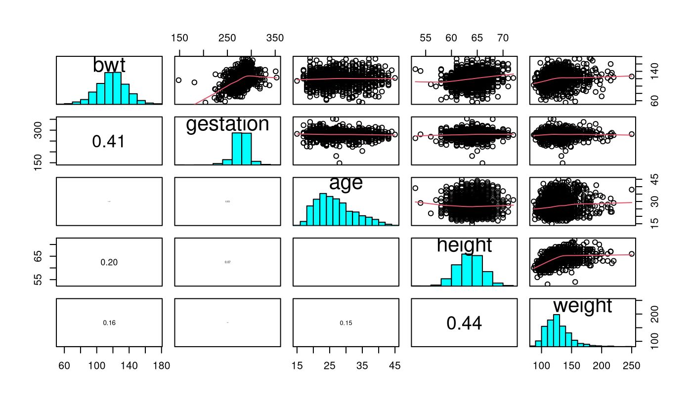
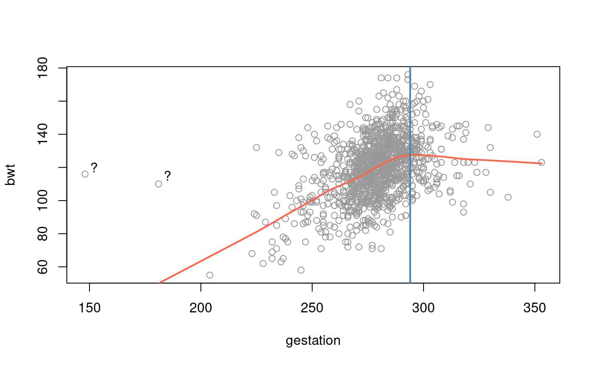
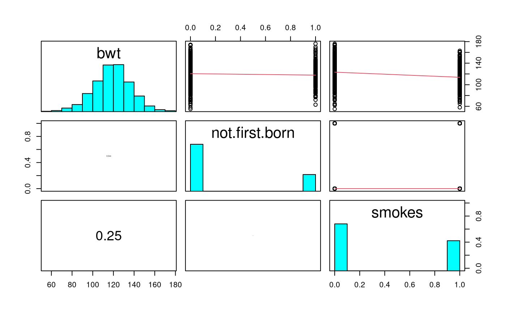
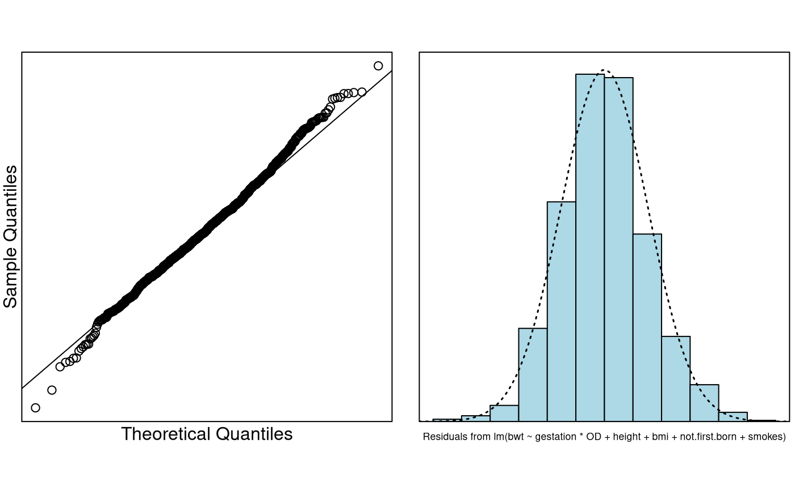

# Case Study 10.1: Birthweight of babies

## Background

Let’s examine what affects the birth weight of babies.

- `bwt`: birth weight in ounces
- `gestation`: length of pregnancy in days
- `not.first.born`: 0=first born, 1=not first-born
- `age`: mother’s age in years
- `height`: mother’s height in inches
- `weight`: mother’s pre-pregnancy weight in pounds
- `smoke`: smoking status of mother 0=not now, 1=yes.

This dataset was obtained from .

It accompanies the excellent text Stat Labs: Mathematical Statistics
through Applications Springer-Verlag (2001) by Deborah Nolan and Terry
Speed.

### Question of Interest

We want to build a model to explain the birth weight of babies.

### Read in and Inspect the Data

``` r

Babies.df = read.table("babies_data.txt", header = TRUE)
pairs20x(Babies.df[, c(1, 2, 4, 5, 6)])
```



Looking at the pairs plot, we see a somewhat weak relationship between
`bwt` and mother’s `height` and `weight`.

There is a stronger relationship between the gestation time
(`gestation`) for the babies and it’s `bwt` which is not surprising, as
the longer the child is in the mother’s womb the longer the child has
had time to have nutrition and grow — up to a point — then it \`flattens
out’ somewhat.

There doesn’t seem to be any relationship between a mother’s `age` and
her child’s `bwt`.

Let us look deeper into the relationship between `bwt` and `gestation`.

``` r

plot(bwt ~ gestation, data = Babies.df, col = "gray60")
lines(lowess(Babies.df$gestation, Babies.df$bwt), col = "tomato", lwd = 2)
text(152, 120, "?")
text(185, 115, "?")
abline(v = 294, col = "steelblue", lwd = 2)
```



Note also that there seems to be some \`weird’ data points in these
plots. There does not appear to be much of a relationship between the
$`X`$s. That is, the explanatory variables do not seem to have any
strong relationships between them.

Most babes are born before 42 weeks = $`42*7=294`$ days. It seems that
beyond this point babies cease to grow and hence the ‘flattening out’
and/or decrease. We’ll create a dummy variable `OD` (for overdue) for
this time point.

Let’s look at the categorical (factor) data variables against the baby’s
birth weight (`bwt`).

They are `not.first.born` and `smoke`.

``` r

pairs20x(Babies.df[, c(1, 3, 7)])
```



Here, we only see a slight relationship between whether the mother
smokes (`smoke`) and `bwt`. There is a slight decrease in babies `bwt`
if the mother smokes. This increases the chance of a mother having a low
birth weight baby if she smokes – perhaps another reason to avoid
tobacco!

The variable `not.first.born` does not appear to have too much of an
effect — which is perhaps not a surprise given that this variable may
not be as important as it once was as family size has deceased markedly
in the developed world (this is US data). We’ll check this out later.

### Model Building and Check Assumptions

``` r

# Let's create OD as mentioned earlier.
Babies.df$OD = 1 * (Babies.df$gestation > 294)
range(Babies.df$gestation[Babies.df$OD == 0]) # Check
```

    ## [1] 148 294

``` r

range(Babies.df$gestation[Babies.df$OD == 1]) # Check
```

    ## [1] 295 353

``` r

bwt.fit = lm(bwt ~ gestation * OD, data = Babies.df)
eovcheck(bwt.fit)
```


``` r

cooks20x(bwt.fit)
```


``` r

bwt.fit2 = lm(bwt ~ gestation * OD, data = Babies.df[-239, ])
cooks20x(bwt.fit2)
```


``` r

bwt.fit3 = lm(bwt ~ gestation * OD, data = Babies.df[-c(239, 820), ])
cooks20x(bwt.fit3)
```


``` r

bwt.fit4 = lm(bwt ~ gestation * OD + weight, data = Babies.df[-c(239, 820), ])
summary(bwt.fit4)
```

    ## 
    ## Call:
    ## lm(formula = bwt ~ gestation * OD + weight, data = Babies.df[-c(239, 
    ##     820), ])
    ## 
    ## Residuals:
    ##    Min     1Q Median     3Q    Max 
    ## -49.23 -11.16  -0.26  10.01  48.71 
    ## 
    ## Coefficients:
    ##               Estimate Std. Error t value Pr(>|t|)    
    ## (Intercept)  -85.06704   11.17499  -7.612 5.54e-14 ***
    ## gestation      0.67509    0.03907  17.279  < 2e-16 ***
    ## OD           263.71433   41.35432   6.377 2.60e-10 ***
    ## weight         0.13329    0.02255   5.910 4.50e-09 ***
    ## gestation:OD  -0.90002    0.13658  -6.589 6.67e-11 ***
    ## ---
    ## Signif. codes:  0 '***' 0.001 '**' 0.01 '*' 0.05 '.' 0.1 ' ' 1
    ## 
    ## Residual standard error: 16 on 1167 degrees of freedom
    ## Multiple R-squared:  0.2416, Adjusted R-squared:  0.239 
    ## F-statistic: 92.92 on 4 and 1167 DF,  p-value: < 2.2e-16

``` r

bwt.fit5 = lm(bwt ~ gestation * OD + weight + height, data = Babies.df[-c(239, 820), ])
summary(bwt.fit5)
```

    ## 
    ## Call:
    ## lm(formula = bwt ~ gestation * OD + weight + height, data = Babies.df[-c(239, 
    ##     820), ])
    ## 
    ## Residuals:
    ##     Min      1Q  Median      3Q     Max 
    ## -53.099 -10.586   0.089  10.005  47.764 
    ## 
    ## Coefficients:
    ##                Estimate Std. Error t value Pr(>|t|)    
    ## (Intercept)  -132.96277   15.50163  -8.577  < 2e-16 ***
    ## gestation       0.66108    0.03889  16.998  < 2e-16 ***
    ## OD            258.01065   41.04989   6.285 4.61e-10 ***
    ## weight          0.08541    0.02486   3.436 0.000612 ***
    ## height          0.90454    0.20460   4.421 1.07e-05 ***
    ## gestation:OD   -0.88049    0.13558  -6.494 1.23e-10 ***
    ## ---
    ## Signif. codes:  0 '***' 0.001 '**' 0.01 '*' 0.05 '.' 0.1 ' ' 1
    ## 
    ## Residual standard error: 15.88 on 1166 degrees of freedom
    ## Multiple R-squared:  0.2541, Adjusted R-squared:  0.2509 
    ## F-statistic: 79.43 on 5 and 1166 DF,  p-value: < 2.2e-16

``` r

# Let's create BMI from both of these measurements
Babies.df$bmi = with(Babies.df, weight / (height^2) * 703)
bwt.fit6 = lm(bwt ~ gestation * OD + weight + height + bmi,
  data = Babies.df[-c(239, 820), ]
)
summary(bwt.fit6)
```

    ## 
    ## Call:
    ## lm(formula = bwt ~ gestation * OD + weight + height + bmi, data = Babies.df[-c(239, 
    ##     820), ])
    ## 
    ## Residuals:
    ##     Min      1Q  Median      3Q     Max 
    ## -53.577 -10.367   0.066  10.042  47.803 
    ## 
    ## Coefficients:
    ##                Estimate Std. Error t value Pr(>|t|)    
    ## (Intercept)  -217.97090   79.76837  -2.733  0.00638 ** 
    ## gestation       0.66127    0.03889  17.004  < 2e-16 ***
    ## OD            258.08808   41.04678   6.288 4.55e-10 ***
    ## weight         -0.24369    0.30395  -0.802  0.42287    
    ## height          2.23309    1.23990   1.801  0.07196 .  
    ## bmi             1.91588    1.76352   1.086  0.27753    
    ## gestation:OD   -0.88083    0.13557  -6.497 1.21e-10 ***
    ## ---
    ## Signif. codes:  0 '***' 0.001 '**' 0.01 '*' 0.05 '.' 0.1 ' ' 1
    ## 
    ## Residual standard error: 15.87 on 1165 degrees of freedom
    ## Multiple R-squared:  0.2548, Adjusted R-squared:  0.251 
    ## F-statistic:  66.4 on 6 and 1165 DF,  p-value: < 2.2e-16

``` r

bwt.fit7 = lm(bwt ~ gestation * OD + height + bmi + not.first.born,
  data = Babies.df[-c(239, 820), ]
)
summary(bwt.fit7)
```

    ## 
    ## Call:
    ## lm(formula = bwt ~ gestation * OD + height + bmi + not.first.born, 
    ##     data = Babies.df[-c(239, 820), ])
    ## 
    ## Residuals:
    ##     Min      1Q  Median      3Q     Max 
    ## -54.278 -10.402   0.002   9.650  46.957 
    ## 
    ## Coefficients:
    ##                  Estimate Std. Error t value Pr(>|t|)    
    ## (Intercept)    -156.43942   15.86220  -9.862  < 2e-16 ***
    ## gestation         0.66898    0.03881  17.237  < 2e-16 ***
    ## OD              263.77416   40.92055   6.446 1.68e-10 ***
    ## height            1.26751    0.18384   6.895 8.83e-12 ***
    ## bmi               0.44904    0.14480   3.101  0.00197 ** 
    ## not.first.born   -3.37234    1.06276  -3.173  0.00155 ** 
    ## gestation:OD     -0.89933    0.13515  -6.654 4.38e-11 ***
    ## ---
    ## Signif. codes:  0 '***' 0.001 '**' 0.01 '*' 0.05 '.' 0.1 ' ' 1
    ## 
    ## Residual standard error: 15.81 on 1165 degrees of freedom
    ## Multiple R-squared:  0.2608, Adjusted R-squared:  0.257 
    ## F-statistic:  68.5 on 6 and 1165 DF,  p-value: < 2.2e-16

``` r

bwt.fit8 = lm(bwt ~ gestation * OD + height + bmi + not.first.born + smokes,
  data = Babies.df[-c(239, 820), ]
)
summary(bwt.fit8)
```

    ## 
    ## Call:
    ## lm(formula = bwt ~ gestation * OD + height + bmi + not.first.born + 
    ##     smokes, data = Babies.df[-c(239, 820), ])
    ## 
    ## Residuals:
    ##     Min      1Q  Median      3Q     Max 
    ## -57.805  -9.985  -0.623   9.184  52.282 
    ## 
    ## Coefficients:
    ##                  Estimate Std. Error t value Pr(>|t|)    
    ## (Intercept)    -146.36091   15.42725  -9.487  < 2e-16 ***
    ## gestation         0.64424    0.03775  17.067  < 2e-16 ***
    ## OD              256.69266   39.69307   6.467 1.47e-10 ***
    ## height            1.29903    0.17832   7.285 5.93e-13 ***
    ## bmi               0.35512    0.14084   2.521 0.011821 *  
    ## not.first.born   -3.50274    1.03078  -3.398 0.000701 ***
    ## smokes           -7.98064    0.92340  -8.643  < 2e-16 ***
    ## gestation:OD     -0.87488    0.13110  -6.673 3.86e-11 ***
    ## ---
    ## Signif. codes:  0 '***' 0.001 '**' 0.01 '*' 0.05 '.' 0.1 ' ' 1
    ## 
    ## Residual standard error: 15.33 on 1164 degrees of freedom
    ## Multiple R-squared:  0.3054, Adjusted R-squared:  0.3012 
    ## F-statistic:  73.1 on 7 and 1164 DF,  p-value: < 2.2e-16

``` r

cooks20x(bwt.fit8)
```


``` r

normcheck(bwt.fit8)
```



``` r

confint(bwt.fit8)
```

    ##                        2.5 %       97.5 %
    ## (Intercept)    -176.62923297 -116.0925891
    ## gestation         0.57017733    0.7182955
    ## OD              178.81470454  334.5706219
    ## height            0.94916219    1.6489067
    ## bmi               0.07878781    0.6314538
    ## not.first.born   -5.52512194   -1.4803515
    ## smokes           -9.79235265   -6.1689248
    ## gestation:OD     -1.13210128   -0.6176549

## Method and Assumption Checks

Looking at the pairs plot, we saw that birthweight was related to a
number of our explanatory variables. We will construct a multiple linear
regression model with a suitable selection of the explanatory variables.

Observations 239 and 820 were found to be highly influential. They were
deemed to be anomolous and were removed from the dataset.

The hockey stick relationship between gestational age and birthweight
required allowing the age effect to differ depending on whether the baby
was overdue, and was fitted by including an interaction term between age
and overdue status. Moreover, we also decided to include body mass
weight as an explanatory variable, but had to remore weight as an
explanatory due to multicollinearity. All model assumptions were
satisfied by our final model.

Using forward model selection (i.e., adding the most promising
explanatory variables in turn), our final model is
``` math
\begin{align*}
  bwt_i = &~\beta_0 + \beta_1 \times gestation_i + \beta_2 \times OD_i + \beta_3 \times height_i~+ \beta_4 \times bmi_i + \beta_5 \times not.first.born_i +\\
  &~\beta_6 \times smokes_i + \beta_7 \times gestation_i \times OD_i + \epsilon_i,
\end{align*}
```
where $`\epsilon_i~iid \sim N(0, \sigma)`$. Here our three indicator
variables take the value 1 if the baby was overdue, not the first born,
and the mother smokes, respectively.

Our model only explains about 31% of the variability in a baby’s
birthweight.

## Executive Summary.

We wanted to build a model to explain the birth weight of babies.

Keeping all other varaiables constant:

- A child has a higher expected birth-weight the longer its gestation
  time — up to a 42 weeks — then it starts decreasing in size the longer
  it stays unborn. We estimated an expected increase of 0.57 to 0.72
  ounces per gestation day. After 42 weeks this will decrease by about
  0.62 to 1.13 ounces per gestational day \[NOTE: it might have been
  better had we changed the OD baseline\].
- We estimated that for each additional inch of mother’s height the
  baby’s birthweight increases by 0.95 to 1.65 ounces, on average.
- We estimated that for each unit change in a mothers BMI the baby’sb
  irthweight increases by 0.08 to 0.63 ounces, on average.
- If the mother smokes this reduces the baby’s birthweight by 6.17 to
  9.79 ounces, on average.
- Not being first born seems to reduce the baby’s birthweight by 1.48 to
  5.53 ounces, on average.

#### Exercise

Is there significant evidence that expected birthweight decreases with
increasing gestational age for babies that are overdue? Provide a
confidence interval for this effect.
