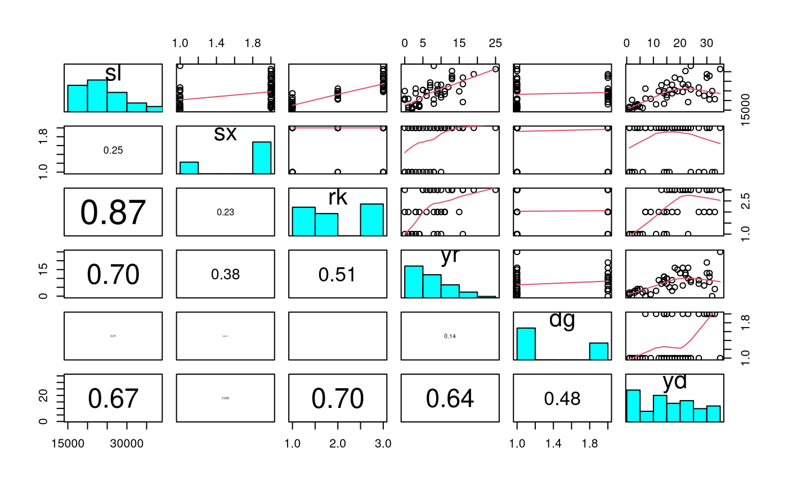
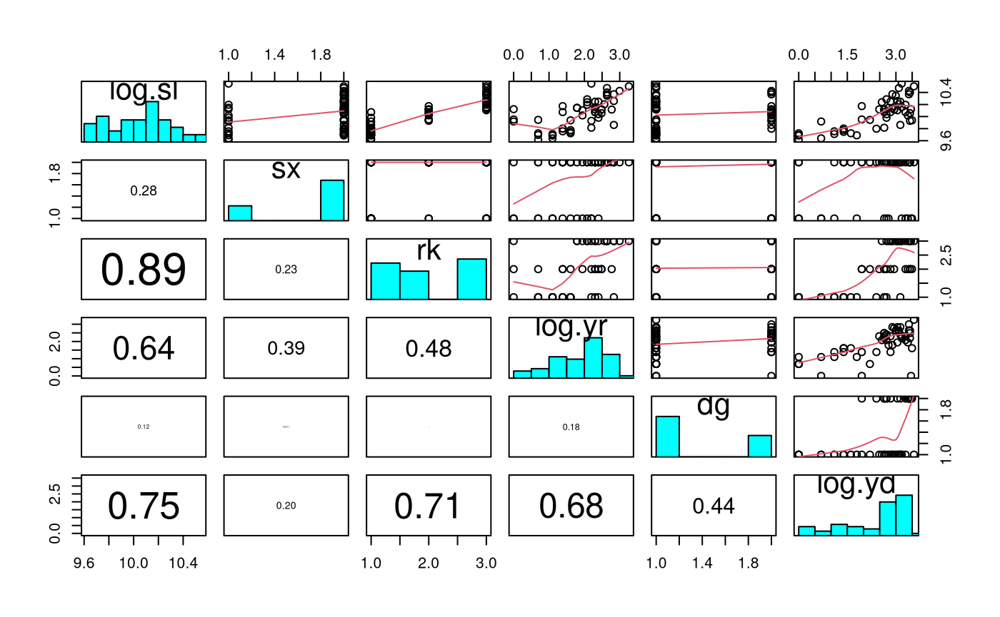
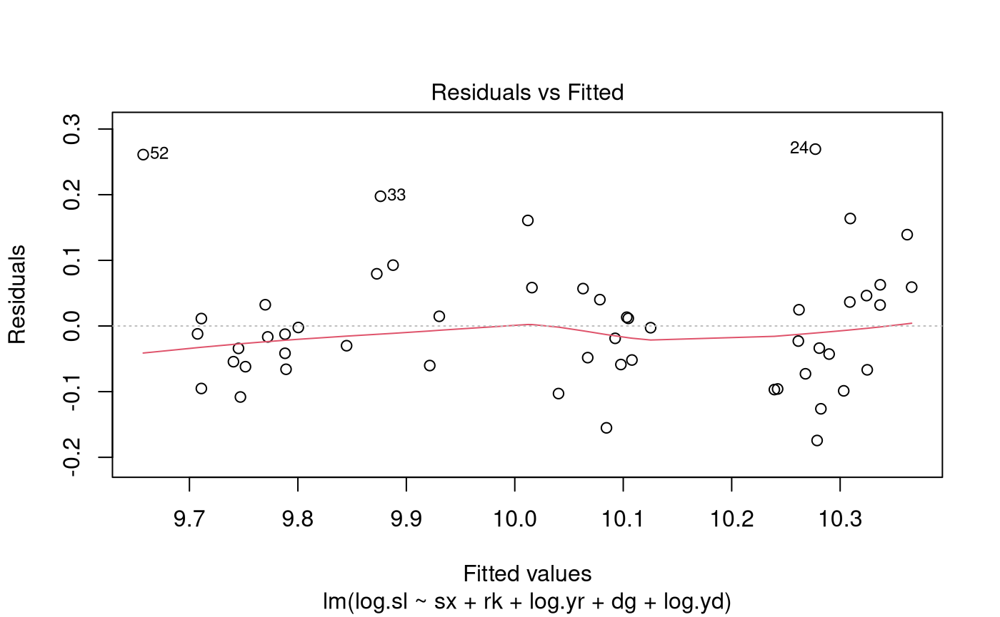
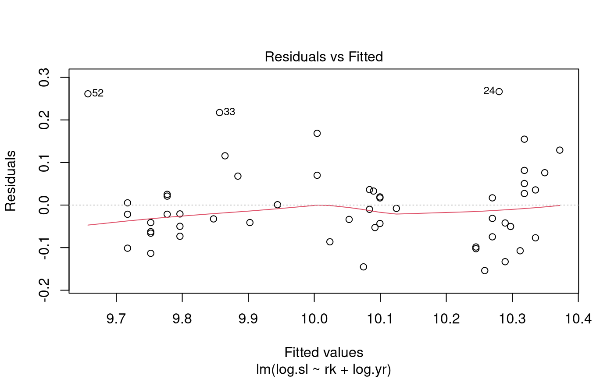
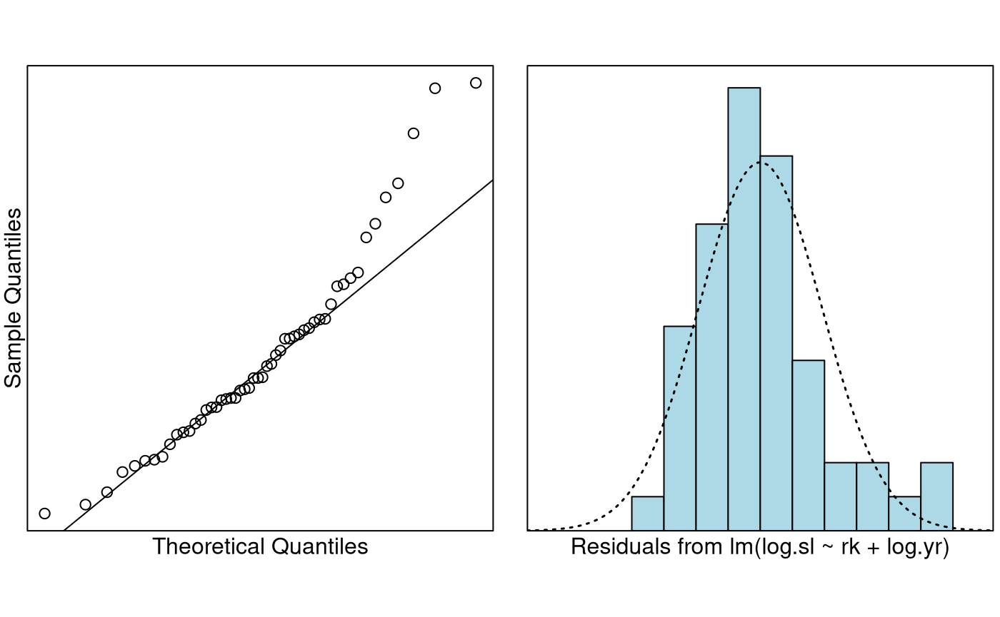

# Case Study 10.2: Gender differences in salary

## Problem

These are the salary data used in Weisberg’s book consisting of
observations on six variables for 52 professors in a small college. We
want to build a model to predict salary. Of particular interest was the
effect (if any) of gender on salary.

The variables of interest were:

- `sx`: Sex, (female or male)
- `rk`: Rank, (assistant, associate or full)
- `yr`: Number of years in current rank
- `dg`: Highest degree (masters or doctorate)
- `yd`: Number of years since highest degree was earned,
- `sl`: Academic year salary, in dollars.

### Question of Interest

We want to build a model to explain salary. In particular, the effect
(if any) of gender on salary.

### Read in and Inspect the Data

``` r

salary.df = read.table("salary.txt", header = TRUE)
salary.df$sx = factor(salary.df$sx)
salary.df$dg = factor(salary.df$dg)
salary.df$rk = factor(salary.df$rk)
head(salary.df)
tail(salary.df)
pairs20x(salary.df[, c("sl", "sx", "rk", "yr", "dg", "yd")])
```

    ##       sx   rk yr        dg yd    sl
    ## 1   male full 25 doctorate 35 36350
    ## 2   male full 13 doctorate 22 35350
    ## 3   male full 10 doctorate 23 28200
    ## 4 female full  7 doctorate 27 26775
    ## 5   male full 19   masters 30 33696
    ## 6   male full 16 doctorate 21 28516

    ##        sx        rk yr        dg yd    sl
    ## 47 female assistant  2 doctorate  6 16150
    ## 48 female assistant  2 doctorate  2 15350
    ## 49   male assistant  1 doctorate  1 16244
    ## 50 female assistant  1 doctorate  1 16686
    ## 51 female assistant  1 doctorate  1 15000
    ## 52 female assistant  0 doctorate  2 20300



It seems that males have a larger mean `sl` than females. The higher the
rank, the higher the `sl` (Note that the levels of `rk` are in
alphabetical order). As `yr` increases the expected `sl` increases. Not
too much going on in the relationship between `sl` and `dg`. There is a
weak positive relationship between `sl` and `yd`. Also, as `yd`
increases the variability in `sl` increases.

Since the response variable is salary, it would make sense to use
log-salary so that effects will be multiplicative. Some previous
analyses have also used `log(yr)` and `log(yd)` as explanatory
variables. It is not obvious that this is the best choice, but for
consistency we will follow these previous analyses.

``` r

salary.df$log.yr = log(salary.df$yr + 1) # log(yr + 1) since log(0) = -infinity
salary.df$log.yd = log(salary.df$yd)
salary.df$log.sl = log(salary.df$sl)
pairs20x(salary.df[, c("log.sl", "sx", "rk", "log.yr", "dg", "log.yd")])
```

 It seems that males
have a larger mean `log(sl)` than females. The higher the rank, the
higher the `log(sl)`. As `log(yr)` increases the expected `log(sl)`
increases. However, the low `log(sl)`s do not follow this observed
trend. Still not too much going on in the relationship between `log(sl)`
and `dg`. There is a weak positive relationship between `log(sl)` and
`log(yd)`. Also, as `log(yd)` increases the variability in `log(sl)`
increases. In comparison to `sl` and `yd`, there is some improvement.

We’ll find our preferred model by fitting all terms, and then
successively removing the one that is least significant, until all
remaining terms are significant.

### Model Building and Check Assumptions

``` r

salary.fit = lm(log.sl ~ sx + rk + log.yr + dg + log.yd, data = salary.df)
plot(salary.fit, which = 1)
```



``` r

summary(salary.fit)
```

    ## 
    ## Call:
    ## lm(formula = log.sl ~ sx + rk + log.yr + dg + log.yd, data = salary.df)
    ## 
    ## Residuals:
    ##      Min       1Q   Median       3Q      Max 
    ## -0.17438 -0.06067 -0.01456  0.04168  0.26938 
    ## 
    ## Coefficients:
    ##              Estimate Std. Error t value Pr(>|t|)    
    ## (Intercept)  9.654427   0.043548 221.698  < 2e-16 ***
    ## sxmale      -0.003494   0.036384  -0.096 0.923914    
    ## rkassociate  0.213574   0.050898   4.196 0.000126 ***
    ## rkfull       0.429959   0.056213   7.649 1.12e-09 ***
    ## log.yr       0.081603   0.027493   2.968 0.004787 ** 
    ## dgmasters    0.026184   0.039074   0.670 0.506203    
    ## log.yd       0.004235   0.031797   0.133 0.894646    
    ## ---
    ## Signif. codes:  0 '***' 0.001 '**' 0.01 '*' 0.05 '.' 0.1 ' ' 1
    ## 
    ## Residual standard error: 0.1012 on 45 degrees of freedom
    ## Multiple R-squared:  0.8528, Adjusted R-squared:  0.8332 
    ## F-statistic: 43.46 on 6 and 45 DF,  p-value: < 2.2e-16

``` r

salary.fit2 = lm(log.sl ~ rk + log.yr + dg + log.yd, data = salary.df)
summary(salary.fit2)
```

    ## 
    ## Call:
    ## lm(formula = log.sl ~ rk + log.yr + dg + log.yd, data = salary.df)
    ## 
    ## Residuals:
    ##      Min       1Q   Median       3Q      Max 
    ## -0.17515 -0.06095 -0.01423  0.04172  0.27191 
    ## 
    ## Coefficients:
    ##             Estimate Std. Error t value Pr(>|t|)    
    ## (Intercept) 9.652977   0.040407 238.892  < 2e-16 ***
    ## rkassociate 0.212025   0.047750   4.440 5.59e-05 ***
    ## rkfull      0.428683   0.054027   7.935 3.69e-10 ***
    ## log.yr      0.080503   0.024722   3.256  0.00212 ** 
    ## dgmasters   0.025820   0.038468   0.671  0.50545    
    ## log.yd      0.005058   0.030286   0.167  0.86809    
    ## ---
    ## Signif. codes:  0 '***' 0.001 '**' 0.01 '*' 0.05 '.' 0.1 ' ' 1
    ## 
    ## Residual standard error: 0.1001 on 46 degrees of freedom
    ## Multiple R-squared:  0.8528, Adjusted R-squared:  0.8368 
    ## F-statistic:  53.3 on 5 and 46 DF,  p-value: < 2.2e-16

``` r

salary.fit3 = lm(log.sl ~ rk + log.yr + dg, data = salary.df)
summary(salary.fit3)
```

    ## 
    ## Call:
    ## lm(formula = log.sl ~ rk + log.yr + dg, data = salary.df)
    ## 
    ## Residuals:
    ##      Min       1Q   Median       3Q      Max 
    ## -0.17723 -0.06084 -0.01646  0.04136  0.27343 
    ## 
    ## Coefficients:
    ##             Estimate Std. Error t value Pr(>|t|)    
    ## (Intercept)  9.65585    0.03618 266.856  < 2e-16 ***
    ## rkassociate  0.21669    0.03832   5.655 8.92e-07 ***
    ## rkfull       0.43522    0.03686  11.807 1.16e-15 ***
    ## log.yr       0.08284    0.02015   4.111 0.000157 ***
    ## dgmasters    0.02934    0.03186   0.921 0.361820    
    ## ---
    ## Signif. codes:  0 '***' 0.001 '**' 0.01 '*' 0.05 '.' 0.1 ' ' 1
    ## 
    ## Residual standard error: 0.09902 on 47 degrees of freedom
    ## Multiple R-squared:  0.8527, Adjusted R-squared:  0.8402 
    ## F-statistic: 68.02 on 4 and 47 DF,  p-value: < 2.2e-16

``` r

salary.fit4 = lm(log.sl ~ rk + log.yr, data = salary.df)
summary(salary.fit4)
```

    ## 
    ## Call:
    ## lm(formula = log.sl ~ rk + log.yr, data = salary.df)
    ## 
    ## Residuals:
    ##      Min       1Q   Median       3Q      Max 
    ## -0.15389 -0.06344 -0.02122  0.03568  0.26648 
    ## 
    ## Coefficients:
    ##             Estimate Std. Error t value Pr(>|t|)    
    ## (Intercept)  9.65710    0.03610 267.503  < 2e-16 ***
    ## rkassociate  0.22719    0.03653   6.220 1.16e-07 ***
    ## rkfull       0.43264    0.03670  11.789 8.85e-16 ***
    ## log.yr       0.08661    0.01970   4.396 6.08e-05 ***
    ## ---
    ## Signif. codes:  0 '***' 0.001 '**' 0.01 '*' 0.05 '.' 0.1 ' ' 1
    ## 
    ## Residual standard error: 0.09886 on 48 degrees of freedom
    ## Multiple R-squared:   0.85,  Adjusted R-squared:  0.8407 
    ## F-statistic:  90.7 on 3 and 48 DF,  p-value: < 2.2e-16

``` r

plot(salary.fit4, which = 1)
```



``` r

normcheck(salary.fit4)
```



``` r

cooks20x(salary.fit4)
```


``` r

exp(confint(salary.fit4))
```

    ##                    2.5 %       97.5 %
    ## (Intercept) 14537.893426 16809.266030
    ## rkassociate     1.166196     1.350709
    ## rkfull          1.431690     1.659352
    ## log.yr          1.048118     1.134534

### Get `log.yr` Effect for Doubling of Time at Current Rrank

``` r

2^confint(salary.fit4)[4, ]
```

    ##    2.5 %   97.5 % 
    ## 1.033112 1.091432

## Method and Assumption Checks

We have a numeric response and multiple explanatory variables, so we
fitted a multiple linear regression model. After looking at pairwise
plots, salary and the two year explanatory variables were logged.

After fitting all explanatory terms, Occam’s razor was applied to remove
those that were not significant. We dropped the variables in the
following order:

- `sx` (*P-value* = 0.92).
- `log(yd)` (*P-value* = 0.87).
- `dg` (*P-value* = 0.36).

All model assumptions looked reasonably well satisfied, notwithstanding
that the residuals were a bit right skewed.

Our final model is
``` math
log(salary_i)=\beta_0 +\beta_1 \times rank.associate_i + \beta_2 \times rank.full_i + \beta_3 \times log(yr_i) + \epsilon_i,
```
where $`\epsilon_i \sim iid~N(0,\sigma^2)`$. Here $`rank.associate`$ and
$`rank.full`$ are equal to 1 if rank is associate or full, respectively,
otherwise they are zero.

Our model explains about 85% of the variability in the log of salary.

## Executive Summary

We wanted to build a model to explain salary. In particular, the effect
(if any) of gender on salary.

Our final model used the rank of the professor and the number of years
at the current rank to explain their salary. After adjusting for these,
gender, highest degree, and number of years since highest degree was
earned were not required.

We estimate that being promoted from assistant to associate professor
increases median salary by between 17% and 35%.

We estimate that being promoted from assistant to full professor
increases median salary by between 43% and 66%.

We estimate that a doubling in years (at current rank) increases median
salary by between 3.3% and 9.1%.

It appears that after adjusting for these in our model variables the
effect of gender is not significant, however other question may need to
be asked about why so few females are in senior academic positions in
the first place – it could be argued that more work needs to be done to
determine the cause of the “gender gap”.

## Addendum - what happened to the gender gap?

In a regression by itself (i.e., two sample t-test), we can show that
gender is marginally significant — what could be driving this apparent
effect?

``` r

table(salary.df$rk, salary.df$sx)
```

    ##            
    ##             female male
    ##   assistant      8   10
    ##   associate      2   12
    ##   full           4   16

``` r

table(salary.df$dg, salary.df$sx)
```

    ##            
    ##             female male
    ##   doctorate     10   24
    ##   masters        4   14

To really understand what is going on, we need to ask why there are so
few females in the higher professorial ranks (relative to males).

#### Exercises

- Perform a two-sample t-test using only sex as the explanatory factor
  variable (this confirms that sex is marginally statistically
  significant if no other explanatories are included in the model.)

- Redo the analysis using forward selection (as in the Chapter notes).
  That is, build the model up by adding the most relevant terms in
  succession (provided they are significant). Do you end up with the
  same final model?

- Redo the analysis but using `yr` and `yd` rather than `log(yr)` and
  `log(yd)`. Does this make any meaningful difference?
