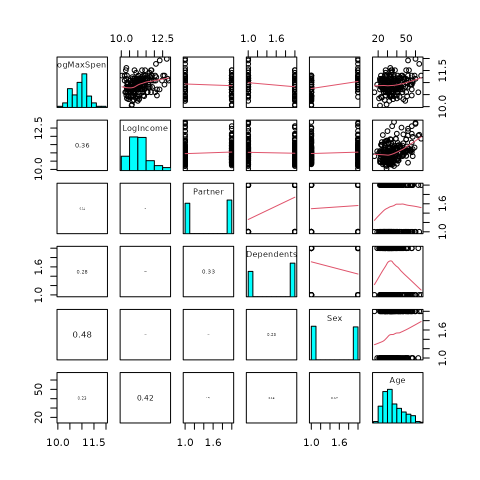
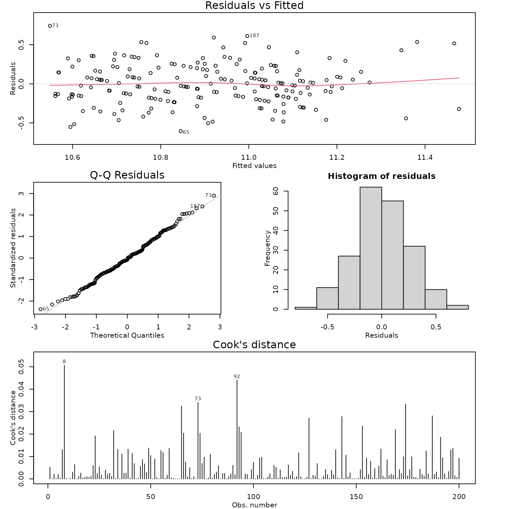
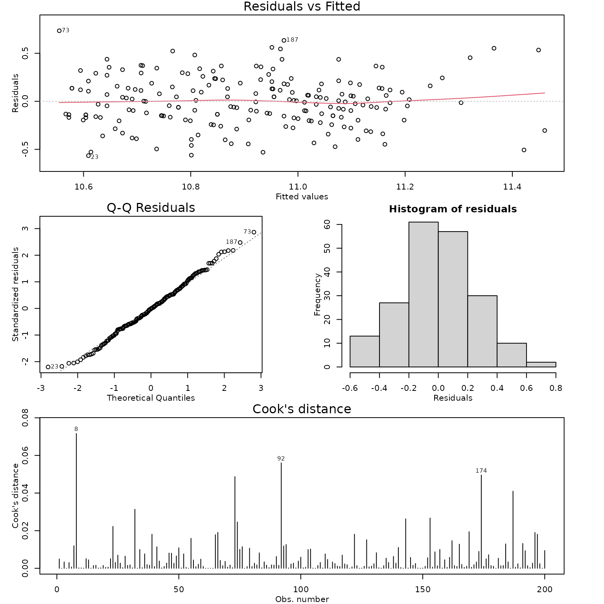

# Case Study 10.3: STATS 201/8 Extra Case Study - Multiple Regression Model

title: ‘Case Study 15.1: Haddock retention in a trawl’ output:
html_document vignette: \> % % % —

## Question 1

A leading car distributor invited visitors to its website to complete a
survey to learn about how much they were willing to spend on a new car.
It was of interest to see how this depended on the participant’s annual
income, marital status, dependents, gender and age.

The resulting data are in the file *Carspend.csv*, which contains the
variables:

| Variable | Description |
|----|----|
| logMaxSpend | The natural log of the maximum participant will spend on a new car (\$). |
| logIncome | The natural log of the participants annual income (\$). |
| Partner | Yes if the participant had a partner, No if they did not. |
| Dependents | Yes if the participant had financial dependents, No if they had none. |
| Sex | M if the participant was Male or F if they were female. (Nobody that participated in the survey selected any other option.) |
| Age | The age of the participant (in years). |

**Notes:** It is better to work with both MaxSpend and Income logged. We
have already logged these in the dataset so you do not need to do this.
You do not need to comment on the need to log these in the Method and
Assumptions section.

**Instructions:**

- Comment on the pairs plot of the data.
- Fit an appropriate linear model as follows: fit a linear regression
  model to the response variable logMaxSpend containing the five
  explanatory terms logIncome, Partner, Dependents, Sex, Age. (Do not
  include any interaction terms.) Then simplify the model by
  successively removing the least significant term until all are
  significant at the 5% level. Generate the inference output you need
  from the final model.
- Write a Method and Assumption Checks section.
- Write sentences as if for an *Executive Summary* to answer the
  following:
  - Estimate the change in MaxSpend when income is increased by 50%.
  - Estimate the change in MaxSpend between males and females.

### Question of interest/goal of the study

It was of interest to see how maximum spend on a new car depended on
annual income, partnership status, dependents, gender and age.

### inspect the data:

``` r

CarSpend.df = read.csv("CarSpend.csv", header = TRUE, stringsAsFactors = TRUE)
pairs20x(CarSpend.df)
```



### Comment on plot

There is a moderate increasing relationship between LogIncome and
LogMaxSpend. Males tend to spend more than females. People without
partners or dependents tend to spend more, but this difference isn’t as
great as the gender difference. There is also a weaker increasing
relationship between age and logMaxSpend, but there is a hit of curve in
this, with the relationship starting fairly flat. Age and LogIncome have
the greatest correlation between the explanatory variables (0.42).

### Fit an appropriate linear model and Check Assumptions

``` r

car.fit1 = lm(LogMaxSpend ~ LogIncome + Partner + Dependents + Sex + Age, data = CarSpend.df)
modelcheck(car.fit1)
```



``` r

summary(car.fit1)
```

    ## 
    ## Call:
    ## lm(formula = LogMaxSpend ~ LogIncome + Partner + Dependents + 
    ##     Sex + Age, data = CarSpend.df)
    ## 
    ## Residuals:
    ##      Min       1Q   Median       3Q      Max 
    ## -0.60567 -0.16550 -0.01957  0.16995  0.74099 
    ## 
    ## Coefficients:
    ##                 Estimate Std. Error t value Pr(>|t|)    
    ## (Intercept)    8.7710889  0.3750150  23.389  < 2e-16 ***
    ## LogIncome      0.1860703  0.0358246   5.194 5.18e-07 ***
    ## PartnerYes    -0.0950260  0.0395258  -2.404   0.0172 *  
    ## DependentsYes -0.0694440  0.0410605  -1.691   0.0924 .  
    ## SexM           0.2889717  0.0383235   7.540 1.76e-12 ***
    ## Age            0.0005588  0.0020055   0.279   0.7808    
    ## ---
    ## Signif. codes:  0 '***' 0.001 '**' 0.01 '*' 0.05 '.' 0.1 ' ' 1
    ## 
    ## Residual standard error: 0.2588 on 194 degrees of freedom
    ## Multiple R-squared:  0.3852, Adjusted R-squared:  0.3694 
    ## F-statistic: 24.31 on 5 and 194 DF,  p-value: < 2.2e-16

``` r

car.fit2 = lm(LogMaxSpend ~ LogIncome + Partner + Dependents + Sex, data = CarSpend.df)

summary(car.fit2)
```

    ## 
    ## Call:
    ## lm(formula = LogMaxSpend ~ LogIncome + Partner + Dependents + 
    ##     Sex, data = CarSpend.df)
    ## 
    ## Residuals:
    ##      Min       1Q   Median       3Q      Max 
    ## -0.59785 -0.16778 -0.02272  0.16744  0.74230 
    ## 
    ## Coefficients:
    ##               Estimate Std. Error t value Pr(>|t|)    
    ## (Intercept)    8.74549    0.36272  24.111  < 2e-16 ***
    ## LogIncome      0.19018    0.03258   5.838 2.18e-08 ***
    ## PartnerYes    -0.09377    0.03917  -2.394   0.0176 *  
    ## DependentsYes -0.07098    0.04059  -1.749   0.0819 .  
    ## SexM           0.29020    0.03798   7.642 9.47e-13 ***
    ## ---
    ## Signif. codes:  0 '***' 0.001 '**' 0.01 '*' 0.05 '.' 0.1 ' ' 1
    ## 
    ## Residual standard error: 0.2582 on 195 degrees of freedom
    ## Multiple R-squared:  0.385,  Adjusted R-squared:  0.3724 
    ## F-statistic: 30.52 on 4 and 195 DF,  p-value: < 2.2e-16

``` r

car.fit3 = lm(LogMaxSpend ~ LogIncome + Partner + Sex, data = CarSpend.df)
modelcheck(car.fit3)
```



``` r

summary(car.fit3)
```

    ## 
    ## Call:
    ## lm(formula = LogMaxSpend ~ LogIncome + Partner + Sex, data = CarSpend.df)
    ## 
    ## Residuals:
    ##      Min       1Q   Median       3Q      Max 
    ## -0.56586 -0.16645 -0.00379  0.16268  0.73504 
    ## 
    ## Coefficients:
    ##             Estimate Std. Error t value Pr(>|t|)    
    ## (Intercept)  8.66153    0.36141  23.966  < 2e-16 ***
    ## LogIncome    0.19447    0.03265   5.955 1.18e-08 ***
    ## PartnerYes  -0.11797    0.03684  -3.202  0.00159 ** 
    ## SexM         0.30760    0.03684   8.349 1.23e-14 ***
    ## ---
    ## Signif. codes:  0 '***' 0.001 '**' 0.01 '*' 0.05 '.' 0.1 ' ' 1
    ## 
    ## Residual standard error: 0.2596 on 196 degrees of freedom
    ## Multiple R-squared:  0.3754, Adjusted R-squared:  0.3658 
    ## F-statistic: 39.26 on 3 and 196 DF,  p-value: < 2.2e-16

``` r

confint(car.fit3)
```

    ##                  2.5 %      97.5 %
    ## (Intercept)  7.9487739  9.37429562
    ## LogIncome    0.1300713  0.25887177
    ## PartnerYes  -0.1906225 -0.04532111
    ## SexM         0.2349375  0.38025876

``` r

1.5^confint(car.fit3)[2, ]
```

    ##    2.5 %   97.5 % 
    ## 1.054155 1.110670

``` r

100 * (1.5^confint(car.fit3)[2, ] - 1)
```

    ##     2.5 %    97.5 % 
    ##  5.415487 11.067004

``` r

exp(confint(car.fit3)[4, ])
```

    ##    2.5 %   97.5 % 
    ## 1.264830 1.462663

``` r

100 * (exp(confint(car.fit3)[4, ]) - 1)
```

    ##    2.5 %   97.5 % 
    ## 26.48297 46.26630

### Methods and assumption checks

We have applied a multiple regression linear model to the logMaxSpend
response variable, with explanatory variables logIncome, Sex, Age,
Partner and Dependents. Age had the highest p-value (0.78) and the model
was refitted with age removed. Dependents was then removed (p-value of
0.08) and the model refitted once more. All remaining terms were highly
significant.

The residual plot showed approximately constant variability and no
trend. Normality looks good and no influential points were detected.
Model assumptions are satisfied.

Our model is:

$`\log(MaxSpend_i) = \beta_0 + \beta_1 \times \log(Income_i) + \beta_2 \times SexMale_i
                            + \beta_3 \times PartnerYes_i +\epsilon_i`$

where $`\epsilon_i \sim iid ~ N(0,\sigma^2)`$ and $`SexMale_i=1`$ if
male (else = 0 if female), and $`PartnerYes_i=1`$ if in a partnership
(else = 0 if not).

Our model explained 37.5% of the variability in the logged survival
times.

### Write sentences as if for an Executive Summary to answer the following:

#### Estimate the change in MaxSpend when income is increased by 50%.

Holding all other variables constant, we estimate that an increase in
income of 50% is associated with an increase of between 5.4% and 11.1%
in the median maximum amount that people are prepared to spend for a new
car.

#### Estimate the change in MaxSpend between males and females.

Holding all other variables constant, we estimate that, the median
maximum amount that males are prepared to spend for a new car is between
26.5% and 46.3% higher than that for females.

## Question 2

This question revisits the data from question 1.

- Fit a linear regression model containing only the Age explanatory
  variable to explain LogMaxSpend.  

- What does this model reveal about the relationship between Age and
  logMaxSpend.

- You will have (hopefully) reached a different conclusion regarding the
  effect of age in (b) above than in the executive summary from
  question 1. Provide an explanation of why this happened.

### Fit a linear regression model containing only the Age explanatory variable to explain LogMaxSpend.

``` r

car.fit4 = lm(LogMaxSpend ~ Age, data = CarSpend.df)
summary(car.fit4)
```

    ## 
    ## Call:
    ## lm(formula = LogMaxSpend ~ Age, data = CarSpend.df)
    ## 
    ## Residuals:
    ##     Min      1Q  Median      3Q     Max 
    ## -0.7671 -0.2021  0.0036  0.2153  0.9032 
    ## 
    ## Coefficients:
    ##              Estimate Std. Error t value Pr(>|t|)    
    ## (Intercept) 10.640666   0.082173 129.491  < 2e-16 ***
    ## Age          0.007317   0.002180   3.357 0.000945 ***
    ## ---
    ## Signif. codes:  0 '***' 0.001 '**' 0.01 '*' 0.05 '.' 0.1 ' ' 1
    ## 
    ## Residual standard error: 0.3178 on 198 degrees of freedom
    ## Multiple R-squared:  0.05384,    Adjusted R-squared:  0.04907 
    ## F-statistic: 11.27 on 1 and 198 DF,  p-value: 0.0009454

### What does this model reveal about the relationship between Age and logMaxSpend.

There is strong evidence of a positive association between age and
logmaxspend.

### You will have (hopefully) reached a different conclusion regarding the effect of age above than in question 1. Provide an explanation of why this happened.

As age increases, so does income, and as income increases so does spend
amount. Hence there is an indirect association between age and spend.
However, once income is taken into account in explaining spend amount
there is no longer an effect of age. In other words, any effect that age
has on spend amount is already explained by using income as an
explanatory variable.
