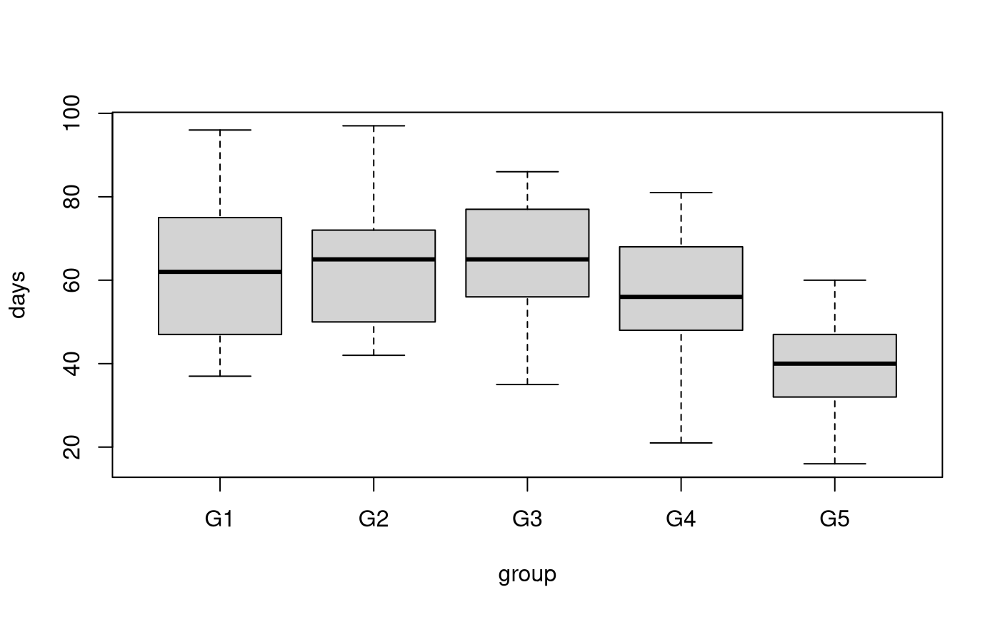
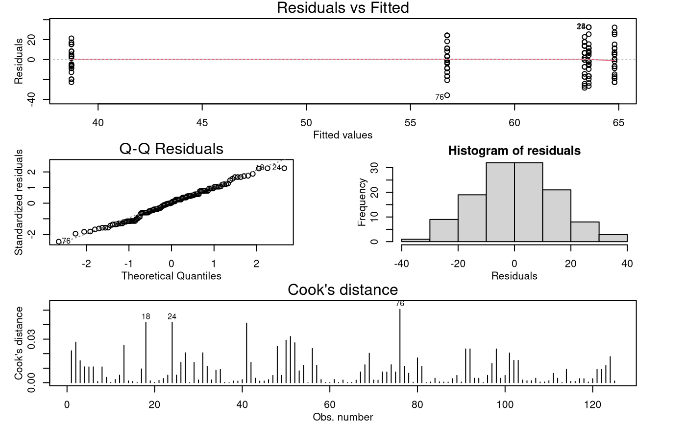

# Case Study 11.1: Fruit-flies, sex and frustration

## Problem:

In this study, we look at how the male fruit-flies longevity is related
to reproductive activity. (Data is described in more detail
[here](https://www.tandfonline.com/doi/full/10.1080/10691898.1994.11910467#d1e114))

How does one define “interest” in fruit-flies? Here is this study’s
definition:

> Newly inseminated females will not usually mate again for at least two
> days.

So the males in the uninterested groups were always living with newly
inseminated females!

The hypothesis was that the males living alone and with the uninterested
females would live longer than the males living with the interested
females. Since there are more than two group means, a one-way ANOVA is
used to determine if there is a significant difference between the group
means.

The design of the study placed male fruit-flies in the following groups:

1.  Males living alone,
2.  Males living with one interested female,
3.  Males living with eight interested females,
4.  Males living with one uninterested female, and
5.  Males living with eight uninterested females.

The variables of interest were:

- `days`: A male fruitfly’s longevity in days.
- `group`: A five-level factor with the levels which corresponds to the
  group a male fruitfly is in:
  - “G1”: males living alone,
  - “G2”: males with one interested female,
  - “G3”: males with eight interested females,
  - “G4”: males with one uninterested female,
  - “G5”: males with eight uninterested females,

### Question of Interest

How does sexual activity affect male fruitfly longevity?

### Read in and Inspect the Data

``` r

Fruitfly.df = read.csv("Fruitfly.csv", stringsAsFactors = TRUE)
plot(days ~ group, data = Fruitfly.df)
summaryStats(days ~ group, Fruitfly.df)
```



    ##    Sample Size  Mean Median  Std Dev Midspread
    ## G1          25 63.56     62 16.45215        28
    ## G2          25 64.80     65 15.65248        22
    ## G3          25 63.36     65 14.53983        21
    ## G4          25 56.76     56 14.92838        20
    ## G5          25 38.72     40 12.10207        15

Our hypothesis that the males living alone and with the uninterested
females would live longer than the males living with the interested
females does not seem plausible with our data.

### Model Building and Check Assumptions

``` r

ff.fit = lm(days ~ group, data = Fruitfly.df)
modelcheck(ff.fit)
```



``` r

anova(ff.fit)
```

    ## Analysis of Variance Table
    ## 
    ## Response: days
    ##            Df Sum Sq Mean Sq F value    Pr(>F)    
    ## group       4  11939 2984.82  13.612 3.516e-09 ***
    ## Residuals 120  26314  219.28                      
    ## ---
    ## Signif. codes:  0 '***' 0.001 '**' 0.01 '*' 0.05 '.' 0.1 ' ' 1

``` r

summary(ff.fit)
```

    ## 
    ## Call:
    ## lm(formula = days ~ group, data = Fruitfly.df)
    ## 
    ## Residuals:
    ##    Min     1Q Median     3Q    Max 
    ## -35.76  -8.76   0.20  11.20  32.44 
    ## 
    ## Coefficients:
    ##             Estimate Std. Error t value Pr(>|t|)    
    ## (Intercept)   63.560      2.962  21.461  < 2e-16 ***
    ## groupG2        1.240      4.188   0.296    0.768    
    ## groupG3       -0.200      4.188  -0.048    0.962    
    ## groupG4       -6.800      4.188  -1.624    0.107    
    ## groupG5      -24.840      4.188  -5.931 2.98e-08 ***
    ## ---
    ## Signif. codes:  0 '***' 0.001 '**' 0.01 '*' 0.05 '.' 0.1 ' ' 1
    ## 
    ## Residual standard error: 14.81 on 120 degrees of freedom
    ## Multiple R-squared:  0.3121, Adjusted R-squared:  0.2892 
    ## F-statistic: 13.61 on 4 and 120 DF,  p-value: 3.516e-09

### Multiple Comparisons Output

``` r

library(emmeans)
```

    ## Welcome to emmeans.
    ## Caution: You lose important information if you filter this package's results.
    ## See '? untidy'

``` r

Fruitfly.emm = emmeans(ff.fit, ~group)
# View all pairwise comparisons:
pairs(Fruitfly.emm, infer = TRUE)
```

    ##  contrast estimate   SE  df lower.CL upper.CL t.ratio p.value
    ##  G1 - G2     -1.24 4.19 120   -12.84     10.4  -0.296  0.9983
    ##  G1 - G3      0.20 4.19 120   -11.40     11.8   0.048  1.0000
    ##  G1 - G4      6.80 4.19 120    -4.80     18.4   1.624  0.4854
    ##  G1 - G5     24.84 4.19 120    13.24     36.4   5.931 <0.0001
    ##  G2 - G3      1.44 4.19 120   -10.16     13.0   0.344  0.9970
    ##  G2 - G4      8.04 4.19 120    -3.56     19.6   1.920  0.3127
    ##  G2 - G5     26.08 4.19 120    14.48     37.7   6.227 <0.0001
    ##  G3 - G4      6.60 4.19 120    -5.00     18.2   1.576  0.5158
    ##  G3 - G5     24.64 4.19 120    13.04     36.2   5.883 <0.0001
    ##  G4 - G5     18.04 4.19 120     6.44     29.6   4.307  0.0003
    ## 
    ## Confidence level used: 0.95 
    ## Conf-level adjustment: tukey method for comparing a family of 5 estimates 
    ## P value adjustment: tukey method for comparing a family of 5 estimates

``` r

# View only the comparisons that are significant at the 5% level:
Fruitfly.pairs = data.frame(pairs(Fruitfly.emm, infer = TRUE))
subset(Fruitfly.pairs, p.value < 0.05)
```

    ##    contrast estimate       SE  df  lower.CL upper.CL  t.ratio      p.value
    ## 4   G1 - G5    24.84 4.188358 120 13.239532 36.44047 5.930724 2.958395e-07
    ## 7   G2 - G5    26.08 4.188358 120 14.479532 37.68047 6.226783 7.232306e-08
    ## 9   G3 - G5    24.64 4.188358 120 13.039532 36.24047 5.882973 3.701044e-07
    ## 10  G4 - G5    18.04 4.188358 120  6.439532 29.64047 4.307177 3.240300e-04

## Methods and Assumption Checks

The boxplot of `days` by `group` indicated that males living with 8
uninterested females have shorter lives compared to their counterparts
in other groups. So, we fitted a One-way ANOVA model to these data.

The model assumptions seem satisfied.

Our final model is
``` math
\text{days}_i = \beta_0 + \beta_1 \times Group2_i + \beta_2 \times Group3_i + \beta_3 \times Group4_i + \beta_4 \times Group5_i + \epsilon_i,
```
where $`GroupX_i`$ is 1 if the $`i`$th male fruitfly is in group $`X`$
and 0 otherwise, and $`\epsilon_i \sim iid N(0,\sigma^2)`$.

Alternatively, our final model could be written as
``` math
\text{days}_{ij} = \mu + \alpha_i + \epsilon_{ij},
```
where $`\mu`$ is the overall mean survival time and $`\alpha_i`$ is the
effect of being in the $`i`$th group and
$`\epsilon_{ij} \sim iid~N(0,\sigma^2)`$.

Our model explained 31% of variability in male fruitfly longevity.

## Executive Summary

Researchers were interested in how sexual activity affects male fruitfly
longevity.

We see that the effect of Group 5, males with 8 uninterested females,
seems markedly different from all the others.

In particular group 5 males, on average, lived fewer days than:

- Group 1 males (living alone) by between 13 to 36 fewer days.
- Group 2 males (living with one interested female) by between 14 to 38
  fewer days.
- Group 3 males (living with eight interested females) by between 13 to
  36 fewer days.
- Group 4 males (living with one uninterested female) by between 6 to 30
  fewer days.

On a lighter note these male fruit flies are fine if no females are
about or if they are there they need to be ‘interested’ in them —
otherwise they die earlier (they ‘drop like flies’). It’s tempting to
make similar inference about the human species but that may be going too
far!
