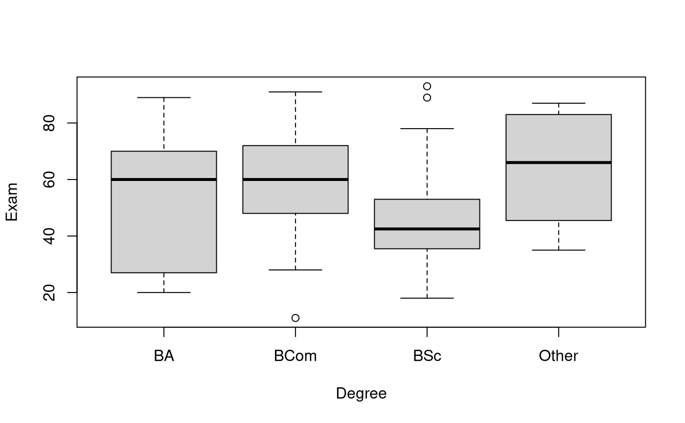
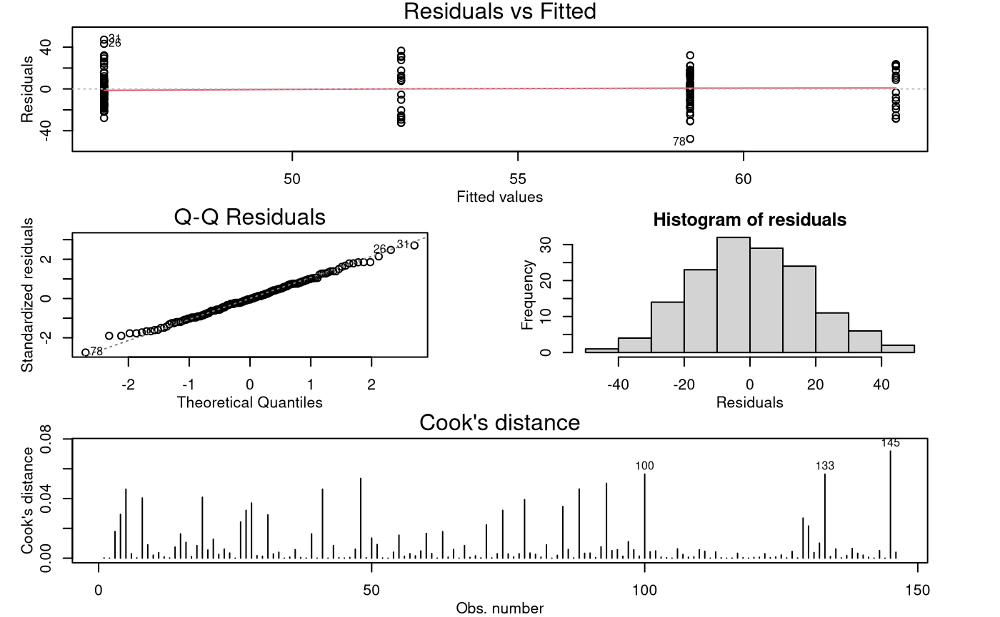

# Case Study 11.2: Exam vs Degree

## Problem

We want to quantify the expected final exam mark (out of 100) in Stats
20x for each type of degree. In particular, we want to investigate
whether there is a “degree” effect on the final exam mark.

The variables of interest were:

- `Exam`: A student’s exam mark out of 100.
- `Degree`: A four-level factor with levels corresponding to a student’s
  degree.
  - “BA”, “BCom”, “BSc”, and “Other”.

### Question of Interest

Is the degree a student is enrolled for related to their final 20x exam
score?

### Read in and Inspect the Data

``` r

load(system.file("extdata", "Stats20x.df.rda", package = "s20x"))
```

``` r

Stats20x.df = read.table("STATS20x.txt", header = TRUE)
```

``` r

Stats20x.df$Degree = factor(Stats20x.df$Degree)
# Draw boxplot
plot(Exam ~ Degree, data = Stats20x.df)
```



``` r

# Summary stats:
summaryStats(Exam ~ Degree, Stats20x.df)
```

    ##       Sample Size     Mean Median  Std Dev Midspread
    ## BA             17 52.41176   60.0 24.57402     43.00
    ## BCom           49 58.81633   60.0 16.23868     24.00
    ## BSc            64 45.82812   42.5 15.80090     17.25
    ## Other          16 63.37500   66.0 19.76824     35.75

The “BSc” group is centred noticeably lower than the others. The
standard deviations are within a factor of two from smallest to largest,
so we can accept the equality of variance assumption. (The midspreads do
exceed the factor-of-two rule-of-thumb, so we might need to be cautious
in our interpretations.)

### Model Building and Check Assumptions

``` r

degree.fit = lm(Exam ~ Degree, data = Stats20x.df)
modelcheck(degree.fit)
```



``` r

anova(degree.fit)
```

    ## Analysis of Variance Table
    ## 
    ## Response: Exam
    ##            Df Sum Sq Mean Sq F value    Pr(>F)    
    ## Degree      3   6675 2225.15  7.1958 0.0001568 ***
    ## Residuals 142  43910  309.23                      
    ## ---
    ## Signif. codes:  0 '***' 0.001 '**' 0.01 '*' 0.05 '.' 0.1 ' ' 1

``` r

summary(degree.fit)
```

    ## 
    ## Call:
    ## lm(formula = Exam ~ Degree, data = Stats20x.df)
    ## 
    ## Residuals:
    ##     Min      1Q  Median      3Q     Max 
    ## -47.816 -12.456  -0.816  12.487  47.172 
    ## 
    ## Coefficients:
    ##             Estimate Std. Error t value Pr(>|t|)    
    ## (Intercept)   52.412      4.265  12.289   <2e-16 ***
    ## DegreeBCom     6.405      4.950   1.294   0.1978    
    ## DegreeBSc     -6.584      4.798  -1.372   0.1722    
    ## DegreeOther   10.963      6.125   1.790   0.0756 .  
    ## ---
    ## Signif. codes:  0 '***' 0.001 '**' 0.01 '*' 0.05 '.' 0.1 ' ' 1
    ## 
    ## Residual standard error: 17.58 on 142 degrees of freedom
    ## Multiple R-squared:  0.132,  Adjusted R-squared:  0.1136 
    ## F-statistic: 7.196 on 3 and 142 DF,  p-value: 0.0001568

### Multiple Comparisons Output

``` r

pairs(emmeans(degree.fit, ~Degree), infer = TRUE)
```

    ##  contrast     estimate   SE  df lower.CL upper.CL t.ratio p.value
    ##  BA - BCom       -6.41 4.95 142   -19.27     6.46  -1.294  0.5683
    ##  BA - BSc         6.58 4.80 142    -5.89    19.06   1.372  0.5189
    ##  BA - Other     -10.96 6.12 142   -26.89     4.96  -1.790  0.2825
    ##  BCom - BSc      12.99 3.34 142     4.31    21.67   3.891  0.0009
    ##  BCom - Other    -4.56 5.06 142   -17.72     8.61  -0.900  0.8047
    ##  BSc - Other    -17.55 4.92 142   -30.32    -4.77  -3.570  0.0027
    ## 
    ## Confidence level used: 0.95 
    ## Conf-level adjustment: tukey method for comparing a family of 4 estimates 
    ## P value adjustment: tukey method for comparing a family of 4 estimates

## Methods and Assumption Checks

We wish to explain exam marks using degree, a factor with four levels,
so we fitted a One-way ANOVA model to these data.

The model assumptions seem satisfied.

Our final model is
``` math
\text{Exam}_i = \beta_0 + \beta_1 \times Degree.BCom_i + \beta_2 \times Degree.BSc_i + \beta_3 \times Degree.Other_i + \epsilon_i,
```
where $`Degree.x_i`$ is 1 if a student is enrolled in degree $`x`$ and 0
otherwise (with $`x \in \{\text{BCom}, \text{BSc}, \text{Other}\}`$),
and $`\epsilon_i \sim iid~N(0,\sigma^2)`$.

Alternatively, our final model could be written as
``` math
\text{Exam}_{ij} = \mu + \alpha_i + \epsilon_{ij},
```
where $`\mu`$ is the overall mean exam mark and $`\alpha_i`$ is the
effect of being in the $`i`$th degree (with
$`i \in \{\text{BA}, \text{BCom}, \text{BSc}, \text{Other}\}`$), and
$`\epsilon_{ij} \sim iid~N(0,\sigma^2)`$.

Our model explained 13.2% of the variability in students’ exam marks.

## Executive Summary

Is the degree a student is enrolled in related to their final 20x exam
mark?

We do have evidence that expected exam marks were not identical between
the four degree groups (Ba, BCom, BSc, and Other). However, the only
significant differences we found were that BSc students had lower marks
than BCom and Other degree students.

With 95% confidence we can say that:

- on average, “BSc” students do worse than “BCom” students by between 4
  and 22 marks.
- on average, “BSc” students do worse than “Other” students by between 5
  and 30 marks.
