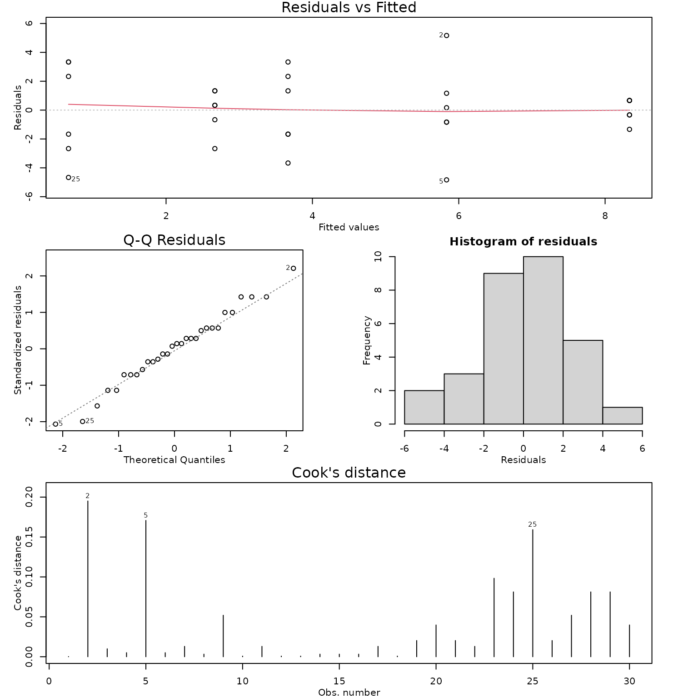

# Case Study 11.3: STATS 201/8 Extra Case Study - Oneway ANOVA Model

## Question 1

A musical college wished to study the effectiveness of various practice
methods for its trombonists. To this end 30 trombonists were randomly
assigned to one of 5 practice methods. Each student’s ability with the
trombone was initially assessed. To assess improvement, after a set
period of time using the assigned practice method only, they reassessed
each student and recorded the difference between the student’s final and
initial scores.

The resulting data are in the file *trombone.csv*, which contains the
variables:

| Variable | Description |
|----|----|
| diff | The difference in trombone assessment scores (after – before). |
| method | The practice method assigned to the student: NP - no practice control, MP - mental practice only, MPS - mental practice with simulated slide movement, PP - physical practice only, CP - combination of mental and physical practice |

We are interested in whether any of the methods show significant
improvement. If so, which method shows the most significant improvement
and by how much?

**Instructions:**

- Comment on what the plot of the data and summary statistics reveal.
- Fit an appropriate model to the data and check the assumptions.
  Generate the inference output you need from the final model.
- Write a Method and Assumption Checks section.
- Write an *Executive Summary*. Remember to just focus on answering what
  we are interested in.

### Question of interest/goal of the study

We wish to identify the most promising trombone practice method. Do any
of the methods show significant improvement? If so, which method shows
the most significant improvement and by how much?

### Inspect the data

``` r

load(system.file("extdata", "trombone.df.rda", package = "s20x"))
```

``` r

trombone.df <- read.csv("trombone.csv", header = TRUE, stringsAsFactors = TRUE)

trombone.df$method <- factor(trombone.df$method, levels = c("NP", "MP", "MPS", "PP", "CP"))

stripchart(diff ~ method, data = trombone.df, vertical = TRUE, pch = 16, cex = 1.5, method = "stack", ylab = "Difference in scores", main = "Score change vs Training method")

summaryStats(diff ~ method, data = trombone.df)
```


    ##     Sample Size      Mean Median   Std Dev Midspread
    ## NP            6 0.6666667    1.0 3.4448028      5.50
    ## MP            6 2.6666667    3.0 1.5055453      1.50
    ## MPS           6 3.6666667    3.5 2.7325202      3.75
    ## PP            6 5.8333333    5.5 3.2506410      1.75
    ## CP            6 8.3333333    8.5 0.8164966      1.00

### Comment on the plots and summary statistics.

The no practice group has the lowest average change in score, with half
of the students’ scores dropping in value. The physical practice and
combined mental and physical practice groups appeared to have the
highest average increases in scores. The variability of the scores was
similar for 3 groups, but lower for the mental practice only and
combined groups.

### Fit appropriate model and check assumptions

``` r

trombone.fit <- lm(diff ~ method, data = trombone.df)

modelcheck(trombone.fit)
```



``` r

anova(trombone.fit)
```

    ## Analysis of Variance Table
    ## 
    ## Response: diff
    ##           Df Sum Sq Mean Sq F value    Pr(>F)    
    ## method     4 209.20  52.300  7.9645 0.0002771 ***
    ## Residuals 25 164.17   6.567                      
    ## ---
    ## Signif. codes:  0 '***' 0.001 '**' 0.01 '*' 0.05 '.' 0.1 ' ' 1

``` r

summary(trombone.fit)
```

    ## 
    ## Call:
    ## lm(formula = diff ~ method, data = trombone.df)
    ## 
    ## Residuals:
    ##    Min     1Q Median     3Q    Max 
    ## -4.833 -1.583  0.250  1.333  5.167 
    ## 
    ## Coefficients:
    ##             Estimate Std. Error t value Pr(>|t|)    
    ## (Intercept)   0.6667     1.0462   0.637   0.5298    
    ## methodMP      2.0000     1.4795   1.352   0.1885    
    ## methodMPS     3.0000     1.4795   2.028   0.0534 .  
    ## methodPP      5.1667     1.4795   3.492   0.0018 ** 
    ## methodCP      7.6667     1.4795   5.182 2.33e-05 ***
    ## ---
    ## Signif. codes:  0 '***' 0.001 '**' 0.01 '*' 0.05 '.' 0.1 ' ' 1
    ## 
    ## Residual standard error: 2.563 on 25 degrees of freedom
    ## Multiple R-squared:  0.5603, Adjusted R-squared:   0.49 
    ## F-statistic: 7.964 on 4 and 25 DF,  p-value: 0.0002771

``` r

pairs(emmeans(trombone.fit, "method"), infer = TRUE)
```

    ##  contrast estimate   SE df lower.CL upper.CL t.ratio p.value
    ##  NP - MP     -2.00 1.48 25    -6.35    2.345  -1.352  0.6626
    ##  NP - MPS    -3.00 1.48 25    -7.35    1.345  -2.028  0.2824
    ##  NP - PP     -5.17 1.48 25    -9.51   -0.822  -3.492  0.0141
    ##  NP - CP     -7.67 1.48 25   -12.01   -3.322  -5.182  0.0002
    ##  MP - MPS    -1.00 1.48 25    -5.35    3.345  -0.676  0.9598
    ##  MP - PP     -3.17 1.48 25    -7.51    1.178  -2.140  0.2351
    ##  MP - CP     -5.67 1.48 25   -10.01   -1.322  -3.830  0.0063
    ##  MPS - PP    -2.17 1.48 25    -6.51    2.178  -1.464  0.5938
    ##  MPS - CP    -4.67 1.48 25    -9.01   -0.322  -3.154  0.0309
    ##  PP - CP     -2.50 1.48 25    -6.85    1.845  -1.690  0.4579
    ## 
    ## Confidence level used: 0.95 
    ## Conf-level adjustment: tukey method for comparing a family of 5 estimates 
    ## P value adjustment: tukey method for comparing a family of 5 estimates

``` r

# Extra code just to extract significant pairs
trom.pairs = pairs(emmeans(trombone.fit, "method"), infer = TRUE)
sig.pairs = subset(data.frame(trom.pairs), p.value < 0.05)
sig.pairs
```

    ##   contrast  estimate       SE df   lower.CL   upper.CL   t.ratio      p.value
    ## 3  NP - PP -5.166667 1.479489 25  -9.511736 -0.8215968 -3.492196 0.0141361076
    ## 4  NP - CP -7.666667 1.479489 25 -12.011736 -3.3215968 -5.181968 0.0002090927
    ## 7  MP - CP -5.666667 1.479489 25 -10.011736 -1.3215968 -3.830150 0.0062646253
    ## 9 MPS - CP -4.666667 1.479489 25  -9.011736 -0.3215968 -3.154241 0.0309065923

### Methods and assumption checks

As we have one explanatory variable which is a factor with five levels
we have fitted a oneway ANOVA model to the data.

One student’s performance should not affect the performance of another,
and the students are assigned randomly. There are differences in the
within-group variability, but we have very small individual sample
sizes. As we have equal sample sizes and there is no consistent pattern
in the residuals (the variability does not increase with the average),
the EOV assumptions should be valid. The residuals look approximately
normal. There are no obvious influential points. We can therefore rely
on the results from fitting this linear model.

Our model is:

$`diff_i = \beta_0 + \beta_{1} \times MP_i + \beta_{2} \times MPS_i + \beta_{3} \times PP_i + \beta_{4} \times CP_i + \epsilon_{i}`$

where $`MP_i`$ equals 1 if student $`i`$ was trained using mental
practice only and 0 otherwise (similar for $`MPS_i`$, $`PP_i`$ and
$`CP_i`$), and $`\epsilon_{i} \sim iid ~ N(0,\sigma^2)`$. (Note:
$`\beta_0`$ is the mean improvement of students without any practice.)

Alternatively our model is:

$`diff_{ij} = \mu + \alpha_i + \epsilon_{ij}`$ where $`\mu`$ is the
overall mean improvement score for all students and $`\alpha_i`$ is the
effect of working under strategy $`i`$.

Our model explains 56% of the variation in improvement scores.

### Executive Summary:

A musical college wished to study the effectiveness of various practice
methods for its trombonists. Four methods: mental practice only; mental
practice with simulated slide movement; physical practice only; and
combined mental and physical practice were trialled and compared to no
practice.

We found strong evidence that practice method had an influence on the
students improvement scores.

Both physical practice only and a combination of physical and mental
practice showed significantly better improvement in scores than the no
practice schedule, with the combination showing the largest improvement.

On average, a student following a combined practice schedule improved by
between 3.3 and 12 points more compared to a student with the no
practice schedule.
