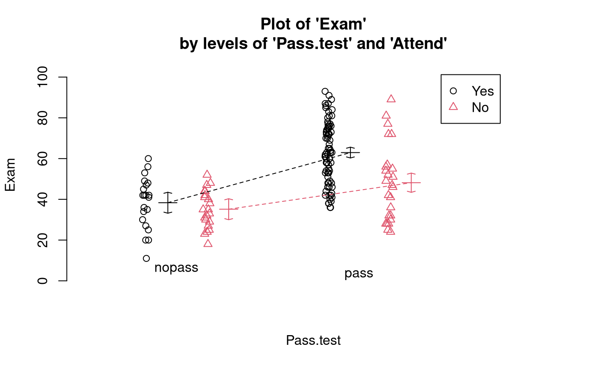
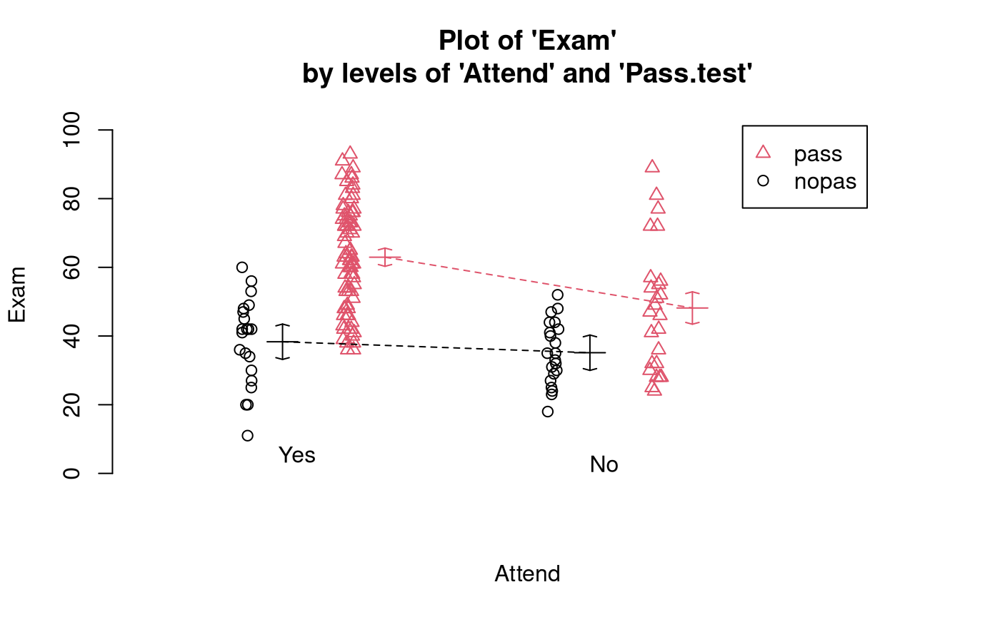
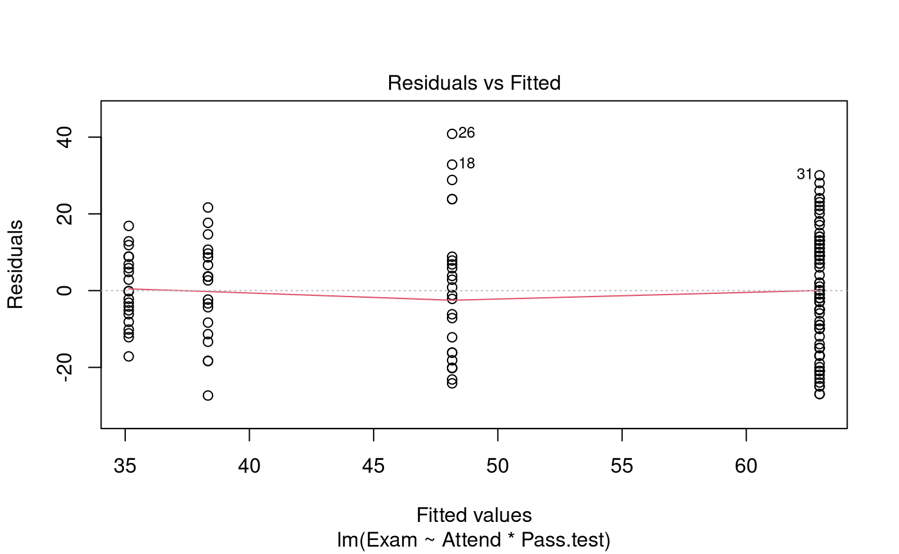
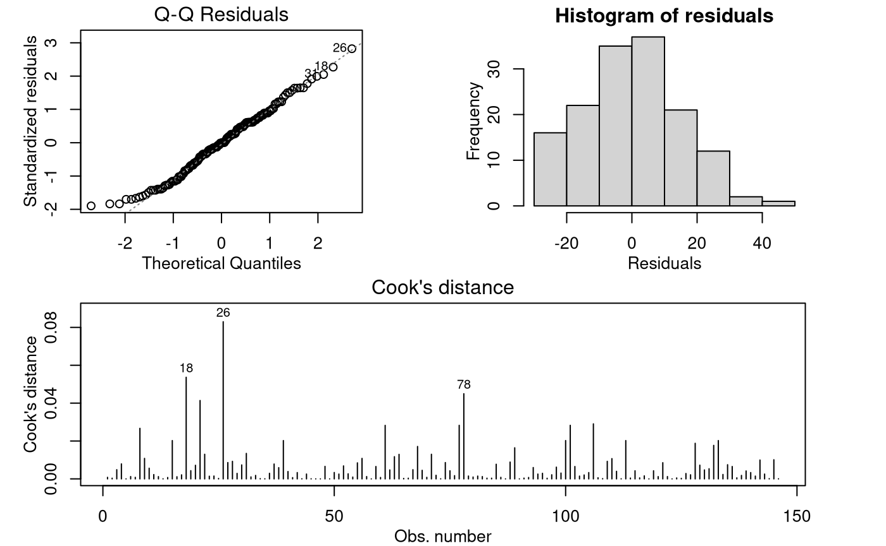

# Case Study 12.1: Exam vs Test & Attendance

## Problem

We wish to determine if regular attendance in class and passing the test
is associated with exam mark. We have seen individually that passing the
test and regular attendance in class increases the chances for a good
exam mark — on average.

The variables of interest are:

- `Exam`: Exam mark out of 100.
- `Attend`: A two-level factor with the levels `Yes` and `No`.
- `Pass.test`: A two-level factor with the levels `Yes` and `No`.

### Question of Interest

We are interested in the relationship between final exam mark and
passing the test, and whether this relationship differs for students who
did and did not attend lectures regularly.

### Read in and Inspect the Data

``` r

Stats20x.df = read.table("STATS20x.txt", header = TRUE)
```

``` r

head(Stats20x.df)
```

    ##   Grade Pass Exam Degree Gender Attend Assign Test  B  C MC Colour Stage1
    ## 1     C  Yes   42    BSc   Male    Yes   17.2  9.1  5 13 12   Blue      C
    ## 2     B  Yes   58   BCom Female    Yes   17.2 13.6 12 12 17 Yellow      A
    ## 3     A  Yes   81  Other Female    Yes   17.2 14.5 14 17 25   Blue      A
    ## 4     A  Yes   86  Other Female    Yes   19.6 19.1 15 17 27 Yellow      A
    ## 5     D   No   35  Other   Male     No    8.0  8.2  4  1 15   Blue      C
    ## 6     A  Yes   72   BCom Female    Yes   18.4 12.7 15 17 20   Blue      A
    ##   Years.Since Repeat
    ## 1         2.5    Yes
    ## 2         2.0     No
    ## 3         3.0     No
    ## 4         0.0     No
    ## 5         3.0     No
    ## 6         1.5     No

``` r

# So, we have to create the variable `Pass.test' using the `Test` variable
Stats20x.df$Pass.test = factor(ifelse(Stats20x.df$Test >= 10, "pass", "nopass"))
# Check if our new variable `Pass.test` was generated correctly
min(Stats20x.df$Test[Stats20x.df$Pass.test == "pass"])
```

    ## [1] 10

``` r

max(Stats20x.df$Test[Stats20x.df$Pass.test == "nopass"])
```

    ## [1] 9.1

``` r

interactionPlots(Exam ~ Pass.test + Attend, data = Stats20x.df)
```



``` r

# Also look at the interaction plot the other way around:
interactionPlots(Exam ~ Attend + Pass.test, data = Stats20x.df)
```

 Exam marks for
students who passed the test are centred higher than for students who
did not. However, this difference appears to be greater for students who
attended lectures than for non-attenders, which can be seen from the
non-parallel coloured lines on the interaction plots. In other words,
the impact of passing the test appears to differ according to attendance
group, suggesting there may be an interaction between the two predictor
variables.

### Model Building and Check Assumptions

``` r

Exam.fit = lm(Exam ~ Attend * Pass.test, data = Stats20x.df)
# The model formula could of also been `Exam ~ Attend + Pass.test + Attend:Past.test'
plot(Exam.fit, 1)
```



``` r

modelcheck(Exam.fit, 2:3)
```



``` r

anova(Exam.fit)
```

    ## Analysis of Variance Table
    ## 
    ## Response: Exam
    ##                   Df  Sum Sq Mean Sq F value    Pr(>F)    
    ## Attend             1  7630.8  7630.8  34.990 2.364e-08 ***
    ## Pass.test          1 11076.9 11076.9  50.791 4.763e-11 ***
    ## Attend:Pass.test   1   909.7   909.7   4.171   0.04297 *  
    ## Residuals        142 30968.4   218.1                      
    ## ---
    ## Signif. codes:  0 '***' 0.001 '**' 0.01 '*' 0.05 '.' 0.1 ' ' 1

``` r

summary(Exam.fit)
```

    ## 
    ## Call:
    ## lm(formula = Exam ~ Attend * Pass.test, data = Stats20x.df)
    ## 
    ## Residuals:
    ##     Min      1Q  Median      3Q     Max 
    ## -27.333 -10.893  -0.046   9.513  40.840 
    ## 
    ## Coefficients:
    ##                         Estimate Std. Error t value Pr(>|t|)    
    ## (Intercept)               35.143      3.223  10.905  < 2e-16 ***
    ## AttendYes                  3.190      4.557   0.700  0.48504    
    ## Pass.testpass             13.017      4.371   2.978  0.00341 ** 
    ## AttendYes:Pass.testpass   11.599      5.679   2.042  0.04297 *  
    ## ---
    ## Signif. codes:  0 '***' 0.001 '**' 0.01 '*' 0.05 '.' 0.1 ' ' 1
    ## 
    ## Residual standard error: 14.77 on 142 degrees of freedom
    ## Multiple R-squared:  0.3878, Adjusted R-squared:  0.3749 
    ## F-statistic: 29.98 on 3 and 142 DF,  p-value: 4.452e-15

### Pairwise comparisons

``` r

library(emmeans)
```

    ## Welcome to emmeans.
    ## Caution: You lose important information if you filter this package's results.
    ## See '? untidy'

``` r

Exam.pairs = pairs(emmeans(Exam.fit, ~ Attend * Pass.test), infer = TRUE)
Exam.pairs
```

    ##  contrast               estimate   SE  df lower.CL upper.CL t.ratio p.value
    ##  No nopass - Yes nopass    -3.19 4.56 142    -15.0     8.66  -0.700  0.8969
    ##  No nopass - No pass      -13.02 4.37 142    -24.4    -1.65  -2.978  0.0178
    ##  No nopass - Yes pass     -27.81 3.63 142    -37.2   -18.38  -7.669 <0.0001
    ##  Yes nopass - No pass      -9.83 4.37 142    -21.2     1.54  -2.248  0.1155
    ##  Yes nopass - Yes pass    -24.62 3.63 142    -34.0   -15.19  -6.789 <0.0001
    ##  No pass - Yes pass       -14.79 3.39 142    -23.6    -5.98  -4.364  0.0001
    ## 
    ## Confidence level used: 0.95 
    ## Conf-level adjustment: tukey method for comparing a family of 4 estimates 
    ## P value adjustment: tukey method for comparing a family of 4 estimates

``` r

# Get a simpler display using displayPairs:
displayPairs(Exam.pairs, c("Yes", "No"), c("pass", "nopass"))
```

    ## Note: displayPairs is a s20x function that displays only the within-level
    ## comparisons from allpairs. To see all comparisons, inspect the allpairs
    ## output directly.
    ## 
    ## $Yes
    ##               contrast       est       lwr       upr         pval
    ##  Yes nopass - Yes pass -24.61603 -34.04182 -15.19025 1.701486e-09
    ## 
    ## $No
    ##             contrast       est       lwr       upr       pval
    ##  No nopass - No pass -13.01714 -24.38137 -1.652912 0.01776097
    ## 
    ## $pass
    ##            contrast       est       lwr       upr         pval
    ##  No pass - Yes pass -14.78937 -23.59933 -5.979408 0.0001423139
    ## 
    ## $nopass
    ##                contrast       est       lwr      upr     pval
    ##  No nopass - Yes nopass -3.190476 -15.03851 8.657554 0.896901

## Methods and Assumption Checks

We have two explanatory factors, `Pass.test` and `Attend`, and one
numeric response `Exam`, so we fitted a two-way ANOVA model with
interaction term. The interaction was significant (*P-value* = 0.04) so
it was retained in the model.

The model assumptions seem satisfied.

Our final model is
``` math
\text{Exam}_i = \beta_0 + \beta_1 \times Test.pass_i + \beta_2 \times Attend.Yes_i + \beta_3 \times Test.pass_i \times Attend.Yes_i + \epsilon_i,
```
where $`Test.pass_i`$ and $`Attend.Yes_i`$ are dummy variables that take
the value 1 if student $`i`$ passed the test and if student $`i`$
regularly attended lectures respectively, otherwise they are 0; and
$`\epsilon_i \sim iid ~ N(0,\sigma^2)`$.

Alternatively, our final model could be written as
``` math
\text{Exam}_{ijk} = \mu + \alpha_i +\beta_j + \gamma_{ij} +  \epsilon_{ijk},
```
where $`\text{Exam}_{ijk}`$ is the mark of student $`k`$ in test-pass
group $`i`$ and attendance group $`j`$; and where $`\mu`$ is the overall
mean exam mark, $`\alpha_i`$ is the effect of whether the student passed
the test, $`\beta_j`$ is the effect of whether the student regularly
attended lectures, $`\gamma_{ij}`$ is the interaction effect for the
combination of a student passing the test and attendance, and
$`\epsilon_{ijk} \sim iid~N(0,\sigma^2)`$. Here,
$`i \in \{\text{pass}, \text{ nopass}\}`$ and
$`j \in \{\text{Yes}, \text{ No}\}`$.

Our model explained 39% of variability in students’ exam marks.

## Executive Summary

We are interested in the relationship between final exam mark and
passing the test, and whether this relationship differs for those
students that attended lectures regularly and those that didn’t.

We have evidence that the relationship between exam mark and test-pass
status does depend upon attendance practice.

We estimate that:

- Among students who attended regularly, the average exam mark for those
  who passed the test was between 15 and 34 marks higher than for those
  who didn’t pass the test.
- Among students who did not attend regularly, the average exam mark for
  those who passed the test was between 2 and 24 marks higher than for
  those who didn’t pass the test.
- Among students who passed the test, the average exam mark for those
  who attended regularly was between 6 and 24 marks higher than for
  those who didn’t attend regularly.
