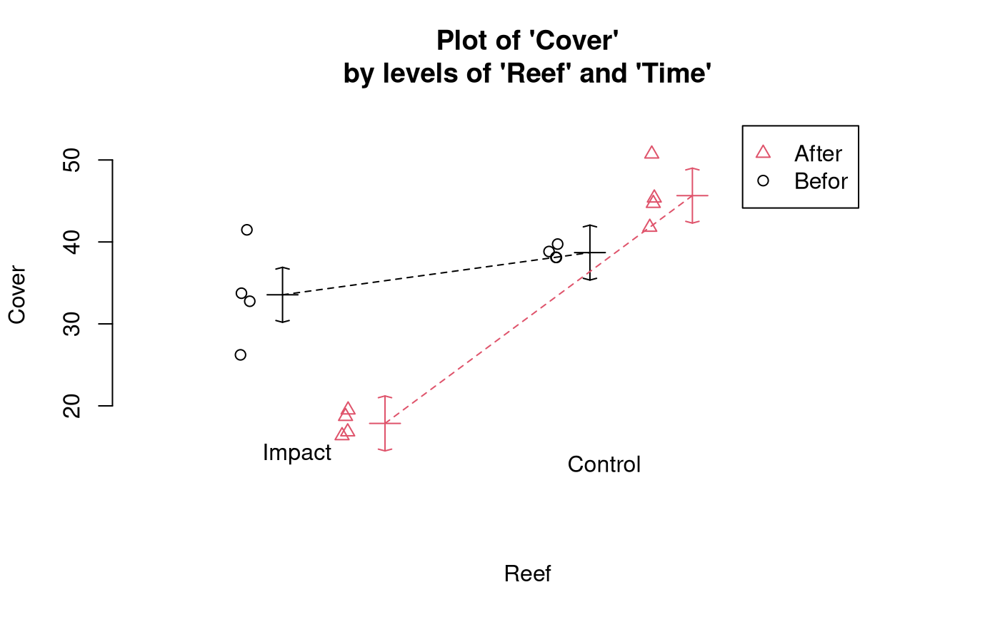
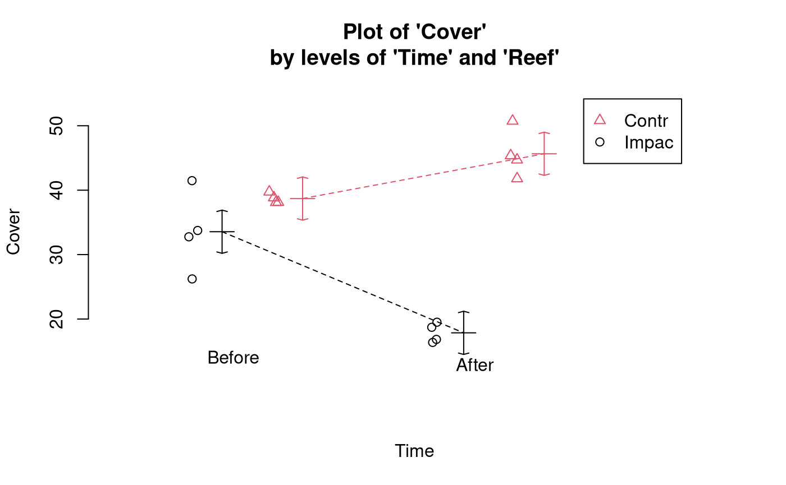
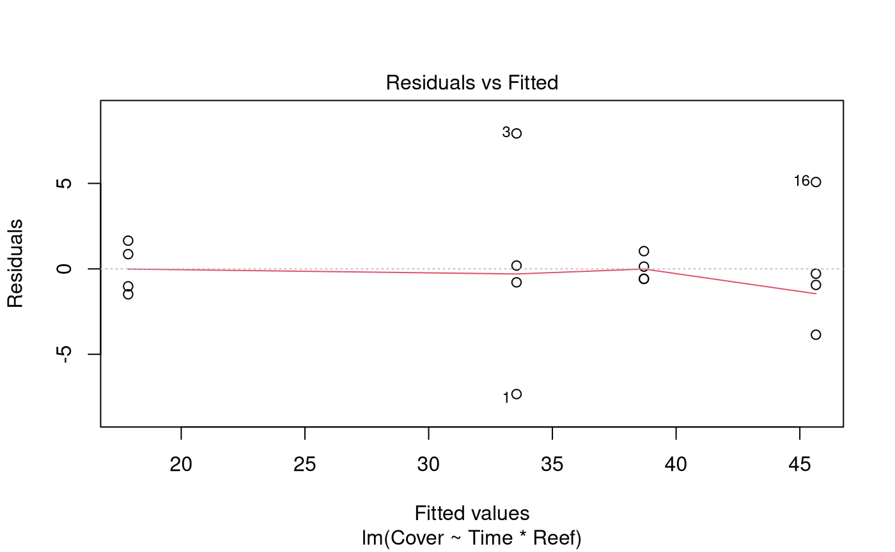
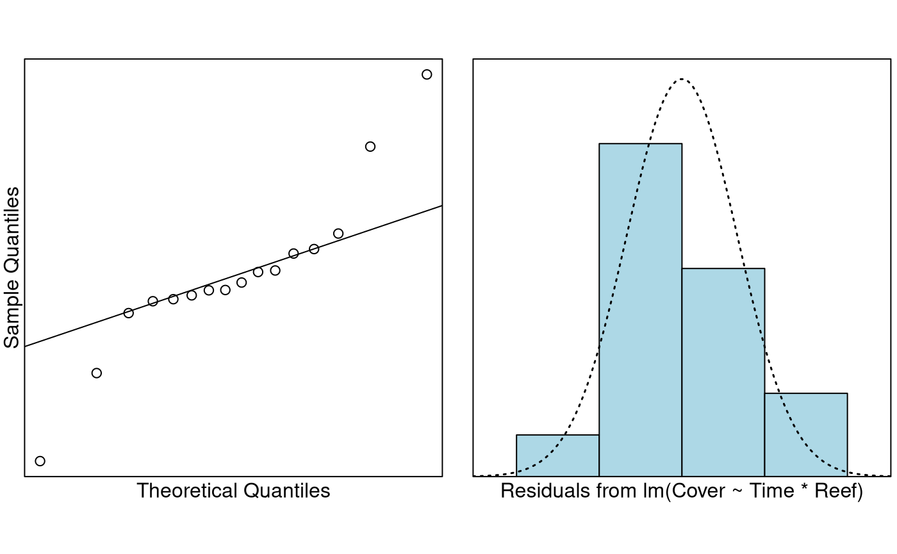
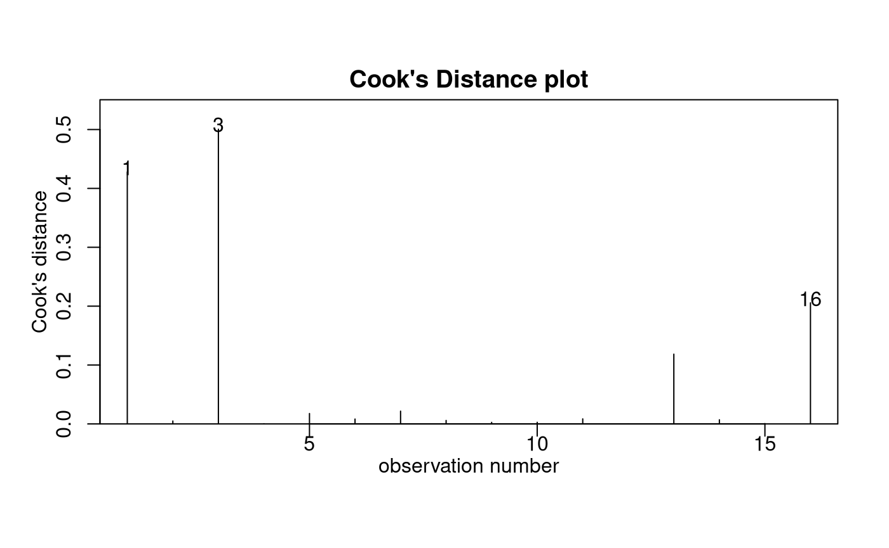

# Case Study 12.2: Impact of a cyclone on coral reefs

## Problem

The Australian Institute of Marine Science monitors coral and fish
assemblages along the Great Barrier Reef. These data consist of
percentage cover of hard corals recorded from underwater video transects
from various reef sites. In 1997, parts of the reef were affected by
tropical cyclone “Justin”. We wish to investigate the impact of the
cyclone on coral cover.

**Source of data**: Anderson, M.J. and Thompson, A.A. (2004).
Multivariate control charts for ecological and environmental monitoring.
Ecological Applications 14: 1921-1935.

This type of design is called a **BACI** design, for *before-after*,
*control-impact*. One factor is `Time` with two levels: `Before` and
`After`. The other factor is `Reef` (or `Site`) with two levels:
`Control` and `Impact`. An interaction would imply that the trend in
coral cover over time differed between control sites and impacted sites.
Here, the sites classified as `impacted` were outer reefs which take the
brunt of any storms.

The variables of interest were:

- `Cover`: percentage cover of hard corals in the reef.
- `Reef`: a two-level factor with levels `Control` and `Impact`.
- `Time`: a two-level factor with levels `Before` and `After`.

### Research question

What was the impact of cyclone Justin on coral cover in the affected
sites?

### Read in and Inspect the Data

``` r

Reef.df = read.csv("Reef.csv")
```

``` r

Reef.df = transform(Reef.df, Reef = factor(Reef), Time = factor(Time))
interactionPlots(Cover ~ Reef + Time, data = Reef.df)
```



``` r

# Also look at the interaction plot the other way around:
interactionPlots(Cover ~ Time + Reef, data = Reef.df)
```



The trend in coral cover over time appears to differ for impacted and
control reefs. The cover appears fairly similar in both reef categories
before Cyclone Justin. However, for control reefs, the cover increased
after the cyclone, whereas for impacted reefs, it decreased. From the
highly non-parallel appearance of the coloured lines we suspect there is
an interaction between the `Time` and `Reef` predictors.

### Model Building and Check Assumptions

``` r

Cover.fit = lm(Cover ~ Time * Reef, data = Reef.df)
plot(Cover.fit, which = 1)
```



``` r

normcheck(Cover.fit)
```



``` r

cooks20x(Cover.fit)
```



``` r

anova(Cover.fit)
```

    ## Analysis of Variance Table
    ## 
    ## Response: Cover
    ##           Df  Sum Sq Mean Sq F value    Pr(>F)    
    ## Time       1   76.46   76.46  5.4834   0.03727 *  
    ## Reef       1 1085.24 1085.24 77.8318 1.362e-06 ***
    ## Time:Reef  1  512.84  512.84 36.7802 5.631e-05 ***
    ## Residuals 12  167.32   13.94                      
    ## ---
    ## Signif. codes:  0 '***' 0.001 '**' 0.01 '*' 0.05 '.' 0.1 ' ' 1

``` r

summary(Cover.fit)
```

    ## 
    ## Call:
    ## lm(formula = Cover ~ Time * Reef, data = Reef.df)
    ## 
    ## Residuals:
    ##     Min      1Q  Median      3Q     Max 
    ## -7.3282 -0.9609 -0.4308  0.9049  7.9257 
    ## 
    ## Coefficients:
    ##                       Estimate Std. Error t value Pr(>|t|)    
    ## (Intercept)             45.651      1.867  24.451 1.32e-11 ***
    ## TimeBefore              -6.951      2.640  -2.633   0.0219 *  
    ## ReefImpact             -27.795      2.640 -10.527 2.05e-07 ***
    ## TimeBefore:ReefImpact   22.646      3.734   6.065 5.63e-05 ***
    ## ---
    ## Signif. codes:  0 '***' 0.001 '**' 0.01 '*' 0.05 '.' 0.1 ' ' 1
    ## 
    ## Residual standard error: 3.734 on 12 degrees of freedom
    ## Multiple R-squared:  0.9092, Adjusted R-squared:  0.8864 
    ## F-statistic: 40.03 on 3 and 12 DF,  p-value: 1.583e-06

### Pairwise comparisons using emmeans

``` r

Cover.pairs <- pairs(emmeans(Cover.fit, ~ Time * Reef), infer = TRUE)
# Simplify the display:
displayPairs(Cover.pairs, c("Before", "After"), c("Control", "Impact"))
```

    ## Note: displayPairs is a s20x function that displays only the within-level
    ## comparisons from allpairs. To see all comparisons, inspect the allpairs
    ## output directly.
    ## 
    ## $Before
    ##                        contrast    est       lwr      upr      pval
    ##  Before Control - Before Impact 5.1485 -2.690584 12.98758 0.2593307
    ## 
    ## $After
    ##                      contrast     est      lwr      upr         pval
    ##  After Control - After Impact 27.7945 19.95542 35.63358 1.079047e-06
    ## 
    ## $Control
    ##                        contrast   est        lwr      upr      pval
    ##  After Control - Before Control 6.951 -0.8880843 14.79008 0.0886507
    ## 
    ## $Impact
    ##                      contrast     est       lwr       upr         pval
    ##  After Impact - Before Impact -15.695 -23.53408 -7.855916 0.0003413045

## Methods and Assumption Checks

We have a numeric response, `Cover`, and two explanatory factors, `Reef`
and `Time`, so we fitted a two-way ANOVA model with interaction between
`Reef` and `Time`. The interaction term was significant (P-value \<
0.001) so it was retained.

The assumption checks were reasonable, except for the Cook’s distance
which exceeded 0.4 for a couple of points. However, this was not of
great concern, since there were no obvious outliers. It is not
surprising that some data points will have high influence when there are
only 16 observations in the dataset.

Our final model was
``` math
\text{Cover}_i = \beta_0 + \beta_1\ \times \text{Time.Before}_i + \beta_2 \times \text{Reef.Impact}_i + \beta_3 \times \text{Time.Before}_i \times \text{Reef.Impact}_i + \epsilon_i,
```
where $`\text{Time.Before}_i`$ and $`\text{Reef.Impact}_i`$ are the
dummy variables that take the value 1 if observation $`i`$ was
respectively recorded before Cyclone Justin and in an impacted reef
site, otherwise 0; and $`\epsilon_i \sim iid ~ N(0,\sigma^2)`$.

Alternatively, our final model could be written as
``` math
\text{Cover}_{ijk} = \mu + \alpha_i + \beta_j + \gamma_{ij} + \epsilon_{ijk},
```
where $`\text{Cover}_{ijk}`$ denotes the coral cover for observation
$`k`$ in time category $`i`$ and reef category $`j`$, and where $`\mu`$
is the overall mean percentage cover of the reefs, $`\alpha_i`$ is the
effect of time category $`i`$, $`\beta_j`$ is the effect of reef
category $`j`$, $`\gamma_{ij}`$ is the interaction effect for the
combination of time category $`i`$ and reef category $`j`$, and
$`\epsilon_{ijk} \sim iid~N(0, \sigma^2)`$.

Our model explained 91% of the variation in the coral cover
measurements.

## Executive Summary

We aimed to investigate the effect of Cyclone Justin on coral cover in
impacted reef sites.

There was no evidence of a difference in the average amount of coral
cover between impacted sites and control sites before Cyclone Justin.
However, there was strong evidence of a difference after the cyclone.

We estimate that the average coral cover in impacted reefs was between 8
and 24 percentage points lower after the cyclone than before. By
comparison, there was no loss in the average coral cover in control
reefs (in fact, there was weak evidence of an increase).

After the cyclone, we estimate that the average coral cover was between
20 and 36 percentage points greater in control reefs than in impacted
reefs.
