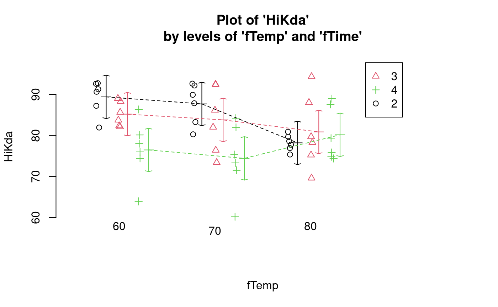
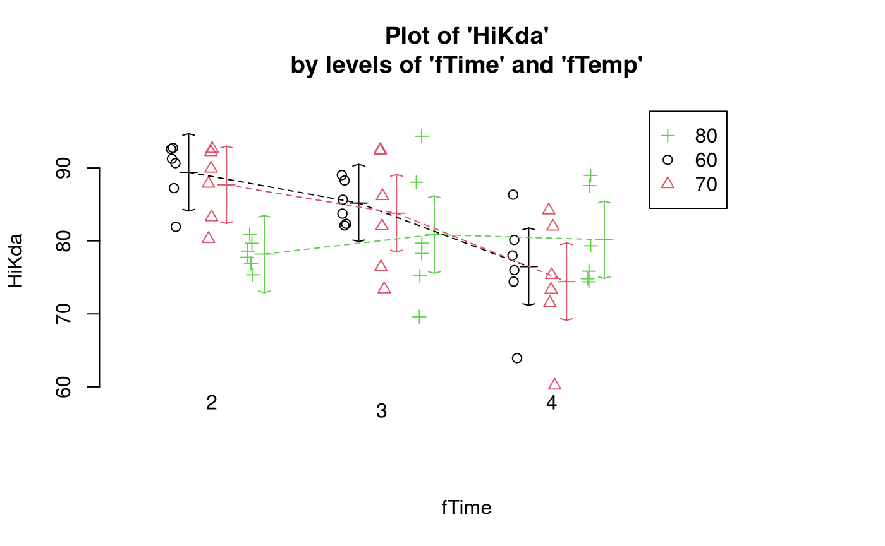
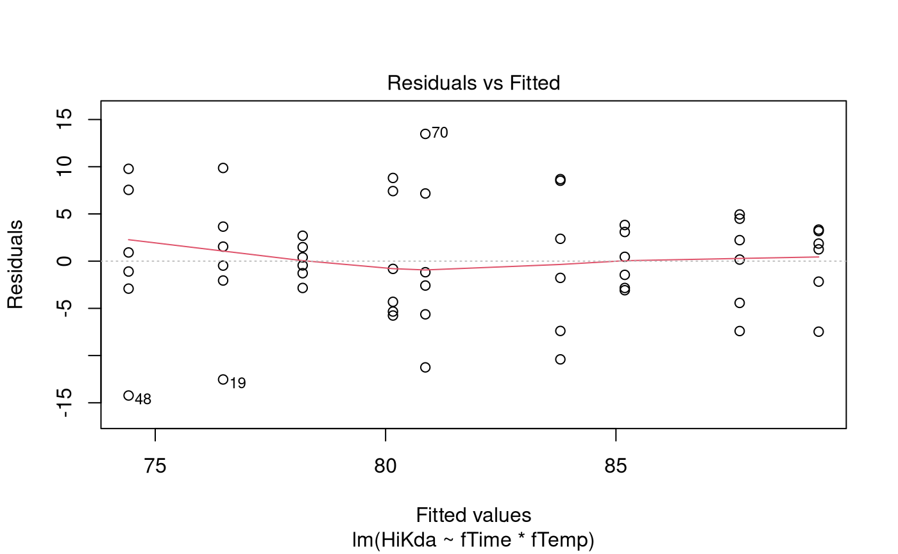
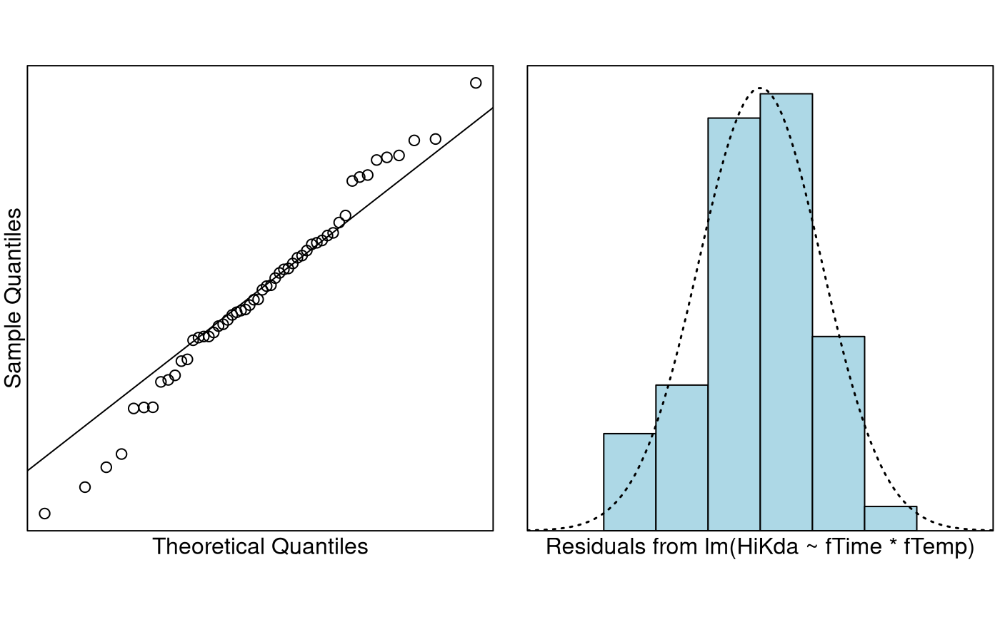

# Case Study 12.3: Extracting dietary supplements from seaweed

## Problem

*Fucoidan* is a dietary supplement found in several species of brown
seaweed, including the invasive species *Undaria* which is now
widespread in New Zealand.

One silver lining to the invasion of *Undaria* is that it has potential
to be a valuable source of *fucoidan*. These data come from a study
investigating the yield of *fucoidan* from *Undaria* under different
laboratory conditions.

The response is `HikDa` (a measurement based on molecular weight), and
the explanatory variables are the two factor variables `fTemp`
(temperature level) and `fTime` (time level), each of which has three
levels.

The variables of interest were:

- `HiKda`: A measurement based on molecular weight.
- `fTemp`: A three-level factor with the levels “60”, “70”, and “80”.
- `fTime`: A three-level factor with the levels “2”, “3”, and “4”.

### Question of Interest

We wish to determine how the yield of fucoidan from *Undaria* depends on
the temperature and time level, and whether these factors influence each
other.

### Read in and Inspect the Data

``` r

# The call for tab delimited data
Weed.df = read.table("Weed.txt", header = TRUE, sep = "\t")
```

``` r

# Several R commands to subset the data for answering the question of interest:
WeedDf = transform(Weed.df, logAlg = log(Alg), Ratio = as.character(Ratio))
WeedDf = transform(WeedDf, Ratio = as.numeric(substr(Ratio, 3, nchar(Ratio))))
WeedDf = transform(WeedDf,
  fTime = factor(Time), fTemp = factor(Temp),
  fRatio = factor(Ratio)
)
KdaDf = subset(WeedDf, subset = (!is.na(HiKda)))
interactionPlots(HiKda ~ fTemp + fTime, data = KdaDf)
```



``` r

# Also look at the interaction plot the other way around:
interactionPlots(HiKda ~ fTime + fTemp, data = KdaDf)
```



An interaction is suggested because of the non-parallel lines. When the
temperature is 80 degrees, the yield is similar for all time levels.
When temperature is 60 and 70 degrees, the yield decreases as time
increases.

### Model Building and Check Assumptions

``` r

Kda.lm = lm(HiKda ~ fTime * fTemp, data = KdaDf)
plot(Kda.lm, which = 1)
```



``` r

normcheck(Kda.lm)
```



``` r

cooks20x(Kda.lm)
```


``` r

anova(Kda.lm)
```

    ## Analysis of Variance Table
    ## 
    ## Response: HiKda
    ##             Df  Sum Sq Mean Sq F value   Pr(>F)   
    ## fTime        2  646.56  323.28  7.8746 0.001168 **
    ## fTemp        2  140.99   70.49  1.7171 0.191142   
    ## fTime:fTemp  4  455.71  113.93  2.7751 0.038203 * 
    ## Residuals   45 1847.41   41.05                    
    ## ---
    ## Signif. codes:  0 '***' 0.001 '**' 0.01 '*' 0.05 '.' 0.1 ' ' 1

``` r

summary(Kda.lm)
```

    ## 
    ## Call:
    ## lm(formula = HiKda ~ fTime * fTemp, data = KdaDf)
    ## 
    ## Residuals:
    ##      Min       1Q   Median       3Q      Max 
    ## -14.2317  -2.8942  -0.1425   3.3025  13.4767 
    ## 
    ## Coefficients:
    ##                Estimate Std. Error t value Pr(>|t|)    
    ## (Intercept)     89.4000     2.6158  34.177  < 2e-16 ***
    ## fTime3          -4.2083     3.6993  -1.138  0.26130    
    ## fTime4         -12.9267     3.6993  -3.494  0.00108 ** 
    ## fTemp70         -1.7150     3.6993  -0.464  0.64516    
    ## fTemp80        -11.2000     3.6993  -3.028  0.00407 ** 
    ## fTime3:fTemp70   0.3167     5.2315   0.061  0.95200    
    ## fTime4:fTemp70  -0.3367     5.2315  -0.064  0.94897    
    ## fTime3:fTemp80   6.8717     5.2315   1.314  0.19567    
    ## fTime4:fTemp80  14.8867     5.2315   2.846  0.00665 ** 
    ## ---
    ## Signif. codes:  0 '***' 0.001 '**' 0.01 '*' 0.05 '.' 0.1 ' ' 1
    ## 
    ## Residual standard error: 6.407 on 45 degrees of freedom
    ## Multiple R-squared:  0.4023, Adjusted R-squared:  0.296 
    ## F-statistic: 3.785 on 8 and 45 DF,  p-value: 0.001811

### Pairwise comparisons

``` r

Kda.pairs = pairs(emmeans(Kda.lm, ~ fTime * fTemp), infer = TRUE)
# Simplify the display of pairwise comparisons.
# Because factor levels are numbers, need to enter as "fTime2", "fTime3", etc:
displayPairs(Kda.pairs, c("fTime2", "fTime3", "fTime4"), c("fTemp60", "fTemp70", "fTemp80"))
```

    ## Note: displayPairs is a s20x function that displays only the within-level
    ## comparisons from allpairs. To see all comparisons, inspect the allpairs
    ## output directly.
    ## 
    ## $fTime2
    ##                         contrast    est         lwr    upr       pval
    ##  fTime2 fTemp60 - fTime2 fTemp70  1.715 -10.3339988 13.764 0.99993090
    ##  fTime2 fTemp60 - fTime2 fTemp80 11.200  -0.8489988 23.249 0.08688628
    ##  fTime2 fTemp70 - fTime2 fTemp80  9.485  -2.5639988 21.534 0.23050599
    ## 
    ## $fTime3
    ##                         contrast      est        lwr      upr      pval
    ##  fTime3 fTemp60 - fTime3 fTemp70 1.398333 -10.650666 13.44733 0.9999856
    ##  fTime3 fTemp60 - fTime3 fTemp80 4.328333  -7.720666 16.37733 0.9587448
    ##  fTime3 fTemp70 - fTime3 fTemp80 2.930000  -9.118999 14.97900 0.9965610
    ## 
    ## $fTime4
    ##                         contrast       est        lwr       upr      pval
    ##  fTime4 fTemp60 - fTime4 fTemp70  2.051667  -9.997332 14.100666 0.9997341
    ##  fTime4 fTemp60 - fTime4 fTemp80 -3.686667 -15.735666  8.362332 0.9843199
    ##  fTime4 fTemp70 - fTime4 fTemp80 -5.738333 -17.787332  6.310666 0.8249778
    ## 
    ## $fTemp60
    ##                         contrast       est        lwr      upr       pval
    ##  fTime2 fTemp60 - fTime3 fTemp60  4.208333 -7.8406655 16.25733 0.96494777
    ##  fTime2 fTemp60 - fTime4 fTemp60 12.926667  0.8776678 24.97567 0.02712413
    ##  fTime3 fTemp60 - fTime4 fTemp60  8.718333 -3.3306655 20.76733 0.33196381
    ## 
    ## $fTemp70
    ##                         contrast       est       lwr      upr       pval
    ##  fTime2 fTemp70 - fTime3 fTemp70  3.891667 -8.157332 15.94067 0.97805768
    ##  fTime2 fTemp70 - fTime4 fTemp70 13.263333  1.214334 25.31233 0.02124471
    ##  fTime3 fTemp70 - fTime4 fTemp70  9.371667 -2.677332 21.42067 0.24400944
    ## 
    ## $fTemp80
    ##                         contrast        est       lwr       upr      pval
    ##  fTime2 fTemp80 - fTime3 fTemp80 -2.6633333 -14.71233  9.385666 0.9982321
    ##  fTime2 fTemp80 - fTime4 fTemp80 -1.9600000 -14.00900 10.088999 0.9998109
    ##  fTime3 fTemp80 - fTime4 fTemp80  0.7033333 -11.34567 12.752332 0.9999999

## Methods and Assumption Checks

We have a numeric response `HiKda`, and two explanatory factors, `fTime`
and `fTemp`, so we fitted a two-way ANOVA model with interaction. The
interaction term was significant (*P-value* =0.04) so it was retained
for the final model.

The model assumptions were satisfied.

The final model is
``` math
\text{HiKda}_{ijk} = \mu + \alpha_i + \beta_j + \gamma_{ij} + \epsilon_{ijk},
```
where $`\mu`$ is the overall mean yield, $`\alpha_i`$ is the effect of
the $`i`$th time-point, $`\beta_j`$ is the effect of the $`j`$th
temperature, $`\gamma_{ij}`$ is the interaction effect for the
combination of the $`i`$th time-point and the $`j`$th temperature, and
$`\epsilon_{ijk} \sim iid~N(0,\sigma^2)`$.

Our model explained 40% of the variability in the yield (`HiKda`).

## Executive Summary

We wish to determine how the yield of fucoidan from *Undaria* depends on
the temperature and time level, and whether these factors influence each
other.

We found that the effect that temperature had on the yield depended on
the time level, so we could not look at the effects of temperature and
time individually.

At the temperature of 60 degrees, the expected yield was estimated to be
between 1 and 25 units higher at time-point 2 than time-point 4. The
same statement also applies to the temperature of 70 degrees.

There was some (though weaker) evidence that yield at time-point 2 was
higher at a temperature of 60 degrees than at a temperature of 80
degrees.

## Additional Comments

Looking at the interaction plot, there appears to be little if any
difference between the distribution of `HiKda` values at the two lower
temperatures. It might be worth combining these two groups into a single
group, because this would reduce `fTemp` to a two-level factor which
increases the degrees of freedom and reduces the magnitude of the
multi-comparison adjustment, thereby resulting in more statistical
power. This is something that would need to be discussed with the
researchers.

## Example code if there is no interaction

Had there been no interaction then the multi-comparison adjustment would
have proceeded thus:

``` r

Kda.Wrong.lm = lm(HiKda ~ fTime + fTemp, data = KdaDf)
pairs(emmeans(Kda.Wrong.lm, ~fTime), infer = TRUE)
```

    ##  contrast        estimate   SE df lower.CL upper.CL t.ratio p.value
    ##  fTime2 - fTime3     1.81 2.29 49   -3.711     7.34   0.793  0.7091
    ##  fTime2 - fTime4     8.08 2.29 49    2.553    13.60   3.534  0.0026
    ##  fTime3 - fTime4     6.26 2.29 49    0.741    11.79   2.741  0.0228
    ## 
    ## Results are averaged over the levels of: fTemp 
    ## Confidence level used: 0.95 
    ## Conf-level adjustment: tukey method for comparing a family of 3 estimates 
    ## P value adjustment: tukey method for comparing a family of 3 estimates

``` r

pairs(emmeans(Kda.Wrong.lm, ~fTemp), infer = TRUE)
```

    ##  contrast          estimate   SE df lower.CL upper.CL t.ratio p.value
    ##  fTemp60 - fTemp70     1.72 2.29 49    -3.80     7.25   0.753  0.7330
    ##  fTemp60 - fTemp80     3.95 2.29 49    -1.58     9.47   1.727  0.2054
    ##  fTemp70 - fTemp80     2.23 2.29 49    -3.30     7.75   0.974  0.5967
    ## 
    ## Results are averaged over the levels of: fTime 
    ## Confidence level used: 0.95 
    ## Conf-level adjustment: tukey method for comparing a family of 3 estimates 
    ## P value adjustment: tukey method for comparing a family of 3 estimates
