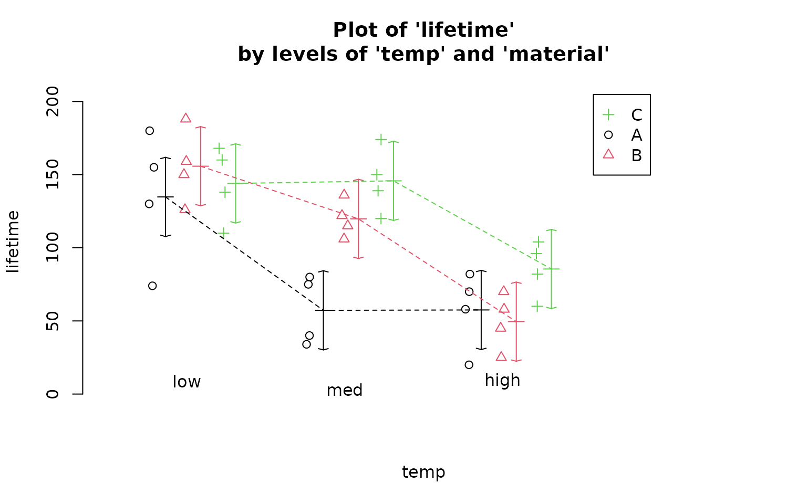
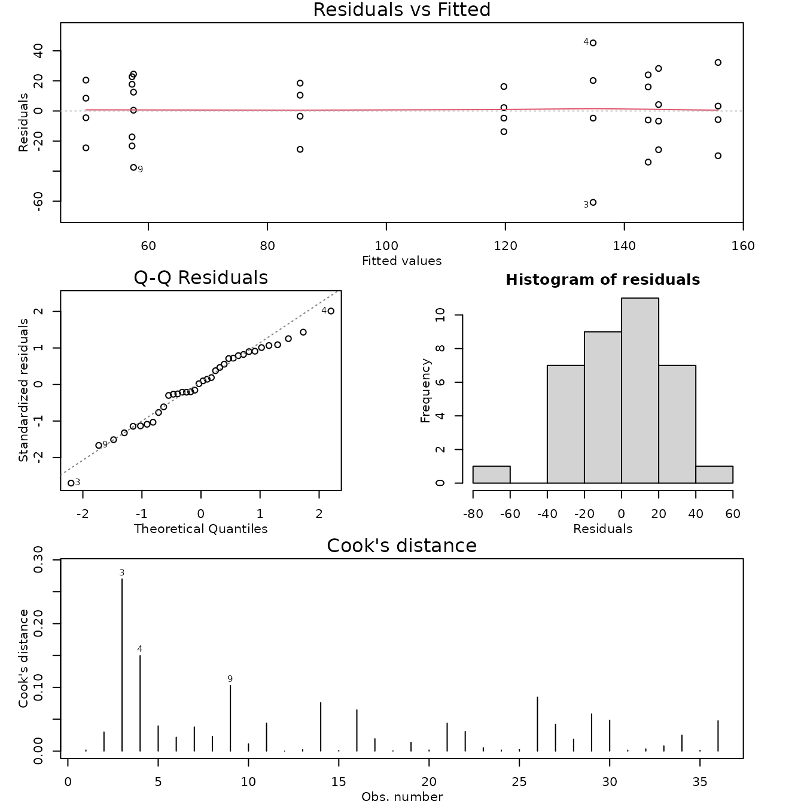

# Case Study 12.4: STATS 201/8 Extra Case Study - Two-way ANOVA Model, Interaction

## Question 1

Researchers were interested in which of three types of material for
producing batteries lead to the longest effective battery life. They
wanted a recommendation for which material (if any) performed better at
each of three different temperatures and wanted to know if the
temperature performance was the same for the three types of material
used.

Note: The researchers were NOT interested in the differences in
performance of the batteries made of the same material between the three
different temperatures at this time.

36 batteries were made, 12 each from the three different materials
available. They were then randomly allocated to one of three
temperatures. The batteries were then tested using a standardised
testing procedure under their allocated temperature to measure the
effective life of the battery.

The resulting data are in the file *Batteries.csv*, which contains the
variables:

| Variable | Description                                                   |
|----------|---------------------------------------------------------------|
| lifetime | The effective lifetime of the battery (hours).                |
| material | The material the battery was made of (coded as A, B or C).    |
| temp     | The temperature the battery was tested at (low, med or high). |

**Instructions:**

- Comment on the interaction plot of the data.
- Fit an appropriate linear model to answer the questions of interest
  and check its assumptions. Determine whether the model can be
  simplified to decide on an appropriate final model. Generate the
  inference output you need from the final model.
- Write a Method and Assumption Checks section.
- Write an *Executive Summary*. Remember to answer the researchers
  questions, including recommendations. Only focus on what is requested.

### Question of interest/goal of the study

Researchers were interested in which of three types of material for
producing batteries lead to the longest effective battery life at each
of three different temperatures and wanted to know if the temperature
performance was the same for the three types of material used.

### Read in and inspect the data

``` r

Batteries.df = read.csv("Batteries.csv", stringsAsFactors = TRUE)
interactionPlots(lifetime ~ temp + material, data = Batteries.df)
```



### Comment on the plot.

The plots don’t appear to be parallel suggesting the will be
interaction. At both high and low temperature there doesn’t seem to be
much difference in battery life between the three materials. However at
medium temperature, Material A seems to have a lower lifetime than the
others.

### Fit model, simplify as necessary, and generate inference output

``` r

battery.fit = lm(lifetime ~ temp * material, data = Batteries.df)

modelcheck(battery.fit)
```



``` r

anova(battery.fit)
```

    ## Analysis of Variance Table
    ## 
    ## Response: lifetime
    ##               Df Sum Sq Mean Sq F value    Pr(>F)    
    ## temp           2  39119 19559.4 28.9677 1.909e-07 ***
    ## material       2  10684  5341.9  7.9114  0.001976 ** 
    ## temp:material  4   9614  2403.4  3.5595  0.018611 *  
    ## Residuals     27  18231   675.2                      
    ## ---
    ## Signif. codes:  0 '***' 0.001 '**' 0.01 '*' 0.05 '.' 0.1 ' ' 1

``` r

summary(battery.fit)
```

    ## 
    ## Call:
    ## lm(formula = lifetime ~ temp * material, data = Batteries.df)
    ## 
    ## Residuals:
    ##     Min      1Q  Median      3Q     Max 
    ## -60.750 -14.625   1.375  17.938  45.250 
    ## 
    ## Coefficients:
    ##                   Estimate Std. Error t value Pr(>|t|)    
    ## (Intercept)          57.50      12.99   4.426 0.000142 ***
    ## templow              77.25      18.37   4.204 0.000257 ***
    ## tempmed              -0.25      18.37  -0.014 0.989244    
    ## materialB            -8.00      18.37  -0.435 0.666736    
    ## materialC            28.00      18.37   1.524 0.139165    
    ## templow:materialB    29.00      25.98   1.116 0.274242    
    ## tempmed:materialB    70.50      25.98   2.713 0.011461 *  
    ## templow:materialC   -18.75      25.98  -0.722 0.476759    
    ## tempmed:materialC    60.50      25.98   2.328 0.027632 *  
    ## ---
    ## Signif. codes:  0 '***' 0.001 '**' 0.01 '*' 0.05 '.' 0.1 ' ' 1
    ## 
    ## Residual standard error: 25.98 on 27 degrees of freedom
    ## Multiple R-squared:  0.7652, Adjusted R-squared:  0.6956 
    ## F-statistic:    11 on 8 and 27 DF,  p-value: 9.426e-07

``` r

battery.pairs <- pairs(emmeans(battery.fit, ~ temp * material), infer = TRUE)
displayPairs(battery.pairs, c("low", "med", "high"), c("A", "B", "C"))
```

    ## Note: displayPairs is a s20x function that displays only the within-level
    ## comparisons from allpairs. To see all comparisons, inspect the allpairs
    ## output directly.
    ## 
    ## $low
    ##       contrast    est       lwr      upr      pval
    ##  low A - low B -21.00 -82.82318 40.82318 0.9616404
    ##  low A - low C  -9.25 -71.07318 52.57318 0.9998527
    ##  low B - low C  11.75 -50.07318 73.57318 0.9991463
    ## 
    ## $med
    ##       contrast   est        lwr        upr        pval
    ##  med A - med B -62.5 -124.32318  -0.676816 0.046038781
    ##  med A - med C -88.5 -150.32318 -26.676816 0.001417257
    ##  med B - med C -26.0  -87.82318  35.823184 0.882288139
    ## 
    ## $high
    ##         contrast est       lwr      upr      pval
    ##  high A - high B   8 -53.82318 69.82318 0.9999508
    ##  high A - high C -28 -89.82318 33.82318 0.8347331
    ##  high B - high C -36 -97.82318 25.82318 0.5819453
    ## 
    ## $A
    ##        contrast    est        lwr       upr        pval
    ##  high A - low A -77.25 -139.07318 -15.42682 0.006747114
    ##  high A - med A   0.25  -61.57318  62.07318 1.000000000
    ##   low A - med A  77.50   15.67682 139.32318 0.006521215
    ## 
    ## $B
    ##        contrast     est        lwr        upr         pval
    ##  high B - low B -106.25 -168.07318 -44.426816 0.0001151507
    ##  high B - med B  -70.25 -132.07318  -8.426816 0.0172076171
    ##   low B - med B   36.00  -25.82318  97.823184 0.5819453144
    ## 
    ## $C
    ##        contrast    est        lwr       upr      pval
    ##  high C - low C -58.50 -120.32318  3.323184 0.0742711
    ##  high C - med C -60.25 -122.07318  1.573184 0.0604247
    ##   low C - med C  -1.75  -63.57318 60.073184 1.0000000

### Methods and assumption checks

As we have two explanatory factors, we fitted a two-way ANOVA model with
interactions. After fitting the model the residuals look good, there are
no major problems with normality or overly influential observations. We
should have independence due to the experimental design. There is
reasonably strong evidence suggesting there is an interaction between
temperature and material, and thus we keep the interaction term in the
model.

Our model is: model:
$`lifetime_i = \beta_0 + \beta_1 \times templow_i + ... + \beta_8 \times tempmed_i \times materialC_i +\epsilon_i`$,

where $`templow_i=1`$ if the $`i^{th}`$ battery was tested at low
temperature , and 0 otherwise; … and
$`\epsilon_i \sim iid N(0,\sigma^2)`$

Alternatively, our model is:
$`lifetime_{ijk}=\mu+\alpha_i+\beta_j+\gamma_{ij}+\epsilon_{ijk},\epsilon_{ijk} \sim N(0,\sigma^2)`$,

where $`\mu`$ is the overall mean lifetime, $`\alpha_i`$ is the effect
due to the $`i^{th}`$ temperature, $`i \in \{low, med, high\}`$,
$`\beta_j`$ is the effect due to the $`j^{th}`$ material,
$`j \in \{A, B, C\}`$, $`\gamma_{ij}`$ is the effect due to the
$`i^{th}`$ temperature and $`j^{th}`$ material combination.

Our model explains about 77% of variation in the lifetimes.

### Executive Summary

Researchers were interested in which of three types of material for
producing batteries lead to the longest effective battery life at each
of three different temperatures and wanted to know if the temperature
performance was the same for the three types of material used.

We found evidence that the effects of material on battery life did
depend on the temperature.

At both low temperatures and high temperatures there was no evidence of
any difference in performance between the three types of material.

However, at medium temperature, batteries made from material A performed
worse than batteries made from material B or C. We could not find any
evidence of a better performer between batteries made from materials B
or C.

At medium temperature, we estimate batteries made from material A had a
lifetime that was, on average, between:

- 1 and 124 hours lower than that of batteries made with material B.

- 27 and 150 hours lower than that of batteries made with material C.

Overall, it doesn’t appear to matter which material is used at low or
high temperatures, but at medium temperatures (probably the most
important) all we can do is rule out material A, so we are left with
either material B or C.
