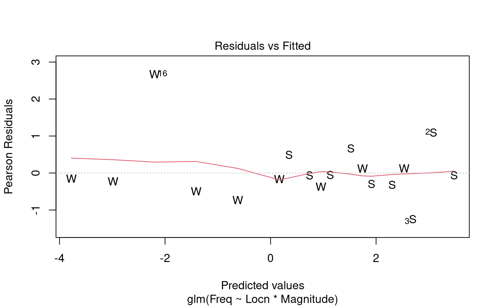

# Case Study 14.1: Decline in expected earthquake numbers with magnitude

## Problem

The Gutenberg-Richter law says that the expected frequency of
earthquakes decreases multiplicatively with their magnitude. The formula
is
``` math
\log_{10} N = a - b M,
```
where $`N`$ is the expected number of earthquakes of magnitude $`M`$ or
more on the Richter scale. Here, $`a`$ and $`b`$ are unknown parameters.

After applying a healthy dash of calculus, this formula can be
re-expressed in a form that is more familiar to us
``` math
E[Y|x] = \exp(\beta_0 + \beta_1 x),
```
where $`Y`$ is the number of number of earthquakes of magnitude between
$`x-\delta`$ and $`x+\delta`$.

The variables of interest were:

- `Magnitude`: The strength of a recorded earthquake.
- `Locn`: A two-level factor which describe the location of the
  earthquakes.
  - It has two levels Southern California (“SC”) and Washington (“WA”).
- `Freq`: The number of earthquakes recorded at `Locn` with magnitude
  `Magnitude`.

### Question of Interest

The research question is to quantify the rate of decrease in earthquake
frequency (with increasing magnitude) in both California and Washington
states, and to assess whether these rates are the same.

### Read in and Inspect the Data

``` r

Quakes.df = read.table("EarthquakeMagnitudes.txt", header = TRUE)
Quakes.df$Locn = as.factor(Quakes.df$Locn)
Quakes.df
plot(Freq ~ Magnitude, data = Quakes.df, pch = substr(Locn, 1, 1))
```

    ##    Locn Magnitude Freq
    ## 1    SC      5.25   32
    ## 2    SC      5.50   27
    ## 3    SC      5.75   10
    ## 4    SC      6.00    9
    ## 5    SC      6.25    6
    ## 6    SC      6.50    6
    ## 7    SC      6.75    3
    ## 8    SC      7.00    2
    ## 9    SC      7.25    2
    ## 10   WA      5.25   13
    ## 11   WA      5.50    6
    ## 12   WA      5.75    2
    ## 13   WA      6.00    1
    ## 14   WA      6.25    0
    ## 15   WA      6.50    0
    ## 16   WA      6.75    1
    ## 17   WA      7.00    0
    ## 18   WA      7.25    0


The plot is consistent with an exponential decreasing relationship
between frequency and magnitude. It is unclear whether the
multiplicative rate of decay is the same in the two locations.

### Model Building and Check Assumptions

``` r

Quake.gfit = glm(Freq ~ Locn * Magnitude, family = poisson, data = Quakes.df)
plot(Quake.gfit, which = 1, pch = substr(Quakes.df$Locn, 1, 1))
```



``` r

plot(Quake.gfit, which = 4)
```


Observation 16 has a largish residual, but as this observation has a
very small fitted value of $`\mu`$ this can be ignored.

``` r

summary(Quake.gfit)
```

    ## 
    ## Call:
    ## glm(formula = Freq ~ Locn * Magnitude, family = poisson, data = Quakes.df)
    ## 
    ## Coefficients:
    ##                  Estimate Std. Error z value Pr(>|z|)    
    ## (Intercept)       11.6923     1.1762   9.941  < 2e-16 ***
    ## LocnWA             7.3923     3.9500   1.871   0.0613 .  
    ## Magnitude         -1.5648     0.2055  -7.616 2.61e-14 ***
    ## LocnWA:Magnitude  -1.5884     0.7199  -2.206   0.0274 *  
    ## ---
    ## Signif. codes:  0 '***' 0.001 '**' 0.01 '*' 0.05 '.' 0.1 ' ' 1
    ## 
    ## (Dispersion parameter for poisson family taken to be 1)
    ## 
    ##     Null deviance: 176.1767  on 17  degrees of freedom
    ## Residual deviance:   8.2295  on 14  degrees of freedom
    ## AIC: 65.11
    ## 
    ## Number of Fisher Scoring iterations: 5

``` r

1 - pchisq(8.23, 14)
```

    ## [1] 0.8770025

``` r

exp(confint(Quake.gfit)) # Row 3 gives multiplicative annual change in CA
```

    ## Waiting for profiling to be done...

    ##                         2.5 %       97.5 %
    ## (Intercept)      1.271578e+04 1.293907e+06
    ## LocnWA           1.444417e+00 9.271450e+06
    ## Magnitude        1.374743e-01 3.082437e-01
    ## LocnWA:Magnitude 4.150846e-02 7.235657e-01

``` r

100 * (exp(confint(Quake.gfit)[3, ]) - 1) # Percentage annual change in CA
```

    ## Waiting for profiling to be done...

    ##     2.5 %    97.5 % 
    ## -86.25257 -69.17563

### Additional Output with `WA` as the baseline Level

``` r

Quakes.df$Locn = relevel(Quakes.df$Locn, ref = "WA")
Quake2.gfit = glm(Freq ~ Locn * Magnitude, family = poisson, data = Quakes.df)
exp(confint(Quake2.gfit)) # Row 3 gives multiplicative annual change in WA
```

    ## Waiting for profiling to be done...

    ##                         2.5 %       97.5 %
    ## (Intercept)      2.691111e+05 8.426878e+11
    ## LocnSC           1.078580e-07 6.923209e-01
    ## Magnitude        9.077661e-03 1.401754e-01
    ## LocnSC:Magnitude 1.382045e+00 2.409148e+01

``` r

100 * (exp(confint(Quake2.gfit)[3, ]) - 1) # Percentage annual change in WA
```

    ## Waiting for profiling to be done...

    ##     2.5 %    97.5 % 
    ## -99.09223 -85.98246

## Methods and Assumption Checks

The response variable, earthquake frequency, is a count, so we fitted a
generalised linear model with a Poisson response distribution. We have
two explanatory variables: Magnitude (Numeric) and Location
(Categorical). The scatterplot of magnitude vs frequency showed an
exponentially decreasing trend for both locations. We fitted a Poisson
model with interaction between magnitude and location. The interaction
was significant (*P-value* $`\approx`$ 0.03) so it was retained for the
final model.

All model assumptions were satisfied. There was no evidence of
overdispersion so we can trust the results from the Poisson model.

For our final model, we assume the number of earthquakes in observation
$`i`$ is Poisson($`\mu_i`$), where
``` math
\log(\mu_i) = \beta_0 + \beta_1 \times \text{Locn.WA}_i + \beta_2 \times \text{Magnitude}_i  + \beta_3 \times \text{Locn.WA}_i \times \text{Magnitude}_i~,
```
and where $`\text{Locn.WA}_i`$ is 1 if observation $`i`$ was in
Washington State and 0 otherwise, and $`\text{Magnitude}_i`$ is the
magnitude of earthquakes that are being counted in observation $`i`$.

## Executive Summary

The research question is to quantify the rate of decrease in earthquake
frequency with increasing magnitude in both California and Washington
states, and to assess whether these rates are the same.

The rate of decline in the frequency of earthquakes with increasing
magnitude is more rapid in Washington than California.

In Washington, there is a 86.0% to 99.1% drop in the expected number of
earthquakes for a one unit increase in their magnitude on the Richter
scale.

In California, the corresponding decrease is between 69.2% and 86.3%.
