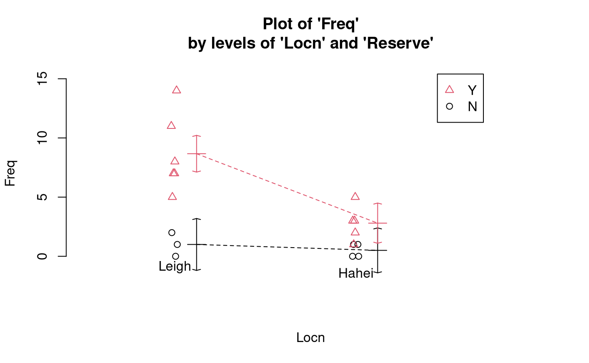
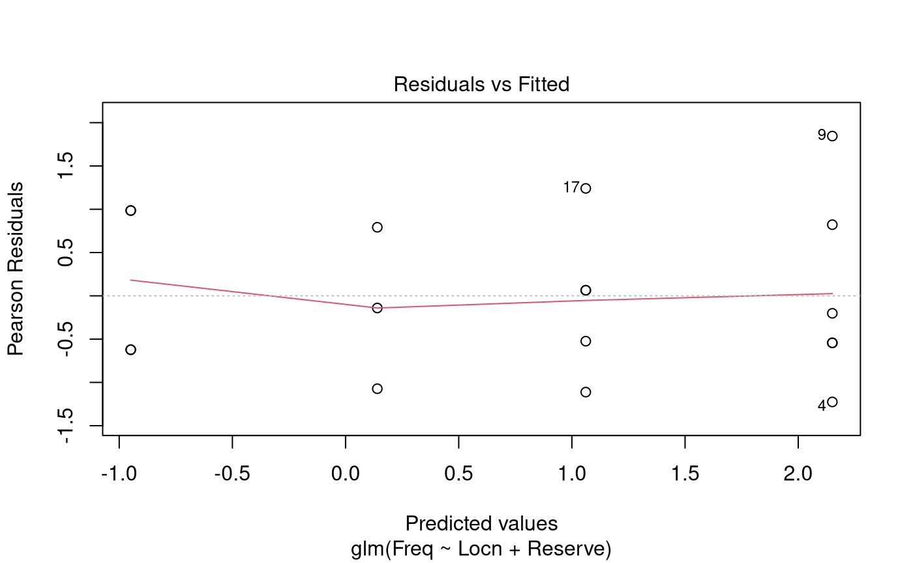

# Case Study 14.2: Snapper counts in and around marine reserves

## Problem

Baited underwater video (BUV) is an established tool for counting fish
such as snapper.

BUV was used at two locations, Leigh and Hahei. Each location has a
marine reserve. The BUV was deployed at sites inside the marine reserve,
and at sites just outside the reserve. BUV was used at a total of 18
sites.

The variables of interest were:

- `Locn`: A two-level factor which describes the BUV’s location.
  - It has the levels “Leigh” and “Hahei”.
- `Reserve`: A two-level factor which describes whether the BUV’s is in
  a marine reserve.
  - It has the levels “N” and “Y”.
- `Freq`: The number of snapped counted by the BUV.

### Question of Interest

It was of interest to explore the relative count of snapper with regard
to location and reservation status.

### Read in and Inspect the Data

``` r

Snap.df = read.table("SnapperCROPvsHAHEI.txt", header = TRUE)
interactionPlots(Freq ~ Locn * Reserve, data = Snap.df, col.width = 0)
```



In Leigh, it seems that there is a higher frequency of snapper counted
in a marine reserve compared to a non-reserve area. In Hahei, it seems
that there is little difference in the frequency of snapper counted in a
marine reserve compared to a non-reserve area. However, the interaction
plot does indicate that the multiplicative effect of reserve could be
similar at the two locations (i.e., no interaction).

### Model Building and Check Assumptions

``` r

Snap.glm = glm(Freq ~ Locn * Reserve, family = poisson, data = Snap.df)
summary(Snap.glm)
```

    ## 
    ## Call:
    ## glm(formula = Freq ~ Locn * Reserve, family = poisson, data = Snap.df)
    ## 
    ## Coefficients:
    ##                    Estimate Std. Error z value Pr(>|z|)  
    ## (Intercept)         -0.6931     0.7071  -0.980   0.3270  
    ## LocnLeigh            0.6931     0.9129   0.759   0.4477  
    ## ReserveY             1.7228     0.7559   2.279   0.0227 *
    ## LocnLeigh:ReserveY   0.4367     0.9612   0.454   0.6496  
    ## ---
    ## Signif. codes:  0 '***' 0.001 '**' 0.01 '*' 0.05 '.' 0.1 ' ' 1
    ## 
    ## (Dispersion parameter for poisson family taken to be 1)
    ## 
    ##     Null deviance: 70.453  on 17  degrees of freedom
    ## Residual deviance: 14.678  on 14  degrees of freedom
    ## AIC: 69.143
    ## 
    ## Number of Fisher Scoring iterations: 5

``` r

1 - pchisq(14.678, 14)
```

    ## [1] 0.4005141

``` r

anova(Snap.glm, test = "Chisq")
```

    ## Analysis of Deviance Table
    ## 
    ## Model: poisson, link: log
    ## 
    ## Response: Freq
    ## 
    ## Terms added sequentially (first to last)
    ## 
    ## 
    ##              Df Deviance Resid. Df Resid. Dev  Pr(>Chi)    
    ## NULL                            17     70.453              
    ## Locn          1   22.656        16     47.798 1.938e-06 ***
    ## Reserve       1   32.919        15     14.879 9.609e-09 ***
    ## Locn:Reserve  1    0.201        14     14.678    0.6542    
    ## ---
    ## Signif. codes:  0 '***' 0.001 '**' 0.01 '*' 0.05 '.' 0.1 ' ' 1

``` r

Snap2.glm = glm(Freq ~ Locn + Reserve, family = poisson, data = Snap.df)
anova(Snap2.glm, test = "Chisq")
```

    ## Analysis of Deviance Table
    ## 
    ## Model: poisson, link: log
    ## 
    ## Response: Freq
    ## 
    ## Terms added sequentially (first to last)
    ## 
    ## 
    ##         Df Deviance Resid. Df Resid. Dev  Pr(>Chi)    
    ## NULL                       17     70.453              
    ## Locn     1   22.656        16     47.798 1.938e-06 ***
    ## Reserve  1   32.919        15     14.879 9.609e-09 ***
    ## ---
    ## Signif. codes:  0 '***' 0.001 '**' 0.01 '*' 0.05 '.' 0.1 ' ' 1

``` r

summary(Snap2.glm)
```

    ## 
    ## Call:
    ## glm(formula = Freq ~ Locn + Reserve, family = poisson, data = Snap.df)
    ## 
    ## Coefficients:
    ##             Estimate Std. Error z value Pr(>|z|)    
    ## (Intercept)  -0.9491     0.4884  -1.943 0.051990 .  
    ## LocnLeigh     1.0894     0.2845   3.829 0.000128 ***
    ## ReserveY      2.0105     0.4646   4.328 1.51e-05 ***
    ## ---
    ## Signif. codes:  0 '***' 0.001 '**' 0.01 '*' 0.05 '.' 0.1 ' ' 1
    ## 
    ## (Dispersion parameter for poisson family taken to be 1)
    ## 
    ##     Null deviance: 70.453  on 17  degrees of freedom
    ## Residual deviance: 14.879  on 15  degrees of freedom
    ## AIC: 67.344
    ## 
    ## Number of Fisher Scoring iterations: 5

``` r

plot(Snap2.glm, which = 1)
```



``` r

exp(confint(Snap2.glm))
```

    ## Waiting for profiling to be done...

    ##                 2.5 %     97.5 %
    ## (Intercept) 0.1298697  0.9105143
    ## LocnLeigh   1.7443515  5.3626745
    ## ReserveY    3.3224830 21.3481546

### Methods and Assumption Checks

As the response variable, `Freq`, is a count, we have fitted a
generalised linear model with a Poisson response distribution. We have
two explanatory factors: `Locn` and `Reserve`. We initially fitted an
interaction between reserve and location. The interaction term was not
significant ($`P`$-value = 0.65) so the model was refitted with main
effects only. Both factors were significant so were retained for the
final model.

All assumptions were satisfied. There was no evidence of overdispersion,
so we can trust the results from the Poisson model ($`P`$-value = 0.40).

For our final model, we assume that the snapper count for observation
$`i`$ is Poisson with mean $`\mu_i`$, where
``` math
\log(\mu_i) = \beta_0 + \beta_1 \times \text{Locn.Leigh}_i + \beta_2 \times \text{Reserve.Yes}_i ~,
```
and where $`\text{Locn.Leigh}_i`$ and $`\text{Reserve.Yes}_i`$ are dummy
variables which take the value 1 if observation $`i`$ is respectively
from Leigh and from a marine reserve, otherwise they are 0.

### Executive Summary

It was of interest to explore the relative count of snapper with regard
to location and reserve status.

We conclude that the expected count of snapper inside a marine reserve
is between 3.3 and 21.3 times that outside of the reserve.

Additionally, the expected count of snapper in Leigh is between 1.7 and
5.4 times the expected count in Hahei.
