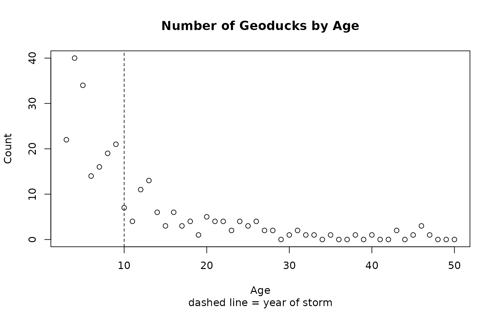
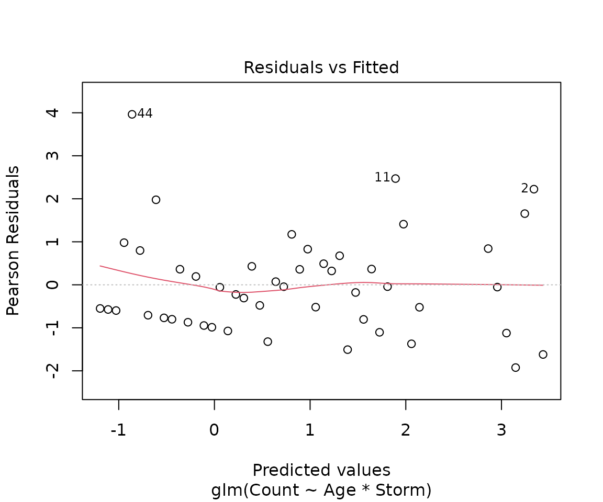
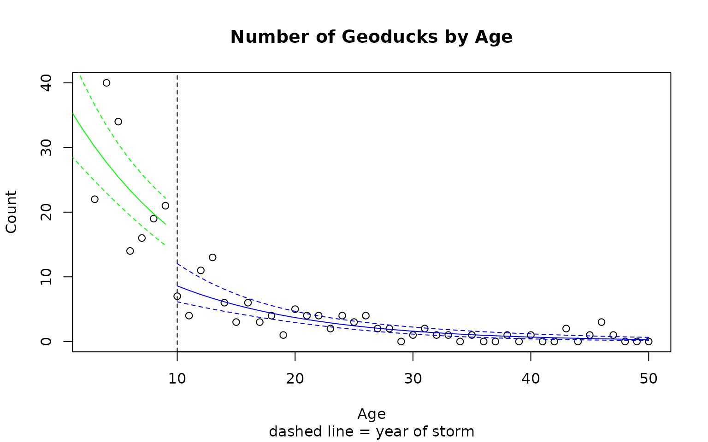

# Case Study 14.4: STATS 201/8 Extra Case Study - Poisson GLM. Parallel Curves

## Question 1

A marine scientist was interested in modelling the population of
geoducks from the west coast of the North Island taking into account
their age and an extreme storm event 10 years before. A random sample of
geoducks (a big clam, the name is actually pronounced “gooey-duck”) was
taken off the west coast of a North Island surf beach in 2013. Each
geoduck was aged by counting rings in the shell, and the count of
geoduck at each age was recorded. The population theory of geoducks
suggests using the following model for the expected count at each age:

``` math
 \log(E[Count_i]) = \beta_0 + \beta_1 \times Age_i 
```

Here, we’ll be using a modified version of this model since there was as
extreme storm event that all geoduck of age 10 or older experienced. The
initial model to be fitted includes the storm effect and its interaction
with age in the following way:

``` math
 \log(E[Count_i]) = \beta_0 + \beta_1 \times Age_i + \beta_2 \times Storm_i + \beta_3 \times Age_i\times Storm_i  
```

where $`Count_i`$ is the geoduck count at age i and $`Storm_i`$ is an
indicator variable that takes the value 0 if age is less than 10, or 1
if age is at least 10.

The data are stored in *Geoduck.csv*, which contains the following
variables:

| Variable | Description |
|----|----|
| Count | Number of geoducks counted at given value of age. |
| Age | Years of age of geoduck. |
| Storm | Indicator variable (0 if age less than 10 after storm, or 1 if age at least 10 before storm). |

**Instructions:**

- Comment on the plot of the data.
- Fit an appropriate Poisson GLM to model the number of geoducks.
  Determine whether the model can be simplified and determine an
  appropriate final model. Generate confidence interval output for this
  model.
- Write appropriate **Methods and Assumption Checks**.
- Write an appropriate **Executive Summary**. Remember to address all
  the questions asked.
- **Bonus** Produce predicted values for the expected number of geoducks
  at each age group using this model, including intervals. Add these
  intervals to a plot of the data.

### Questions of Interest

The questions we want answered are: how does the population of geoducks
change with age, did the storm event have any impact on the population,
and did the relationship between age and the population count change
after the storm?

### Read in and inspect the data:

``` r

Geoduck.df = read.csv("Geoduck.csv", stringsAsFactors = TRUE)
plot(Count ~ Age,
  main = "Number of Geoducks by Age",
  sub = "dashed line = year of storm", data = Geoduck.df
)
abline(v = 10, lty = 2)
```



### Comment on plot.

The scatter plot shows an exponential (i.e., multiplicative) decline in
geoduck count with age. There is some indication of a storm effect at
age 10, but it is hard to be sure.

### Fit an appropriate GLM:

``` r

duckfit1 = glm(Count ~ Age * Storm, family = poisson, data = Geoduck.df)
plot(duckfit1, which = 1)
```



``` r

summary(duckfit1)
```

    ## 
    ## Call:
    ## glm(formula = Count ~ Age * Storm, family = poisson, data = Geoduck.df)
    ## 
    ## Coefficients:
    ##             Estimate Std. Error z value Pr(>|z|)    
    ## (Intercept)  3.72147    0.23386  15.913   <2e-16 ***
    ## Age         -0.09560    0.03925  -2.436   0.0149 *  
    ## Storm       -0.74423    0.33266  -2.237   0.0253 *  
    ## Age:Storm    0.01216    0.04068   0.299   0.7650    
    ## ---
    ## Signif. codes:  0 '***' 0.001 '**' 0.01 '*' 0.05 '.' 0.1 ' ' 1
    ## 
    ## (Dispersion parameter for poisson family taken to be 1)
    ## 
    ##     Null deviance: 458.589  on 47  degrees of freedom
    ## Residual deviance:  60.985  on 44  degrees of freedom
    ## AIC: 189.51
    ## 
    ## Number of Fisher Scoring iterations: 5

``` r

1 - pchisq(60.985, 44)
```

    ## [1] 0.04567957

``` r

# Evidence of overdispersion
duckfit2 = glm(Count ~ Age * Storm, family = quasipoisson, data = Geoduck.df)
summary(duckfit2)
```

    ## 
    ## Call:
    ## glm(formula = Count ~ Age * Storm, family = quasipoisson, data = Geoduck.df)
    ## 
    ## Coefficients:
    ##             Estimate Std. Error t value Pr(>|t|)    
    ## (Intercept)  3.72147    0.28203  13.195   <2e-16 ***
    ## Age         -0.09560    0.04734  -2.020   0.0495 *  
    ## Storm       -0.74423    0.40118  -1.855   0.0703 .  
    ## Age:Storm    0.01216    0.04906   0.248   0.8054    
    ## ---
    ## Signif. codes:  0 '***' 0.001 '**' 0.01 '*' 0.05 '.' 0.1 ' ' 1
    ## 
    ## (Dispersion parameter for quasipoisson family taken to be 1.454374)
    ## 
    ##     Null deviance: 458.589  on 47  degrees of freedom
    ## Residual deviance:  60.985  on 44  degrees of freedom
    ## AIC: NA
    ## 
    ## Number of Fisher Scoring iterations: 5

``` r

# Drop interaction
duckfit3 = glm(Count ~ Age + Storm, family = quasipoisson, data = Geoduck.df)
summary(duckfit3)
```

    ## 
    ## Call:
    ## glm(formula = Count ~ Age + Storm, family = quasipoisson, data = Geoduck.df)
    ## 
    ## Coefficients:
    ##             Estimate Std. Error t value Pr(>|t|)    
    ## (Intercept)  3.65761    0.11672  31.338  < 2e-16 ***
    ## Age         -0.08428    0.01243  -6.782 2.15e-08 ***
    ## Storm       -0.66339    0.23351  -2.841  0.00673 ** 
    ## ---
    ## Signif. codes:  0 '***' 0.001 '**' 0.01 '*' 0.05 '.' 0.1 ' ' 1
    ## 
    ## (Dispersion parameter for quasipoisson family taken to be 1.438666)
    ## 
    ##     Null deviance: 458.589  on 47  degrees of freedom
    ## Residual deviance:  61.075  on 45  degrees of freedom
    ## AIC: NA
    ## 
    ## Number of Fisher Scoring iterations: 5

``` r

exp(confint(duckfit3))
```

    ## Waiting for profiling to be done...

    ##                  2.5 %     97.5 %
    ## (Intercept) 30.7695824 48.6534515
    ## Age          0.8961418  0.9409958
    ## Storm        0.3233277  0.8086895

``` r

100 * (exp(confint(duckfit3))[2:3, ] - 1)
```

    ## Waiting for profiling to be done...

    ##           2.5 %     97.5 %
    ## Age   -10.38582  -5.900423
    ## Storm -67.66723 -19.131046

### Method and Assumption Checks

A Poisson log-linear model was fitted to the geoduck counts. The
explanatory variables were Age and an indicator variable for the storm
event. The initial model included interaction. Residuals looked fine but
there was evidence that over–dispersion was present (P-value = 0.0457)
so the model was refitted as quasipoisson, The interaction term was not
significant and so was removed. After this, both Age and Storm were
significant so the model was not simplified any further.

The Age and Storm effects were significant and the final model was
``` math
 \log (\mu_i) = \beta_0 + \beta_1 \times age_i + \beta_2 \times Storm_i
```

where $`Count_i`$ is the count of geoduck of age $`i`$ geoduck and has
an overdispersed distribution with mean $`\mu_i`$. $`Storm_i`$ is an
indicator variable that takes the value 0 if age is less than 10 years
(before the storm) and 1 if 10 or more.

**Note 1:** this is not a Poisson distribution in this case as we used a
QuasiPoisson model.)

**Note 2:** could use $`E[Count_i]`$ for $`\mu_i`$ as have the same
definition.

### Executive Summary

We want to model the population of geoducks from the west coast of the
North Island taking into account their age and an extreme storm event 10
years prior to the sample being taken.

Both age and the storm event have a significant effect on expected count
of geoduck. However, there was no evidence that the relationship between
age and the expected count of geoducks differed for geoducks born before
and after the storm.

For every year increase in age (notwithstanding the storm event), the
expected count of geoduck decreases by between 5.9% and 10.4%.

For any age class of geoducks old enough to be affected by the storm,
there was a further decrease in their expected count of between 19.1%
and 67.7%.

### Produce predicted values for the expected number of geoducks at each age group using this model, including intervals. Add these intervals to a plot of the data.

``` r

# Create predictions for geoducks age less than 10, after the storm
Pred.data1 = data.frame(Age = seq(1, 9), Storm = rep(0, 9))
PredAfter = predict20x(duckfit3, Pred.data1, print.out = FALSE)$frame
PredAfter
```

    ##   Predicted  Conf.lower Conf.upper
    ## 1    35.635      28.743     44.180
    ## 2    32.755      26.734     40.132
    ## 3    30.107      24.806     36.541
    ## 4    27.674      22.956     33.361
    ## 5    25.437      21.179     30.550
    ## 6    23.381      19.478     28.066
    ## 7    21.491      17.855     25.867
    ## 8    19.754      16.317     23.914
    ## 9    18.157      14.870     22.171

``` r

# Create predictions for geoducks age 10 or more, before the storm but don't display these.
Pred.data2 = data.frame(Age = seq(10, 50), Storm = rep(1, 41))
PredBefore = predict20x(duckfit3, Pred.data2, print.out = FALSE)$frame

# Redo plot from above.
plot(Count ~ Age,
  main = "Number of Geoducks by Age",
  sub = "dashed line = year of storm", data = Geoduck.df
)
abline(v = 10, lty = 2)


# Add after lines to plot.Interval bounds as dashed lines.
lines(seq(1, 9), PredAfter[, 1], col = "Green")
lines(seq(1, 9), PredAfter[, 2], col = "Green", lty = 2)
lines(seq(1, 9), PredAfter[, 3], col = "Green", lty = 2)


# Add before lines to plot.Interval bounds as dashed lines.
lines(seq(10, 50), PredBefore[, 1], col = "Blue")
lines(seq(10, 50), PredBefore[, 2], col = "Blue", lty = 2)
lines(seq(10, 50), PredBefore[, 3], col = "Blue", lty = 2)
```


