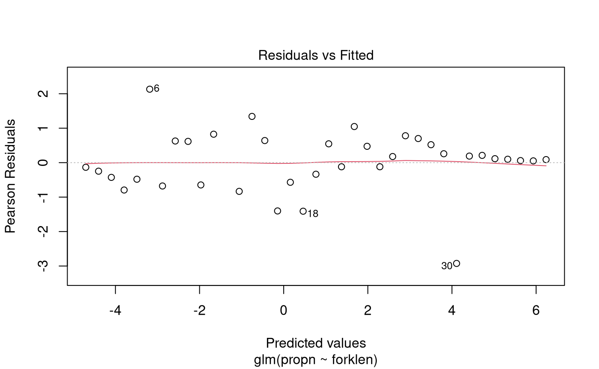

# Case Study 15.1: Haddock retention in a trawl

## Problem

The experiment consisted of observing the number of fish at given fork
lengths that entered a trawl codend, and the number of those fish that
were retained by it.

In dataframe `Haddock.df`, `codend` is the number retained in the codend
and `cover` is the number that escaped the codend into the cover region.
The total number of fish is therefore `codend + cover`.

The variables of interest were:

- `propn`: The proportion of fish caught in the trawl codend.
- `forklen`: The fork length of the fish (in cm). (This is the length
  measured from snout to the end of tail fin rays.)

### Question of Interest

How does the length of the fish affect the odds of it being caught in
the trawl codend?

### Read in and Inspect the Data

``` r

Haddock.df = read.table("Haddock.txt", header = TRUE)
Haddock.df$n = with(Haddock.df, codend + cover)
Haddock.df$propn = with(Haddock.df, codend / n)
plot(propn ~ forklen, data = Haddock.df, xlab = "Fork length (cm)", las = 1)
```


We can see that as the length of the fish increases, the proportion of
fish caught in the trawl codend increases. Notably, it follows a
S-shaped curve.

### Model Building and Check Assumptions

``` r

Haddock.glm = glm(propn ~ forklen, family = binomial, weight = n, data = Haddock.df)
plot(Haddock.glm, which = 1)
```



``` r

summary(Haddock.glm)
```

    ## 
    ## Call:
    ## glm(formula = propn ~ forklen, family = binomial, data = Haddock.df, 
    ##     weights = n)
    ## 
    ## Coefficients:
    ##              Estimate Std. Error z value Pr(>|z|)    
    ## (Intercept) -10.63219    0.86468  -12.30   <2e-16 ***
    ## forklen       0.30396    0.02363   12.86   <2e-16 ***
    ## ---
    ## Signif. codes:  0 '***' 0.001 '**' 0.01 '*' 0.05 '.' 0.1 ' ' 1
    ## 
    ## (Dispersion parameter for binomial family taken to be 1)
    ## 
    ##     Null deviance: 432.464  on 35  degrees of freedom
    ## Residual deviance:  23.436  on 34  degrees of freedom
    ##   (1 observation deleted due to missingness)
    ## AIC: 79.75
    ## 
    ## Number of Fisher Scoring iterations: 5

``` r

1 - pchisq(23.436, 34)
```

    ## [1] 0.9133009

``` r

exp(confint(Haddock.glm))
```

    ## Waiting for profiling to be done...

    ##                    2.5 %      97.5 %
    ## (Intercept) 3.893019e-06 0.000117379
    ## forklen     1.297561e+00 1.424118770

``` r

100 * (exp(confint(Haddock.glm)) - 1)
```

    ## Waiting for profiling to be done...

    ##                 2.5 %    97.5 %
    ## (Intercept) -99.99961 -99.98826
    ## forklen      29.75615  42.41188

## Methods and assumption Checks

The data recorded the number of fish that entered the codend and the
number of those fish that were retained, for fish of different fork
lengths. We therefore fitted a Binomial GLM with a single predictor of
fork length (numeric). The response was treated as grouped data, with
each group corresponding to a specific value of fork length.

Taking into account the fact that we expect small positive residuals
from length classes with high retention probability, the residual plot
from fitting the binomial model showed no strong trends. There was no
evidence of overdispersion (*P-value* = 0.91) so we can trust the
results from this binomial model.

Our final model was
``` math
 \log(\text{Odds_i}) = \beta_0 + \beta_1 \times \text{length}_i, 
```
where $`\text{Odds}_i`$ is the odds of retention for fish at the $`i`$th
value of fork length.

## Executive Summary

We aimed to investigate the relationship between fish fork length and
the odds that the fish is retained in the trawl codend after entering
it.

We estimate that for every 1 cm increase in the fork length of a
haddock, the odds that it is retained in the codend increase by between
30% and 42%.
