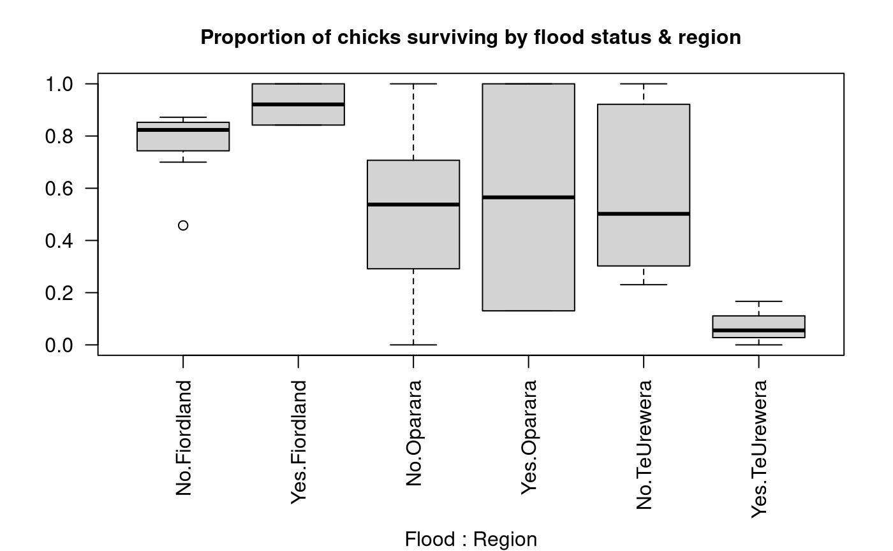
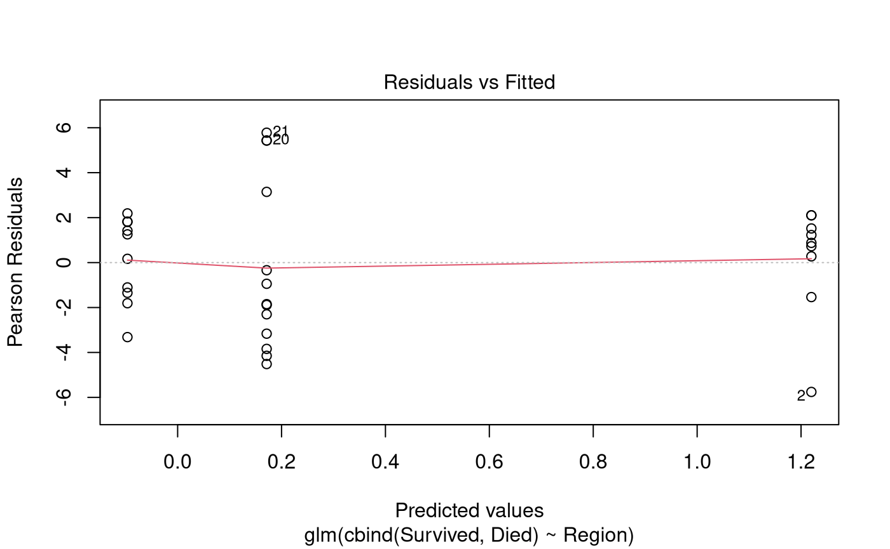

# Case Study 15.2: Whio chick survival

## Problem

The whio, or blue duck, is an endangered bird that lives in fast-flowing
rivers throughout NZ. Although it is a type of duck, it doesn’t quack
but instead emits a soft whistle that sounds like ‘whio’ (pronounced
‘fee-oh’). It’s an iconic NZ species and is pictured on the \$10 bank
note.

Rangers from the Department of Conservation monitored whio nests in
various regions of NZ over several years. For each nest found, they
recorded the number of chicks in the nest, and how many of them survived
to the point of fledging (leaving the nest). They also recorded whether
the region had suffered floods in the corresponding year, because
flooded rivers are a potential cause of chick mortality.

The dataframe `Whio.df` has records for several regions and years, with
the following columns:

- `Chicks`: total number of chicks in monitored nests in that region and
  year.
- `Survived`: number of the chicks that survived.
- `Died`: number of the chicks that died.
- `Region`: a categorical variable for location, with levels Fiordland,
  Oparara, and TeUrewera.
- `Flood`: a categorical variable specifying whether the region was
  affected by floods in the corresponding year, with levels Yes and No.

### Questions of interest

Does whio chick survival differ by region and/or flood status? Quantify
all findings, including absolute survival probabilities and any
differences found in survival among different predictor categories.

### Read in and inspect the data

``` r

whio.df <- read.csv("WhioChicks.csv", stringsAsFactors = TRUE)
head(whio.df)
par(mar = c(8, 4, 3, 2), mgp = c(7, 1, 0))
with(whio.df, boxplot(Survived / Chicks ~ Flood * Region, data = whio.df, las = 2))
title("Proportion of chicks surviving by flood status & region", cex.main = 1)
# Numbers of observations by predictor levels:
table(whio.df$Flood, whio.df$Region)
```

    ##   Chicks Survived Died    Region Flood
    ## 1     46       39    7 Fiordland    No
    ## 2     59       27   32 Fiordland    No
    ## 3     56       48    8 Fiordland    No
    ## 4     51       42    9 Fiordland    No
    ## 5     78       68   10 Fiordland    No
    ## 6     80       56   24 Fiordland    No



    ##      
    ##       Fiordland Oparara TeUrewera
    ##   No          7       8        10
    ##   Yes         2       2         3

### Comment on the plot and summary information

Chick survival appears to be higher in Fiordland than in the other two
regions. There is no consistent pattern of average survival with flood
status. In Fiordland, average survival appears a little higher in flood
years, but in Oparara there appears to be little difference, and in
TeUrewera average survival is noticeably lower in flood years. However,
we can see from the summary table that there are only a few observations
for flood years so it might be difficult to use this data to draw
conclusions about the impact of floods.

### Model building and check assumptions

``` r

whio.fit1 <- glm(cbind(Survived, Died) ~ Flood * Region, family = binomial, data = whio.df)
summary(whio.fit1)
```

    ## 
    ## Call:
    ## glm(formula = cbind(Survived, Died) ~ Flood * Region, family = binomial, 
    ##     data = whio.df)
    ## 
    ## Coefficients:
    ##                          Estimate Std. Error z value Pr(>|z|)    
    ## (Intercept)                1.1583     0.1129  10.255  < 2e-16 ***
    ## FloodYes                   1.1771     0.6150   1.914  0.05564 .  
    ## RegionOparara             -1.0405     0.2156  -4.826 1.39e-06 ***
    ## RegionTeUrewera           -0.8706     0.1484  -5.867 4.43e-09 ***
    ## FloodYes:RegionOparara    -2.4988     0.7929  -3.152  0.00162 ** 
    ## FloodYes:RegionTeUrewera  -3.9905     0.9631  -4.144 3.42e-05 ***
    ## ---
    ## Signif. codes:  0 '***' 0.001 '**' 0.01 '*' 0.05 '.' 0.1 ' ' 1
    ## 
    ## (Dispersion parameter for binomial family taken to be 1)
    ## 
    ##     Null deviance: 371.19  on 31  degrees of freedom
    ## Residual deviance: 257.10  on 26  degrees of freedom
    ## AIC: 359.79
    ## 
    ## Number of Fisher Scoring iterations: 4

``` r

1 - pchisq(257.10, 26)
```

    ## [1] 0

``` r

whio.fit2 <- glm(cbind(Survived, Died) ~ Flood * Region, family = quasibinomial, data = whio.df)
anova(whio.fit2, test = "F")
```

    ## Analysis of Deviance Table
    ## 
    ## Model: quasibinomial, link: logit
    ## 
    ## Response: cbind(Survived, Died)
    ## 
    ## Terms added sequentially (first to last)
    ## 
    ## 
    ##              Df Deviance Resid. Df Resid. Dev      F  Pr(>F)  
    ## NULL                            31     371.19                 
    ## Flood         1   13.300        30     357.89 1.5112 0.22996  
    ## Region        2   70.597        28     287.29 4.0110 0.03032 *
    ## Flood:Region  2   30.195        26     257.10 1.7156 0.19960  
    ## ---
    ## Signif. codes:  0 '***' 0.001 '**' 0.01 '*' 0.05 '.' 0.1 ' ' 1

``` r

whio.fit3 <- glm(cbind(Survived, Died) ~ Flood + Region, family = quasibinomial, data = whio.df)
anova(whio.fit3, test = "F")
```

    ## Analysis of Deviance Table
    ## 
    ## Model: quasibinomial, link: logit
    ## 
    ## Response: cbind(Survived, Died)
    ## 
    ## Terms added sequentially (first to last)
    ## 
    ## 
    ##        Df Deviance Resid. Df Resid. Dev      F  Pr(>F)  
    ## NULL                      31     371.19                 
    ## Flood   1   13.300        30     357.89 1.4847 0.23321  
    ## Region  2   70.597        28     287.29 3.9406 0.03105 *
    ## ---
    ## Signif. codes:  0 '***' 0.001 '**' 0.01 '*' 0.05 '.' 0.1 ' ' 1

``` r

whio.fit4 <- glm(cbind(Survived, Died) ~ Region, family = quasibinomial, data = whio.df)
anova(whio.fit4, test = "F")
```

    ## Analysis of Deviance Table
    ## 
    ## Model: quasibinomial, link: logit
    ## 
    ## Response: cbind(Survived, Died)
    ## 
    ## Terms added sequentially (first to last)
    ## 
    ## 
    ##        Df Deviance Resid. Df Resid. Dev      F  Pr(>F)  
    ## NULL                      31     371.19                 
    ## Region  2   72.374        29     298.82 4.0394 0.02834 *
    ## ---
    ## Signif. codes:  0 '***' 0.001 '**' 0.01 '*' 0.05 '.' 0.1 ' ' 1

``` r

plot(whio.fit4, which = 1)
```



### Inference output from the final model

``` r

predict20x(whio.fit4, newdata = data.frame(Region = c("Fiordland", "Oparara", "TeUrewera")))
```

    ##   Predicted  Conf.lower Conf.upper
    ## 1     0.772       0.639      0.866
    ## 2     0.476       0.255      0.707
    ## 3     0.543       0.408      0.672

``` r

# Use emmeans for pairwise comparisons:
whio.pairs <- pairs(emmeans(whio.fit4, "Region"), infer = TRUE)
# Convert to data-frame and remove unwanted columns for display:
whio.pairs <- data.frame(whio.pairs)[, -c(3, 4, 7)]
whio.pairs
```

    ##                contrast   estimate   asymp.LCL asymp.UCL    p.value
    ## 1   Fiordland - Oparara  1.3165101 -0.08417811  2.717198 0.07067840
    ## 2 Fiordland - TeUrewera  1.0485250  0.03611644  2.060934 0.04031836
    ## 3   Oparara - TeUrewera -0.2679851 -1.60376512  1.067795 0.88529644

``` r

exp(data.frame(whio.pairs)[, c(2, 3, 4)])
```

    ##    estimate asymp.LCL asymp.UCL
    ## 1 3.7303801 0.9192675 15.137852
    ## 2 2.8534393 1.0367766  7.853299
    ## 3 0.7649192 0.2011378  2.908958

``` r

100 * (exp(data.frame(whio.pairs)[, c(2, 3, 4)]) - 1)
```

    ##    estimate  asymp.LCL asymp.UCL
    ## 1 273.03801  -8.073249 1413.7852
    ## 2 185.34393   3.677656  685.3299
    ## 3 -23.50808 -79.886222  190.8958

## Methods and Assumption Checks

We fitted a logistic regression using a Binomial GLM to investigate the
relationship between whio chick survival and two categorical
predicators: Region, specifying which of three regions each record
corresponded to; and Flood, specifying whether or not the region was
affected by floods for each record.

We initially fitted the model with an interaction between the two
categorical predictors. The test for overdispersion was significant so
we refitted the model using the quasibinomial family. Having corrected
for overdispersion, the interaction term was non-significant so it was
dropped from the model. Refitting the model with main effects only, the
Flood variable was non-significant so it was also dropped. The final
model involved just the single predictor, Region.

The residual plot revealed no concerns with the final model. However,
there might be concerns with non-independence between outcomes for
different chicks, because many nests will have contained multiple
chicks, which might all die together if the whole nest was destroyed.
This might explain the overdispersion in the data.

The final model was:

``` math
 \log(\text{odds}_{ij}) = \mu + \alpha_i 
```
where $`\text{odds}_{ij}`$ denotes the odds that chick $`j`$ in region
$`i`$ survives to leave the nest, and where $`\mu`$ is the overall mean
and $`\alpha_i`$ is the region effect for region $`i`$.

## Executive Summary

We were interested in whether whio chick survival differs according to
region and/or flood status.

There was evidence that survival differed by region; in particular, that
the Fiordland region had a higher average chick survival rate than the
Te Urewera region. There was no evidence that survival differed by flood
status, although we note that there were only a few observations from
flood years, so more data might be needed to investigate this question
more thoroughly.

We estimate the probability of a chick surviving to leave the nest was:

- between 64% and 87% in the Fiordland region;
- between 26% and 71% in the Oparara region;
- between 41% and 67% in the Te Urewera region.

We estimate that the odds of chick survival in the Fiordland region were
between 1.04 and 7.85 times those in the Te Urewera region.

\[Alternatively: We estimate that the odds of chick survival in the
Fiordland region were between 4% and 685% higher than those in the Te
Urewera region.\]
