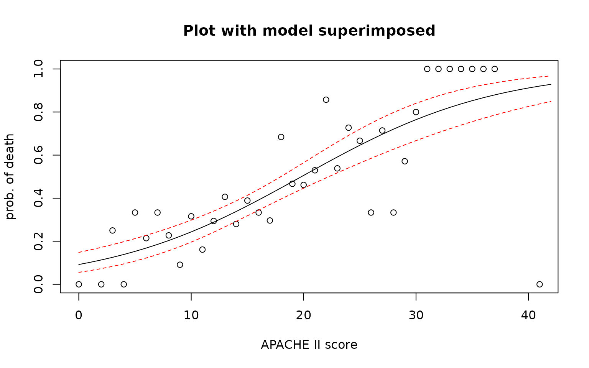

# Case Study 15.3: STATS 201/8 Extra Case Study - Binomial GLM - Grouped Data.

## Question 1

A study was carried out into the mortality of people who have sepsis.
Sepsis is a life-threatening condition that arises when the body’s
response to infection causes injury to its own tissues and organs. We
wish to see if their mortality increases depending on how healthy they
are when they are admitted to an intensive care unit (ICU). In order to
measure their health we will use a diagnostic measurement called APACHE
II.

APACHE II (“Acute Physiology And Chronic Health Evaluation II”) is a
severity-of-disease classification system (Knaus et al., 1985), one of
several ICU scoring systems. It is applied within 24 hours of admission
of a patient to an ICU. An integer score from 0 to 71 is computed based
on several measurements; higher scores correspond to more severe disease
and a higher risk of death.

A sample of septic patients admitted to ICU’s was analysed.

The resulting grouped data is stored in *Apache.csv* which contains the
following variables:

| Variable | Description |
|----|----|
| apache_score | The APACHE II score for patients in the group. |
| number_of_patients | The number of patients in the group. |
| deaths | The number of patients in the group who died within 30 days of being admitted to ICU. |

It was of interest to see how increasing APACHE II scores related to the
mortality rate. In particular, to assess the effect of a 1 point or 5
point difference in APACHE II scores and to estimate mortality rates for
APACHE II scores of 10, 20, 30 and 40.

**Instructions:**

- Comment on the plot of the data. (Some of the data is listed to help
  clarify the plot.)
- Fit an appropriate GLM model to the data. Generate appropriate
  confidence interval output for this model.
- Get intervals to predict the probability of a patient admitted to ICU
  dying with 30 days with APACHE II scores of 10, 20, 30 or 40.
- Write appropriate **Methods and Assumption Checks**.
- Write sentences, as if for an **Executive Summary**, interpreting your
  four prediction intervals.
- Write sentences, as if for an **Executive Summary**, quantifying the
  effect of a 1 point and 5 point increase in APPACHE II scores.
- Superimpose the model onto the original plot of the data, including
  confidence interval limits.

### Questions of Interest

It was of interest to see how increasing APACHE II scores related to the
mortality rate. In particular, to assess the effect of a 1 point or 5
point difference in APACHE II scores and to estimate mortality rates for
APACHE II scores of 10, 20, 30 and 40.

### Read in and inspect the data:

``` r

Apache.df = read.csv("Apache.csv", header = TRUE)
plot(deaths / number_of_patients ~ apache_score,
  ylab = "prob. of death",
  xlab = "APACHE II score", data = Apache.df
)
head(Apache.df)
tail(Apache.df, 10)
```


    ##   apache_score number_of_patients deaths
    ## 1            0                  1      0
    ## 2            2                  1      0
    ## 3            3                  4      1
    ## 4            4                 11      0
    ## 5            5                  9      3
    ## 6            6                 14      3

    ##    apache_score number_of_patients deaths
    ## 29           29                  7      4
    ## 30           30                  5      4
    ## 31           31                  3      3
    ## 32           32                  3      3
    ## 33           33                  1      1
    ## 34           34                  1      1
    ## 35           35                  1      1
    ## 36           36                  1      1
    ## 37           37                  1      1
    ## 38           41                  1      0

### Comment on plot.

The scatter plot clearly shows that the probability of death increase as
the APACHE II score increases. The patient with the highest APACHE II
score (41) survived, while all the patients with scores between 31 and
40 died.

### Fit an appropriate GLM:

``` r

fit = glm(I(deaths / number_of_patients) ~ apache_score, weights = number_of_patients, family = binomial, data = Apache.df)

plot(fit, which = 1)
```


``` r

p.value = 1 - pchisq(summary(fit)$deviance, summary(fit)$df.residual)
p.value
```

    ## [1] 0.1690227

``` r

summary(fit)
```

    ## 
    ## Call:
    ## glm(formula = I(deaths/number_of_patients) ~ apache_score, family = binomial, 
    ##     data = Apache.df, weights = number_of_patients)
    ## 
    ## Coefficients:
    ##              Estimate Std. Error z value Pr(>|z|)    
    ## (Intercept)   -2.2903     0.2765  -8.282  < 2e-16 ***
    ## apache_score   0.1156     0.0160   7.227 4.94e-13 ***
    ## ---
    ## Signif. codes:  0 '***' 0.001 '**' 0.01 '*' 0.05 '.' 0.1 ' ' 1
    ## 
    ## (Dispersion parameter for binomial family taken to be 1)
    ## 
    ##     Null deviance: 106.009  on 37  degrees of freedom
    ## Residual deviance:  43.999  on 36  degrees of freedom
    ## AIC: 125.87
    ## 
    ## Number of Fisher Scoring iterations: 4

``` r

confint(fit)
```

    ##                   2.5 %    97.5 %
    ## (Intercept)  -2.8487408 -1.763004
    ## apache_score  0.0850927  0.147920

``` r

exp(confint(fit))
```

    ##                  2.5 %    97.5 %
    ## (Intercept)  0.0579172 0.1715288
    ## apache_score 1.0888180 1.1594201

``` r

exp(confint(fit)[2, ])
```

    ##    2.5 %   97.5 % 
    ## 1.088818 1.159420

``` r

100 * (exp(confint(fit)[2, ]) - 1)
```

    ##     2.5 %    97.5 % 
    ##  8.881799 15.942008

``` r

exp(confint(fit)[2, ] * 5)
```

    ##    2.5 %   97.5 % 
    ## 1.530300 2.095097

``` r

100 * (exp(confint(fit)[2, ] * 5) - 1)
```

    ##     2.5 %    97.5 % 
    ##  53.02995 109.50968

### Get intervals to predict the probability of a patient admitted to ICU dying with 30 days with APACHE II scores of 10, 20, 30 or 40.

``` r

pred.df = data.frame(apache_score = c(10, 20, 30, 40))
predict20x(fit, newdata = pred.df)
```

    ##   Predicted  Conf.lower Conf.upper
    ## 1     0.243       0.196      0.298
    ## 2     0.506       0.446      0.565
    ## 3     0.765       0.667      0.840
    ## 4     0.912       0.826      0.957

### Method and Assumption Checks

We fitted a logistic regression to the APACHE II data as we had a binary
response variable (whether or not the patient died). We had one
explanatory variable, the APACHE II score, which was significant.

There was no evidence of overdispersion and the residual plot didn’t
reveal any major problems. (Observation 38 is unusual, but not too
extreme.)

The fitted model is approximately
$`\log(odds_i) = \beta_0 + \beta_1 \times apache_score_i`$

where the odds are the odds of a person in the i’th group with
$`apache_score_i`$ dying in the 30 days after being admitted to ICU.

### Write sentences, as if for an Executive Summary, interpret your four predictions intervals.

We estimate that the probability that a patient who was admitted to ICU
with sepsis dying within 30 days is:

- between 0.20 and 0.30 if their APACHE II score was 10.

- between 0.45 and 0.56 if their APACHE II score was 20.

- between 0.67 and 0.84 if their APACHE II score was 30.

- between 0.83 and 0.96 if their APACHE II score was 40.

### Write sentences, as if for an Executive Summary, quantifying the effect of a 1 point and 5 point increase in APPACHE II scores.

We estimate an increase in a typical patients APACHE II score by 1 point
is associated with increasing the odds of the patient dying in the next
30 days by between 9% and 16%.

We estimate an increase in a typical patients APACHE II score by 5
points is associated with increasing the odds of the patient dying in
the next 30 days by between 53% and 110%.

**Alternatively:**

We estimate an increase in a typical patients APACHE II score by 1 point
is associated with multiplying the odds of the patient dying in the next
30 days by between 1.09 and 1.16.

We estimate an increase in a typical patients APACHE II score by 5
points is associated with multiplying the odds of the patient dying in
the next 30 days by between 1.53 and 2.10.

### Superimpose the model onto the original plot of the data, including confidence interval limits.

``` r

# Create predictions for before over range 0-42.
pred2.df = data.frame(apache_score = seq(0, 42))
Preds = predict20x(fit, newdata = pred2.df, digits = 8, print.out = FALSE)$frame

# Redo plot from above and add curve to the data.
plot(deaths / number_of_patients ~ apache_score,
  ylab = "prob. of death", xlab = "APACHE II score",
  main = "Plot with model superimposed", data = Apache.df
)
lines(seq(0, 42), Preds[, 1])
lines(seq(0, 42), Preds[, 2], col = "Red", lty = 2)
lines(seq(0, 42), Preds[, 3], col = "Red", lty = 2)
```


