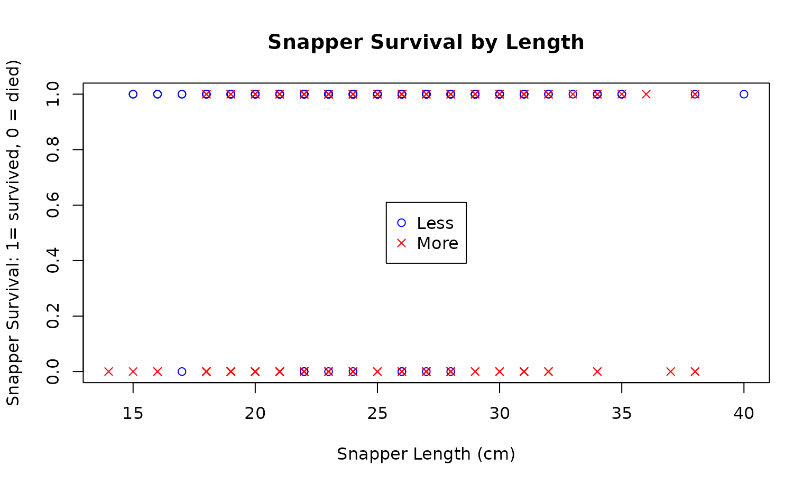
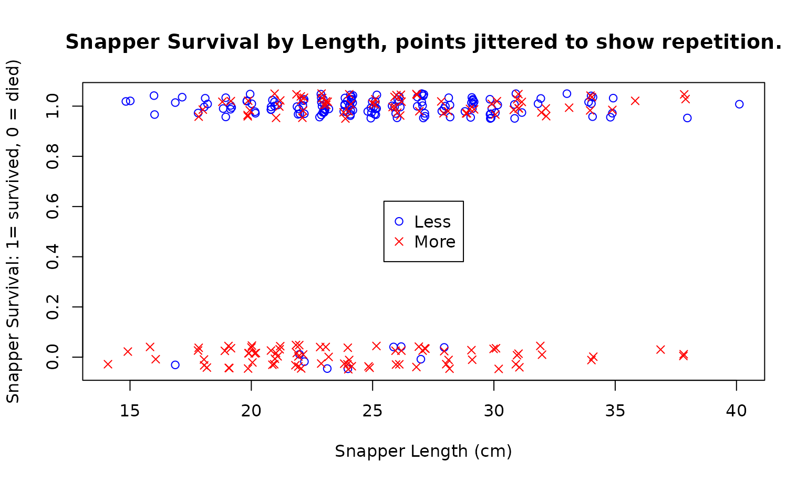
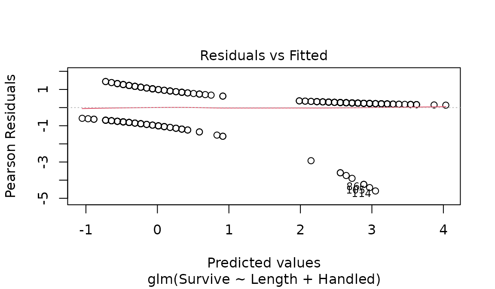

# Case Study 15.4: STATS 201/8 Extra Case Study - Binomial GLM - Binary Data.

## Question 1

Snapper (Pagrus auratus) are a fish that is heavily targeted by
recreational fishers in the Hauraki Gulf. The legal minimum landed size
is 30cm, and all snapper less than this size must be discarded (i.e.,
returned to the sea).

An experiment was undertaken to determine the survival of discarded
snapper. Snapper were caught by hook and line, measured for length, the
hook was removed, and all snapper were placed in holding tanks for 5
days. The handling time (the duration between the fish being brought to
the surface and being placed in a tank) was recorded as whether or not
it was 2 minutes or less.

The resulting binary data is stored in *Snapper.csv* which contains the
following variables:

| Variable | Description |
|----|----|
| Survive | Whether or not the snapper survived, coded as 1=alive after 5 days, 0=dead. |
| Length | The length of the snapper (cm). |
| Handled | The amount of time the snapper was handled (classified as either `Less` if 2 minutes or less, or `More` if more than 2 minutes). |

It is of interest to learn about the survival probability of discarded
snapper. In particular:

- It is of interest to learn how fish length and handling time affect
  survival and quantify any significant effects.
- Did any effect of the length of the fish on the survival time depend
  on the handling time?
- We also want to estimate the probability of a 25 cm long snapper
  surviving for both handling times of 2 minute or less and for more
  than 2 minutes.

**Instructions:**

- Comment on the plot of the data. (Some of the data is listed to help
  clarify the plot.)
- Fit a logistic regression model. Determine whether the model can be
  simplified and determine an appropriate final model.
- Estimate the survival probability of a 25 cm snapper for with handling
  times of both “Less” and “More”. (You do not need interval estimates.)
- Write appropriate **Methods and Assumption Checks**.
- Write an **Executive Summary**. Remember to answer all questions of
  interest.

### Questions of Interest

It is of interest to learn about the survival probability of discarded
snapper, in particular, how fish length and handling time affect
survival.

### Read in and inspect the data:

``` r

Snapper.df = read.csv("Snapper.csv", header = TRUE, stringsAsFactors = TRUE)
```

``` r

plot(Survive ~ Length,
  data = Snapper.df, ylab = 'Snapper Survival: 1= survived, 0 = died)',
  xlab = 'Snapper Length (cm)',
  main = "Snapper Survival by Length",
  pch = ifelse(Handled == 'Less', 1, 4),
  col = ifelse(Handled == 'Less', 'blue', 'Red')
)
legend('center', c('Less', 'More'), col = c("blue", "red"), pch = c(1, 4))
```



``` r

# Second plot where points in the dataset have had a jitter effect added (a small amount of
# random noise to shift them so you can see replications in a plot).
plot(jitter(Survive, 0.25) ~ jitter(Length, 1),
  data = Snapper.df,
  ylab = 'Snapper Survival: 1= survived, 0 = died)',
  xlab = 'Snapper Length (cm)',
  main = "Snapper Survival by Length, points jittered to show repetition.",
  pch = ifelse(Handled == 'Less', 1, 4),
  col = ifelse(Handled == 'Less', 'blue', 'Red')
)
legend('center', c('Less', 'More'), col = c("blue", "red"), pch = c(1, 4))
```



### Comment on plot.

Most of the 0’s (fish which didn’t survive) are for Snapper with more
time out of the water. Of the smaller number of fish with less time out
of water that didn’t survive, most tended to be smaller in length.

### Fit an appropriate GLM:

``` r

Surv.glm1 = glm(Survive ~ Length * Handled, family = binomial, data = Snapper.df)
summary(Surv.glm1)
```

    ## 
    ## Call:
    ## glm(formula = Survive ~ Length * Handled, family = binomial, 
    ##     data = Snapper.df)
    ## 
    ## Coefficients:
    ##                    Estimate Std. Error z value Pr(>|z|)  
    ## (Intercept)         1.21444    1.89483   0.641   0.5216  
    ## Length              0.06267    0.07775   0.806   0.4202  
    ## HandledMore        -3.49977    2.07667  -1.685   0.0919 .
    ## Length:HandledMore  0.02270    0.08448   0.269   0.7882  
    ## ---
    ## Signif. codes:  0 '***' 0.001 '**' 0.01 '*' 0.05 '.' 0.1 ' ' 1
    ## 
    ## (Dispersion parameter for binomial family taken to be 1)
    ## 
    ##     Null deviance: 364.81  on 299  degrees of freedom
    ## Residual deviance: 267.63  on 296  degrees of freedom
    ## AIC: 275.63
    ## 
    ## Number of Fisher Scoring iterations: 5

``` r

Surv.glm2 = glm(Survive ~ Length + Handled, family = binomial, data = Snapper.df)
plot(Surv.glm2, which = 1)
```



``` r

summary(Surv.glm2)
```

    ## 
    ## Call:
    ## glm(formula = Survive ~ Length + Handled, family = binomial, 
    ##     data = Snapper.df)
    ## 
    ## Coefficients:
    ##             Estimate Std. Error z value Pr(>|z|)    
    ## (Intercept)  0.75538    0.79689   0.948  0.34317    
    ## Length       0.08196    0.03039   2.697  0.00699 ** 
    ## HandledMore -2.95480    0.38649  -7.645 2.08e-14 ***
    ## ---
    ## Signif. codes:  0 '***' 0.001 '**' 0.01 '*' 0.05 '.' 0.1 ' ' 1
    ## 
    ## (Dispersion parameter for binomial family taken to be 1)
    ## 
    ##     Null deviance: 364.81  on 299  degrees of freedom
    ## Residual deviance: 267.70  on 297  degrees of freedom
    ## AIC: 273.7
    ## 
    ## Number of Fisher Scoring iterations: 5

``` r

confint(Surv.glm2)
```

    ##                   2.5 %     97.5 %
    ## (Intercept) -0.80535475  2.3307766
    ## Length       0.02360406  0.1431844
    ## HandledMore -3.77492291 -2.2450140

``` r

exp(confint(Surv.glm2))
```

    ##                  2.5 %     97.5 %
    ## (Intercept) 0.44692935 10.2859266
    ## Length      1.02388484  1.1539426
    ## HandledMore 0.02293886  0.1059261

``` r

100 * (exp(confint(Surv.glm2)) - 1)
```

    ##                  2.5 %    97.5 %
    ## (Intercept) -55.307065 928.59266
    ## Length        2.388484  15.39426
    ## HandledMore -97.706114 -89.40739

### Calculate survival probabilities for 25cm snapper with handling times of both “Less” and “More”.

``` r

Pred.df = data.frame(Length = c(25, 25), Handled = c("Less", "More"))
predict(Surv.glm2, newdata = Pred.df, type = "response")
```

    ##         1         2 
    ## 0.9429148 0.4624795

### Methods and Assumption Checks

Our response variable is a binary response variable - whether or not the
snapper survived. We have therefore fitted a generalised linear model
with a binomial response distribution (i.e. a logistic regression
model). We have two explanatory variables: Length (numeric) and Handled
(categoric). We want to know if any length effect depends on Handled so
have fitted a model with an interaction term. The interaction term is
not significant, so we have dropped this (P-value = 0.7882). Both the
explanatory variables were then found to be significant so the model was
not simplified any further. (Since we do not have grouped data the
deviance statistic is not checked.) The residuals do not reveal any
major issues.

Our model is
$`log(odds_i) = \beta_0 + \beta_1 \times Length_i + \beta_2 \times HandledMore_i`$.

Where $`odds_i`$ are the odds of the i’th snapper with combinations of
variables $`Length_i`$ and $`HandledMore_i`$ surviving.
$`HandledMore_i`$ is 1 if the time the snapper was out of the water was
more than 2 minutes and 0 otherwise.

### Executive Summary

It is of interest to learn how fish length and handling time affect
survival of snapper that are discarded after being caught and found to
be below the legal size limit. An experiment was conducted to gather
data on this.

Both snapper length and handling time are associated with the survival
probability of discarded snapper. However, there is no evidence that the
effect of length on survival differs depending on the handling time.

For the same handling time, we estimate that every 1 cm increase in
length of the Snapper increases the odds of survival by between 2.4 and
15.4 percent.

For the same length snapper, we estimate that having a handling time
greater than 2 minutes decreases the odds of survival by between 89 and
98 percent when compared to having a handling time of 2 minutes or less.

We estimate that the survival probability of 25 cm snapper is 94% if
handling time is 2 minutes or less. This drops to 46% if the handling
time is more than 2 minutes.
