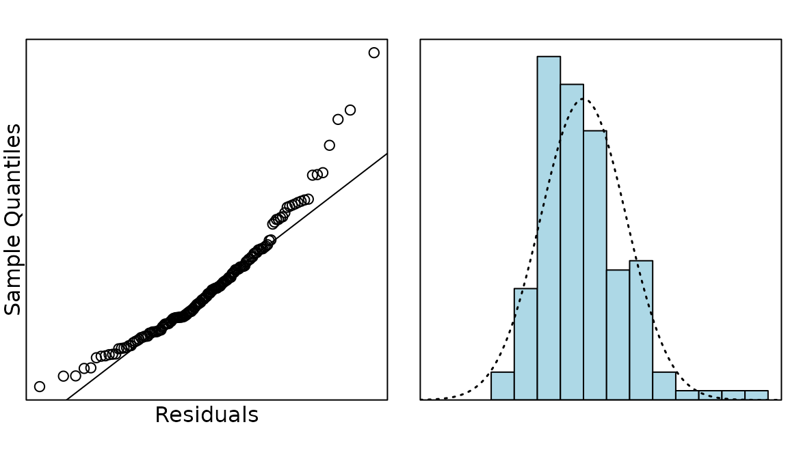
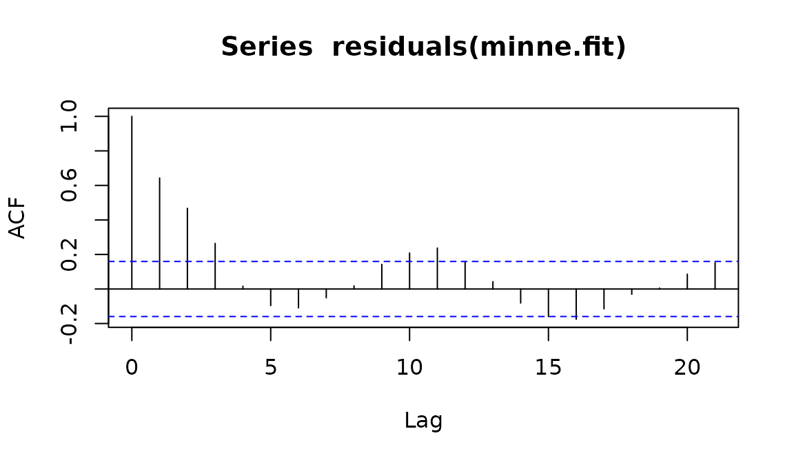
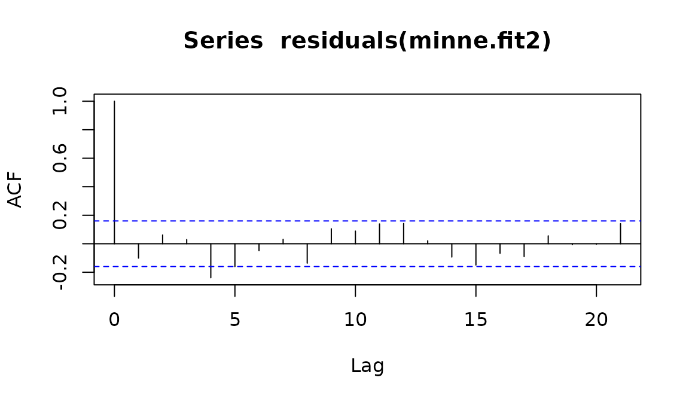
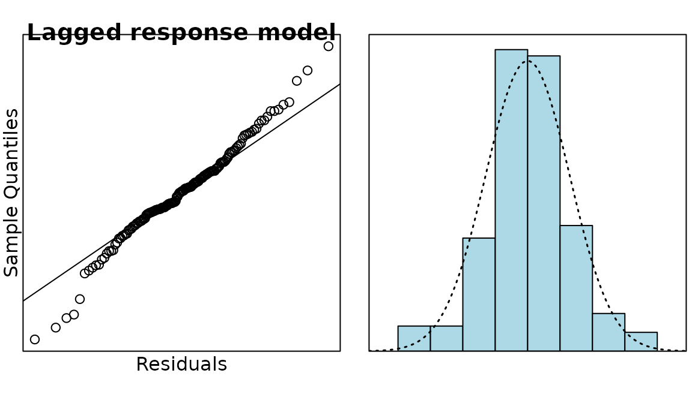

# Case Study 17.1: Additional Time Series Case Study A: Public Drunkenness Data

The data in this question comes from public records about the number of
people arrested for public drunkenness in Minneapolis, Minnesota in the
United States. The data was recorded monthly from January 1966 to June
1979. In 1973 Minnesota lowered the legal drinking age to 18, in line
with the 26th amendment to the US Constitution (in 1971) which lowered
the minimum voting age to 18.

The variables are:

| Variable | Description |
|----|----|
| `year` | the year the measurement was made, starting at 1966 and ending in 1978 |
| `month` | the month (1, …, 12) the measurement was made (1 = January, …) |
| `arrests` | the number of arrests made in a given month in a particular year |

``` r

## when you load data make sure it is in the Data directory
minne.df = read.csv("Data/minneapolis.csv")
```

``` r

minne.ts = ts(minne.df$arrests, start = c(1966, 1), frequency = 12)
plot(minne.ts, ylab = "Number of people arrested")
abline(v = c(1966:1979), lty = 2)
```


``` r

minne.stl = stl(minne.ts, s.window = "periodic")
plot(minne.stl)
abline(v = c(1966:1979), lty = 2)
```


``` r

minne.df = within(minne.df, {
  month = factor(c(rep(month.abb, 12), month.abb[1:7]),
    levels = month.abb
  );
  t = 1:151
  change = 1 * (t > 5 * 12)
})
```

``` r

minne.fit = lm(arrests ~ change + month + t, data = minne.df)
anova(minne.fit)
```

    ## Analysis of Variance Table
    ## 
    ## Response: arrests
    ##            Df  Sum Sq Mean Sq  F value    Pr(>F)    
    ## change      1 6733595 6733595 714.4931 < 2.2e-16 ***
    ## month      11  376067   34188   3.6276 0.0001605 ***
    ## t           1   59433   59433   6.3064 0.0131922 *  
    ## Residuals 137 1291129    9424                       
    ## ---
    ## Signif. codes:  0 '***' 0.001 '**' 0.01 '*' 0.05 '.' 0.1 ' ' 1

``` r

plot(residuals(minne.fit), type = "l")
```


``` r

library(s20x)
normcheck(minne.fit, xlab = "Residuals")
```



``` r

acf(residuals(minne.fit))
```



``` r

minne.fit1 = lm(arrests[-1] ~ change[-1] + month[-1] + arrests[-151]
  + t[-1], data = minne.df)

anova(minne.fit1)
```

    ## Analysis of Variance Table
    ## 
    ## Response: arrests[-1]
    ##                Df  Sum Sq Mean Sq   F value    Pr(>F)    
    ## change[-1]      1 6729621 6729621 1461.1695 < 2.2e-16 ***
    ## month[-1]      11  366252   33296    7.2293 1.331e-09 ***
    ## arrests[-151]   1  720893  720893  156.5240 < 2.2e-16 ***
    ## t[-1]           1    2549    2549    0.5535    0.4582    
    ## Residuals     135  621761    4606                        
    ## ---
    ## Signif. codes:  0 '***' 0.001 '**' 0.01 '*' 0.05 '.' 0.1 ' ' 1

``` r

minne.fit2 = lm(arrests[-1] ~ change[-1] + month[-1] + arrests[-151],
  data = minne.df
)
anova(minne.fit2)
```

    ## Analysis of Variance Table
    ## 
    ## Response: arrests[-1]
    ##                Df  Sum Sq Mean Sq   F value    Pr(>F)    
    ## change[-1]      1 6729621 6729621 1465.9819 < 2.2e-16 ***
    ## month[-1]      11  366252   33296    7.2531 1.194e-09 ***
    ## arrests[-151]   1  720893  720893  157.0395 < 2.2e-16 ***
    ## Residuals     136  624311    4591                        
    ## ---
    ## Signif. codes:  0 '***' 0.001 '**' 0.01 '*' 0.05 '.' 0.1 ' ' 1

``` r

acf(residuals(minne.fit2))
```



``` r

summary(minne.fit2)
```

    ## 
    ## Call:
    ## lm(formula = arrests[-1] ~ change[-1] + month[-1] + arrests[-151], 
    ##     data = minne.df)
    ## 
    ## Residuals:
    ##      Min       1Q   Median       3Q      Max 
    ## -199.806  -34.076    1.376   33.831  198.492 
    ## 
    ## Coefficients:
    ##                 Estimate Std. Error t value Pr(>|t|)    
    ## (Intercept)    164.62960   40.96402   4.019 9.64e-05 ***
    ## change[-1]    -115.48358   27.83543  -4.149 5.86e-05 ***
    ## month[-1]Feb    -4.01749   27.12955  -0.148   0.8825    
    ## month[-1]Mar    64.47022   27.12946   2.376   0.0189 *  
    ## month[-1]Apr    53.13523   27.41105   1.938   0.0546 .  
    ## month[-1]May    30.74339   27.82829   1.105   0.2712    
    ## month[-1]Jun    -6.45317   27.91054  -0.231   0.8175    
    ## month[-1]Jul    38.62951   27.52457   1.403   0.1628    
    ## month[-1]Aug    24.63299   28.19479   0.874   0.3838    
    ## month[-1]Sep   -19.94512   28.23742  -0.706   0.4812    
    ## month[-1]Oct    -2.24227   27.85589  -0.080   0.9360    
    ## month[-1]Nov   -49.03804   27.78048  -1.765   0.0798 .  
    ## month[-1]Dec   -29.03304   27.69039  -1.048   0.2963    
    ## arrests[-151]    0.73194    0.05841  12.532  < 2e-16 ***
    ## ---
    ## Signif. codes:  0 '***' 0.001 '**' 0.01 '*' 0.05 '.' 0.1 ' ' 1
    ## 
    ## Residual standard error: 67.75 on 136 degrees of freedom
    ## Multiple R-squared:  0.926,  Adjusted R-squared:  0.919 
    ## F-statistic:   131 on 13 and 136 DF,  p-value: < 2.2e-16

``` r

plot(residuals(minne.fit2), type = "l")
```


``` r

normcheck(minne.fit2, main = "Lagged response model", xlab = "Residuals")
```



### Question

What is the most important feature of the time series plot at the start
of this analysis?

### Solution

The large drop in the trend in 1971-2. This was around when the law was
being proposed to lower the drinking age to 18, so shows the effects of
the legislation.

### Question

Looking at the Seasonal Trend Lowess (STL) plot, do you think there is
evidence of seasonality in this time series.

### Solution

There is evidence of a seasonal trend, with the number of arrests being
higher in summer and lower in winter. However, the seasonal effects are
more pronounced in the first part of the time series and are not at all
apparent after 1974. (This could be due to the number of underage people
being arrested for drinking during summer and spring breaks that were no
longer underage after the drinking age was lowered.)

### Question

What is the variable `change`? What is it being used to test?

### Solution

`change` is is a binary variable that is 0 for the first 5 years (60
months) and 1 for the rest of the time series. It is being used to
measure the change between the number of arrests before and after the
law was passed.

### Question

Discuss the reasoning behind changing between models `minne.fit`,
`minne.fit1` and `minne.fit2`.

### Solution

The ACF plot of the residuals for `minne.fit` had many bars outside the
dotted lines, revealing the presence of autocorrelation, so an
autocorrelation term was added to create `minne.fit1`. In `minne.fit1`
the variable `t` was found to be non-significant, so it was dropped to
give `minne.fit2`.

### Question

Did time end up being related to the number of arrests? If not, justify
your answer. If so, in what ways was it related?

### Solution

Time was related to the number of arrests, even though the variable t
was dropped from the model. Time was included in the model as:

- **change**: this measured the effect of the change in time from the
  first 5 years.
- **month**: this measured the seasonal effect of time.
- **lagged arrests**: this was an autocorrelation term that used the
  previous result  
  to predict the next value, thus taking time into account.
