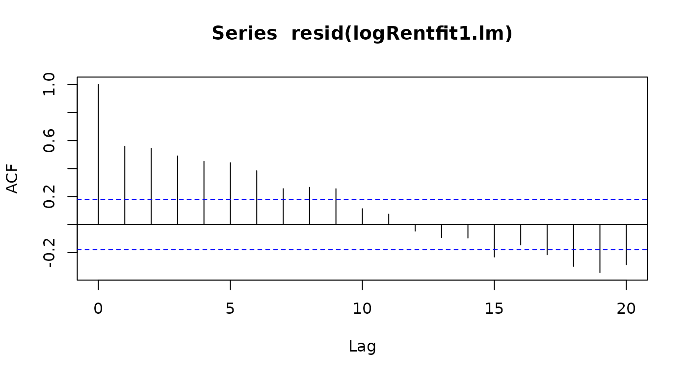
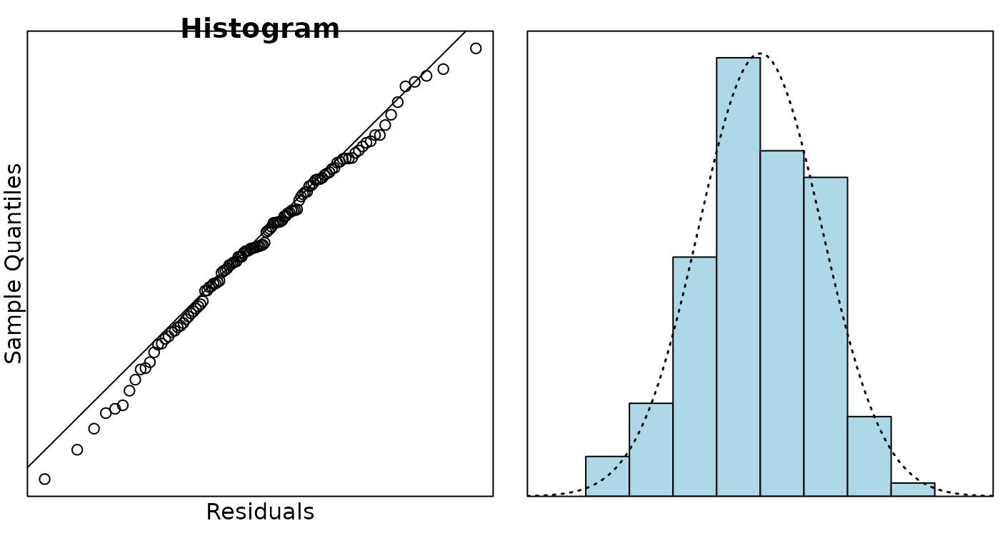

# Case Study 17.3: Additional Time Series Case Study C: Auckland Rental Data

Dataframe `AkldRent` contains the average weekly rents in Auckland, by
month from January 2006 to November 2015. (Data courtesy of the Ministry
of Business, Innovation and Enterprise, and are compiled from rental
bonds lodged by landlords.)

It is of particular interest to describe the overall trend in rents, and
to see whether it broadly follows the same trend in Auckland houses
prices - house prices in Auckland peaked in late 2007, then dropped
slightly and began rising again in late 2011.

The variables are:

| Variable | Description                          |
|----------|--------------------------------------|
| `Month`  | month of the year                    |
| `Rent`   | average weekly rent in Auckland (\$) |

``` r

Rent.ts = ts(AkldRent$Rent, frequency = 12, start = c(2006, 1))
plot(log(Rent.ts), main = "Average log-weekly rent in Auckland")
abline(v = c(2006:2016), lty = 2)
```


``` r

logRent.stl = stl(log(Rent.ts), s.window = "periodic")
plot(logRent.stl)
abline(v = c(2006:2016), lty = 2)
```


``` r

head(logRent.stl$time.series, 13)
```

    ##               seasonal    trend     remainder
    ## Jan 2006 -8.003817e-03 5.859849  0.0092777257
    ## Feb 2006  4.221416e-03 5.862638  0.0009009141
    ## Mar 2006 -1.278855e-02 5.865426  0.0017852545
    ## Apr 2006 -4.236588e-03 5.868391  0.0148784430
    ## May 2006  1.458487e-02 5.871356 -0.0205386655
    ## Jun 2006  1.244522e-02 5.874420 -0.0065911247
    ## Jul 2006  2.864471e-03 5.877483 -0.0090088960
    ## Aug 2006 -3.324272e-03 5.880578 -0.0001047001
    ## Sep 2006 -2.210474e-03 5.883674 -0.0059652020
    ## Oct 2006 -4.873515e-03 5.887571  0.0048990552
    ## Nov 2006  1.239582e-03 5.891469  0.0001457731
    ## Dec 2006  8.165459e-05 5.896188 -0.0017611381
    ## Jan 2007 -8.003817e-03 5.900907 -0.0052376069

``` r

logRent.hw = HoltWinters(log(Rent.ts))
predict(logRent.hw, n.ahead = 6, prediction.interval = TRUE)
```

    ##               fit      upr      lwr
    ## Dec 2015 6.252607 6.282249 6.222966
    ## Jan 2016 6.248644 6.280201 6.217087
    ## Feb 2016 6.266879 6.300755 6.233003
    ## Mar 2016 6.260274 6.296856 6.223691
    ## Apr 2016 6.267631 6.307283 6.227979
    ## May 2016 6.290621 6.333680 6.247561

``` r

n = nrow(AkldRent)
time.pt = seq(2006 + 1 / 12, 2015 + 11 / 12, 1 / 12)
time.pt
```

    ##   [1] 2006.083 2006.167 2006.250 2006.333 2006.417 2006.500 2006.583 2006.667
    ##   [9] 2006.750 2006.833 2006.917 2007.000 2007.083 2007.167 2007.250 2007.333
    ##  [17] 2007.417 2007.500 2007.583 2007.667 2007.750 2007.833 2007.917 2008.000
    ##  [25] 2008.083 2008.167 2008.250 2008.333 2008.417 2008.500 2008.583 2008.667
    ##  [33] 2008.750 2008.833 2008.917 2009.000 2009.083 2009.167 2009.250 2009.333
    ##  [41] 2009.417 2009.500 2009.583 2009.667 2009.750 2009.833 2009.917 2010.000
    ##  [49] 2010.083 2010.167 2010.250 2010.333 2010.417 2010.500 2010.583 2010.667
    ##  [57] 2010.750 2010.833 2010.917 2011.000 2011.083 2011.167 2011.250 2011.333
    ##  [65] 2011.417 2011.500 2011.583 2011.667 2011.750 2011.833 2011.917 2012.000
    ##  [73] 2012.083 2012.167 2012.250 2012.333 2012.417 2012.500 2012.583 2012.667
    ##  [81] 2012.750 2012.833 2012.917 2013.000 2013.083 2013.167 2013.250 2013.333
    ##  [89] 2013.417 2013.500 2013.583 2013.667 2013.750 2013.833 2013.917 2014.000
    ##  [97] 2014.083 2014.167 2014.250 2014.333 2014.417 2014.500 2014.583 2014.667
    ## [105] 2014.750 2014.833 2014.917 2015.000 2015.083 2015.167 2015.250 2015.333
    ## [113] 2015.417 2015.500 2015.583 2015.667 2015.750 2015.833 2015.917

``` r

months = factor(rep(month.abb, 10))[1:n]
months = factor(months, levels = month.abb)
months
```

    ##   [1] Jan Feb Mar Apr May Jun Jul Aug Sep Oct Nov Dec Jan Feb Mar Apr May Jun
    ##  [19] Jul Aug Sep Oct Nov Dec Jan Feb Mar Apr May Jun Jul Aug Sep Oct Nov Dec
    ##  [37] Jan Feb Mar Apr May Jun Jul Aug Sep Oct Nov Dec Jan Feb Mar Apr May Jun
    ##  [55] Jul Aug Sep Oct Nov Dec Jan Feb Mar Apr May Jun Jul Aug Sep Oct Nov Dec
    ##  [73] Jan Feb Mar Apr May Jun Jul Aug Sep Oct Nov Dec Jan Feb Mar Apr May Jun
    ##  [91] Jul Aug Sep Oct Nov Dec Jan Feb Mar Apr May Jun Jul Aug Sep Oct Nov Dec
    ## [109] Jan Feb Mar Apr May Jun Jul Aug Sep Oct Nov
    ## Levels: Jan Feb Mar Apr May Jun Jul Aug Sep Oct Nov Dec

``` r

logRent = log(AkldRent$Rent)
logRentfit1.lm = lm(logRent ~ time.pt + +months)
acf(resid(logRentfit1.lm))
```



``` r

logRentfit2.lm = lm(logRent[-1] ~ time.pt[-1] + logRent[-n] + months[-1])
acf(resid(logRentfit2.lm))
```


``` r

library(s20x)
plot(residuals(logRentfit2.lm), type = "l")
```


``` r

normcheck(logRentfit2.lm, main = "Histogram", xlab = "Residuals")
```



``` r

summary(logRentfit2.lm)
```

    ## 
    ## Call:
    ## lm(formula = logRent[-1] ~ time.pt[-1] + logRent[-n] + months[-1])
    ## 
    ## Residuals:
    ##       Min        1Q    Median        3Q       Max 
    ## -0.039614 -0.007999 -0.000426  0.010460  0.032691 
    ## 
    ## Coefficients:
    ##                 Estimate Std. Error t value Pr(>|t|)    
    ## (Intercept)   -28.604938   5.475928  -5.224 9.06e-07 ***
    ## time.pt[-1]     0.015510   0.002965   5.232 8.75e-07 ***
    ## logRent[-n]     0.571065   0.081661   6.993 2.68e-10 ***
    ## months[-1]Feb   0.017008   0.006909   2.462 0.015464 *  
    ## months[-1]Mar  -0.006848   0.006899  -0.993 0.323194    
    ## months[-1]Apr   0.011039   0.006942   1.590 0.114860    
    ## months[-1]May   0.024891   0.006886   3.615 0.000465 ***
    ## months[-1]Jun   0.011724   0.007004   1.674 0.097154 .  
    ## months[-1]Jul   0.003196   0.006969   0.459 0.647441    
    ## months[-1]Aug   0.002554   0.006888   0.371 0.711583    
    ## months[-1]Sep   0.007137   0.006886   1.036 0.302382    
    ## months[-1]Oct   0.004328   0.006885   0.629 0.530912    
    ## months[-1]Nov   0.012136   0.006892   1.761 0.081190 .  
    ## months[-1]Dec   0.007565   0.007061   1.071 0.286449    
    ## ---
    ## Signif. codes:  0 '***' 0.001 '**' 0.01 '*' 0.05 '.' 0.1 ' ' 1
    ## 
    ## Residual standard error: 0.01498 on 104 degrees of freedom
    ## Multiple R-squared:  0.9816, Adjusted R-squared:  0.9793 
    ## F-statistic: 427.1 on 13 and 104 DF,  p-value: < 2.2e-16

``` r

anova(logRentfit2.lm)
```

    ## Analysis of Variance Table
    ## 
    ## Response: logRent[-1]
    ##              Df  Sum Sq Mean Sq   F value    Pr(>F)    
    ## time.pt[-1]   1 1.22793 1.22793 5473.6338 < 2.2e-16 ***
    ## logRent[-n]   1 0.01041 0.01041   46.4234 6.372e-10 ***
    ## months[-1]   11 0.00735 0.00067    2.9803  0.001773 ** 
    ## Residuals   104 0.02333 0.00022                        
    ## ---
    ## Signif. codes:  0 '***' 0.001 '**' 0.01 '*' 0.05 '.' 0.1 ' ' 1

### Question

We have analysed log rents instead of rents. The initial analysis of the
raw data has been omitted from the appendix. What aspects of this data
do you think leads to a log model being more appropriate?

### Solution

It would be natural to expect that higher rents would be associated with
more variability and greater seasonal effects so a log model would be
more appropriate. Also, any effects of inflation tend to be percentage
changes which suggests a multiplicative model, hence a log model.

### Question

Comment on the STL decomposition plot, paying particular attention to
address the comparison with house price trends stated in the
introduction to the data.

### Solution

We can see a steady linear increase in rental price, except from 2008 to
2010 where the trend flattens out. This seems to have followed on from
the pattern in house prices, but not quite as extreme - taking a few
more months for the effect to kick in and the recovery happening a few
months earlier. There is a seasonal pattern, but it is not very large
relative to the trend (looking at the scale of the plots). The trend
isn’t consistent every year, but does suggest there can be a drop in
rents in March followed by a rise around May.

### Question

Using the Holt-Winters model, provide a 95% prediction interval for the
average weekly rent in Auckland in Feb 2016.

### Solution

exp(6.300755) = 544.98, exp(6.233003) = 509.28. We predict that the
average weekly rent in Auckland in Feb 2016 is somewhere between \$509
and \$545.

### Question

Usually we code the variable time as an integer from 1 for the first
observation and then increasing by 1 for each consecutive observation.
How have we coded `time.pt` in the regression model?

### Solution

We have coded time from 2006.083 to 2015.917. The integer part of this
represents the year and the decimal part of this represent the month,
being a fraction out of 12 corresponding to the number of the month. So
2010.417 is the year 2010 and month is 0.417 $`\times`$ 12 = 5 so May.

### Question

What does the variable `logRent[-n]` fitted in model `logRentfit2`
represent and why did we add it to the model?

{} The variable `logRent[-n]` fitted in model `logRentfit2` is the
lagged values of `logRent` and represents the autocorrelation term in
the model. This uses the previous `logRent` value to predict the next
`logRent` value to allow for the autocorrelation. An autocorrelation
term was added as the acf plot showed clear signs of positive
autocorrelation. Many of the vertical lines are greatly exceeding the
dotted line. After adding a term for autocorrelation to the model, this
is much improved.
