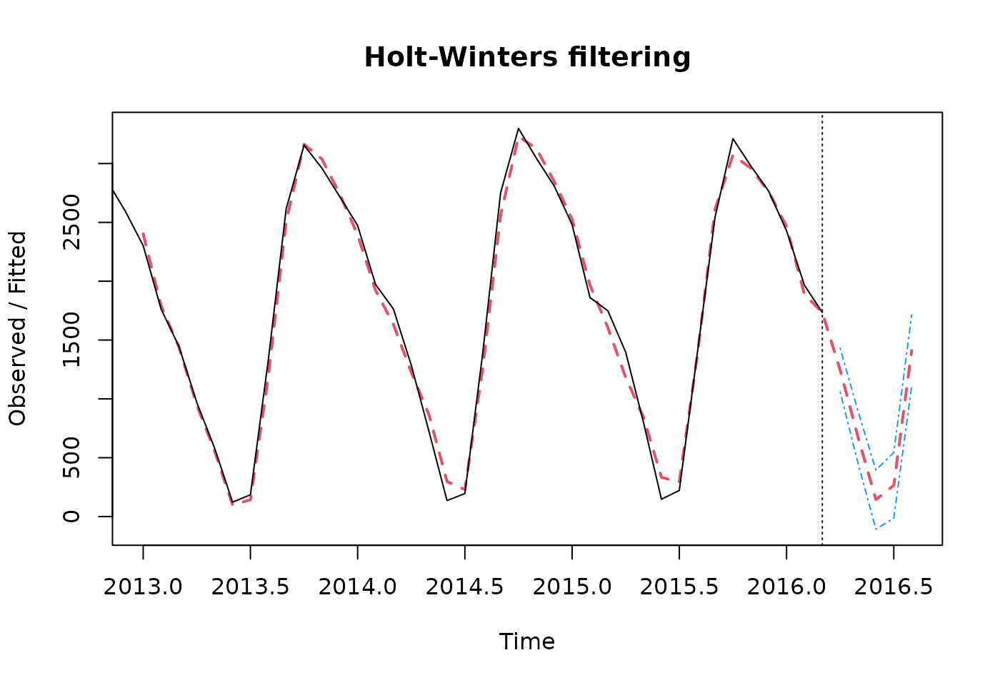
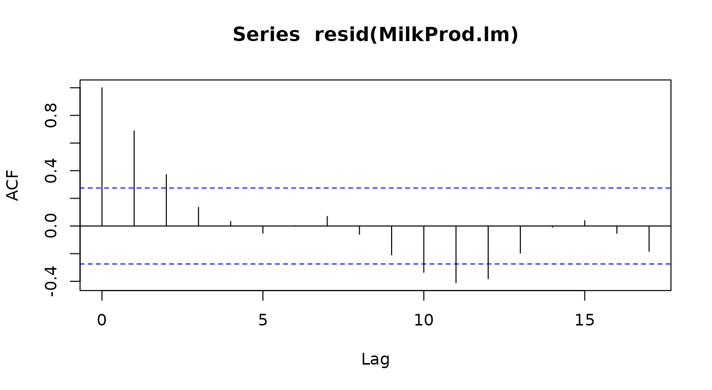
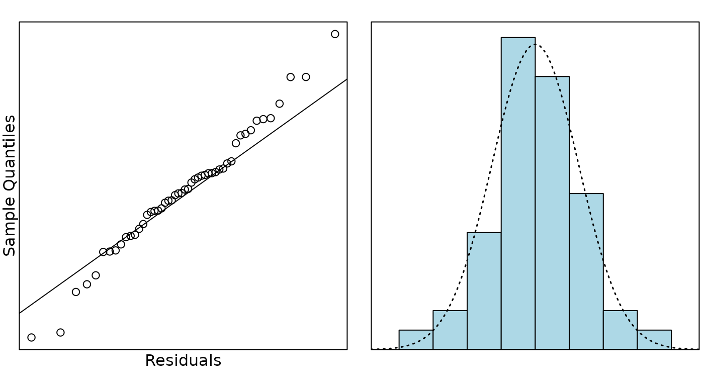

# Case Study 17.4: Additional Time Series Case Study D: Milk Production Data

The data in this question refers to the average monthly production of
milk in New Zealand (in 1000s of tonnes) from January 2012 until March
2016. (Data courtesy of the Dairy Company Association of New Zealand.)

It is of particular interest to describe the overall trend in
production, and, in particular, how it changes from month to month.
Dairy farmers typically do not milk their herds in the late autumn and
earlier winter months with the the traditional \`flush’ of production
occuring in the spring months.

The variables are:

| Variable     | Description            |
|--------------|------------------------|
| `year`       | the year of production |
| `month`      | month of the year      |
| `production` | in 1000s of tonnes     |

``` r

MilkProd.ts = ts(MilkProd.df$production, frequency = 12, start = c(2012, 1))
plot(MilkProd.ts, main = "Milk productions in 1000s tonnes")
abline(v = c(2012:2015), lty = 2)
```


``` r

MilkProd.stl = stl(MilkProd.ts, s.window = "periodic")
plot(MilkProd.stl)
abline(v = c(2012:2015), lty = 2)
```


``` r

head(MilkProd.stl$time.series, 13)
```

    ##             seasonal    trend   remainder
    ## Jan 2012   617.08327 1790.080 -199.163163
    ## Feb 2012   127.59824 1776.788  -30.386627
    ## Mar 2012   -72.48669 1763.497   45.989812
    ## Apr 2012  -466.44590 1749.903  195.543153
    ## May 2012 -1024.59084 1736.309   90.282220
    ## Jun 2012 -1616.06399 1723.367   23.697036
    ## Jul 2012 -1552.03718 1710.425   36.611912
    ## Aug 2012  -424.13555 1696.483  -54.347749
    ## Sep 2012   831.51611 1682.541  -78.057430
    ## Oct 2012  1409.61059 1661.207  -76.817840
    ## Nov 2012  1203.20508 1639.873    4.921737
    ## Dec 2012   966.74691 1630.345   -2.091944
    ## Jan 2013   617.08327 1620.817   64.099843

``` r

MilkProd.hw = HoltWinters(MilkProd.ts)
preds.hw = predict(MilkProd.hw, n.ahead = 5, prediction.interval = TRUE)
preds.hw
```

    ##                fit       upr        lwr
    ## Apr 2016 1244.4407 1430.8911 1057.99038
    ## May 2016  673.7034  895.0975  452.30934
    ## Jun 2016  143.6157  395.1449 -107.91344
    ## Jul 2016  265.3632  543.7847  -13.05828
    ## Aug 2016 1411.0278 1713.9636 1108.09194

``` r

plot(MilkProd.hw, preds.hw, lty.predicted = 2, lty.interval = 4, lwd = 2)
```



``` r

MilkProd.df = within(MilkProd.df, {
  time = 1:nrow(MilkProd.df);month.fac = factor(month)
})
```

``` r

MilkProd.lm = lm(production ~ time + month.fac, data = MilkProd.df)
acf(resid(MilkProd.lm))
```



``` r

# start from observation 2
MilkProd2.df = MilkProd.df[-1, ]
# put the past month as an explanatory variable
MilkProd2.df = within(MilkProd2.df, {
  past.prod = MilkProd.df$production[-51]
})
MilkProd.lm2 = lm(production ~ time + past.prod + month.fac, data = MilkProd2.df)
```

``` r

plot(residuals(MilkProd.lm2), type = "l")
```


``` r

library(s20x)
normcheck(MilkProd.lm2, main = "", xlab = "Residuals")
```



``` r

summary(MilkProd.lm2)
```

    ## 
    ## Call:
    ## lm(formula = production ~ time + past.prod + month.fac, data = MilkProd2.df)
    ## 
    ## Residuals:
    ##      Min       1Q   Median       3Q      Max 
    ## -152.489  -37.881    0.075   27.728  164.041 
    ## 
    ## Coefficients:
    ##              Estimate Std. Error t value Pr(>|t|)    
    ## (Intercept)  521.4644   310.5383   1.679 0.101768    
    ## time           0.6282     0.8300   0.757 0.454032    
    ## past.prod      0.6908     0.1172   5.892 9.69e-07 ***
    ## month.fac2  -293.0884    63.0254  -4.650 4.35e-05 ***
    ## month.fac3  -156.0944   108.4736  -1.439 0.158787    
    ## month.fac4  -408.8582   130.6755  -3.129 0.003470 ** 
    ## month.fac5  -697.7288   173.9354  -4.011 0.000292 ***
    ## month.fac6  -902.8208   237.4975  -3.801 0.000536 ***
    ## month.fac7  -430.4813   305.7098  -1.408 0.167668    
    ## month.fac8   653.8187   298.5372   2.190 0.035080 *  
    ## month.fac9  1130.3882   170.0994   6.645 9.62e-08 ***
    ## month.fac10  838.9638    54.6090  15.363  < 2e-16 ***
    ## month.fac11  232.5797    74.4520   3.124 0.003516 ** 
    ## month.fac12  137.8422    59.6143   2.312 0.026596 *  
    ## ---
    ## Signif. codes:  0 '***' 0.001 '**' 0.01 '*' 0.05 '.' 0.1 ' ' 1
    ## 
    ## Residual standard error: 74.32 on 36 degrees of freedom
    ## Multiple R-squared:  0.9959, Adjusted R-squared:  0.9944 
    ## F-statistic:   675 on 13 and 36 DF,  p-value: < 2.2e-16

### Question

Comment on the STL decomposition plot, paying particular attention to
the comparison with the milk production trends stated in the
introduction to the data.

### Solution

The original data has clear seasonality with, perhaps, a slight increase
over time. The seasonal component explains most of these data.The
seasonal component shows high milk production in August - November and
lowest in April - July so this is consistent with low production in late
autumn/early winter and high production in spring.

There may have been a very slight drop in production in 2013 (drought?)
with an increase to regular levels afterwards but this effect is very
slight. There remainder (residuals) seem to indicate a high degree of
auto correlation (clustering of positive and negative residuals).

### Question

Using the Holt-Winters model, provide a 95% prediction interval for the
average milk production for the month of April in 2016.

### Solution

The Holt-Winters model predicts that, with 95% confidence, the average
milk production for the month of April, 2016 would be about 1244
thousand tonnes and could be between 1058 to 1431 thousand tonnes.

### Question

Which of the four components of times series; trend, cycle, seasonality
and error, contributes most to describing what you observe for these
data?

### Solution

These data appear to be mostly explained by seasonal (monthly) effect
reflecting the very seasonal nature of dairy production with high
spending production and slight (or no) production in winter. Any trend
effect seems very slight.

Note: Looking at the stl plot, the range of the seasonal variation is
from -1500 to 1000, so 2500. The range of the trend is just 1650 to
1750, so only 100 - half of that of the remainders which estimate
errors. There is too little data to see any sign of a cycle. Seasonality
dominates this data.

### Question

In most time series analysis we commonly encounter a lack of
independence between consecutive residuals (i.e. auto-correlation).

- What would an auto-correlation of zero indicate?
- What would an auto-correlation of one indicate?
- What is the estimate of the auto-correlation for these data?
- Is there any evidence that the auto-correlation is different from the
  value zero?

### Solution

An auto-correlation of zero would indicate errors are independent each
other over time - the near past has no bearing on the future errors. I.e
the usual independence assumption for the linear model.

An auto-correlation of one would indicate total dependence over time -
i.e. there is no error (except for the first observation). Every
observation depends on the previous observation.

The estimate of the autocorrelation is 0.6908 (from `MilkProd.lm2`
output) or about 0.7 from ACF plot.

The autocorrelation is highly significant (from `MilkProd.lm2` the
P-value = 9.769e-06) or P-value $`<`$ .05 from ACF plot as the first
lagged correlation above 5% threshold line.
