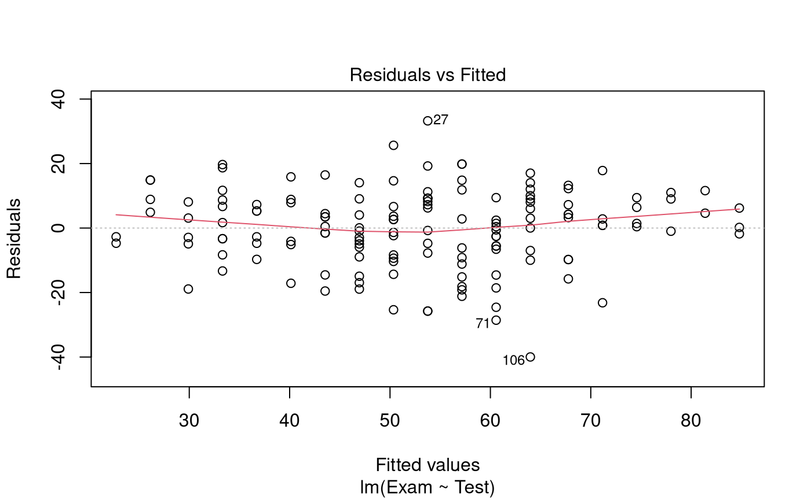

# Case Study 2.1: Exam vs Test

## Problem

We wish to quantify the relationship between test mark and exam mark,
especially for the purpose of being able to predict a student’s exam
mark with their test mark (to aid in making decisions about aegrotat
passes for students who do not sit the exam). In particular, we want to
predict a student’s exam mark when their test mark is either 0, 10, or
20.

The variables of interest are:

- `Exam`: Exam mark out of 100.
- `Test`: Test mark out of 20.

### Question of Interest

We want to build a model to predict exam marks with test marks. In
particular, we want to predict a student’s exam mark when their test
mark is either 0, 10, or 20.

### Read in and Inspect the Data

``` r

Stats20x.df = read.table("STATS20x.txt", header = TRUE)
plot(Exam ~ Test, data = Stats20x.df)
```


The plot reveals a positive linear relationship between exam marks and
test marks.

### Model Building and Check Assumptions

``` r

examTest.fit = lm(Exam ~ Test, data = Stats20x.df)
plot(examTest.fit, which = 1)
```



``` r

normcheck(examTest.fit)
```


``` r

cooks20x(examTest.fit)
```


``` r

summary(examTest.fit)
```

    ## 
    ## Call:
    ## lm(formula = Exam ~ Test, data = Stats20x.df)
    ## 
    ## Residuals:
    ##     Min      1Q  Median      3Q     Max 
    ## -39.980  -6.471   0.826   8.575  33.242 
    ## 
    ## Coefficients:
    ##             Estimate Std. Error t value Pr(>|t|)    
    ## (Intercept)   9.0845     3.2204   2.821  0.00547 ** 
    ## Test          3.7859     0.2647  14.301  < 2e-16 ***
    ## ---
    ## Signif. codes:  0 '***' 0.001 '**' 0.01 '*' 0.05 '.' 0.1 ' ' 1
    ## 
    ## Residual standard error: 12.05 on 144 degrees of freedom
    ## Multiple R-squared:  0.5868, Adjusted R-squared:  0.5839 
    ## F-statistic: 204.5 on 1 and 144 DF,  p-value: < 2.2e-16

``` r

confint(examTest.fit)
```

    ##                2.5 %    97.5 %
    ## (Intercept) 2.719020 15.449907
    ## Test        3.262659  4.309189

### Prediction Output

``` r

predTest.df = data.frame(Test = c(0, 10, 20))
predict(examTest.fit, predTest.df, interval = "prediction")
```

    ##         fit       lwr       upr
    ## 1  9.084463 -15.56475  33.73368
    ## 2 46.943703  23.03510  70.85231
    ## 3 84.802942  60.50438 109.10151

## Method and Assumption Checks

A scatter plot of exam marks vs test marks showed a linear association
with approximately constant scatter and so a linear model was fitted.

All model assumptions appear to be satisfied - a slight trend in the
residual plot was observed but does not seem to be of major concern.

Our final model is
``` math
Exam_i=\beta_0 +\beta_1\times Test_i+\epsilon_i,
```
where $`\epsilon_i \sim iid~N(0,\sigma^2)`$.

Our model explained a modest 59% of the variability in the students’
final exam marks.

## Executive Summary

We were interested in building a model to predict exam mark from test
mark.

There was a significant linear relationship between test mark and exam
mark (*P-value* $`\approx`$ 0). We estimate that each additional test
mark (out of 20) obtained by the student would increase their exam mark
by between 3.3 to 4.3 (out of 100) on average.

For test marks of 0, 10 and 20, we predict exam marks (for individual
students) between -15.6 to 33.7, 23.0 to 70.9, and 60.5 to 109.1,
respectively. These intervals are very wide and some of these intervals
have bounds that are outside of the feasible values of exam mark
(0-100). The model is not reliable for prediction.
