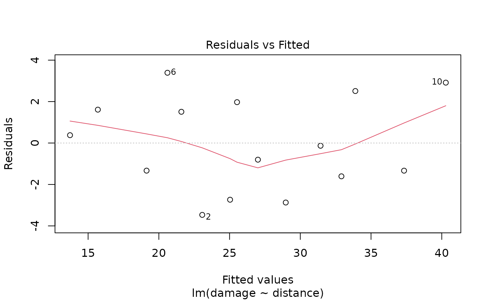
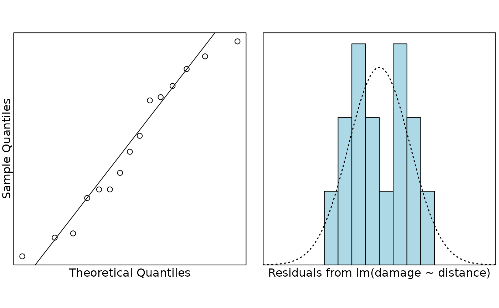

# Case Study 2.2: Fire Damage

## Problem

An insurance company wants to predict the repair cost of damage (in
\$000’s) to a house in a particular area if a fire occurs. The damage,
and distance from the fire station were recorded for a random sample of
15 house fires in the area of interest. They were also particularly
interested in predicting the repair cost of fire damage to a randomly
chosen house at distances of 1 and 4 miles from the fire station.

The variables measured were:

- `damage`: repair cost of damage (in \$000’s)
- `distance`: distance from the fire station (in miles)

## Question of interest/goal of the study

We were interested in predicting the cost of damage caused to houses by
fires depending on how far away they are from the nearest fire station.
In particular, we want to predict the cost of damage to individual
randomly chosen houses that are 1 and 4 miles from the fire station.

## Read in and inspect the data:

``` r

# import the data
fire.df = read.table("fire.txt", header = TRUE)
plot(damage ~ distance, main = "Cost of damage versus distance", data = fire.df)
```

 \# Comment on the
plot

There is, not surprisingly, an increasing trend with the distance from
the fire station and the cost of fire damage suffered by the house. The
trend looks reasonably linear and the variability around this trend
looks reasonably constant.

## Fit model and check assumptions

``` r

# fit the model
fire.fit <- lm(damage ~ distance, data = fire.df)

# Assumption checks
plot(fire.fit, which = 1)
```



``` r

normcheck(fire.fit)
```



``` r

cooks20x(fire.fit)
```


Observation 10 exceeds the Cook’s distance threshold of 0.4. However,
from the fitted vs residuals plot we see that this point is not at all
anomalous – it is influential because it is the house that is furtherest
from the fire station (i.e., has an “extreme” value for the explanatory
variable). Moreover, there are only 15 observations, so it is not
surprising that a single point could be influential. There is no reason
to remove this point.

``` r

# Get summary output and confidence intervals
summary(fire.fit)
```

    ## 
    ## Call:
    ## lm(formula = damage ~ distance, data = fire.df)
    ## 
    ## Residuals:
    ##     Min      1Q  Median      3Q     Max 
    ## -3.4682 -1.4705 -0.1311  1.7915  3.3915 
    ## 
    ## Coefficients:
    ##             Estimate Std. Error t value Pr(>|t|)    
    ## (Intercept)  10.2779     1.4203   7.237 6.59e-06 ***
    ## distance      4.9193     0.3927  12.525 1.25e-08 ***
    ## ---
    ## Signif. codes:  0 '***' 0.001 '**' 0.01 '*' 0.05 '.' 0.1 ' ' 1
    ## 
    ## Residual standard error: 2.316 on 13 degrees of freedom
    ## Multiple R-squared:  0.9235, Adjusted R-squared:  0.9176 
    ## F-statistic: 156.9 on 1 and 13 DF,  p-value: 1.248e-08

``` r

confint(fire.fit)
```

    ##                2.5 %    97.5 %
    ## (Intercept) 7.209605 13.346252
    ## distance    4.070851  5.767811

## Plot with superimposed line

``` r

plot(damage ~ distance, main = "Cost of damage versus distance", data = fire.df)
abline(fire.fit)
```


## Get additional predicted output

``` r

preddistance.df = data.frame(distance = c(1, 4))
predict(fire.fit, preddistance.df, interval = "prediction")
```

    ##        fit      lwr      upr
    ## 1 15.19726  9.67879 20.71573
    ## 2 29.95525 24.75100 35.15951

## Method and Assumption Checks

A scatter plot of damage vs distance showed a linear association with
approximately constant scatter and so a simple linear regression model
was fitted.

We have a random sample of fires so the results should be independent of
each other. A slight trend in the residual plot was observed, but does
not appear to be of major concern. Observation 10 had a Cook’s distance
of about 0.5, but is not an anomalous point. We conclude that all
assumptions are reasonably well satisfied.

Our final model is
$`damage_i=\beta_0 +\beta_1\times distance_i+\epsilon_i`$ where
$`\epsilon_i \sim iid ~ N(0,\sigma^2)`$.

Our model explains 92% of the variation in house fire damage cost.

## Executive Summary

An insurance company wanted to predict the cost of damage that occurs
when a house catches fire using distance from the fire station as an
explanatory variable.

Not surprisingly, there was strong evidence that the further a house is
away from a fire station the more fire damage it suffers. We estimate
that for each additional mile from the fire station, the expected fire
damage cost increases by between \$4,100 to \$5,800.

Our model explains 92% of the variation in house fire damage and should
therefore be a reasonable model for prediction. We predict that if a new
fire occurs in a house that is 1 mile from the fire station, the damage
will be between \$9,700 to \$20,700. For a house that is 4 miles from
the fire station, we predict the damage will be between \$24,800 to
\$35,200.

## Aside 1

If one was concerned about the slight curvature in the residual plot
then this could be checked by adding a quadratic term in distance. This
quadratic term is not significant, and so the above simple linear model
is preferred.

## Aside 2

Although not a question of interest, the intercept corresponds to the
cost of damage of houses next door (i.e., zero distance) to the fire
station. In this case, we estimate an expected fire damage cost of
\$7,200 to \$13,300.
