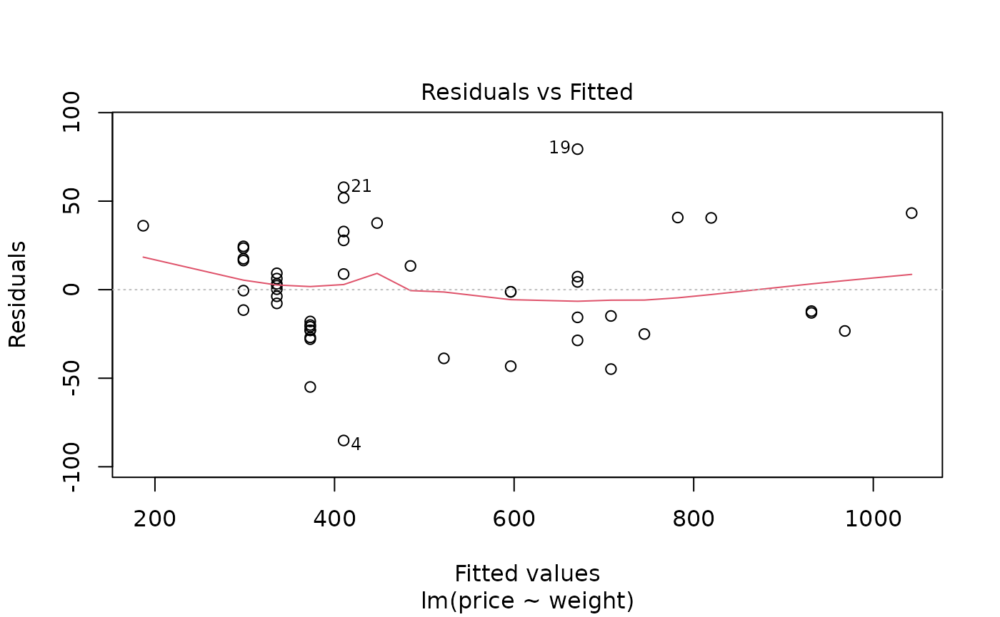
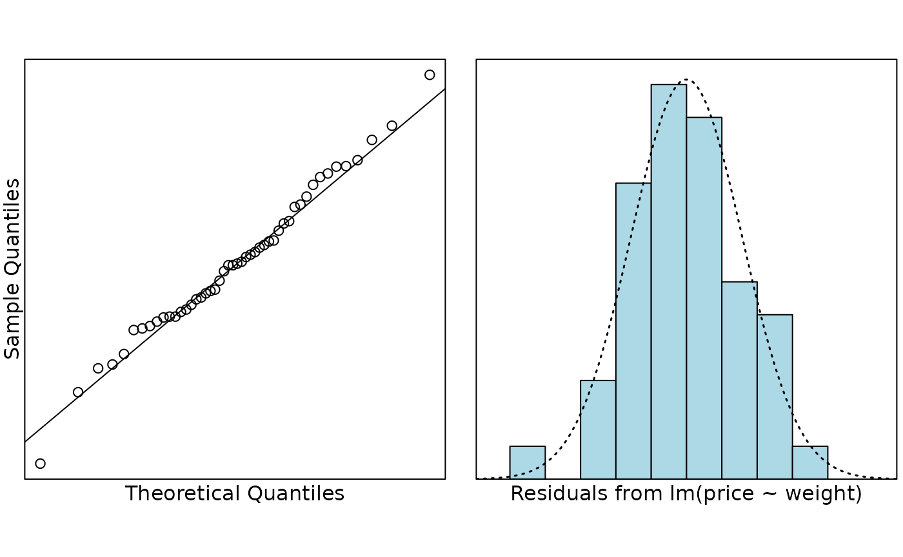

# Case Study 2.3: Diamond Rings

## Problem

This data set contains the prices of ladies’ diamond rings and the carat
size of their diamond stones from a random sample of rings from
Singaporean retailers. The rings are made of 20 carat gold and are each
mounted with a single diamond stone. The data was collected by a
lecturer quite a few years ago when they were in Singapore and they were
interested in building a model to explain the price of diamond rings.

In particular, it was hoped that the prices of two rings could be
predicted using the model: a 0.3-carat diamond ring and a 1.2-carat
diamond ring.

The variables measured were:

- `price`: price of ring (in Singapore dollars)
- `weight`: weight of diamond (in carats)

## Question of interest/goal of the study

We were interested in building a model to explain the price of diamond
rings. In particular, we want to predict the price of a 0.3-carat
diamond ring and a 1.2-carat diamond ring.

## Read in and inspect the data:

``` r

# import the data
diamonds.df = read.table("diamonds.txt", header = TRUE)
head(diamonds.df)
plot(price ~ weight, main = "Price versus weight of diamonds", data = diamonds.df)
```

    ##   weight price
    ## 1   0.17   355
    ## 2   0.16   328
    ## 3   0.17   350
    ## 4   0.18   325
    ## 5   0.25   642
    ## 6   0.16   342


## Comment on the plot

The scatter plot of price versus weight shows a strong, increasing,
linear relationship. The greater the weight of the diamond, the greater
the mean price of the diamond ring.

## Fit model and check assumptions

``` r

# fit the model
diamond.fit <- lm(price ~ weight, data = diamonds.df)

# Assumption checks
plot(diamond.fit, which = 1)
```



``` r

normcheck(diamond.fit)
```



``` r

cooks20x(diamond.fit)
```


``` r

# Get summary output and confidence intervals
summary(diamond.fit)
```

    ## 
    ## Call:
    ## lm(formula = price ~ weight, data = diamonds.df)
    ## 
    ## Residuals:
    ##     Min      1Q  Median      3Q     Max 
    ## -85.159 -21.448  -0.869  18.972  79.370 
    ## 
    ## Coefficients:
    ##             Estimate Std. Error t value Pr(>|t|)    
    ## (Intercept)  -259.63      17.32  -14.99   <2e-16 ***
    ## weight       3721.02      81.79   45.50   <2e-16 ***
    ## ---
    ## Signif. codes:  0 '***' 0.001 '**' 0.01 '*' 0.05 '.' 0.1 ' ' 1
    ## 
    ## Residual standard error: 31.84 on 46 degrees of freedom
    ## Multiple R-squared:  0.9783, Adjusted R-squared:  0.9778 
    ## F-statistic:  2070 on 1 and 46 DF,  p-value: < 2.2e-16

``` r

confint(diamond.fit)
```

    ##                2.5 %    97.5 %
    ## (Intercept) -294.487 -224.7649
    ## weight      3556.398 3885.6513

## Plot with superimposed line

``` r

plot(price ~ weight, main = "Price versus weight of diamonds", data = diamonds.df)
abline(diamond.fit$coef[1], diamond.fit$coef[2])
```


## Get additional predicted output required

``` r

predweight.df = data.frame(weight = c(0.3, 1.2))
predict(diamond.fit, predweight.df, interval = "prediction")
```

    ##         fit       lwr       upr
    ## 1  856.6815  790.0316  923.3315
    ## 2 4205.6039 4029.3376 4381.8702

## Method and Assumption Checks

A scatter plot of price vs diamond weight showed a linear association
with approximately constant scatter and so a simple linear regression
model was fitted.

All the assumptions were met so we have no problems with the analysis.

Our final model is
$`price_i=\beta_0 +\beta_1\times weight_i+\epsilon_i`$ where
$`\epsilon_i \sim iid ~ N(0,\sigma^2)`$.

Our model explains 98% of the variation in diamond ring prices.

## Executive Summary

We have data on diamond ring prices and the weights of the diamonds in
those rings from Singapore retailers. Our aim is to predict the price of
a diamond ring using the weight of the diamond.

There is a strong positive association between the weight of the diamond
and the price of the ring - the bigger the diamond, the higher the price
of the diamond ring.

We estimate that for every 0.1-carat increase in the weight of the
diamond, the mean diamond ring price increases by somewhere between
\$360 to \$390.

Our model explains 98% of the variation in diamond ring prices and
therefore should be excellent for predicting the price of diamond rings.

Using our model, we predict that the 0.3-carat diamond ring will be
priced between \$790 to \$920.

Our data only has diamond rings weighing up to 0.35 carats, so we cannot
rely on the predictions for the 1.2-carat ring.

\[Note: the range of the orignal data was around 900 dollars, this has
been reduced to around 130 dollars which is roughly 15% of this and much
more useful for prediction.\]
