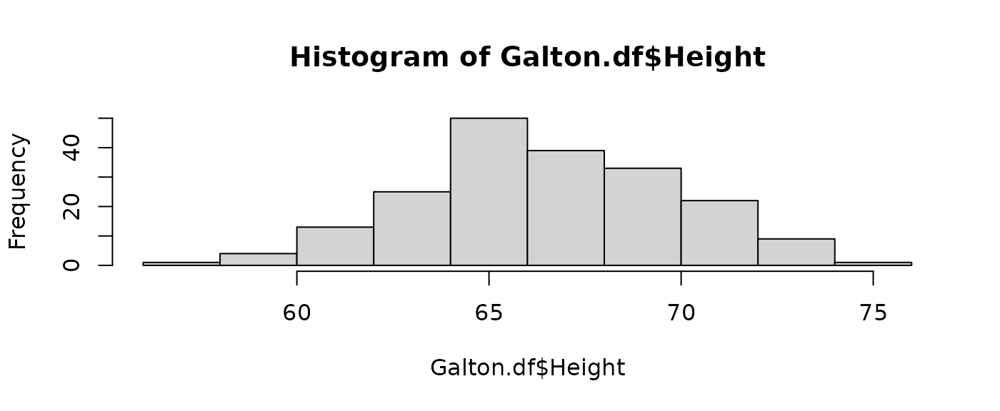
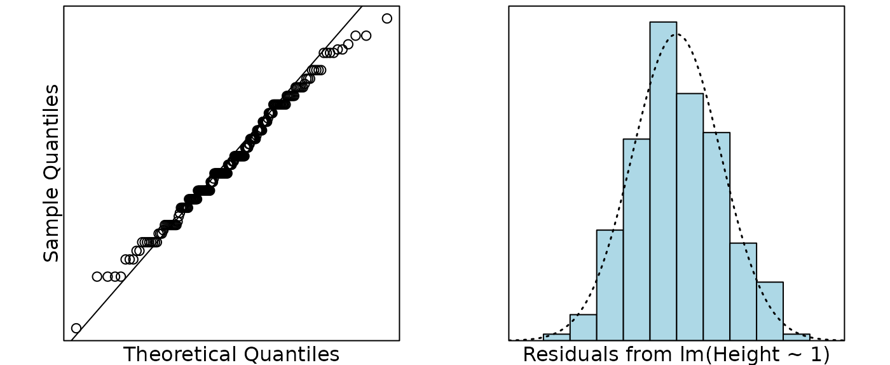

# Case Study 3.2: STATS 201/8 Extra Case Study - One Sample

## Question

For this question, we are getting historic. In 1886, Francis Galton
presented a data set on a sample of 928 adult British children from 197
sets of parents. For each child, he had recorded their adult height and
the average of their parent’s heights. He then analysed the relationship
between their heights.

However, for this question, we are just interested in a simpler
question. How do heights of people in Britain in 1886 compare to heights
of people now? We will use the sample of children’s adults heights to
answer this. In particular, we wish to see if the average height in 1886
in Britain is different from the average height of 70 inches, which is
today’s estimated average adult height in Britain.

The data on the children’s heights from Galton’s 1886 dataset is in the
file *Galton3.csv*, which contains the variable:

| Variable | Description                            |
|----------|----------------------------------------|
| Height   | the adult height (inches) of the child |

**Instructions:**

- Make sure you change your name and UPI/ID number at the top of the
  assignment.
- Comment on the plot of the data.
- Manually calculate the *t*-statistic for comparing the mean height to
  70 inches and the corresponding 95% confidence interval.
- Galton’s original data set originally included multiple children from
  families with over 500 children from the 197 families. For the
  purposes of this analysis, we took a subset of the data, with one
  child randomly selected from each family,reducing the data to 197
  observations. Why did we do this?
- Write an appropriate **Executive Summary**.

### Question of interest/goal of the study

We are interested in seeing if the average height if these British
children (when they were adults) is different from the average height of
70 inches which is today’s estimated average adult height.

### Read in and inspect the data:

``` r

Galton.df = read.csv("Galton3.csv", header = TRUE)
hist(Galton.df$Height)
summary(Galton.df$Height)
```



    ##    Min. 1st Qu.  Median    Mean 3rd Qu.    Max. 
    ##   57.00   64.50   66.50   66.79   69.50   75.00

### Comment on the plot/exploratory data analysis

The heights appear to be centred around 67 and reasonably symmetric (and
looking roughly normal).

### Manually calculate the t-statistic for testing if the underlying mean is 70, and the 95% confidence interval for the mean.

Formulas: $`T = \frac{\bar{y}-\mu_0}{se(\bar{y})}`$ and 95% confidence
interval $`\bar{y} \pm t_{df, 0.975} \times se(\bar{y})`$

NOTES: The R code `mean(y)` calculates $`\bar{y}`$. The standard error
is $`se(\bar{y}) = \frac{s}{\sqrt{n}}`$ where $`s`$ is the standard
deviation of $`y`$ and is calculated by `sd(y)`, and $`n`$ is the number
of data-points calculated by `length(y)`. The degrees of freedom is
$`df = n-1`$. The $`t_{df,0.975}`$ multiplier is given by the R code
`qt(0.975, df)`.

``` r

ybar = mean(Galton.df$Height)
n = length(Galton.df$Height)
se.ybar = sd(Galton.df$Height) / sqrt(n)

# t-statistic for H0: mu=70 :
(ybar - 70) / se.ybar
```

    ## [1] -13.51375

``` r

# 95% confidence interval for the mean:
ybar - qt(0.975, n - 1) * se.ybar
```

    ## [1] 66.32253

``` r

ybar + qt(0.975, n - 1) * se.ybar
```

    ## [1] 67.25919

``` r

ybar + c(-1, 1) * qt(0.975, n - 1) * se.ybar
```

    ## [1] 66.32253 67.25919

### Repeat the same calculation using the t.test function (done for you):

``` r

t.test(Galton.df$Height, mu = 70)
```

    ## 
    ##  One Sample t-test
    ## 
    ## data:  Galton.df$Height
    ## t = -13.514, df = 196, p-value < 2.2e-16
    ## alternative hypothesis: true mean is not equal to 70
    ## 95 percent confidence interval:
    ##  66.32253 67.25919
    ## sample estimates:
    ## mean of x 
    ##  66.79086

**Note:** You should get exactly the same results from the manual
calculations and using the $`t.test`$ function. Doing this was to give
you practice using some R code. The $`t.test`$ function also delivers
the p-value that we did not calculate above.

### Fit and check the null model (done for you):

``` r

Galton.fit = lm(Height ~ 1, data = Galton.df)
normcheck(Galton.fit)
```



``` r

cooks20x(Galton.fit)
```


``` r

summary(Galton.fit);
```

    ## 
    ## Call:
    ## lm(formula = Height ~ 1, data = Galton.df)
    ## 
    ## Residuals:
    ##     Min      1Q  Median      3Q     Max 
    ## -9.7909 -2.2909 -0.2909  2.7091  8.2091 
    ## 
    ## Coefficients:
    ##             Estimate Std. Error t value Pr(>|t|)    
    ## (Intercept)  66.7909     0.2375   281.3   <2e-16 ***
    ## ---
    ## Signif. codes:  0 '***' 0.001 '**' 0.01 '*' 0.05 '.' 0.1 ' ' 1
    ## 
    ## Residual standard error: 3.333 on 196 degrees of freedom

``` r

confint(Galton.fit)
```

    ##                2.5 %   97.5 %
    ## (Intercept) 66.32253 67.25919

``` r

70 - confint(Galton.fit)
```

    ##                2.5 %   97.5 %
    ## (Intercept) 3.677465 2.740809

### Galton’s original data set originally included multiple children from families with over 500 children from the 197 families. For the purposes of this analysis, we took a subset of the data, with one child randomly selected from each family,reducing the data to 197 observations. Why did we do this?

Having multiple children from the same family would have violated the
independence assumption (and required a more complicated form of
analysis).

### Method and Assumption Checks

As this data consists of one measurement (the child’s height as an
adult) we have applied a one sample t-test to it, equivalent to an
intercept only linear model (null model).

We have a random sample of 197 children (who were measured when adult),
and we wished to see if their average height is the same as the current
average height of people which is 70 inches. The child’s height should
be independent of each other. Checking the normality of the differences
reveals no problems. There were no unduly influential points.

Our model is: $`Height_i = \mu + \epsilon_i`$ where
$`\epsilon_i \sim iid ~ N(0,\sigma^2)`$

### Executive Summary

We are interested if the average height of these children (as adults)
which was measured since 1886 is different from the current population
average height of 70 inches.

There was evidence to suggest that British people have got taller on
average since 1886.

We estimate the height of adults in 1886 to be, on average, between 66.3
and 67.3 inches.

Thus, the average increase in height was estimated as between 2.7 and
3.7 inches since 1886.
