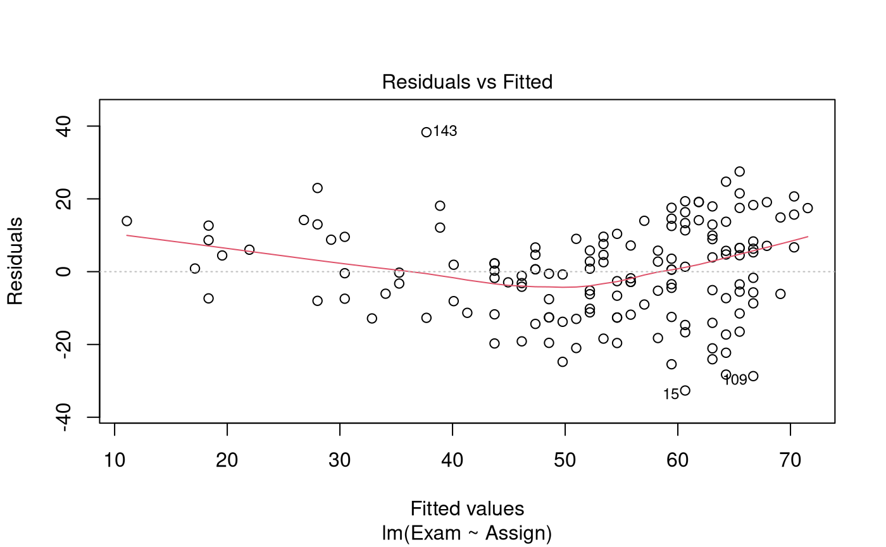
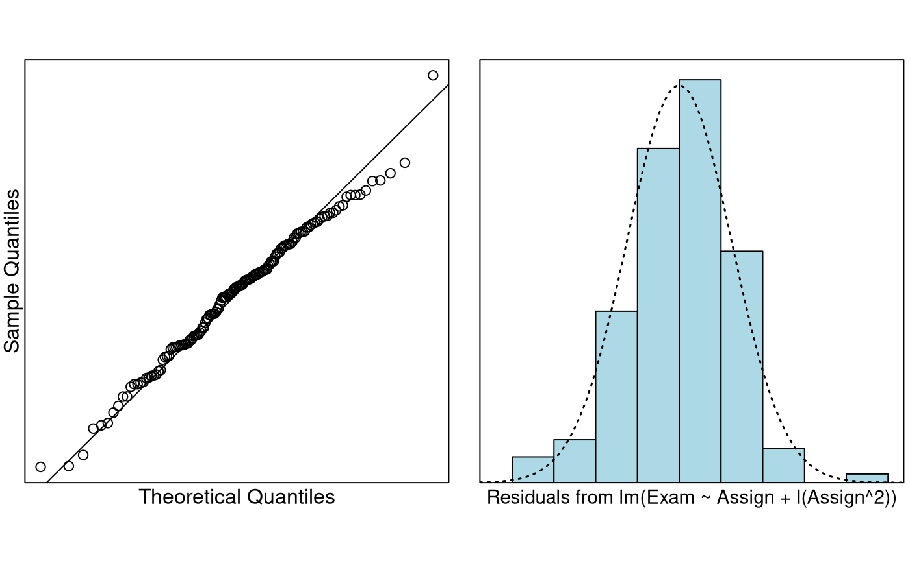

# Case Study 4.1: Exam vs Assignment mark

## Problem

We wish to quantify the relationship between exam mark and assignment
score. In particular, we want to estimate the typical exam mark for all
students when the assignment marks are 0, 10, and 20.

The variables of interest are:

- `Exam`: Exam mark out of 100.
- `Assign`: Assignment mark out of 20.

### Question of Interest

We want to build a model to estimate exam marks with assignment marks.
In particular, we want to estimate the typical exam mark for all
students when the assignment marks are 0, 10, and 20.

### Read in and Inspect the Data

``` r

Stats20x.df = read.table("STATS20x.txt", header = TRUE)
plot(Exam ~ Assign, data = Stats20x.df)
```


We see an increasing relationship between assignment marks and exam
marks. However, this relationship does not seem very strong, and there
is some suggestion of curvature in the relationship. We’ll need to fit a
linear model and scrutinise the residual plot to verify the extent of
the curvature.

### Model Building and Check Assumptions

``` r

examAssign.fit = lm(Exam ~ Assign, data = Stats20x.df)
plot(examAssign.fit, which = 1) # We can use this code as an alternative to eovcheck
```



``` r

examAssign.fit2 = lm(Exam ~ Assign + I(Assign^2), data = Stats20x.df)
plot(examAssign.fit2, which = 1)
```


``` r

normcheck(examAssign.fit2)
```



``` r

cooks20x(examAssign.fit2)
```


``` r

summary(examAssign.fit2)
```

    ## 
    ## Call:
    ## lm(formula = Exam ~ Assign + I(Assign^2), data = Stats20x.df)
    ## 
    ## Residuals:
    ##     Min      1Q  Median      3Q     Max 
    ## -32.541  -9.149   1.273   9.087  41.116 
    ## 
    ## Coefficients:
    ##             Estimate Std. Error t value Pr(>|t|)    
    ## (Intercept) 28.41396    5.99081   4.743 5.05e-06 ***
    ## Assign      -0.68172    1.07242  -0.636 0.525999    
    ## I(Assign^2)  0.16102    0.04545   3.542 0.000536 ***
    ## ---
    ## Signif. codes:  0 '***' 0.001 '**' 0.01 '*' 0.05 '.' 0.1 ' ' 1
    ## 
    ## Residual standard error: 12.65 on 143 degrees of freedom
    ## Multiple R-squared:  0.5477, Adjusted R-squared:  0.5414 
    ## F-statistic: 86.59 on 2 and 143 DF,  p-value: < 2.2e-16

``` r

confint(examAssign.fit2)
```

    ##                   2.5 %     97.5 %
    ## (Intercept) 16.57197462 40.2559372
    ## Assign      -2.80156333  1.4381240
    ## I(Assign^2)  0.07117039  0.2508643

### Get additional Confidence Intervals

Note, since we are after typical exam marks we have to use confidence
intervals rather than prediction intervals.

``` r

predAssign.df = data.frame(Assign = c(0, 10, 20))
predict(examAssign.fit2, predAssign.df, interval = "confidence")
```

    ##        fit      lwr      upr
    ## 1 28.41396 16.57197 40.25594
    ## 2 37.69849 34.29319 41.10379
    ## 3 79.18650 73.61953 84.75346

## Method and Assumption Checks

The scatter plot of exam mark vs assignment mark suggested curvature in
the relationship.

We began with a linear model to describe exam marks with assignment
marks. The residual plot from the fit of a simple linear model showed
fairly constant scatter but had strong curvature. So, a quadratic term
was added to the linear model.

All model assumptions look satisfied once we added the quadratic term to
the linear model.

Our final model is
``` math
Exam_i=\beta_0 +\beta_1\times Assign_i+\beta_2\times Assign_i^2 +\epsilon_i,
```
where $`\epsilon_i \sim iid ~ N(0,\sigma^2)`$.

Our model explained 55% of the variability in the students’ final exam
marks.

## Executive Summary

We were interested in building a model to estimate exam marks with
assignment marks.

The relationship between expected exam mark and assignment score was
modelled as quadratic.

Here, for a one mark increase in assignment score, the increase in
expected exam score was greater as assignment score increased. For
example, there was little difference in expected exam score for those
getting 7 or 8 in assignments, but a much bigger difference for those
getting 17 or 18.

For assignment marks of 0, 10 and 20, the estimate expected exam marks
were between 16.6 to 40.3, 34.3 to 41.1, and 73.6 to 84.8, respectively.
