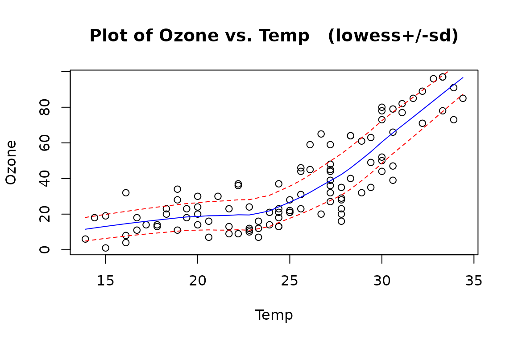
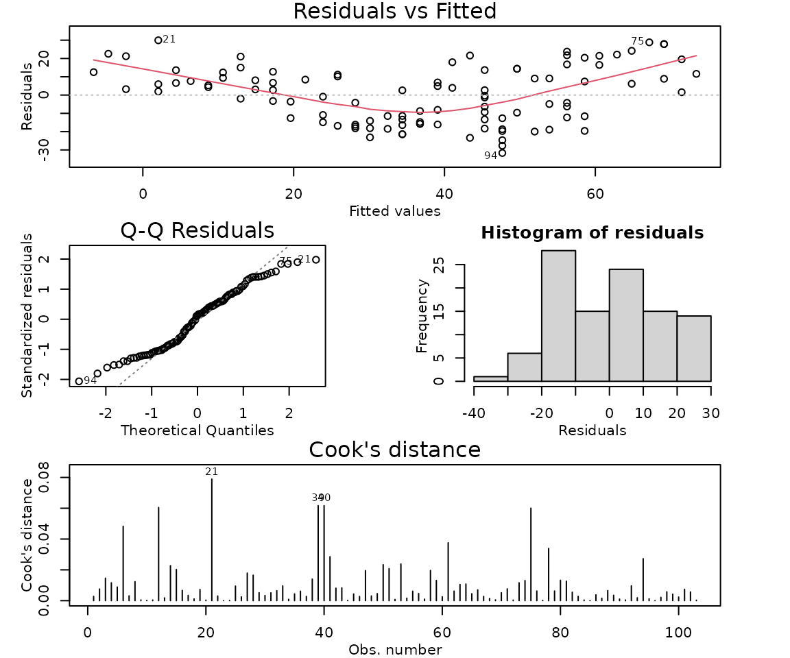
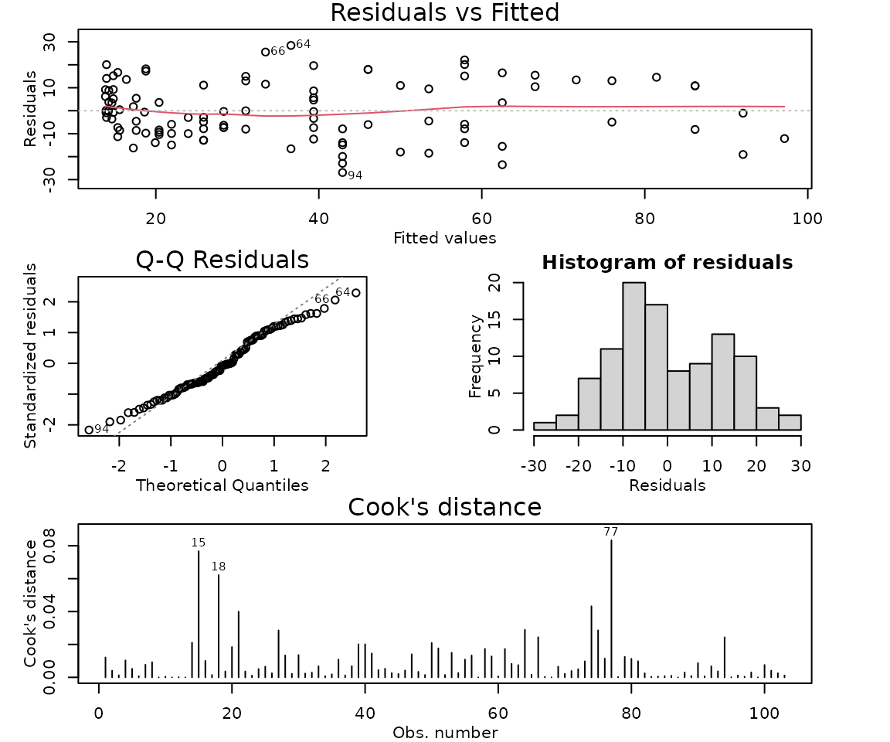
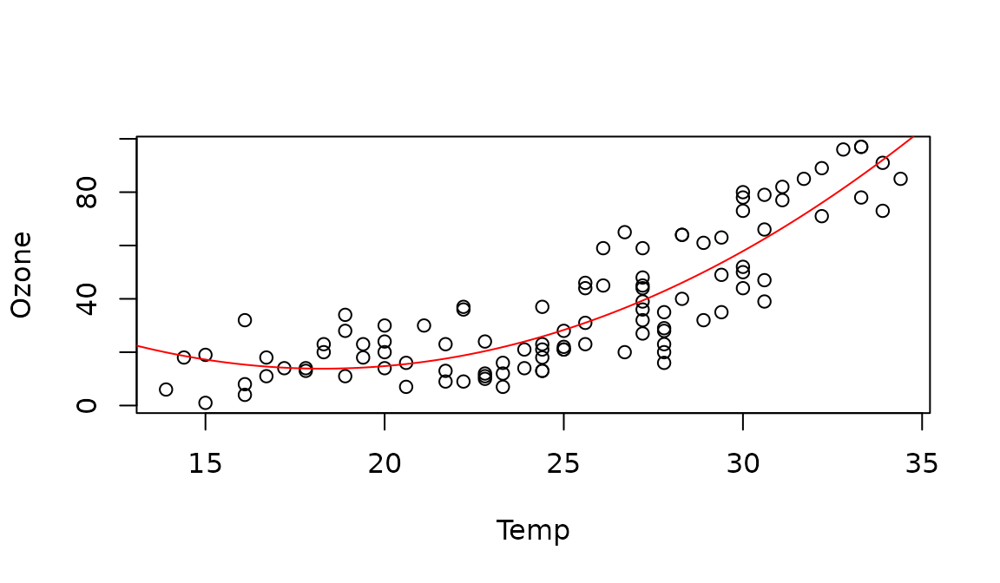

# Case Study 4.2: STATS 201/8 Extra Case Study - Quadratic Model

## Question

Ozone is an air pollutant that causes some people to have breathing
difficulties, and is harmful to vegetation. It is an essential part of
the upper atmosphere, but is harmful at breathing level. The following
data gives daily ozone concentration and temperature on 103 consecutive
summer days in New York in the 1970s. We wish to describe the
relationship between ozone concentration and temperature.

The data is in the file *Ozone.csv*, which contains the variables:

| Variable | Description                                             |
|----------|---------------------------------------------------------|
| Ozone    | ozone concentration at 2pm each day (parts per billion) |
| Temp     | maximum daily temperature (degrees Celsius)             |

**Instructions:**

- Comment on the initial plot of the data.
- Fit a linear model with an appropriate quadratic term, including model
  checks.
- Plot the data with your appropriate model superimposed over it.
- Discuss why there will be concerns about the independence assumption
  for this model.
- Look at your plot of the fitted model superimposed on the data. Does
  the entire model make sense? Briefly discuss any concerns.
- Write appropriate Methods and Assumption Checks. (You do not need to
  repeat the comments from the previous two questions here.)
- In 2-3 sentences of plain English, describe the relationship between
  temperature and ozone level, as if for an Executive Summary.
- Why can’t we give a single interval quantifying the effect of a one
  degree change in temperature on ozone level?

### Question of interest/goal of the study

We wish to describe the relationship between daily ozone concentration
and temperature, using data taken from consecutive summer days in New
York in the 1970s.

### Read in and inspect the data:

``` r

ozone.df = read.csv("Ozone.csv")
plot(Ozone ~ Temp, data = ozone.df)
trendscatter(Ozone ~ Temp, data = ozone.df)
```



### Comment on the plot

Ozone concentration increases as temperature increases. However, the
relationship appears to be curved, with a gentle increase in ozone at
lower temperatures and a steeper increase at higher temperatures. The
scatter is reasonably constant about the curved trend line.

### Fit a linear model with an appropriate quadratic term, including model checks.

``` r

## Fitting the simple linear model to show the residual plot for demonstration only. In this case with a strong curve and constant scatter, we can go straight to fitting quadratic.
ozone.fit1 = lm(Ozone ~ Temp, data = ozone.df)
modelcheck(ozone.fit1)
```



``` r

## Plot has a strong quadratic pattern. Fit a quadratic relationship.
ozone.fit2 = lm(Ozone ~ Temp + I(Temp^2), data = ozone.df)
modelcheck(ozone.fit2)
```



``` r

summary(ozone.fit2)
```

    ## 
    ## Call:
    ## lm(formula = Ozone ~ Temp + I(Temp^2), data = ozone.df)
    ## 
    ## Residuals:
    ##      Min       1Q   Median       3Q      Max 
    ## -26.9099  -8.5758  -0.8907  10.8325  28.4169 
    ## 
    ## Coefficients:
    ##              Estimate Std. Error t value Pr(>|t|)    
    ## (Intercept) 120.68430   25.46426   4.739 7.11e-06 ***
    ## Temp        -11.69920    2.13876  -5.470 3.33e-07 ***
    ## I(Temp^2)     0.32020    0.04363   7.339 5.81e-11 ***
    ## ---
    ## Signif. codes:  0 '***' 0.001 '**' 0.01 '*' 0.05 '.' 0.1 ' ' 1
    ## 
    ## Residual standard error: 12.51 on 100 degrees of freedom
    ## Multiple R-squared:  0.7602, Adjusted R-squared:  0.7554 
    ## F-statistic: 158.5 on 2 and 100 DF,  p-value: < 2.2e-16

### Plot the data with your appropriate model superimposed over it.

``` r

# Generate predicted values over a range for the model and use the lines command to add these as the appropriate line/curve to the plot.
pred.temp = data.frame(Temp = seq(12, 35, 0.1))
ozone.pred = predict(ozone.fit2, pred.temp)

plot(Ozone ~ Temp, data = ozone.df)
lines(ozone.pred ~ pred.temp[, 1], col = "red")
```



### Discuss why there will be concerns about the independence assumption for this model.

The data were taken from consecutive days, so there is some concern
about independence, because ozone is likely to carry over from one day
to the next. We should therefore treat the results of this model with
caution, especially regarding confidence interval width. (See Time
Series later in the course.)

### Look at your plot of the fitted model superimposed on the data. Does the entire model make sense? Briefly discuss any concerns.

The fitted model shows a slight downward trend in mean ozone
concentration at the lowest temperatures that is not obvious from the
initial data plot. This might be due to the constraints of the quadratic
model, rather than reflecting a real relationship in the data.

### Method and Assumption Checks (You do not need to repeat the comments from the previous two questions here.)

We fitted a linear model with a quadratic term, as exploratory plots
revealed some curvature. The quadratic term was highly significant, so
it was retained. After fitting the quadratic, the residuals were fine,
normality was adequate, and there were no unduly influential points.

See comments from the two questions above for additional information
about concerns with the fitted model.

Our model is:
$`Ozone_i =\beta_0 +\beta_1\times Temp_i + \beta_2\times Temp_i^2 + \epsilon_i`$
where $`\epsilon_i \sim iid ~ N(0,\sigma^2)`$.

Our model explained 76% of the variation in the data.

### In 2-3 sentences of plain English, describe the relationship between temperature and ozone level, as if for an Executive Summary

We found strong evidence of a curved, increasing relationship between
ozone concentration and temperature.

The relationship demonstrates very little change for temperatures
between about 14C and 24C, with an average ozone concentration of
roughly 20 parts per billion for temperatures in this range.

As the daily temperature increases from 24C to 35C, there is a much
steeper increase in average ozone concentration.

### Why can’t we give a single interval quantifying the effect of a one degree change in temperature on ozone level?

We have fitted a curved model to the data. This means that the effect of
a one-degree change in temperature on ozone level depends on what the
starting temperature was. For example, the effect of a one-degree
increase is different at 20 degrees (not expecting much change to ozone
level) than at 30 degrees (expecting an increase in ozone level).
