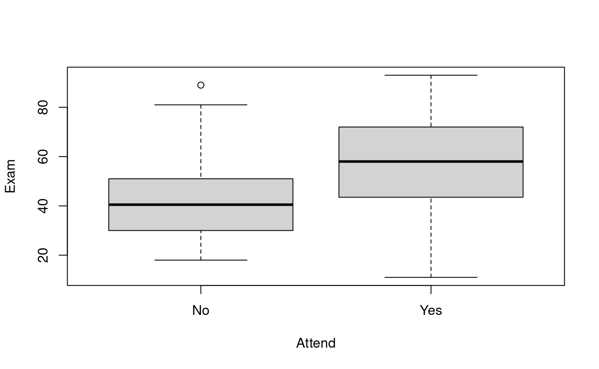
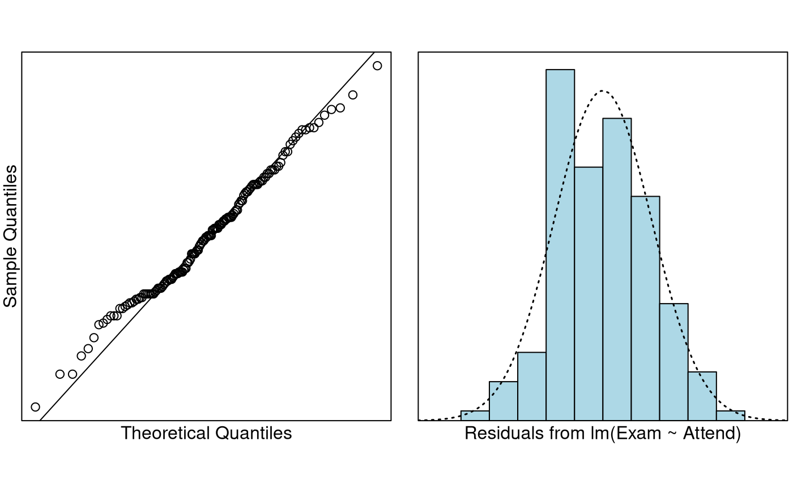

# Case Study 5.1: Exam vs Attendance

## Problem

We wish to determine if regular attendance in class is associated with
exam mark. In particular, we want to estimate the expected exam marks of
attendees and non-attendees, and predict the actual exam scores of
individual attendees and non-attendees.

The variables of interest are:

- `Exam`: Exam mark out of 100.
- `Attend`: A two-level categorical variable which has the levels `Yes`
  and `No`.

### Question of Interest

We want to quantify the relationship between exam marks and attendance.
In particular, we want to estimate the expected exam marks of attendees
and non-attendees, and predict the actual exam scores of individual
attendees and non-attendees.

### Read in and Inspect the Data

``` r

Stats20x.df = read.table("STATS20x.txt", header = TRUE)
# Could of also used plot(Exam ~ Attend, data = Stats20x.df)
boxplot(Exam ~ Attend, data = Stats20x.df)
```

 The exam marks for
the students attended seem to be centred than the students who did not
attend lectures regularly. The boxplots look reasonably symmetric in
both groups.

### Model Building and Check Assumptions

``` r

examAttend.fit = lm(Exam ~ Attend, data = Stats20x.df)
eovcheck(examAttend.fit)
```


``` r

normcheck(examAttend.fit)
```



``` r

cooks20x(examAttend.fit)
```


``` r

summary(examAttend.fit)
```

    ## 
    ## Call:
    ## lm(formula = Exam ~ Attend, data = Stats20x.df)
    ## 
    ## Residuals:
    ##     Min      1Q  Median      3Q     Max 
    ## -46.780 -13.108  -0.217  12.642  46.783 
    ## 
    ## Coefficients:
    ##             Estimate Std. Error t value Pr(>|t|)    
    ## (Intercept)   42.217      2.547  16.578  < 2e-16 ***
    ## AttendYes     15.563      3.077   5.058 1.27e-06 ***
    ## ---
    ## Signif. codes:  0 '***' 0.001 '**' 0.01 '*' 0.05 '.' 0.1 ' ' 1
    ## 
    ## Residual standard error: 17.27 on 144 degrees of freedom
    ## Multiple R-squared:  0.1508, Adjusted R-squared:  0.145 
    ## F-statistic: 25.58 on 1 and 144 DF,  p-value: 1.271e-06

``` r

confint(examAttend.fit)
```

    ##                 2.5 %   97.5 %
    ## (Intercept) 37.184009 47.25077
    ## AttendYes    9.480749 21.64447

### Get additional Prediction Intervals

``` r

predAttend.df = data.frame(Attend = c("No", "Yes"))

# Using `interval = "confidence"' to get CI for expected exam score
# for each level of Attend
predict(examAttend.fit, predAttend.df, interval = "confidence")
```

    ##        fit      lwr      upr
    ## 1 42.21739 37.18401 47.25077
    ## 2 57.78000 54.36619 61.19381

``` r

# Using `interval = "prediction"' to get PI for individual student's exam score
# for each level of Attend
predict(examAttend.fit, predAttend.df, interval = "prediction")
```

    ##        fit       lwr      upr
    ## 1 42.21739  7.710259 76.72452
    ## 2 57.78000 23.471673 92.08833

## Method and Assumption Checks

We wish to explain exam marks with attendance, a two-level factor. So,
we have fitted a linear model with a single explanatory dummy variable.
(Note, this is equivalent to conducting a two-sample t-test).

Four non-attending students did unusually well (i.e., large positive
residuals), but since the sample size was large, this will be of little
consequence. Hence, all model assumptions were satisfied.

Our final model is
``` math
Exam_i=\beta_0 +\beta_1 \times Attend.Yes_i+\epsilon_i,
```
where $`\epsilon_i \sim iid ~ N(0,\sigma^2)`$. Here $`Attend.Yes_i=1`$
if the student regularly attended (i.e., answered “Yes”), otherwise it
is zero (i.e. “No”).

Our model explained a small 15% of the variability in the students’
final exam marks.

## Executive Summary

We wanted to quantify the relationship between exam marks and
attendance.

There was strong evidence that exam marks were higher for students who
attend class versus students who didn’t attend class (*P-value*
$`\approx 10^{-6}`$). We estimate that regular attendance could increase
their expected exam mark between 9.5 to 21.6 exam marks (out of 100).

The expected exam marks of non-attendees and attendees are between 37.2
to 47.3, and 54.4 to 61.2, respectively.

The predicted exam marks for individual non-attendees and attendees are
between 7.7 to 76.7, and 23.5 to 92.1, respectively.

Our model only explains 15% of the variability in the students’ final
exam marks, this would not be very good for prediction. We can see this
in how wide our prediction intervals are.
