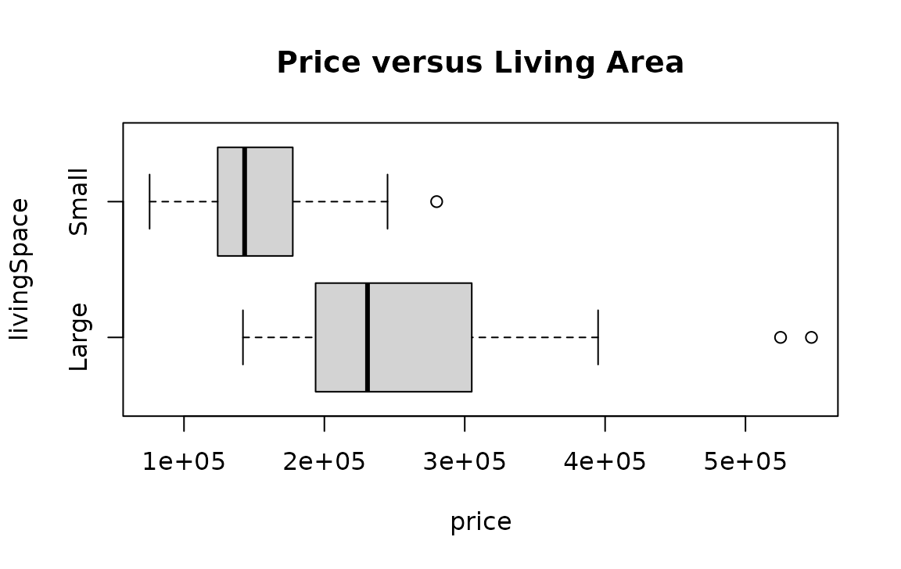
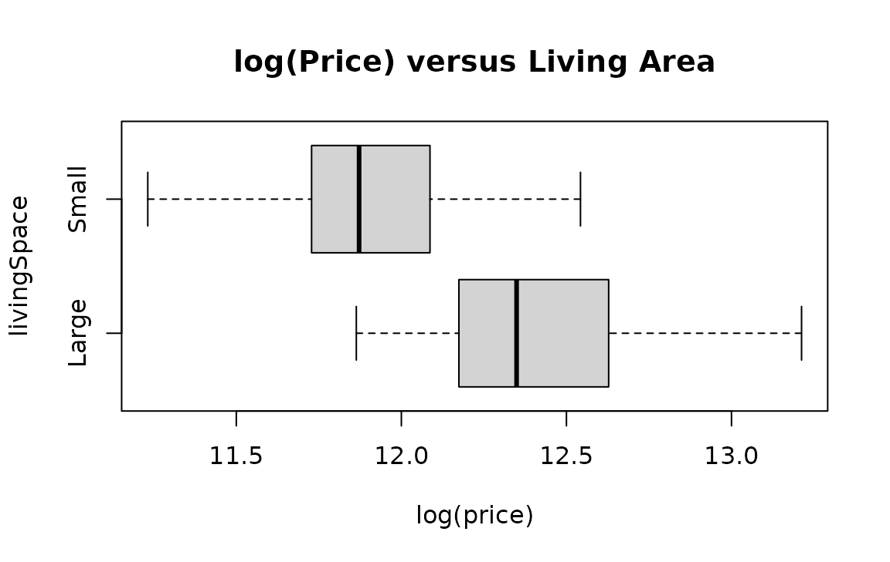
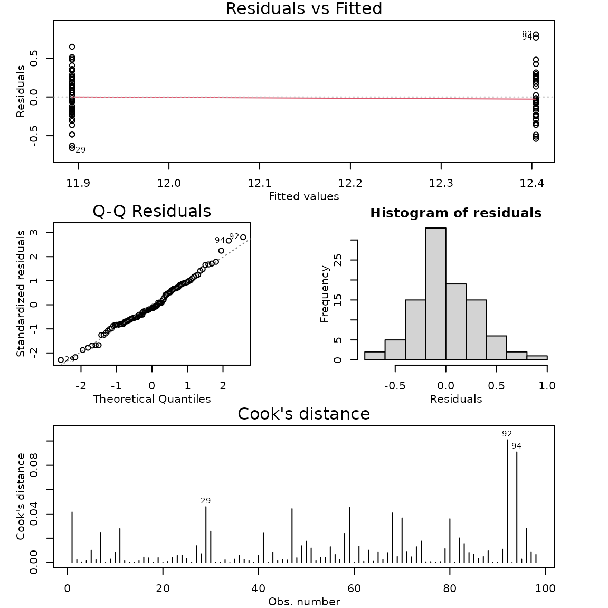

# Case Study 5.2: STATS 201/8 Extra Case Study - Two sample, log response

## Question 1

A real estate agent in Saratoga, New York, wishes to investigate how the
sale price of houses is affected by the size of the house. She has
compiled data from a random sample of 112 recent house sales in the
city. For this question, we want to compare prices for houses with
living areas categorised as small and large and also estimate what the
expected house price for these two groups.

The dataset is stored in Houses.csv and includes variables:

| Variable | Description |
|----|----|
| price | sale price of house, in US dollars |
| livingArea | size of the living area of the house, in square metres |
| livingSpace | a factor classifying the size of the living area as either *small* if less than 170 square metres or *large* if greater. |

**Disclaimer:** Before you rush off to Saratoga to buy a house, this is
an old dataset. I’m afraid house prices have gone up a lot since this
data was collected.

**Instructions:**

- Comment on the two plots of the data.
- Comment why we log the response variable for this data
- Fit an appropriate model to the data. Check the model assumptions.
- Write appropriate Methods and Assumption Checks.
- Write an appropriate **Executive Summary**.

### Question of interest/goal of the study

We want to compare prices for houses with living areas categorised as
small and large and estimate what the expected house price for each
group.

### Inspect the data: livingSpace as an explanatory variable

``` r

houses.df = read.csv("Houses.csv", header = TRUE, stringsAsFactors = TRUE)
plot(price ~ livingSpace, houses.df, main = "Price versus Living Area", horizontal = TRUE)
summaryStats(price ~ livingSpace, houses.df)

plot(log(price) ~ livingSpace, houses.df, main = "log(Price) versus Living Area", horizontal = TRUE)
summaryStats(log(price) ~ livingSpace, houses.df)
```



    ##       Sample Size     Mean Median  Std Dev Midspread
    ## Small          58 151885.4 143200 42683.39     52750
    ## Large          40 256481.1 230739 89608.55    108625



    ##       Sample Size     Mean   Median   Std Dev Midspread
    ## Small          58 11.89323 11.87194 0.2770689 0.3541368
    ## Large          40 12.40448 12.34901 0.3114696 0.4447669

### Comment on the two plots of the data.

House prices are higher and more varied when there are large living
spaces compared to small living spaces. We can see this in the summary
statistics as well. After logging the data, the variability in the data
is fairly similar for the two groups, with the centre still being higher
for the group with larger living spaces.

### Comment why we log the response variable for this data

As the variability between the groups is not constant, with the group
with the larger centre having more than double the standard deviation of
the other group, we need to solve the issue of unequal variability, so
logging the data is the best choice.

We also have financial data, and so interpreting the results as
percentage changes does make more sense if appropriate.

The data is right skewed, but this is not the major concern for this
particular dataset as the skewness isn’t too extreme and we have a
sufficiently large sample size for the Central Limit Theorem to come
into play.

``` r

# Log the response variable and fit the model:
houses.fit1 = lm(log(price) ~ livingSpace, houses.df)
modelcheck(houses.fit1)
```



``` r

summary(houses.fit1)
```

    ## 
    ## Call:
    ## lm(formula = log(price) ~ livingSpace, data = houses.df)
    ## 
    ## Residuals:
    ##      Min       1Q   Median       3Q      Max 
    ## -0.66134 -0.18691 -0.03943  0.19617  0.80772 
    ## 
    ## Coefficients:
    ##                  Estimate Std. Error t value Pr(>|t|)    
    ## (Intercept)      12.40448    0.04610 269.103  < 2e-16 ***
    ## livingSpaceSmall -0.51125    0.05992  -8.533  2.1e-13 ***
    ## ---
    ## Signif. codes:  0 '***' 0.001 '**' 0.01 '*' 0.05 '.' 0.1 ' ' 1
    ## 
    ## Residual standard error: 0.2915 on 96 degrees of freedom
    ## Multiple R-squared:  0.4313, Adjusted R-squared:  0.4254 
    ## F-statistic:  72.8 on 1 and 96 DF,  p-value: 2.095e-13

``` r

confint(houses.fit1)
```

    ##                       2.5 %     97.5 %
    ## (Intercept)      12.3129825 12.4959806
    ## livingSpaceSmall -0.6301905 -0.3923172

``` r

# back transform
exp(confint(houses.fit1))
```

    ##                         2.5 %       97.5 %
    ## (Intercept)      2.225668e+05 2.672609e+05
    ## livingSpaceSmall 5.324904e-01 6.754898e-01

``` r

# Extract second row of CI output only.
exp(confint(houses.fit1)[2, ])
```

    ##     2.5 %    97.5 % 
    ## 0.5324904 0.6754898

``` r

# % change 100*(value-1)
100 * (exp(confint(houses.fit1)[2, ]) - 1)
```

    ##     2.5 %    97.5 % 
    ## -46.75096 -32.45102

``` r

# % Change CI for opposite direction (Large - Small), so negative confidence interval before back transform
100 * (exp(-confint(houses.fit1)[2, ]) - 1)
```

    ##    2.5 %   97.5 % 
    ## 87.79683 48.04073

``` r

# Rotate factor to get intercept to give estimates when area = small
houses.df = within(houses.df, {
  livingSpaceR = factor(livingSpace, levels = c("Small", "Large"))
})
houses.fit2 = lm(log(price) ~ livingSpaceR, houses.df)
summary(houses.fit2)
```

    ## 
    ## Call:
    ## lm(formula = log(price) ~ livingSpaceR, data = houses.df)
    ## 
    ## Residuals:
    ##      Min       1Q   Median       3Q      Max 
    ## -0.66134 -0.18691 -0.03943  0.19617  0.80772 
    ## 
    ## Coefficients:
    ##                   Estimate Std. Error t value Pr(>|t|)    
    ## (Intercept)       11.89323    0.03828 310.688  < 2e-16 ***
    ## livingSpaceRLarge  0.51125    0.05992   8.533  2.1e-13 ***
    ## ---
    ## Signif. codes:  0 '***' 0.001 '**' 0.01 '*' 0.05 '.' 0.1 ' ' 1
    ## 
    ## Residual standard error: 0.2915 on 96 degrees of freedom
    ## Multiple R-squared:  0.4313, Adjusted R-squared:  0.4254 
    ## F-statistic:  72.8 on 1 and 96 DF,  p-value: 2.095e-13

``` r

confint(houses.fit2)
```

    ##                        2.5 %     97.5 %
    ## (Intercept)       11.8172419 11.9692135
    ## livingSpaceRLarge  0.3923172  0.6301905

``` r

# back transform
exp(confint(houses.fit2))
```

    ##                          2.5 %       97.5 %
    ## (Intercept)       1.355698e+05 1.578205e+05
    ## livingSpaceRLarge 1.480407e+00 1.877968e+00

### Method and Assumption Checks

We have a single grouping explanatory variable with two levels, so have
fitted a linear model with a single dummy variable to the data. Due to
the large differences in variability between the two groups,

After logging price, the residuals looked much better. Normality looks
good and no influential points were detected. We have a random sample,
so the independence assumption is satisfied. Model assumptions are
satisfied.

Our model is:
$`log(price_i) = \beta_0 + \beta_1 \times LivingSpaceSmall_i + \epsilon_i,`$

where $`LivingSpaceSmall_i = 1`$ if the $`i`$th house has a small living
area and is 0 otherwise, and $`\epsilon_i \sim iid ~N(0,\sigma^2)`$

Alternatively, our model is: $`log(price_{ij}) =\mu_i + \epsilon_{ij}`$
where $`\mu_1`$ is the mean log price if the house has a small living
space and $`\mu_2`$ is the mean log price if the house has a large
living space., $`\epsilon_{ij} \sim iid ~N(0,\sigma^2)`$

Our model explained 43.1% of the variation in the data.

### Executive Summary.

We investigated how the prices of houses in Saratoga, New York, are
affected by house size.

We found strong evidence that the median house price is greater in
houses with larger living area (greater than 170 square metres) than
those with smaller living areas..

We estimate that the median house price for houses with small living
areas (less than 170 square metres) was between 32.5% and 46.8% smaller
than that than for houses with large living area.

Alternatively: We estimate that the median house price for houses with
large living areas (greater than 170 square metres) was between 48.0%
and 87.8% more than that than for houses with small living area.

We estimate that the median house price for:

- houses with a small living areas is between \$136,000 and \$158,000.
- houses with a large living areas is between \$223,000 and \$267,000.
