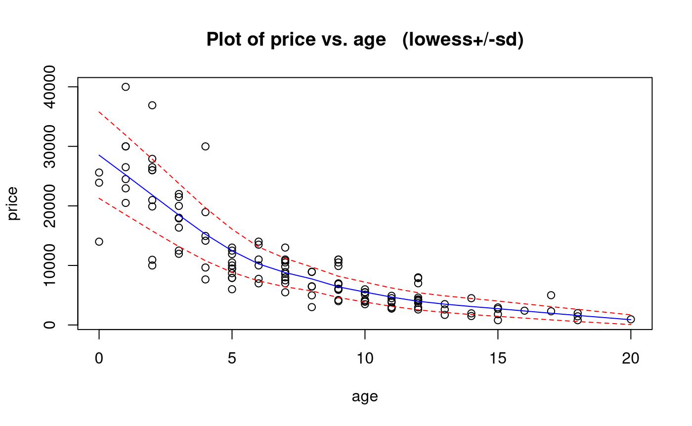
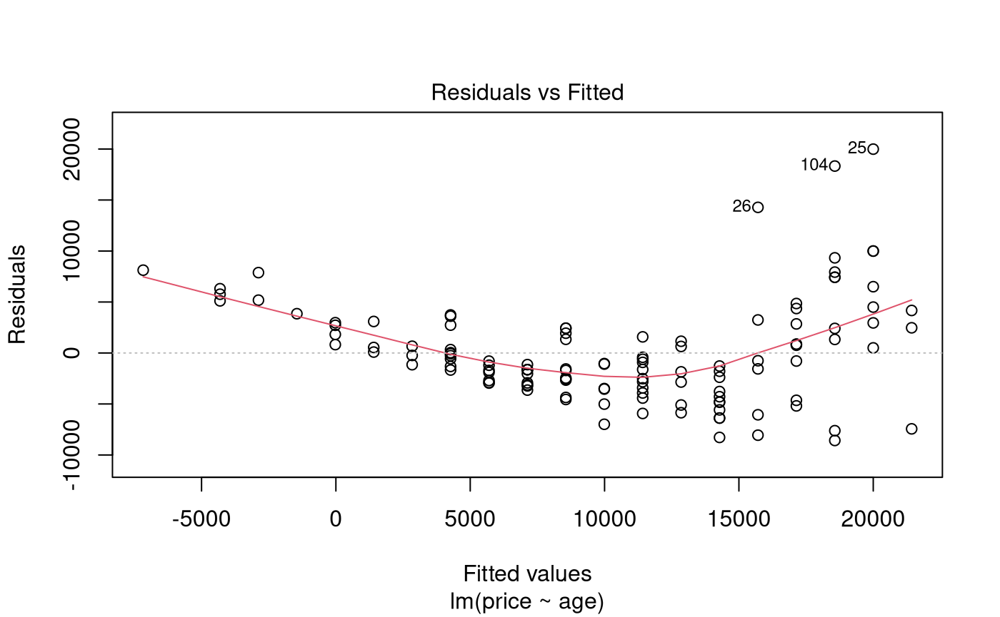
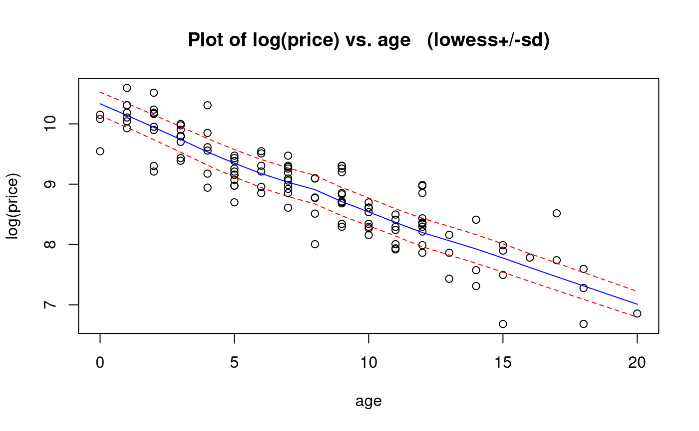
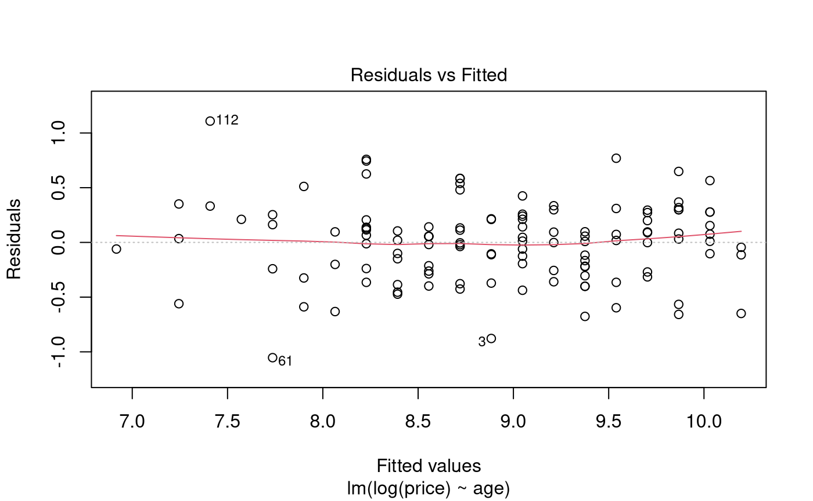
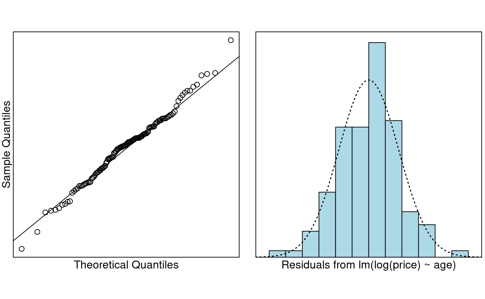

# Case Study 6.1: Mazda price vs age

## Problem

The ages and prices of 123 Mazda cars were collected from the Melbourne
Age newspaper in 1991. We want to learn about Mazda prices, and how they
decrease with age.

The variables measured are:

- `price`: Price in Australian \$.
- `year`: Year of manufacture (note that 1990 = 90).

### Question of Interest

We want to see how Mazda car prices decrease with age.

### Read in and Inspect the Data

``` r

Mazda.df = read.table("mazda.txt", header = TRUE)
head(Mazda.df)
# We need to creates a new variable called age ourselves
Mazda.df$age = 91 - Mazda.df$year
head(Mazda.df)
# Plot these data
trendscatter(price ~ age, data = Mazda.df)
```

    ##   year price
    ## 1   79  2950
    ## 2   82  5900
    ## 3   83  2999
    ## 4   88 11950
    ## 5   82  6100
    ## 6   90 26500

    ##   year price age
    ## 1   79  2950  12
    ## 2   82  5900   9
    ## 3   83  2999   8
    ## 4   88 11950   3
    ## 5   82  6100   9
    ## 6   90 26500   1



The scatter plot shows a decreasing non-linear relationship. As the age
increases, the price decreases - but the rate of decrease is rapid at
first, then declines, so also decrease. This suggests an exponentially
decreasing relationship.

We also see that the scatter around the trend is not constant: it is
higher when the price is higher and lower when the price is lower, so
higher centre is associated with higher spread.

Let’s fit a naive simple linear model using age for now.

### Model Building and Check Assumptions

``` r

PriceAge.fit = lm(price ~ age, data = Mazda.df)
plot(PriceAge.fit, which = 1)
```



``` r

trendscatter(log(price) ~ age, data = Mazda.df)
```



``` r

PriceAge.fit2 = lm(log(price) ~ age, data = Mazda.df)
plot(PriceAge.fit2, which = 1)
```



``` r

normcheck(PriceAge.fit2)
```



``` r

cooks20x(PriceAge.fit2)
```


``` r

summary(PriceAge.fit2)
```

    ## 
    ## Call:
    ## lm(formula = log(price) ~ age, data = Mazda.df)
    ## 
    ## Residuals:
    ##     Min      1Q  Median      3Q     Max 
    ## -1.0531 -0.2398  0.0311  0.2110  1.1085 
    ## 
    ## Coefficients:
    ##              Estimate Std. Error t value Pr(>|t|)    
    ## (Intercept) 10.195210   0.063602   160.3   <2e-16 ***
    ## age         -0.163915   0.007034   -23.3   <2e-16 ***
    ## ---
    ## Signif. codes:  0 '***' 0.001 '**' 0.01 '*' 0.05 '.' 0.1 ' ' 1
    ## 
    ## Residual standard error: 0.3615 on 121 degrees of freedom
    ## Multiple R-squared:  0.8178, Adjusted R-squared:  0.8163 
    ## F-statistic: 543.1 on 1 and 121 DF,  p-value: < 2.2e-16

``` r

# Backtransform
exp(confint(PriceAge.fit2))
```

    ##                    2.5 %       97.5 %
    ## (Intercept) 2.360688e+04 3.036744e+04
    ## age         8.370758e-01 8.607164e-01

``` r

# Backtransform to % difference
100 * (exp(confint(PriceAge.fit2)) - 1)
```

    ##                     2.5 %        97.5 %
    ## (Intercept) 2360588.14537 3036644.20481
    ## age             -16.29242     -13.92836

## Method and Assumption Checks

The scatter plot of age vs price showed clear nonlinearity and an
increase in variability with price.

Residuals from a simple linear model showed failed the equality of
variance and no-trend assumptions, and so the prices were log
transformed. A simple linear model fitted to logged price satisfied all
assumptions.

Our final model is
``` math
log(Price_i)=\beta_0 +\beta_1\times Age_i+\epsilon_i,
```
where $`\epsilon_i \sim iid ~ N(0,\sigma^2)`$.

Our model explained 82% of the variability in the logged Mazda prices.

## Executive Summary

We wanted to see how Mazda car prices decrease with age.

There was clear evidence the price of the cars was exponentially
decreasing as the cars got older (*P-value* $`\approx`$ 0).

We estimate that the median price for new Mazda cars (in 1991) was
between A\$23,600 to A\$30,400 (to the nearest A\$100).

We estimate that each additional year in age results in depreciation of
between 13.9% to 16.3%.
