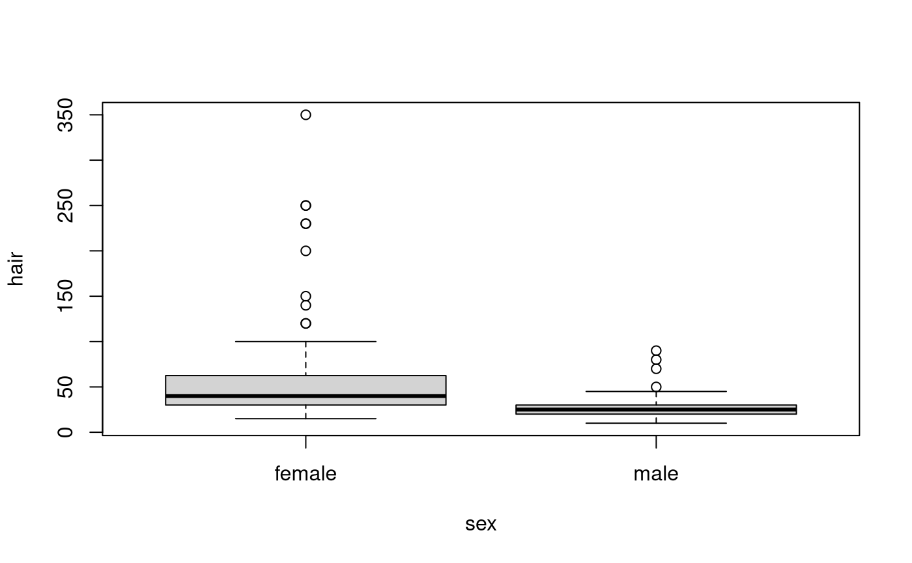
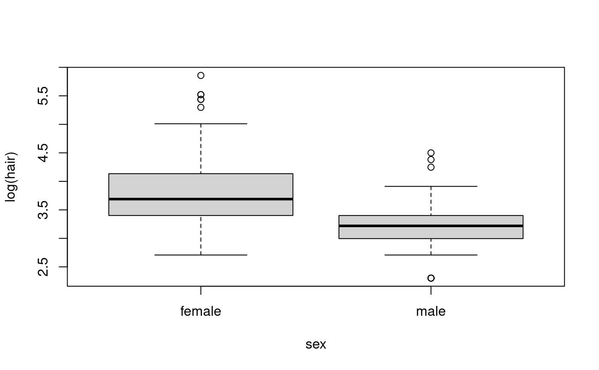
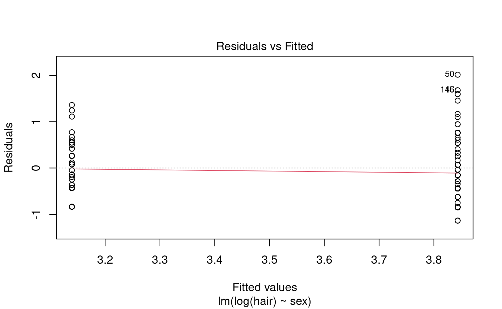
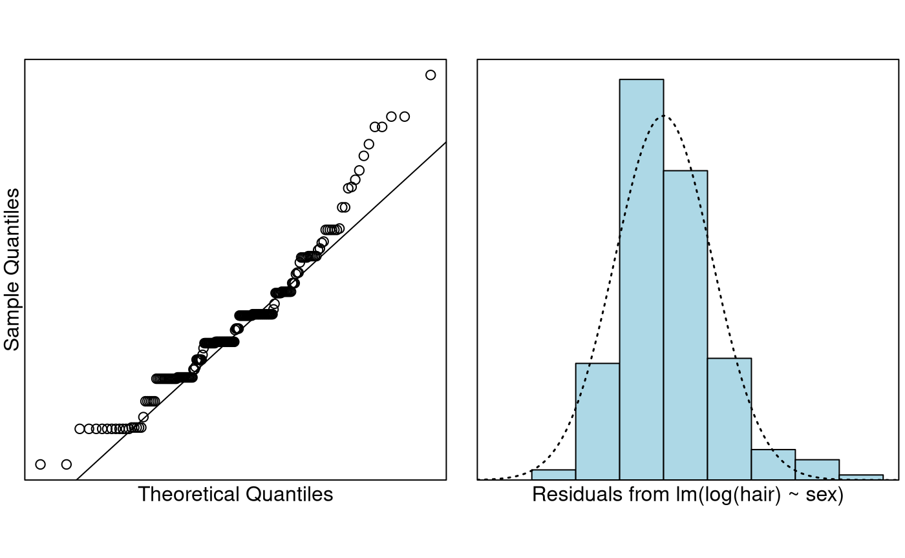

# Case Study 6.2: Students' expenditure on haircuts by gender

## Problem

The question of interest is “Do females spend more money on their hair
than males?” Also, “how much do students typically spend on haircuts?”
To answer these questions, a lecturer carried out a survey on 200
students. Also, A variety of variables were measured including `hair`
and `sex`.

The variables of interest are:

- `hair`: The student’s estimated monthly expenditure on haircuts.
- `sex`: The student’s gender, Male or Female.

### Question of Interest

Do females spend more money on their hair than males? Also, how much do
students typically spend on haircuts?

### Read in and Inspect the Data

``` r

survey.df = read.table("survey.txt", header = TRUE, stringsAsFactors = TRUE)
# To make things a little less cluttered we put the data in its own dataframe
hair.df = with(survey.df, data.frame(hair = hair, sex = sex))
plot(hair ~ sex, data = hair.df)
```



Females seem to spend more money on haircuts than males. We can see the
data is quite right-skewed. There also appears to be a problem with
equality of variance. Maybe taking logs will help.

``` r

plot(log(hair) ~ sex, data = hair.df)
```



Definitely makes things nicer, we should stick with the log-scale. So
perhaps we should perform our inference on the log-scale. Even on the
log-scale females appear to be spending more money on haircuts than
males.

### Model Building and Check Assumptions

``` r

hair.fit = lm(log(hair) ~ sex, data = hair.df)
plot(hair.fit, which = 1)
```



``` r

normcheck(hair.fit)
```



``` r

cooks20x(hair.fit)
```


``` r

summary(hair.fit)
```

    ## 
    ## Call:
    ## lm(formula = log(hair) ~ sex, data = hair.df)
    ## 
    ## Residuals:
    ##      Min       1Q   Median       3Q      Max 
    ## -1.13528 -0.43125 -0.04246  0.26189  2.01460 
    ## 
    ## Coefficients:
    ##             Estimate Std. Error t value Pr(>|t|)    
    ## (Intercept)  3.84333    0.05380  71.443  < 2e-16 ***
    ## sexmale     -0.70403    0.07889  -8.924 3.05e-16 ***
    ## ---
    ## Signif. codes:  0 '***' 0.001 '**' 0.01 '*' 0.05 '.' 0.1 ' ' 1
    ## 
    ## Residual standard error: 0.5565 on 198 degrees of freedom
    ## Multiple R-squared:  0.2868, Adjusted R-squared:  0.2832 
    ## F-statistic: 79.64 on 1 and 198 DF,  p-value: 3.048e-16

``` r

# Column bind the backtransformed output together
cbind(exp(coef(hair.fit)), exp(confint(hair.fit)))
```

    ##                             2.5 %     97.5 %
    ## (Intercept) 46.6807537 41.9821788 51.9051852
    ## sexmale      0.4945885  0.4233304  0.5778413

### Confidence Interval Output

``` r

pred.df = data.frame(sex = c("female", "male"))
exp(predict(hair.fit, pred.df, interval = "confidence"))
```

    ##        fit      lwr      upr
    ## 1 46.68075 41.98218 51.90519
    ## 2 23.08776 20.60453 25.87028

## Methods and Assumption Checks

The boxplot of `hair` vs `sex` revealed that the data were right-skewed.
Hence, we logged `hair`. The boxplot of `log(hair)` vs `sex` show
visible improvement. So, we have fitted a linear model with `log(hair)`
being explained by `sex`.

We probably wouldn’t say the data is normal from the Q-Q plot. What we
have is evidence of a lot of rounding—people rounding to the nearest
\$5, \$10, etc. However, the CLT should make things okay. The histogram
of the residuals was unimodal and reasonably symmetric. The rest of our
model assumptions have been satisfied.

Our final model is
``` math
log(Hair_i) = \beta_0 + \beta_1 \times SexMale_i + \epsilon_i,
```
where $`\epsilon_i \sim iid ~ N(0,\sigma^2)`$. Here $`SexMale_i=1`$ if
the student was male, otherwise it was zero.

Our model explained 29% of the variability in the logged students’ hair
expenditure.

## Executive Summary

We have strong evidence that females typically spend more money on their
hair than males.

We estimate that males spend approximately half as much as females do on
their hair. We are confident this factor is between 42% and 58%.

We estimate the median amount females spend on their hair each month is
\$47 and are confident it is between \$42 and \$52. For males we
estimate a median spend of \$23 and are confident it is between \$21 and
\$26.
