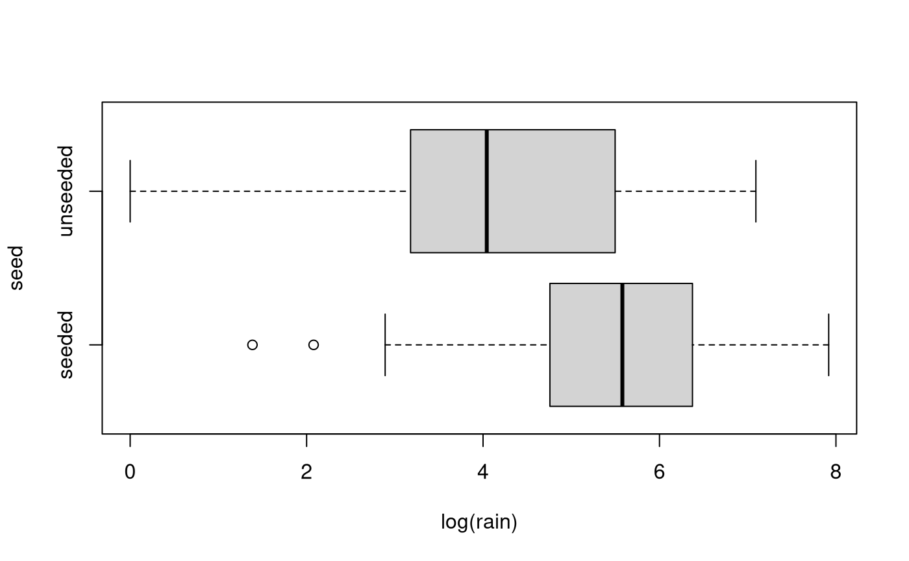
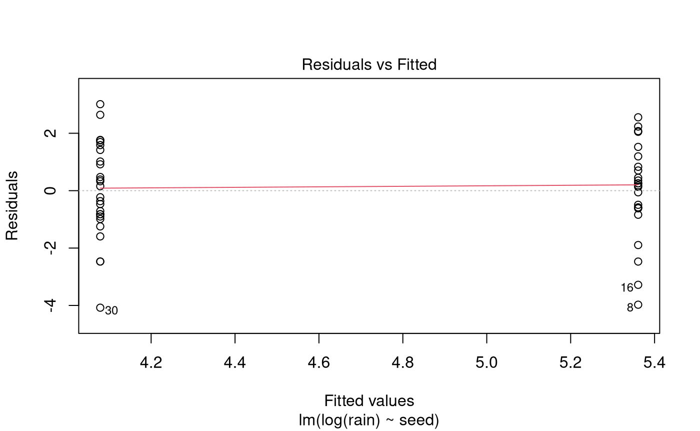
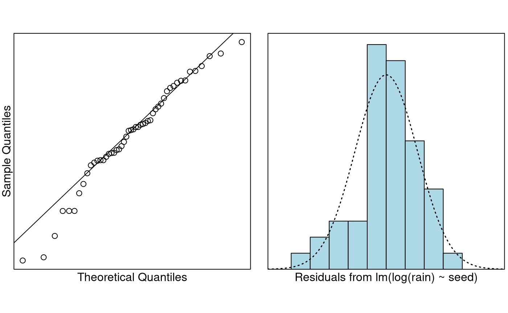

# Case Study 6.4: Clouding seeding

## Problem

The data in this question come from an experiment to see whether
cloud-seeding works. Cloud-seeding is the process of firing silver
nitrate (AgNO$`_3`$) into the clouds. Water coalesces around the silver
nitrate particles, hopefully getting large enough to precipitate (rain).
The measurements in this study are in acre-feet. One acre-foot is the
amount of water it takes to fill one acre uniformly to the depth of one
foot. One acre-foot is about 1.2 million litres of water (1233481.85532
litres to be exact). This dataset is included in the `s20x` library.

The variables of interest are:

- `rain`: total rainfall.
- `seed`: is a factor with two levels, `seeded` and `unseeded`.

### Question of Interest

We wish to see whether cloud seeding produces more rain. Also, what is
the typical rainfall from seeded and unseeded clouds?

### Read in and Inspect the Data

``` r

data(rain.df)
boxplot(rain ~ seed, data = rain.df, horizontal = TRUE)
```


Looks like our old right-skewed friend again. Maybe, just maybe, a
log-transformation would work. Let’s try it.

``` r

boxplot(log(rain) ~ seed, data = rain.df, horizontal = TRUE)
```



Yup. Looks much better, and we have preliminary evidence that the
seeding seems to work. Should we be worried about equality of variance?

``` r

summaryStats(log(rain) ~ seed, data = rain.df)
```

    ##          Sample Size     Mean   Median  Std Dev Midspread
    ## seeded            24 5.360901 5.579017 1.665145  1.518865
    ## unseeded          26 4.078695 4.042127 1.661585  2.198249

No. On the log-scale, the standard deviations are nearly identical, and
the midspreads are well below a factor of two different. Let’s go ahead
and fit the model.

### Model Building and Check Assumptions

``` r

rain.fit = lm(log(rain) ~ seed, data = rain.df)
plot(rain.fit, which = 1)
```



``` r

normcheck(rain.fit)
```



``` r

cooks20x(rain.fit)
```


``` r

summary(rain.fit)
```

    ## 
    ## Call:
    ## lm(formula = log(rain) ~ seed, data = rain.df)
    ## 
    ## Residuals:
    ##     Min      1Q  Median      3Q     Max 
    ## -4.0787 -0.8206  0.1679  1.1496  3.0139 
    ## 
    ## Coefficients:
    ##              Estimate Std. Error t value Pr(>|t|)    
    ## (Intercept)    5.3609     0.3395  15.790  < 2e-16 ***
    ## seedunseeded  -1.2822     0.4708  -2.723  0.00899 ** 
    ## ---
    ## Signif. codes:  0 '***' 0.001 '**' 0.01 '*' 0.05 '.' 0.1 ' ' 1
    ## 
    ## Residual standard error: 1.663 on 48 degrees of freedom
    ## Multiple R-squared:  0.1338, Adjusted R-squared:  0.1158 
    ## F-statistic: 7.416 on 1 and 48 DF,  p-value: 0.008985

``` r

# Let's refit the model so that `unseeded` is the base level.
rain.df$seed = relevel(rain.df$seed, ref = "unseeded")
rain.fit.2 = lm(log(rain) ~ seed, data = rain.df)
summary(rain.fit.2)
```

    ## 
    ## Call:
    ## lm(formula = log(rain) ~ seed, data = rain.df)
    ## 
    ## Residuals:
    ##     Min      1Q  Median      3Q     Max 
    ## -4.0787 -0.8206  0.1679  1.1496  3.0139 
    ## 
    ## Coefficients:
    ##             Estimate Std. Error t value Pr(>|t|)    
    ## (Intercept)   4.0787     0.3262  12.504  < 2e-16 ***
    ## seedseeded    1.2822     0.4708   2.723  0.00899 ** 
    ## ---
    ## Signif. codes:  0 '***' 0.001 '**' 0.01 '*' 0.05 '.' 0.1 ' ' 1
    ## 
    ## Residual standard error: 1.663 on 48 degrees of freedom
    ## Multiple R-squared:  0.1338, Adjusted R-squared:  0.1158 
    ## F-statistic: 7.416 on 1 and 48 DF,  p-value: 0.008985

``` r

exp(confint(rain.fit.2))
```

    ##                 2.5 %     97.5 %
    ## (Intercept) 30.656034 113.813484
    ## seedseeded   1.398702   9.289329

``` r

100 * (exp(confint(rain.fit.2)) - 1)
```

    ##                  2.5 %     97.5 %
    ## (Intercept) 2965.60341 11281.3484
    ## seedseeded    39.87024   828.9329

### Confidence Interval Output

``` r

pred.df = data.frame(seed = c("unseeded", "seeded"))
exp(predict(rain.fit.2, pred.df, interval = "confidence"))
```

    ##         fit       lwr      upr
    ## 1  59.06835  30.65603 113.8135
    ## 2 212.91668 107.58209 421.3853

## Methods and Assumption Checks

The boxplots of `log(rain)` showed that the groups were comparable. So,
we fitted a linear model to explain `log(rain)` with the explanatory
factor `seed`.

All model assumptions were satisfied.

Our final model is
``` math
log(Rain_i) = \beta_0 + \beta_1 \times Seed.Seeded_i + \epsilon_i,
```
where $`\epsilon_i \sim iid ~ N(0,\sigma^2)`$. Here $`Seed.Seeded_i=1`$
if the observation was done in a seeded environment, otherwise it is
zero.

Our model describes 13% of the variability in the logged measurements of
total rainfall.

## Executive Summary

We wish to see whether cloud seeding produces more rain.

There is strong evidence cloud-seeding works (*P-value* \< 0.01).

We estimate that the median rain from the seeded clouds is about 40% to
830% higher than that from unseeded clouds.

The unseeded clouds produce median rainfall of 30.7 to 113.8 acre-feet,
whereas for the seeded clouds it is 107.6 to 421.4 acre-feet of rain.
