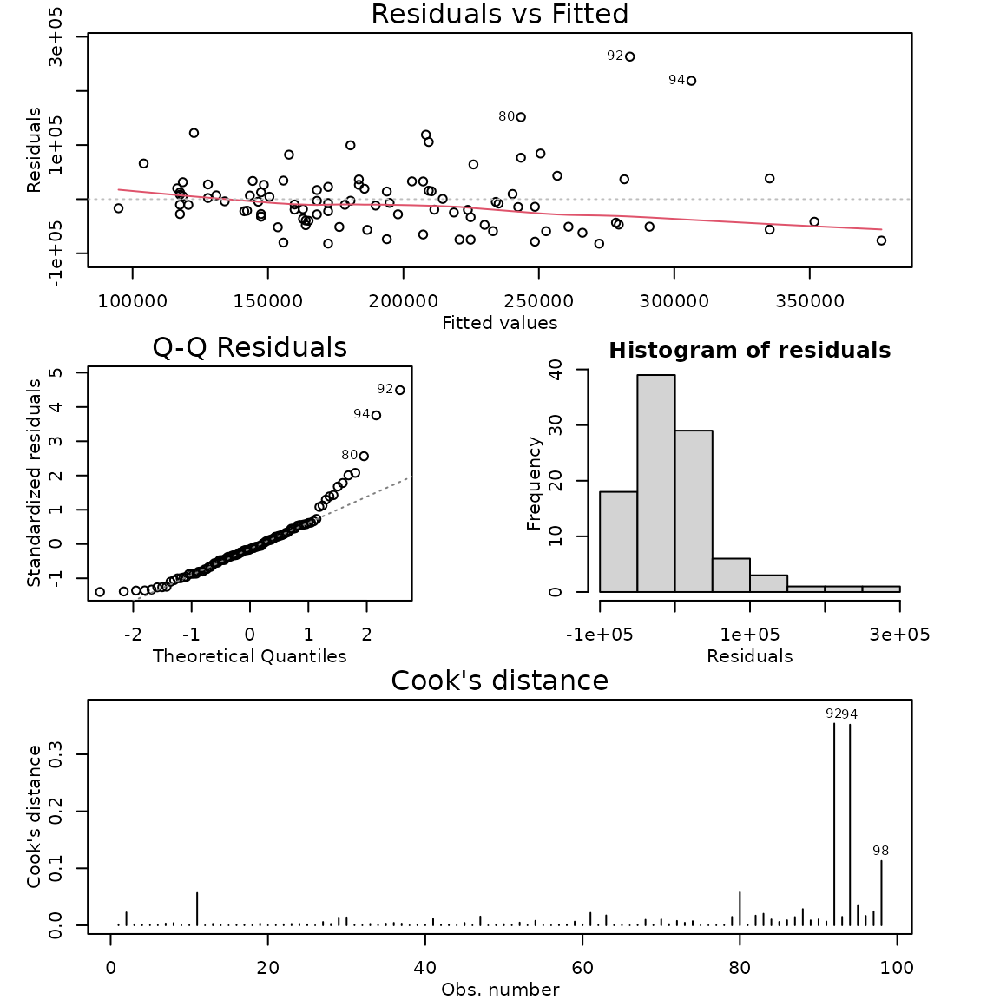
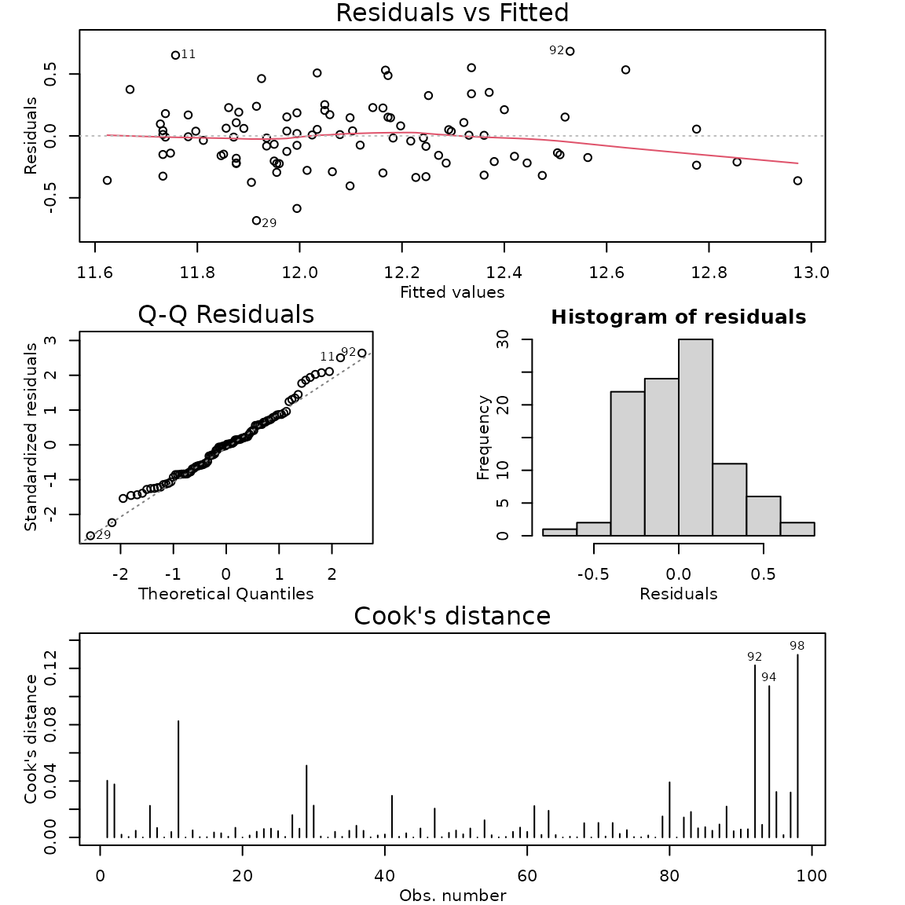

# Case Study 6.5: STATS 201/8 Extra Case Study - Log-linear model

## Question 1

A real estate agent in Saratoga, New York, wishes to investigate how the
sale price of houses is affected by the size of the house. In
particular, what is the effect on price of an additional 20 m^2 in
living area. We also want to compare prices for houses with living areas
categorised as small and large and estimate what the expected house
price for these two groups. She has compiled data from a random sample
of 112 recent house sales in the city.

The dataset is stored in Houses.csv and includes variables:

| Variable | Description |
|----|----|
| price | sale price of house, in US dollars |
| livingArea | size of the living area of the house, in square metres |
| livingSpace | a factor classifying the size of the living area as either *small* if less than 170 square metres or *large* if greater. |

**Disclaimer:** Before you rush off to Saratoga to buy a house, this is
an old data set. I’m afraid house prices have gone up a lot since this
data was collected.

**Instructions:**

- Comment on the two plots of the data.
- Fit an appropriate model to the data. Check the model assumptions.
- Plot the data on the log scale with your appropriate model
  superimposed over it.
- Plot the data on the original scale with your appropriate model
  superimposed over it.
- Write appropriate Methods and Assumption Checks.
- Write an appropriate **Executive Summary**.

### Question of interest/goal of the study

We wish to investigate how the prices of houses in Saratoga, New York,
are affected by the size of the house. In particular, what is the effect
on price of an additional 20 $`m^2`$ in living area.

### Inspect the data: livingArea as an explanatory variable

``` r

houses.df = read.csv("Houses.csv", header = TRUE, stringsAsFactors = TRUE)
plot(price ~ livingArea, houses.df, main = "Price versus Living Area")
plot(log(price) ~ livingArea, houses.df, main = "log(Price) versus Living Area")
```


### Comment on the two plots of the data.

There is an increasing relationship between house price and living area.
The initial plot shows that scatter increases for higher values of
living area, but log-transforming the response variable in the second
plot results in a relationship that looks reasonably linear with
constant scatter

### Fit model and check assumptions

``` r

houses.fit1 <- lm(price ~ livingArea, houses.df)
modelcheck(houses.fit1)
```



``` r

# Log the response variable and refit the model:
houses.fit2 <- lm(log(price) ~ livingArea, houses.df)
modelcheck(houses.fit2)
```



``` r

summary(houses.fit2)
```

    ## 
    ## Call:
    ## lm(formula = log(price) ~ livingArea, data = houses.df)
    ## 
    ## Residuals:
    ##      Min       1Q   Median       3Q      Max 
    ## -0.68367 -0.19741 -0.00103  0.15295  0.68365 
    ## 
    ## Coefficients:
    ##              Estimate Std. Error t value Pr(>|t|)    
    ## (Intercept) 1.132e+01  7.930e-02   142.7   <2e-16 ***
    ## livingArea  4.943e-03  4.707e-04    10.5   <2e-16 ***
    ## ---
    ## Signif. codes:  0 '***' 0.001 '**' 0.01 '*' 0.05 '.' 0.1 ' ' 1
    ## 
    ## Residual standard error: 0.2637 on 96 degrees of freedom
    ## Multiple R-squared:  0.5347, Adjusted R-squared:  0.5298 
    ## F-statistic: 110.3 on 1 and 96 DF,  p-value: < 2.2e-16

``` r

confint(houses.fit2)
```

    ##                    2.5 %       97.5 %
    ## (Intercept) 11.159985754 11.474808217
    ## livingArea   0.004009236  0.005877797

``` r

# back transform
exp(confint(houses.fit2))
```

    ##                    2.5 %       97.5 %
    ## (Intercept) 70261.955239 96260.007176
    ## livingArea      1.004017     1.005895

``` r

# Extract second row of CI output only.
exp(confint(houses.fit2)[2, ])
```

    ##    2.5 %   97.5 % 
    ## 1.004017 1.005895

``` r

# % change 100*(value-1)
100 * (exp(confint(houses.fit2)[2, ]) - 1)
```

    ##     2.5 %    97.5 % 
    ## 0.4017283 0.5895105

``` r

# scale by 20 and THEN back transform
exp(confint(houses.fit2)[2, ] * 20)
```

    ##    2.5 %   97.5 % 
    ## 1.083487 1.124745

``` r

# % change 100*(value-1)
100 * (exp(confint(houses.fit2)[2, ] * 20) - 1)
```

    ##     2.5 %    97.5 % 
    ##  8.348718 12.474455

### Plot the data on the log scale with your appropriate model superimposed over it

``` r

plot(log(price) ~ livingArea, houses.df, main = "log(Price) versus Living Area")
abline(houses.fit2)
```


### Plot the data on the original scale with your appropriate model superimposed over it

``` r

plot(price ~ livingArea, houses.df, main = "log(Price) versus Living Area")
lines(50:350, exp(houses.fit2$coef[1] + houses.fit2$coef[2] * 50:350))
```


### Methods and assumption checks

We have one numeric explanatory variable so have fitted a simple linear
regression model to the data. However, we have clear evidence of
increasing scatter as the living area increases so have logged the
response variable price.

After logging price, the residuals looked much better. Normality looks
good and no influential points were detected. We have a random sample,
so the independence assumption is satisfied. Model assumptions are
satisfied.

Our model is:
$`log(price_i) = \beta_0  + \beta_1 \times livingArea_i  + \epsilon_{i}`$,
where $`\epsilon_i \sim iid N(0,\sigma^2)`$

Our model explained 53.5% of the variability in the logged data.

### Executive Summary.

We investigated how the prices of houses in Saratoga, New York, are
affected by house size.

We found strong evidence that the median house price increases as the
size of the living area increases.Furthermore, this relationship
increases exponentially, so the greater the size of the living area, the
bigger the increase.

We estimate that the median house price increases by between 8.3 and
12.5 for every 20 $`m^2`$ increase in living area.
