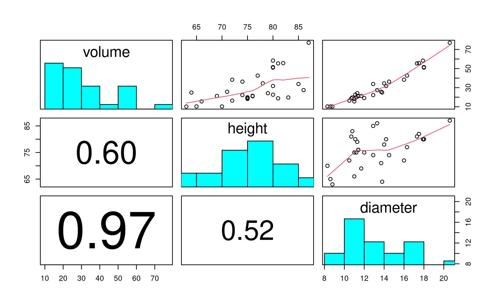
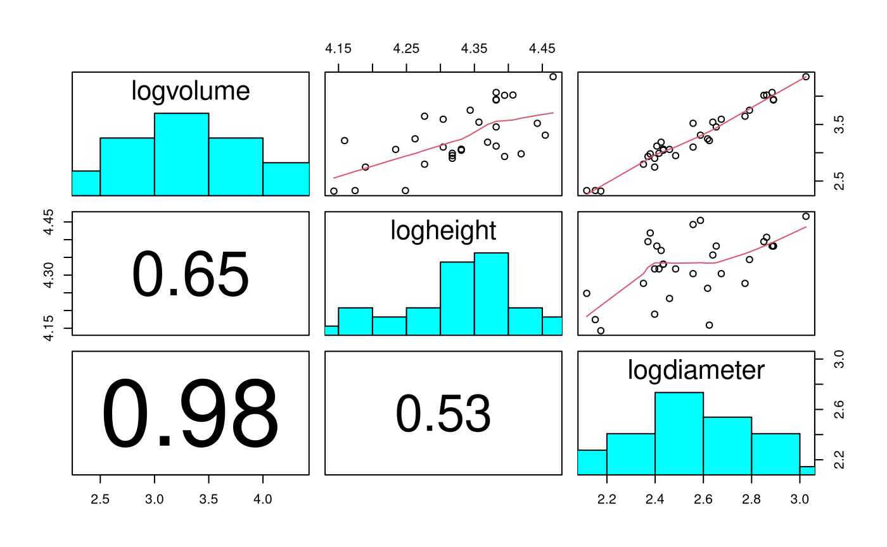
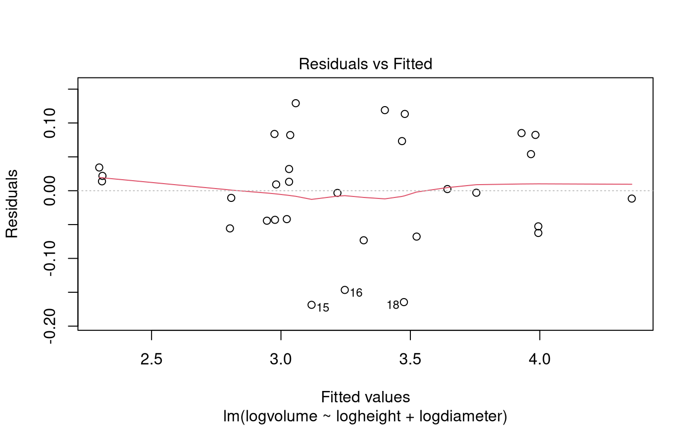
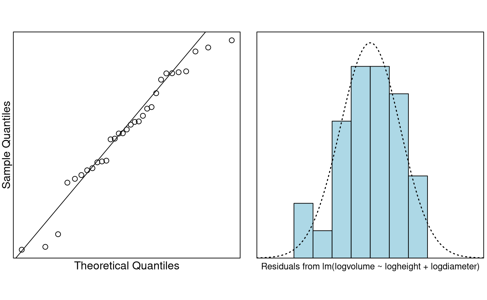

# Case Study 7.1: Case Study for Chapter 7: Power law model for cherry tree volumes

## Problem

We want to build a model to estimate the volume of a tree from the
measurement of its height and diameter. This data set provides
measurements of the diameter, height and volume of timber in 31 felled
black cherry trees.

The data consist of 31 observations on the following 3 variables:

- `diameter`: Tree diameter in inches (measured at 4 ft 6 in above the
  ground).
- `height`: Height in feet.
- `volume`: Volume of timber in cubic feet.

### Question of Interest

The objective is to be able to estimate the volume of the tree from the
measurement of its height and diameter.

#### Model Justification

Using basic geometry, it can argued that volume will have a power law
relationship with diameter and height. Specifically, it may be that the
trunk of a tree can be reasonably approximated by a cylinder/or cone.

For a cylinder the volume is $`V=\pi h r^{2}`$ where $`r`$ is radius and
$`h`$ is height.

For a cone it is $`V=\frac{\pi}{3} h r^{2}`$.

In general, this corresponds to the power law $`V\propto h d^{2}`$,
where $`d`$ is diameter.

That is, $`\log(V)=\beta_0+\log(h)+2*\log(d)`$.

This can be written $`\log(V)=\beta_0+\beta_1*\log(h)+\beta_2\log(d)`$
where $`\beta_1=1`$ and $`\beta_2=2`$.

Hence, to explore whether the above geometric argument is valid, we also
need to test the hypotheses $`H_0:\beta_1=1`$, $`H_0:\beta_2=2`$.

### Read in and Inspect the Data

``` r

Cherry.df = read.table("Cherry.txt", header = TRUE)
pairs20x(Cherry.df[, c("volume", "height", "diameter")])
```

``` r

pairs20x(Cherry.df[, c("volume", "height", "diameter")])
```



Scatter in volume increases with size. Relationship between volume and
height looks close to linear, and with diameter looks to be increasing
in slope with size.

``` r

# Let's create some new variables in Cherry.df
Cherry.df$logvolume = log(Cherry.df$volume)
Cherry.df$logheight = log(Cherry.df$height)
Cherry.df$logdiameter = log(Cherry.df$diameter)

# Check out the new names
dimnames(Cherry.df)[[2]]
```

    ## [1] "diameter"    "height"      "volume"      "logvolume"   "logheight"  
    ## [6] "logdiameter"

``` r

pairs20x(Cherry.df[, c("logvolume", "logheight", "logdiameter")])
```



Scatter in logvolume looks constant, and relationship with logheight and
logdiameter looks linear.

``` r

Cherry.fit = lm(logvolume ~ logheight + logdiameter, data = Cherry.df)
plot(Cherry.fit, which = 1)
```



``` r

normcheck(Cherry.fit)
```



``` r

cooks20x(Cherry.fit)
```


``` r

summary(Cherry.fit)
```

    ## 
    ## Call:
    ## lm(formula = logvolume ~ logheight + logdiameter, data = Cherry.df)
    ## 
    ## Residuals:
    ##       Min        1Q    Median        3Q       Max 
    ## -0.168561 -0.048488  0.002431  0.063637  0.129223 
    ## 
    ## Coefficients:
    ##             Estimate Std. Error t value Pr(>|t|)    
    ## (Intercept) -6.63162    0.79979  -8.292 5.06e-09 ***
    ## logheight    1.11712    0.20444   5.464 7.81e-06 ***
    ## logdiameter  1.98265    0.07501  26.432  < 2e-16 ***
    ## ---
    ## Signif. codes:  0 '***' 0.001 '**' 0.01 '*' 0.05 '.' 0.1 ' ' 1
    ## 
    ## Residual standard error: 0.08139 on 28 degrees of freedom
    ## Multiple R-squared:  0.9777, Adjusted R-squared:  0.9761 
    ## F-statistic: 613.2 on 2 and 28 DF,  p-value: < 2.2e-16

``` r

confint(Cherry.fit)
```

    ##                 2.5 %    97.5 %
    ## (Intercept) -8.269912 -4.993322
    ## logheight    0.698353  1.535894
    ## logdiameter  1.828998  2.136302

### Test the Two Requested Hypotheses

``` r

# Obtain the estimates of interest
(estimates = summary(Cherry.fit)$coeff[2:3, 1])
```

    ##   logheight logdiameter 
    ##    1.117123    1.982650

``` r

# and their associated std errors
(std.errors = summary(Cherry.fit)$coeff[2:3, 2])
```

    ##   logheight logdiameter 
    ##  0.20443706  0.07501061

``` r

# t-values for the two hypotheses beta1=1 and beta2=2
(tstats = (estimates - c(1, 2)) / std.errors)
```

    ##   logheight logdiameter 
    ##   0.5729066  -0.2313018

``` r

# p-values
(pvals = 2 * (1 - pt(abs(tstats), 28)))
```

    ##   logheight logdiameter 
    ##   0.5712805   0.8187623

## Method and Assumption Checks

After logging the variables, the scatter plots showed the desired linear
relationship between volume and the height and diameter variables, and
constant scatter. So, we fitted a power law model explaining log volume
with both log height and log diameter.

The underlying model assumptions appear valid with no unduly influential
points.

Our final model is
``` math
log(volume_i)=\beta_0 +\beta_1\times log(height_i)+ \beta_2*log(diameter_i)+ \epsilon_i,
```
where $`\epsilon_i \sim iid ~ N(0,\sigma^2)`$.

Our power law model explained 97.8% of the total variability in (log)
volume.

## Executive Summary

The objective is to be able to estimate the volume of the tree from the
measurement of its height and diameter. The postulated model was that
cherry tree volume would follow a power law relationship with height and
diameter. In particular, that volume would increase linearly with
height, and with the square of diameter.

Cherry tree volume was seen to follow a power law model with respect to
both height and weight, and there was no evidence that these powers
differ from the hypothesised values of 1 (*P-value = 0.57*) and 2
(*P-value = 0.82*), respectively. It would appear that our geometrical
arguments were valid.

We estimate that a 1% increase in height corresponds to an increase in
median volume of between 0.70% and 1.54%, and a 1% increase in diameter
corresponds to an increase in median volume of between 1.83% and 2.14%.

### Addendum (not examinable)

If you believe (and we have no reason not to) that the underlying
relationship is indeed that $`V \propto h r^2`$ then the only term to be
estimated is $`\beta_0`$. This is how you’d estimate it:

``` r

# Intercept only model.
fit.beta0 = lm(I(logvolume - logheight - 2 * logdiameter) ~ 1, data = Cherry.df)
# beta0 changes from -6.63 to -6.17
summary(fit.beta0)
```

    ## 
    ## Call:
    ## lm(formula = I(logvolume - logheight - 2 * logdiameter) ~ 1, 
    ##     data = Cherry.df)
    ## 
    ## Residuals:
    ##       Min        1Q    Median        3Q       Max 
    ## -0.168446 -0.047355 -0.003518  0.066308  0.136467 
    ## 
    ## Coefficients:
    ##             Estimate Std. Error t value Pr(>|t|)    
    ## (Intercept) -6.16917    0.01421  -434.3   <2e-16 ***
    ## ---
    ## Signif. codes:  0 '***' 0.001 '**' 0.01 '*' 0.05 '.' 0.1 ' ' 1
    ## 
    ## Residual standard error: 0.0791 on 30 degrees of freedom
