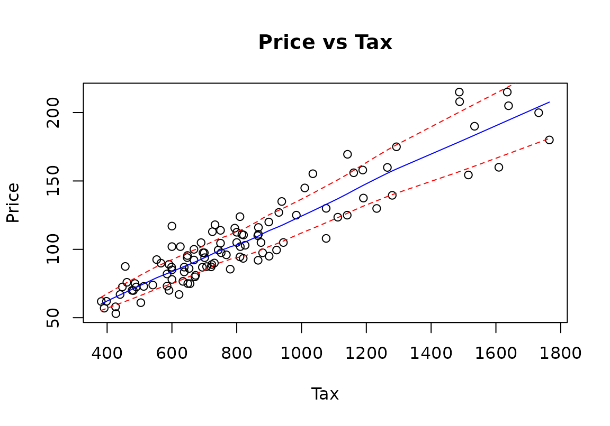
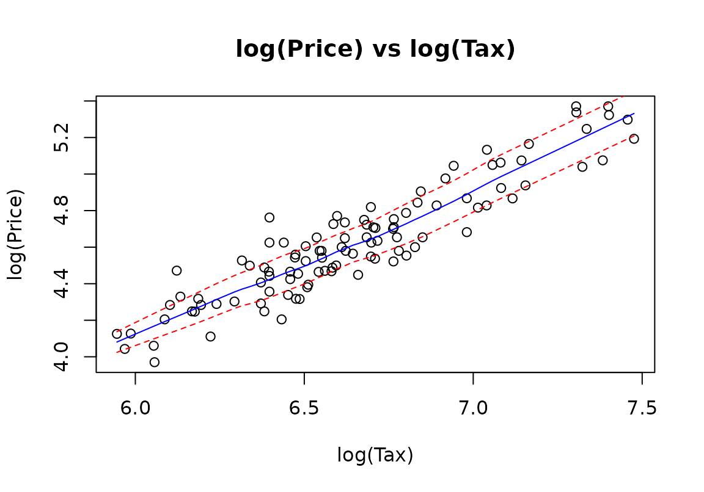
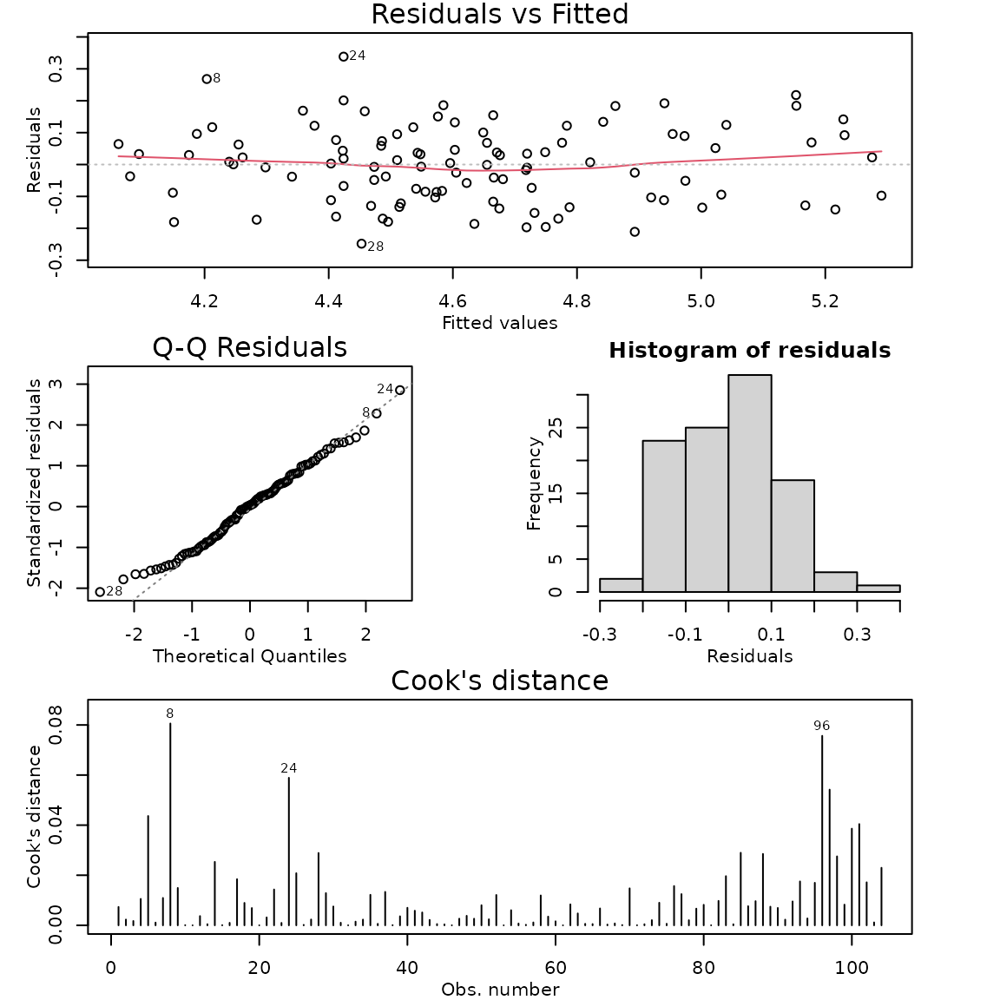

# Case Study 7.2: STATS 201/8 Extra Case Study - Log-Log Model

## Question 1

We want to build a model to explain the sale price of houses using their
annual city tax bill (similar idea to rates in New Zealand) for houses
in Albuquerque, New Mexico. In particular, we are interested in
estimating the effect on sales price for houses which differ in city tax
bills by 1% and 50%. Data was collected from a random sample of 104
houses sold in Albuquerque.

The dataset is stored in hometax.csv and includes variables:

| Variable | Description |
|----|----|
| Price | the sales price of the house (in thousands of dollars). |
| Tax | the amount of annual city tax paid for the house in the year of sale. |

**Instructions:**

- Comment on the two plots of the data.
- Justify why a log-log (power) model is appropriate here
- Fit a log-log model to the data. Check the model assumptions.
- Write appropriate Methods and Assumption Checks.
- Write an appropriate **Executive Summary**.

### Question of interest/goal of the study

We want to build a model to explain the sale price of houses using their
annual city tax bill (similar idea to rates in New Zealand) for houses
in Albuquerque, New Mexico. In particular, we are interested in
estimating the effect on sales price for houses which differ in city tax
bills by 1% and 50%.

### Inspect the data: livingArea as an explanatory variable

``` r

hometax.df = read.csv("hometax.csv")

trendscatter(Price ~ Tax, main = "Price vs Tax", data = hometax.df)
trendscatter(log(Price) ~ log(Tax), main = "log(Price) vs log(Tax)", data = hometax.df)
```



### Comment on the two plots

There is a roughly linear increasing relationship between tax and price.
However, we can see that as tax increases the amount of variability in
price also increases. Also, both tax and Price are positively (right)
skewed, with most of the values being low and relatively few larger
values. The plot of log(Price) versus log(Tax) shows an increasing
linear relationship with roughly constant scatter.

### Justify why a log-log (power) model is appropriate here.

A log-log model can be justified several ways:

- we have commercial data where both variables (Tax and Price) are
  likely to have exponential distributions as they are based on property
  values, which will tend to have a long upper tail.
- the data reveals a pattern of a linear relationship with increasing
  scatter.
- both variables are right skewed.
- and a plot of the logged variables has solved any of our problems with
  the assumptions showing the model is appropriate.
- we want to interpret both variables in terms of percentage changes and
  the log-log plot appears to satisfy the linear models assumptions.

### Fit model and check assumptions

``` r

homefit1 = lm(log(Price) ~ log(Tax), data = hometax.df)
modelcheck(homefit1)
```



``` r

summary(homefit1)
```

    ## 
    ## Call:
    ## lm(formula = log(Price) ~ log(Tax), data = hometax.df)
    ## 
    ## Residuals:
    ##      Min       1Q   Median       3Q      Max 
    ## -0.24820 -0.09519  0.00380  0.07994  0.33821 
    ## 
    ## Coefficients:
    ##             Estimate Std. Error t value Pr(>|t|)    
    ## (Intercept) -0.71348    0.21679  -3.291  0.00137 ** 
    ## log(Tax)     0.80311    0.03257  24.660  < 2e-16 ***
    ## ---
    ## Signif. codes:  0 '***' 0.001 '**' 0.01 '*' 0.05 '.' 0.1 ' ' 1
    ## 
    ## Residual standard error: 0.1194 on 102 degrees of freedom
    ## Multiple R-squared:  0.8564, Adjusted R-squared:  0.855 
    ## F-statistic: 608.1 on 1 and 102 DF,  p-value: < 2.2e-16

``` r

confint(homefit1)
```

    ##                  2.5 %     97.5 %
    ## (Intercept) -1.1434829 -0.2834689
    ## log(Tax)     0.7385139  0.8677080

``` r

confint(homefit1)[2, ]
```

    ##     2.5 %    97.5 % 
    ## 0.7385139 0.8677080

``` r

1.01^confint(homefit1)[2, ]
```

    ##    2.5 %   97.5 % 
    ## 1.007376 1.008671

``` r

1.5^confint(homefit1)[2, ]
```

    ##    2.5 %   97.5 % 
    ## 1.349105 1.421660

``` r

100 * (1.01^confint(homefit1)[2, ] - 1)
```

    ##     2.5 %    97.5 % 
    ## 0.7375524 0.8671362

``` r

100 * (1.5^confint(homefit1)[2, ] - 1)
```

    ##    2.5 %   97.5 % 
    ## 34.91053 42.16602

### Methods and assumption checks

We want to interpret both variables in terms of percentage changes and
the log-log plot appears to satisfy the linear models assumptions so we
fitted a log-log model to the data. The residual plot showed
approximately constant variability and no trend. Normality looks good
and no influential points were detected. A random sample of houses was
taken so independence is satisfied. Model assumptions are satisfied.

Our model is:
$`log(Price_i)=\beta_0+\beta_1 \times log(Tax_i)+\epsilon_i`$, where
$`\epsilon_i \sim iid N(0,\sigma^2)`$

Our model explained 85.6% of the variability in the logged data.

### Executive Summary.

We want to build a model to explain the sale price of houses using their
annual city tax bill (similar idea to rates in New Zealand) for houses
in Albuquerque, New Mexico.

We found strong evidence that the prices of houses increased as the city
tax bill was higher. The increase followed a power-law relationship.

We estimate that a city tax bill that is 1% higher is associated with a
median sale price of houses that is between 0.74% and 0.87% higher.

We estimate that a city tax bill that is 50% higher is associated with a
median sale price of houses that is between 35% and 42% higher.
