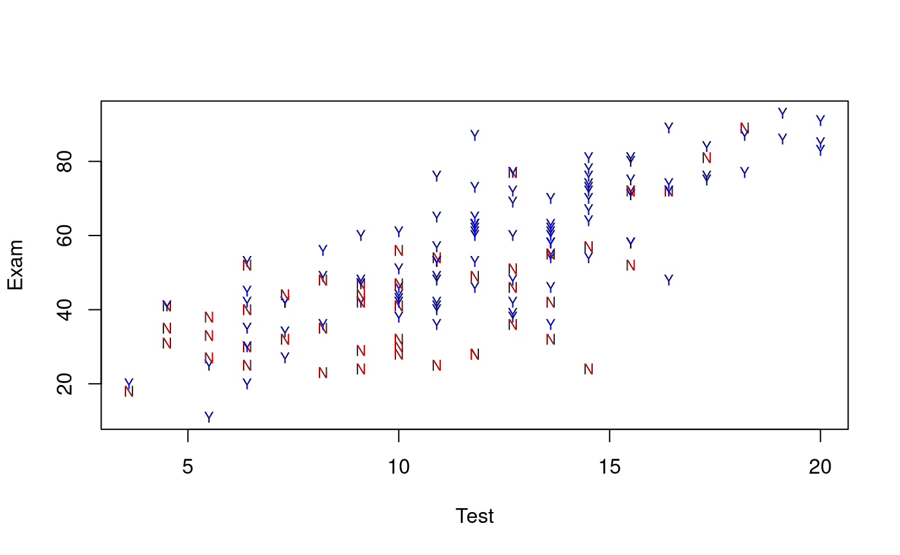
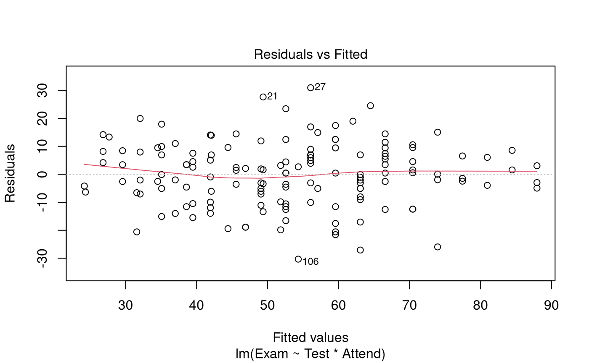
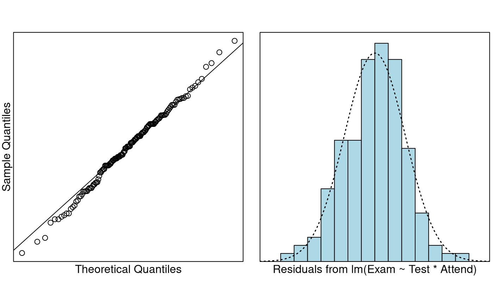
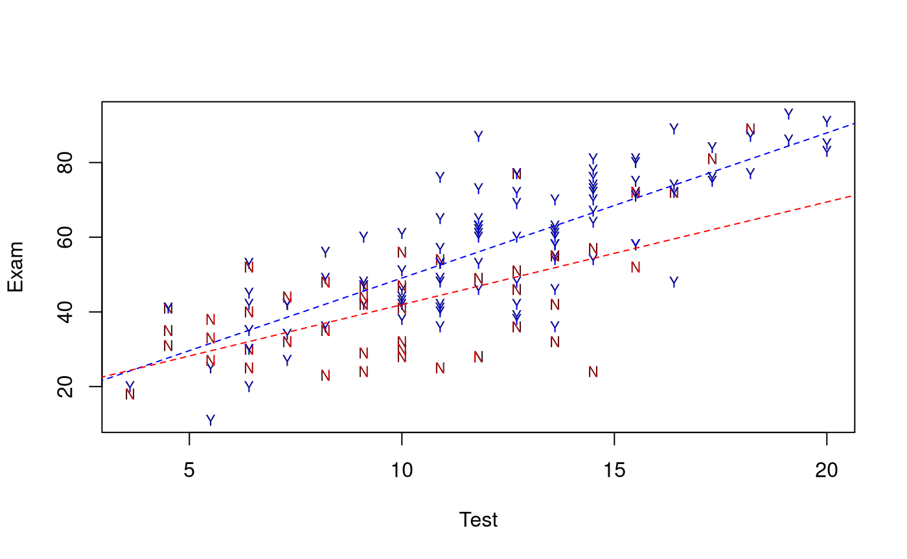

# Case Study 8.1: Exam vs attendance and test mark

## Problem

We’ve previously used test marks and attendance seperately in order to
explain variability in exam marks. The objective here is to use them
together.

### Question of Interest

To quantify students’ exam marks relationship with attendance and test
marks. Also, does any relationship between exam marks and test marks
depend on whether students attended lectures.

### Read in and Inspect the Data

``` r

Stats20x.df = read.table("STATS20x.txt", header = TRUE)
plot(Exam ~ Test,
  data = Stats20x.df, pch = substr(Attend, 1, 1), cex = 0.7,
  col = ifelse(Attend == "Yes", "blue", "red")
)
```



A scatter plot of test score versus exam suggested that the positive
relationship between test and exam was reasonably linear within each
attendance group (“Yes” or “No”), but that the slope could be different
in the two groups.

### Model Building and Check Assumptions

``` r

examTestAttend.fit = lm(Exam ~ Test * Attend, data = Stats20x.df)
plot(examTestAttend.fit, which = 1)
```



``` r

normcheck(examTestAttend.fit)
```



``` r

cooks20x(examTestAttend.fit)
```


``` r

summary(examTestAttend.fit)
```

    ## 
    ## Call:
    ## lm(formula = Exam ~ Test * Attend, data = Stats20x.df)
    ## 
    ## Residuals:
    ##      Min       1Q   Median       3Q      Max 
    ## -30.3155  -6.5139   0.4383   7.3166  30.9383 
    ## 
    ## Coefficients:
    ##                Estimate Std. Error t value Pr(>|t|)    
    ## (Intercept)     14.4467     4.9443   2.922  0.00405 ** 
    ## Test             2.7496     0.4603   5.973 1.78e-08 ***
    ## AttendYes       -4.2582     6.3723  -0.668  0.50506    
    ## Test:AttendYes   1.1380     0.5577   2.040  0.04316 *  
    ## ---
    ## Signif. codes:  0 '***' 0.001 '**' 0.01 '*' 0.05 '.' 0.1 ' ' 1
    ## 
    ## Residual standard error: 11.41 on 142 degrees of freedom
    ## Multiple R-squared:  0.6347, Adjusted R-squared:  0.627 
    ## F-statistic: 82.25 on 3 and 142 DF,  p-value: < 2.2e-16

``` r

confint(examTestAttend.fit)
```

    ##                       2.5 %    97.5 %
    ## (Intercept)      4.67287511 24.220625
    ## Test             1.83956971  3.659567
    ## AttendYes      -16.85506294  8.338572
    ## Test:AttendYes   0.03547053  2.240510

### Visualise the Final Model

``` r

predAttend.df = data.frame(Test = 1:21, Attend = "Yes")
predSlackers.df = data.frame(Test = 1:21, Attend = "No")
plot(Exam ~ Test,
  data = Stats20x.df, pch = substr(Attend, 1, 1), cex = 0.7,
  col = ifelse(Attend == "Yes", "blue", "red")
)
lines(1:21, predict(examTestAttend.fit, predAttend.df), col = "blue", lty = 2)
lines(1:21, predict(examTestAttend.fit, predSlackers.df), col = "red", lty = 2)
```



## Method and Assumption Checks

As we have two explanatory variables, one numeric and one factor, we
have fitted a linear model that used different intercept and slopes for
each attendance group (i.e., interaction model). We could not drop the
interaction term (*P-value* = 0.043).

All model assumptions were satisfied.

Our final model is
``` math
Exam_i=\beta_0 +\beta_1\times Test_i+ \beta_2\times Attend_i + \beta_3\times Attend_i\times Test_i+ \epsilon_i,
```
where $`Attend_i=1`$ if student $`i`$ is a regular attender, otherwise
0, and $`\epsilon_i \sim iid ~ N(0,\sigma^2)`$.

Our model explained a modest 63% of the variability in students’ exam
marks.

## Executive Summary

We wanted to quantify students’ exam marks relationship with attendance
and test marks.

There was a clear linear relationship between test and exam scores, but
this relationship differed between students who attended and who did not
attend lectures.

We estimate that each additional test mark (out of 20) obtained by a
non-attending student would increase their expected exam mark by between
1.8 to 3.7.

For regular attenders, the increase is an additional 0.04 to 2.24
expected exam marks per test mark.
