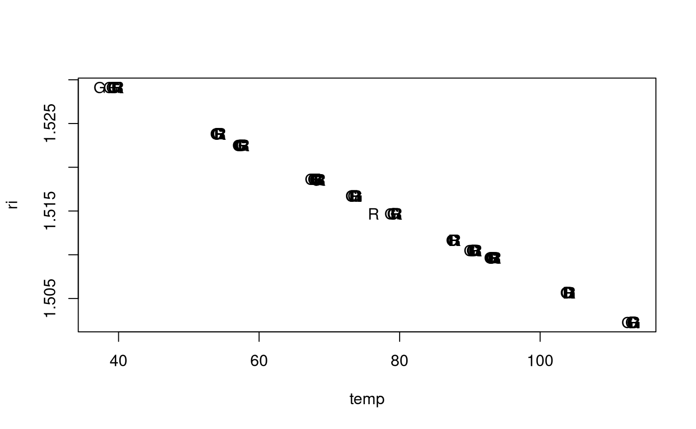
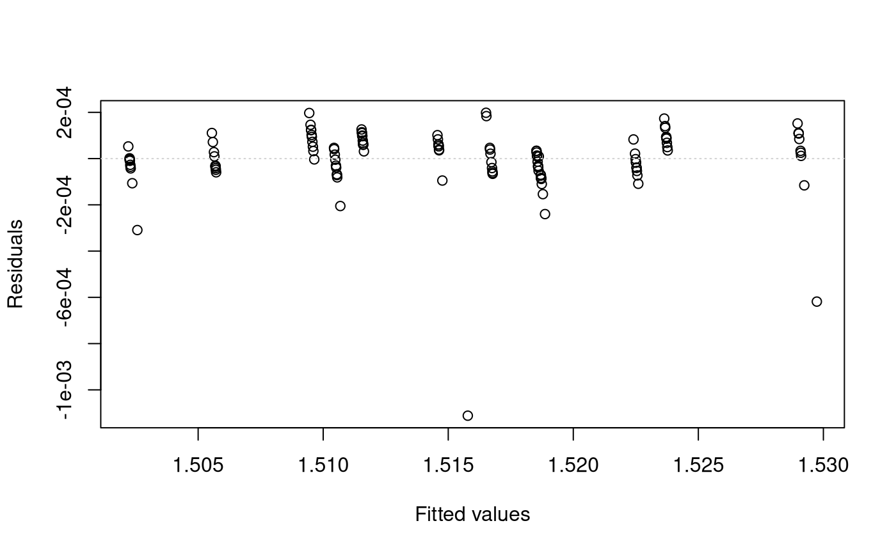
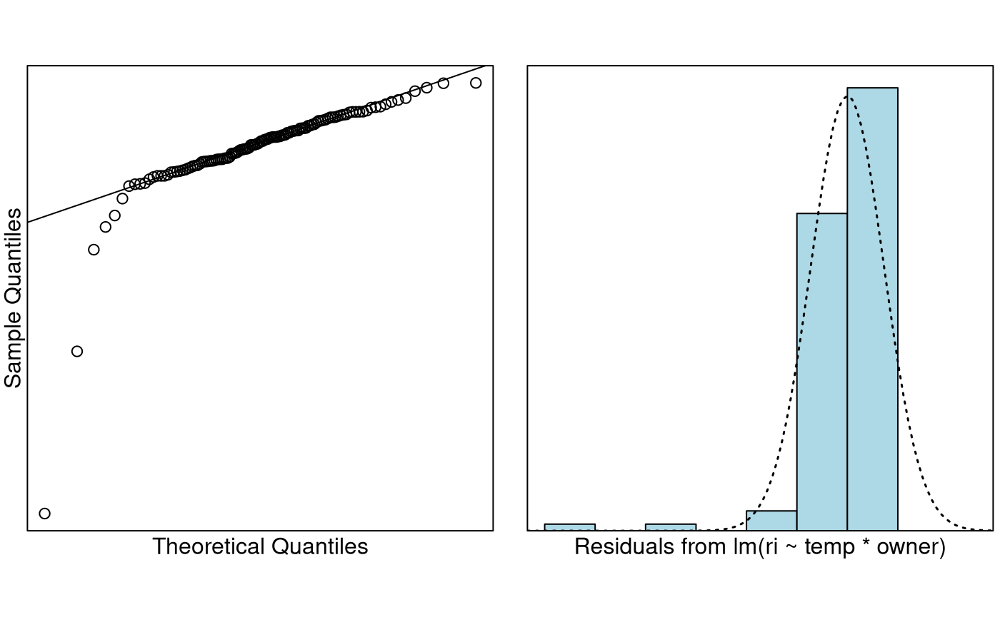
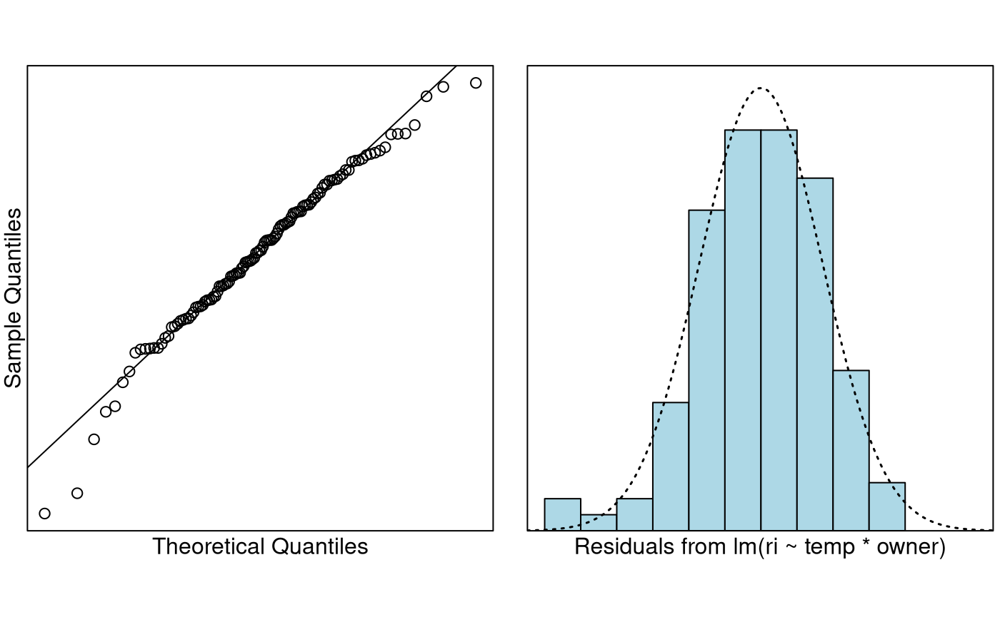
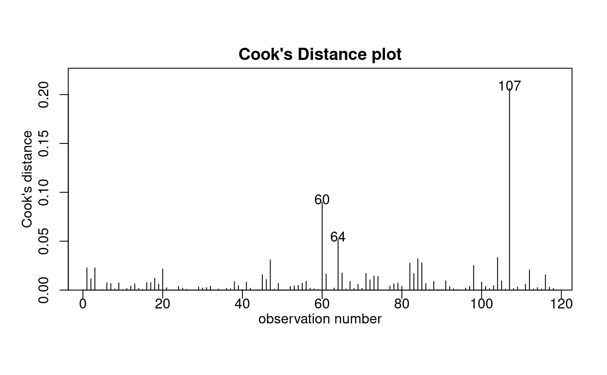

# Case Study 8.2: Refractive Index Calibration

**Note** this handout requires that you install the package `dafs`
before you can try the examples.

Glass evidence can be important to forensic scientists. If a window, or
some other source of glass, is broken during the commission of a crime,
then tiny fragments maybe transferred to the breaker. Studies have shown
that glass from the same source has a similar refractive index (RI),
whereas glass from different sources usually have very different RIs.
Therefore, the presence of glass fragments on the clothing of a person
of interest (POI) that have similar RI values to a broken source at a
crime scene can associate that individual with the crime.

Refractive index describes the way light “bends” when it passes from one
optical medium (like air) to medium of a different density (like glass
or water). If you want to think about this, then think how a pencil
appears to be “cut” when you see it viewed through a glass of water.
This is because both the glass and the water are more dense than the
air. RI of glass is determined by placing it in silicone oil. The
optical density of silicone oil can changed by heating it or cooling it.
A glass fragment is placed in a droplet of silicone oil which is then
heated until the glass becomes optically indistinguishable from the oil.
The temperature at which this happens is recorded. The the oil is cooled
and the temperature at which the glass reappears is recorded. The
average of these two temperatures is called the match temperature. This
match temperature is then translated into RI by means of a calibration
line. Calibration is the process where by a set of “standards”” with
known $`Y`$ values are measured with an instrument to observe the
corresponding $`X`$. These pairs of values can be used to produce a
calibration curve which can be used to interpolate (or predict) the
unknown value of $`Y`$ for an observed $`X`$. In some sense this is
“inverse regression”—usually we know $`X`$ and we measure $`Y`$.

In this example we have a set of 12 standards (labelled B1–B12) of known
RI value. Each of these standards has been measured multiple times by
two different forensic scientists, Rachel Bennett (RB), and my Polish
colleague Grzegorz “Greg” Zadora (GZ). The RI and match temperature has
been recorded for each measurement of each standard by each scientist.
We want to know whether the two different labs/scientists have two
different calibration lines.

``` r

data("ri.calibration.df")

## Let's make the name shorter so it is easier to work with
ri.df = ri.calibration.df
names(ri.df)
```

    ## [1] "standard" "ri"       "temp"     "owner"

``` r

head(ri.df)
```

    ##   standard      ri  temp owner
    ## 1       B1 1.52912 39.97    RB
    ## 2       B1 1.52912 39.90    RB
    ## 3       B1 1.52912 39.97    RB
    ## 4       B1 1.52912 39.70    RB
    ## 5       B1 1.52912 39.76    RB
    ## 6       B2 1.52381 54.50    RB

First we plot the data.

``` r

plot(ri ~ temp, pch = substr(ri.df$owner, 1, 1), data = ri.df)
```



It is really hard to tell if there is a difference from this plot. One
of the reasons is that this data is super precise. We can see a couple
of potential outliers.

We will fit a model. We will ignore the fact that we have multiple
measurements on the same standard in this analysis.

``` r

ri.fit = lm(ri ~ temp * owner, data = ri.df)
eovcheck(ri.fit)
```



The data is very patterned. We expect this because each standard has
been measured multiple times. We can see there are 2–3 big outliers, but
basically equality of variance looks fine.

How about normality?

``` r

normcheck(ri.fit)
```



Looks pretty good again except for some outliers. Probably if we got rid
of points 31 and 109, things would be much better. Let’s try that:

``` r

ri.fit2 = lm(ri ~ temp * owner, data = ri.df, subset = -c(31, 109))
normcheck(ri.fit2)
```



That looks way better. The picture isn’t being distorted by huge
outliers. How about influential points. Do we really expect any?

``` r

cooks20x(ri.fit2)
```



Nothing much to worry about there. So we can trust the inference.

``` r

summary(ri.fit2)
```

    ## 
    ## Call:
    ## lm(formula = ri ~ temp * owner, data = ri.df, subset = -c(31, 
    ##     109))
    ## 
    ## Residuals:
    ##        Min         1Q     Median         3Q        Max 
    ## -2.834e-04 -5.323e-05  1.866e-06  5.897e-05  1.836e-04 
    ## 
    ## Coefficients:
    ##                Estimate Std. Error   t value Pr(>|t|)    
    ## (Intercept)   1.543e+00  4.481e-05 34444.651  < 2e-16 ***
    ## temp         -3.627e-04  5.569e-07  -651.328  < 2e-16 ***
    ## ownerRB       2.701e-04  6.253e-05     4.320 3.34e-05 ***
    ## temp:ownerRB -1.643e-06  7.778e-07    -2.113   0.0368 *  
    ## ---
    ## Signif. codes:  0 '***' 0.001 '**' 0.01 '*' 0.05 '.' 0.1 ' ' 1
    ## 
    ## Residual standard error: 8.629e-05 on 114 degrees of freedom
    ## Multiple R-squared:  0.9999, Adjusted R-squared:  0.9999 
    ## F-statistic: 2.916e+05 on 3 and 114 DF,  p-value: < 2.2e-16

``` r

p = summary(ri.fit2)$coefficients[4, 4]
b = coef(ri.fit2)
```

We first look at the overall P-value, which is very small (\< 2.2e-16).
This says our variables are important in predicting the RI value.

Next, we can see that the interaction term `temp:ownerRB` is significant
with a P-value of 0.0368. Therefore we have evidence to suggest that the
calibration lines are different for Rachel and for Greg. Greg will use
the fitted model
``` math
\hat{RI} = 1.543325 + -0.000363 \times temp
```
whereas Rachel will use the fitted model
``` math
\hat{RI} = 1.543595 + -0.000364 \times temp
```
These may look mind-bogglingly close to each other, but in the RI world
where differences in the fourth to sixth decimal place are critical,
these are quite different lines. You can also see that this is a very
good model for prediction because $`R^2`$ is almost 1.
