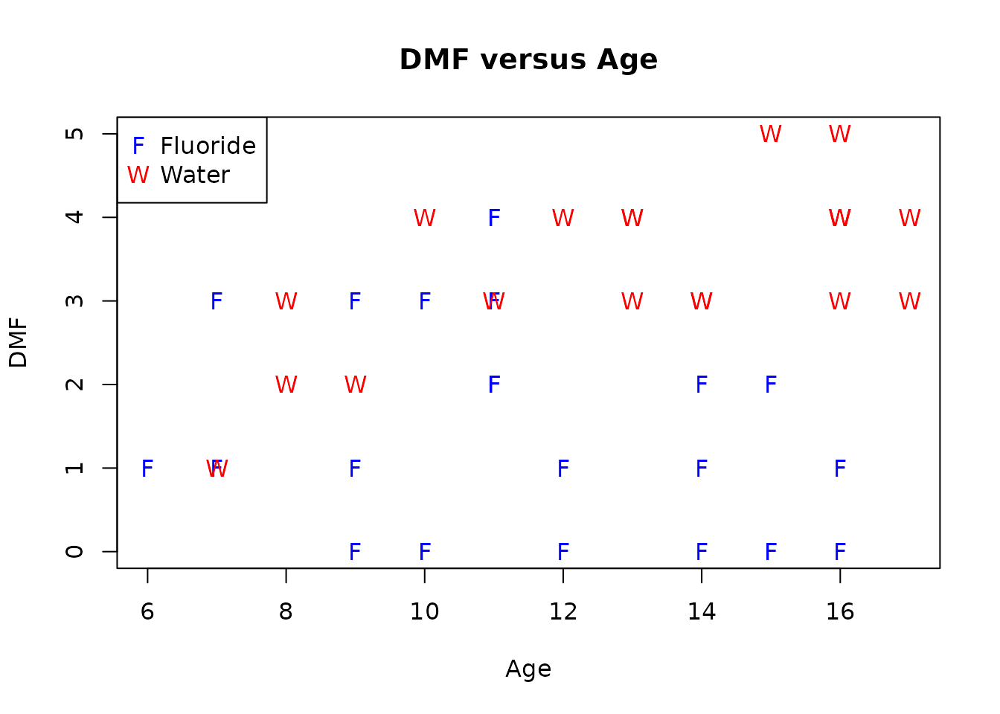
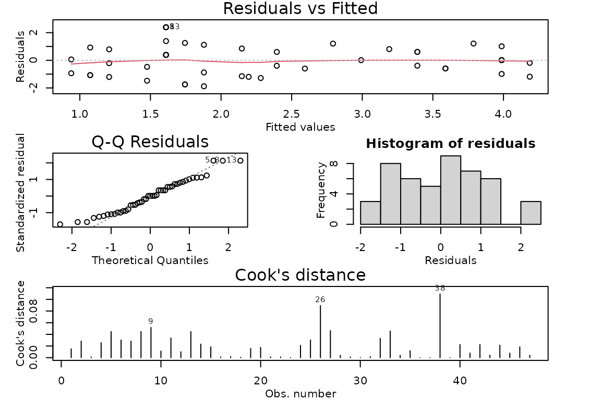
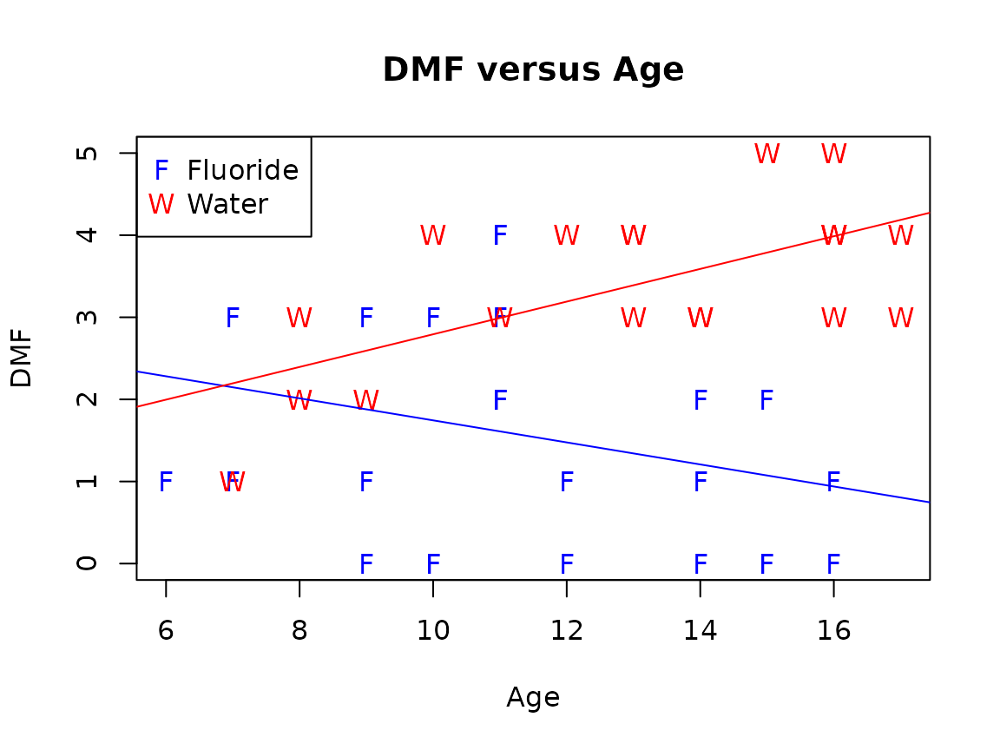

# Case Study 8.3: STATS 201/8 Extra Case Study - Non-parallel Lines Model

## Question 1

In a two year randomised controlled trial into the effectiveness of
various forms of fluoride on dental health, female children were
randomly allocated to one of two groups: using a distilled water mouth
rinse along with brushing their teeth (the placebo group) or using a
mouth rinse where the distilled water had added acid-phosphate fluoride
(which is tasteless). The children’s age at the start of the experiment
was recorded, along with the change in the number of decayed, missing or
filled teeth. 47 children completed the study.

The resulting data are in the file *Dental.csv*, which contains the
variables:

| Variable | Description |
|----|----|
| DMF | The change in the number of decayed, missing or filled teeth over the duration of the experiment.(The higher the value, the worse the dental outcome.) We will model this as numeric (it is discrete ranging from 0-5). |
| Treatment | The allocated treatment: *Water* for water or *Fluoride* for acid-phosphate fluoride. |
| Age | The age of the children at the start of the experiment. |

We are interested in the effect of fluoride on dental outcomes. For this
question we wish to see what effect, if any, there is when we also take
into account the age of the children when they started treatment. In
particular, does the effect of fluoride on the dental outcomes differ
depending on the children's age?

**Instructions:**

- Comment on plot.
- Fit an appropriate model to the data. Check the model assumptions.
- Write appropriate Methods and Assumption Checks.
- Plot the data with your appropriate model superimposed over it.
- Can we conclude that treatment has no effect on DMF? If so, justify
  this with a relevant P-value. If not, briefly explain why not.
- Does the effect of the treatment on the average number of adverse
  dental outcomes depends on the age that the children started taking
  the fluoride treatment? Justify your answer with a relevant P-value.
- For children receiving the fluoride treatment, is there any evidence
  of an age effect? If so, write sentences, as if for an Executive
  Summary, quantifying the effects of a one year increase in age on DMF.
  If not, quote the *P-value* you used to come to this conclusion.
- For children receiving the water treatment, is there any evidence of
  an age effect? If so, write a sentence, as if for an Executive
  Summary, quantifying the effects of a one year increase in age on DMF.
  If not, quote the *P-value* you used to come to this conclusion.

### Question of interest/goal of the study

Does the fluoride treatment seem to be decreasing the average number of
adverse dental outcomes? How is the age of children related to the
number of adverse dental treatments? In particular, does the effect of
fluoride on the dental outcomes differ depending on the children's age?

### inspect the data:

``` r

Dental.df = read.csv("Dental.csv", header = TRUE, stringsAsFactors = TRUE)
plot(DMF ~ Age,
  data = Dental.df, pch = ifelse(Treatment == 'Fluoride', 'F', 'W'),
  col = ifelse(Treatment == 'Fluoride', 'blue', 'red'), main = "DMF versus Age"
)
legend("topleft", pch = c("F", "W"), col = c('blue', 'red'), legend = c("Fluoride", "Water"))
```



### Comment on plot

Looking at the data for the children treated with water, we see an
increasing pattern with DMF and age, the higher the age at the start of
the experiment, the larger the number of decayed, missing or filled
teeth. Unusually, we seem to see the opposite pattern for the children
given fluoride. There is also little difference between the groups when
they are young, but looking at the children aged 14+, all the high
numbers of DMF were for the water group and the low numbers for the
fluoride group, so there is a distinct difference.

### Fit an appropriate linear model and Check Assumptions

``` r

dental.fit1 = lm(DMF ~ Age * Treatment, data = Dental.df)
modelcheck(dental.fit1)
```



``` r

summary(dental.fit1)
```

    ## 
    ## Call:
    ## lm(formula = DMF ~ Age * Treatment, data = Dental.df)
    ## 
    ## Residuals:
    ##      Min       1Q   Median       3Q      Max 
    ## -1.87871 -0.96313  0.01282  0.80073  2.38976 
    ## 
    ## Coefficients:
    ##                    Estimate Std. Error t value Pr(>|t|)   
    ## (Intercept)         3.08682    0.95957   3.217  0.00246 **
    ## Age                -0.13423    0.08188  -1.639  0.10843   
    ## TreatmentWater     -2.28436    1.44995  -1.575  0.12248   
    ## Age:TreatmentWater  0.33328    0.11515   2.894  0.00595 **
    ## ---
    ## Signif. codes:  0 '***' 0.001 '**' 0.01 '*' 0.05 '.' 0.1 ' ' 1
    ## 
    ## Residual standard error: 1.142 on 43 degrees of freedom
    ## Multiple R-squared:  0.4737, Adjusted R-squared:  0.437 
    ## F-statistic:  12.9 on 3 and 43 DF,  p-value: 3.809e-06

``` r

confint(dental.fit1)
```

    ##                         2.5 %     97.5 %
    ## (Intercept)         1.1516731 5.02197503
    ## Age                -0.2993649 0.03089576
    ## TreatmentWater     -5.2084664 0.63974412
    ## Age:TreatmentWater  0.1010541 0.56550506

``` r

# Rotate factor to get slope for treatment = Water
Dental.df = within(Dental.df, {
  TreatmentR = factor(Treatment, levels = c("Water", "Fluoride"))
})
dental.fit2 = lm(DMF ~ Age * TreatmentR, data = Dental.df)
summary(dental.fit2)
```

    ## 
    ## Call:
    ## lm(formula = DMF ~ Age * TreatmentR, data = Dental.df)
    ## 
    ## Residuals:
    ##      Min       1Q   Median       3Q      Max 
    ## -1.87871 -0.96313  0.01282  0.80073  2.38976 
    ## 
    ## Coefficients:
    ##                        Estimate Std. Error t value Pr(>|t|)   
    ## (Intercept)             0.80246    1.08701   0.738  0.46439   
    ## Age                     0.19904    0.08096   2.458  0.01806 * 
    ## TreatmentRFluoride      2.28436    1.44995   1.575  0.12248   
    ## Age:TreatmentRFluoride -0.33328    0.11515  -2.894  0.00595 **
    ## ---
    ## Signif. codes:  0 '***' 0.001 '**' 0.01 '*' 0.05 '.' 0.1 ' ' 1
    ## 
    ## Residual standard error: 1.142 on 43 degrees of freedom
    ## Multiple R-squared:  0.4737, Adjusted R-squared:  0.437 
    ## F-statistic:  12.9 on 3 and 43 DF,  p-value: 3.809e-06

``` r

confint(dental.fit2)
```

    ##                              2.5 %     97.5 %
    ## (Intercept)            -1.38970091  2.9946268
    ## Age                     0.03576409  0.3623259
    ## TreatmentRFluoride     -0.63974412  5.2084664
    ## Age:TreatmentRFluoride -0.56550506 -0.1010541

### Plot the data with your appropriate model superimposed over it

``` r

plot(DMF ~ Age,
  data = Dental.df, pch = ifelse(Treatment == 'Fluoride', 'F', 'W'),
  col = ifelse(Treatment == 'Fluoride', 'blue', 'red'), main = "DMF versus Age"
)
legend("topleft", pch = c("F", "W"), col = c('blue', 'red'), legend = c("Fluoride", "Water"))

ests <- coef(dental.fit1)
abline(ests[1], ests[2], col = 'blue')
abline(ests[1] + ests[3], ests[2] + ests[4], col = 'red')
```



### Method and Assumption Checks

We have two explanatory variables, one factor and one numeric, so have
fitted a linear model to the data and checked for evidence of
interaction between age and treatment. As there was evidence of
interaction we have not been able to simplify the model.

The residual plot showed reasonably constant variability and no trend.
Normality looks good (slightly short tails, but nothing too extreme) and
no influential points were detected. Model assumptions are satisfied.

Our model is:
$`DMF_i = \beta_0 + \beta_1 \times Age_i  + \beta_2 \times TreatmentWater_i  + \beta_3 \times Age_i\times TreatmentWater_i + \epsilon_{i}`$
where $`TreatmentWater_i = 1`$ if the $`i`$th child is in the Water
treatment group and 0 if the child is in the Fluoride treatment group,
and $`\epsilon_i \sim iid ~N(0,\sigma^2)`$

Our model explained 47.4% of the variability in the data.

### Can we conclude that treatment has no effect on DMF? If so, justify this with a relevant P-value. If not, briefly explain why not.

No, we cannot conclude this. Though the *P-value* for Treatment is
large, the *P-value* for the interaction term is small, so we need
treatment in combination with Age. There is a Treatment effect, but the
size of the Treatment effect changes depending on Age.

### Does the effect of the treatment on the average number of adverse dental outcomes depends on the age that the children started taking the treatment? Justify your answer with a relevant P-value.

We have evidence that any effect of the fluoride treatment on the
average number of adverse dental outcomes depends on the age that the
children started taking the treatment. This is because we have evidence
of an interaction between the effects of age and treatment with a
*P-value* of 0.006.

### For children receiving the fluoride treatment, is there any evidence of an age effect? If so, write sentences, as if for an Executive Summary, quantifying the effects of a one year increase in age on DMF. If not, quote the *P-value* you used to come to this conclusion.

For the children given fluoride, we have no evidence that the average
number of decayed, missing or filled teeth changes with age. (*P-value*
for Age = 0.10843 when Treatment is Fluoride.)

### For children receiving the water treatment, is there any evidence of an age effect? If so, write a sentence, as if for an Executive Summary, quantifying the effects of a one year increase in age on DMF. If not, quote the *P-value* you used to come to this conclusion.

We have evidence that for the children given water only, the average
number of decayed, missing or filled teeth increases with age.
(*P-value* for Age = 0.018 when Treatment is Water.)

We estimate that the number of decayed, missing or filled teeth
increases by between 0.04 to 0.36 teeth per additional year of age, on
average.
