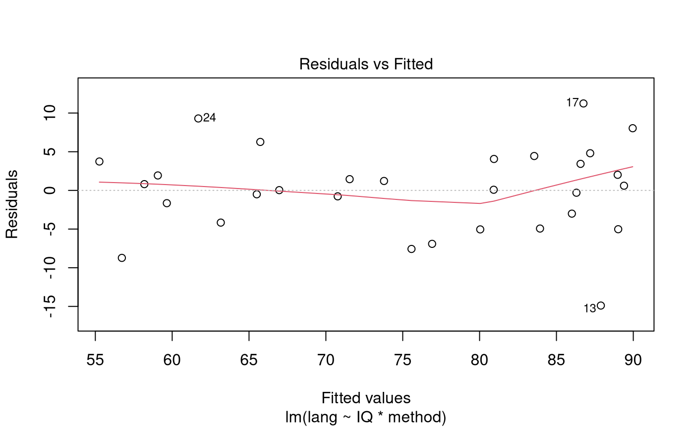
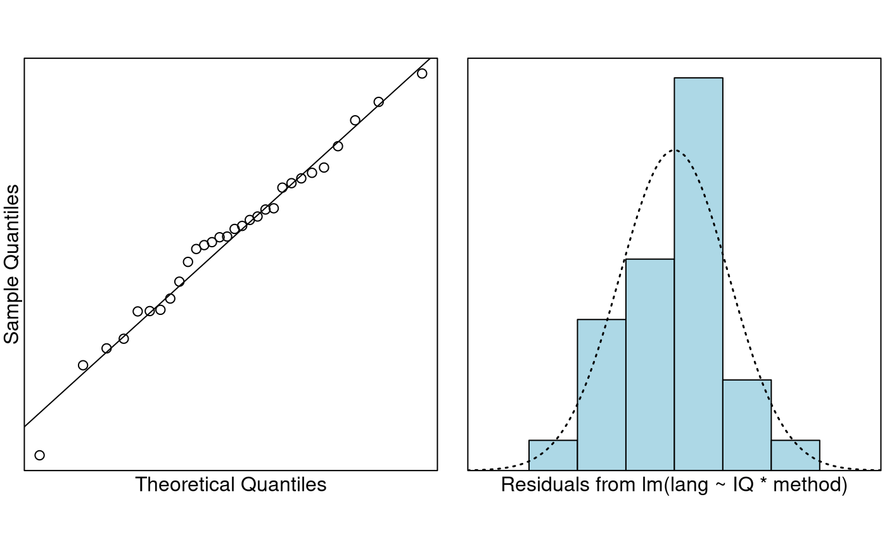
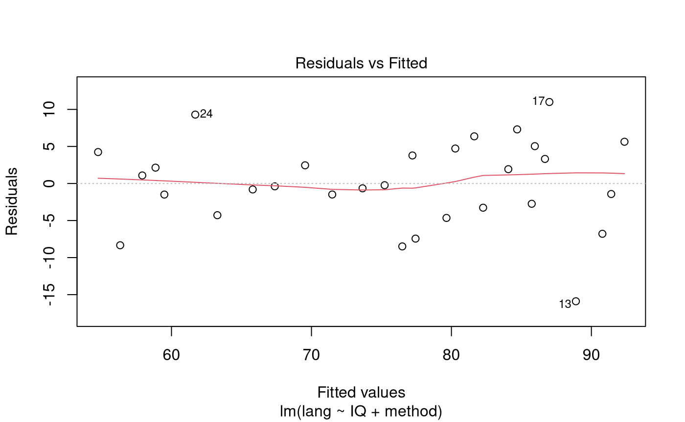
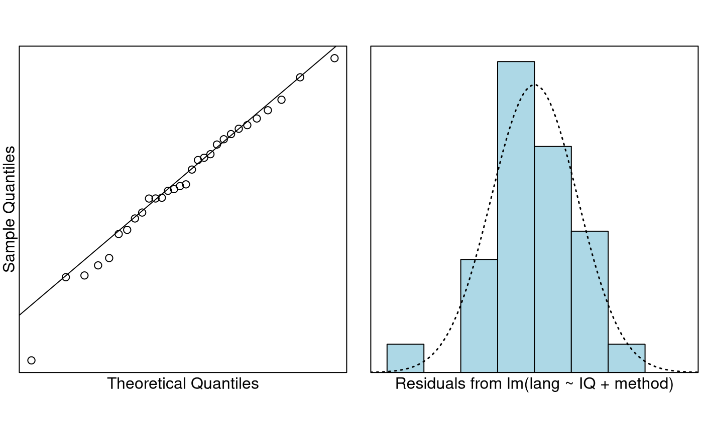

# Case Study 9.1: Language score vs teaching method and student IQ

## Problem

Educational experts were interested in which of three different teaching
methods was most effective in increasing a student-tested language score
for children of a range of abilities—as measured by IQ. Moreover, they
wanted to know if the relative effectiveness of the methods differed
according to IQ.

An experiment was conducted whereby 30 students were randomly allocated
into three groups and each group was taught using a different teaching
method. This randomisation was done to ensure that a range of student
abilities was represented in each group. As students were in a test
environment we can assume that their test scores are independent of each
other.

The variables of interest were:

- `lang`: The student’s language score.
- `IQ`: The student’s IQ before the teaching programme began.
- `method`: The type of teaching method used on the student.

### Question of Interest

We wish to see if the language score achieved depended on the teaching
method. We want to check for any confounding effect of IQ.

### Read in and Inspect the Data

``` r

data(teach.df)
head(teach.df)
```

    ##   lang  IQ method
    ## 1   72  87      1
    ## 2   75 119      1
    ## 3   85 121      1
    ## 4   70 112      1
    ## 5   73 100      1
    ## 6   86 133      1

``` r

str(teach.df)
```

    ## 'data.frame':    30 obs. of  3 variables:
    ##  $ lang  : int  72 75 85 70 73 86 92 68 91 75 ...
    ##  $ IQ    : int  87 119 121 112 100 133 135 109 139 105 ...
    ##  $ method: int  1 1 1 1 1 1 1 1 1 1 ...

``` r

# We need to convert method into a factor variable
teach.df$method = factor(teach.df$method)
plot(lang ~ IQ,
  main = "Language Score versus IQ (by method)",
  pch = as.character(teach.df$method), data = teach.df
)
```


Looking at the coded scatter plot, we can see three parallel lines. It
appears that the score is increasing with IQ and that method 2 is
scoring highest and method 3 is scoring lowest. The variability around
these individual lines is much lower than the variability seen in the
separate plots.

### Model Building and Check Assumptions

``` r

teach.fit = lm(lang ~ IQ * method, data = teach.df)
plot(teach.fit, which = 1)
```



``` r

normcheck(teach.fit)
```



``` r

cooks20x(teach.fit)
```


``` r

anova(teach.fit)
```

    ## Analysis of Variance Table
    ## 
    ## Response: lang
    ##           Df  Sum Sq Mean Sq F value    Pr(>F)    
    ## IQ         1 1004.42 1004.42 26.1416 3.124e-05 ***
    ## method     2 2901.83 1450.91 37.7625 3.867e-08 ***
    ## IQ:method  2   78.82   39.41  1.0257    0.3737    
    ## Residuals 24  922.13   38.42                      
    ## ---
    ## Signif. codes:  0 '***' 0.001 '**' 0.01 '*' 0.05 '.' 0.1 ' ' 1

``` r

teach.fit2 = lm(lang ~ IQ + method, data = teach.df)
plot(teach.fit2, which = 1)
```



``` r

normcheck(teach.fit2)
```



``` r

cooks20x(teach.fit2)
```


``` r

anova(teach.fit2)
```

    ## Analysis of Variance Table
    ## 
    ## Response: lang
    ##           Df Sum Sq Mean Sq F value    Pr(>F)    
    ## IQ         1 1004.4  1004.4  26.090 2.529e-05 ***
    ## method     2 2901.8  1450.9  37.688 2.077e-08 ***
    ## Residuals 26 1001.0    38.5                      
    ## ---
    ## Signif. codes:  0 '***' 0.001 '**' 0.01 '*' 0.05 '.' 0.1 ' ' 1

``` r

summary(teach.fit2)
```

    ## 
    ## Call:
    ## lm(formula = lang ~ IQ + method, data = teach.df)
    ## 
    ## Residuals:
    ##      Min       1Q   Median       3Q      Max 
    ## -15.8936  -3.1331  -0.3047   4.1294  11.0003 
    ## 
    ## Coefficients:
    ##              Estimate Std. Error t value Pr(>|t|)    
    ## (Intercept)  42.08552    8.73921   4.816 5.47e-05 ***
    ## IQ            0.31564    0.07341   4.299 0.000213 ***
    ## method2       9.87793    2.82068   3.502 0.001688 ** 
    ## method3     -14.15922    2.85240  -4.964 3.70e-05 ***
    ## ---
    ## Signif. codes:  0 '***' 0.001 '**' 0.01 '*' 0.05 '.' 0.1 ' ' 1
    ## 
    ## Residual standard error: 6.205 on 26 degrees of freedom
    ## Multiple R-squared:  0.796,  Adjusted R-squared:  0.7725 
    ## F-statistic: 33.82 on 3 and 26 DF,  p-value: 3.986e-09

``` r

confint(teach.fit2)
```

    ##                   2.5 %     97.5 %
    ## (Intercept)  24.1218063 60.0492251
    ## IQ            0.1647361  0.4665482
    ## method2       4.0799363 15.6759248
    ## method3     -20.0224212 -8.2960209

### Visualise the Final Model

``` r

plot(lang ~ IQ,
  main = "Language Score versus IQ (by method)",
  pch = as.character(teach.df$method), data = teach.df
)
abline(teach.fit2$coef[1], teach.fit2$coef[2], lty = 1)
abline(teach.fit2$coef[1] + teach.fit2$coef[3], teach.fit2$coef[2], lty = 2)
abline(teach.fit2$coef[1] + teach.fit2$coef[4], teach.fit2$coef[2], lty = 4)
```


### Generate Model Output for when `method`’s baseline is “2”

``` r

teach.df$method = relevel(teach.df$method, ref = "2")
teach.fit3 = lm(lang ~ IQ + method, data = teach.df)
confint(teach.fit3)
```

    ##                   2.5 %      97.5 %
    ## (Intercept)  35.0127936  68.9140989
    ## IQ            0.1647361   0.4665482
    ## method1     -15.6759248  -4.0799363
    ## method3     -29.7496781 -18.3246250

## Method and Assumption Checks

To explain language score, we first fitted the model with explanatory
variables teaching method, IQ, and their interaction. But, the
interaction term was not significant (*P-value* = 0.37). The model was
refitted with the interaction term removed.

All model assumptions were satisfied. \[*Optional:* The students should
be acting independent of each other as they were randomly allocated to
the method taught and they students are measured under test
conditions.\]

Our final model is
``` math
lang_i = \beta_0 + \beta_1 \times IQ_i + \beta_2 \times method.method2_i + \beta_3 \times method.method3_i + \epsilon_i,
```
where:

- $`method.method2_i`$ is set to one if student $`i`$ received method 2,
  otherwise it is zero,
- $`method.method3_i`$ is set to one if student $`i`$ received method 3,
  otherwise it is zero,
- and $`\epsilon_i \sim iid ~ N(0,\sigma^2)`$.

Here method 1 is our baseline.

The final model was also refitted with method 2 as the baseline.
**Note:** When we change the baseline (to level 2), the values of the
dummy variables switch, so that $`method.method2_i`$ becomes
$`method.method1_i`$. Hence, $`method.method1_i`$ is set to one if
student $`i`$ received method 1, otherwise it is zero.

Our model explains almost 80% of the variation in language score.

## Executive Summary

We were interested in comparing the effectiveness of three teaching
methods on language scores achieved by students. We also wanted to see
how this was effected by students IQ’s.

We found that the effects of the teaching methods are the same
regardless of IQ and the effect of IQ is the same regardless of teaching
method.

In particular teaching method 2 is significantly better than the other
two methods. Also, both methods 1 and 2 are significantly better than
method 3.

Not surprisingly, students with higher IQ tended to score higher.

With 95% confidence:

- For students experiencing the same teaching method, we estimate that
  the expected language test score increases by between 1.6 and 4.7
  marks for each additional 10 IQ points,
- For students with the same IQ, we estimate that the expected language
  test score for students taught using method 2 is between 4.1 and 15.7
  marks higher than those taught using method 1,
- For students with the same IQ, we estimate that the expected language
  test score for students taught using method 1 is between 8.3 and 20.0
  marks higher than those taught using method 3,
- For students with the same IQ, we estimate that the expected language
  test score for students taught using method 3 is between 18.3 and 29.7
  marks lower than those taught using method 2.

## What happens if we don’t adjust for IQ?

We expect the confidence intervals for the methods to get wider because
we have to “absorb” the extra variation not explained by IQ.

``` r

teach.df$method = relevel(teach.df$method, ref = "1")
teach.fit5 = lm(lang ~ method, data = teach.df)
teach.df$method = relevel(teach.df$method, ref = "2")
teach.fit6 = lm(lang ~ method, data = teach.df)
ci = confint(teach.fit5)
ci2 = confint(teach.fit6)
r2 = round(100 * summary(teach.fit5)$r.squared)
```

With 95% confidence :

- The expected language test score for students taught using method 2 is
  between 0.4 and 15 marks higher than for those taught using method 1,
- The expected language test score for students taught using method 3 is
  between 9.7 and 24.3 marks lower than for those taught using method 1,
- The expected language test score for students taught using method 3 is
  between 17.4 and 32 marks lower than for those taught using method 2.

Our model explains almost 65% of the variation in language score. You
should be able to see that every one of these intervals is wider than
before.

## Multiple comparisons adjustment (Chap 11)

This will only make sense after Chapter 11:

``` r

require(emmeans)
emmeans(teach.fit2, specs = pairwise ~ method, infer = TRUE)$contrasts
```

    ##  contrast          estimate   SE df lower.CL upper.CL t.ratio p.value
    ##  method1 - method2    -9.88 2.82 26   -16.89    -2.87  -3.502  0.0046
    ##  method1 - method3    14.16 2.85 26     7.07    21.25   4.964  0.0001
    ##  method2 - method3    24.04 2.78 26    17.13    30.94   8.649 <0.0001
    ## 
    ## Confidence level used: 0.95 
    ## Conf-level adjustment: tukey method for comparing a family of 3 estimates 
    ## P value adjustment: tukey method for comparing a family of 3 estimates

``` r

# Compare to
cbind(coef(summary(teach.fit2)), confint(teach.fit2))
```

    ##             Estimate Std. Error t value  Pr(>|t|)    2.5 %  97.5 %
    ## (Intercept)  42.0855    8.73921   4.816 5.466e-05  24.1218 60.0492
    ## IQ            0.3156    0.07341   4.299 2.134e-04   0.1647  0.4665
    ## method2       9.8779    2.82068   3.502 1.688e-03   4.0799 15.6759
    ## method3     -14.1592    2.85240  -4.964 3.696e-05 -20.0224 -8.2960

``` r

cbind(coef(summary(teach.fit3)), confint(teach.fit3))
```

    ##             Estimate Std. Error t value  Pr(>|t|)    2.5 %   97.5 %
    ## (Intercept)  51.9634    8.24637   6.301 1.137e-06  35.0128  68.9141
    ## IQ            0.3156    0.07341   4.299 2.134e-04   0.1647   0.4665
    ## method1      -9.8779    2.82068  -3.502 1.688e-03 -15.6759  -4.0799
    ## method3     -24.0372    2.77910  -8.649 3.971e-09 -29.7497 -18.3246
