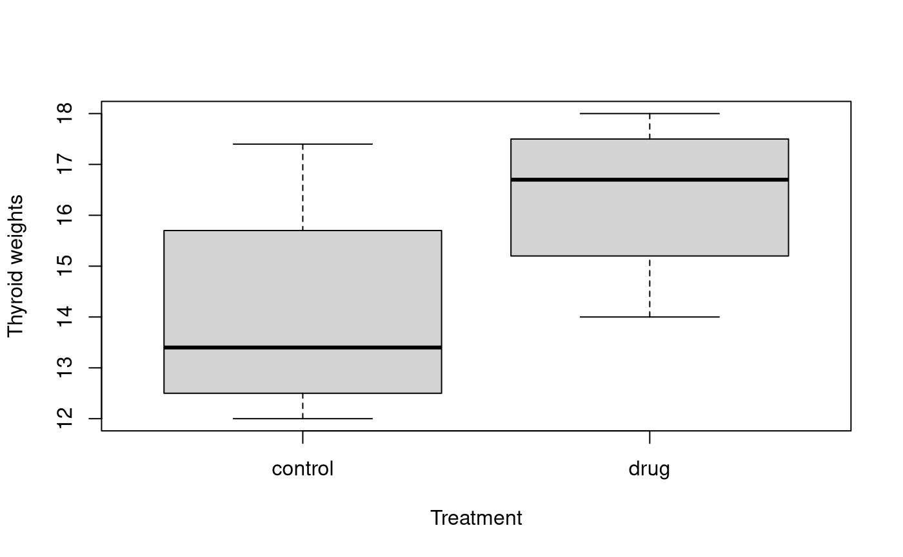
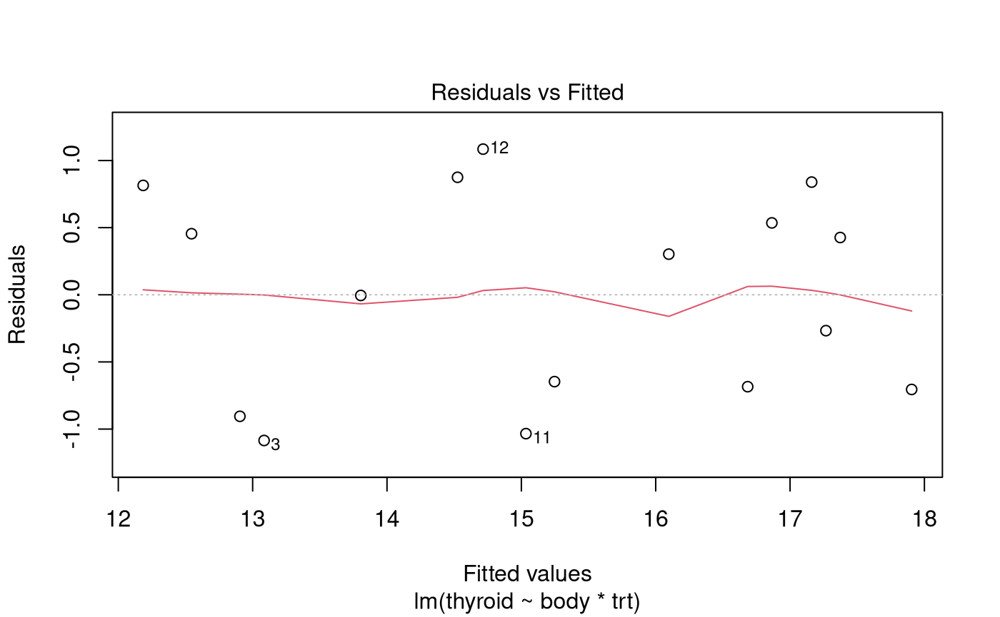
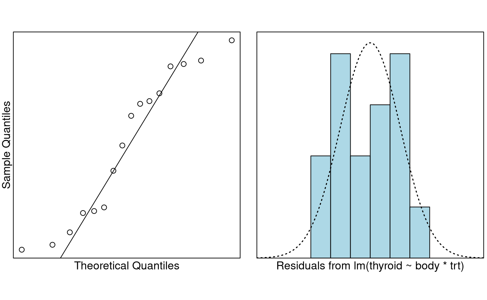
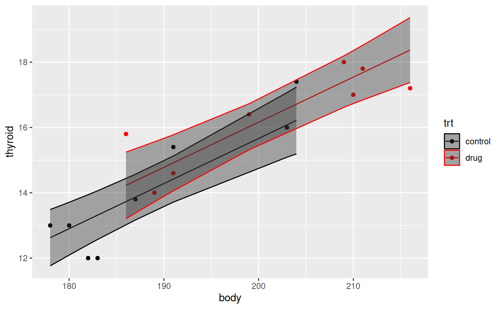
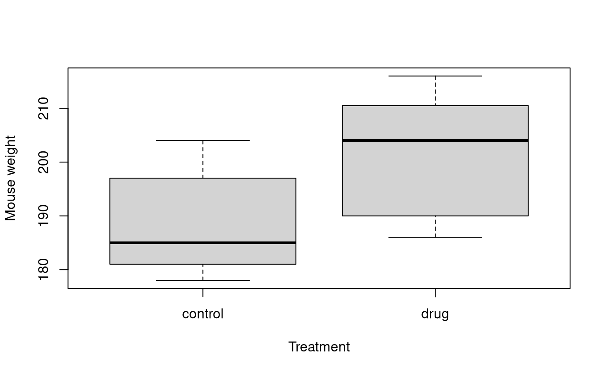

# Case Study 9.2: Thyroid drug experiment

## Problem

Hypothyroidism; (from hypo- meaning under or reduced, plus thyroid),
often called under-active thyroid or low thyroid and sometimes
hypothyreosis, is a common endocrine disorder in which the thyroid gland
does not produce enough thyroid hormone. It can cause a number of
symptoms, such as tiredness, poor ability to tolerate cold, and weight
gain. In children, hypothyroidism leads to delays in growth and
intellectual development, which is called cretinism in severe cases.

Drug companies attempt to develop drugs to help to grow the thyroid
gland. Before these drugs are tested on humans they are tested on mice
as they share a lot of physical characteristics of humans.

With the above in mind, an experiment was conducted to assess the effect
of a newly developed drug that was intended to increase the weight of
the thyroid gland (in mg).

Sixteen laboratory animals (mice) were randomly allocated into 2 groups:

1.  The control group (1) received water orally for 7 days.
2.  The drug group (2) received the new drug orally for 7 days.

The body weight of each mouse (g) was also recorded, since it was felt
that it might explain variability in thyroid weight.

The variables of interest were:

- `thyroid`: The weight of the mouse’s thyroid gland.
- `body`: The body weight of the mouse (g).
- `group`: A two-level factor with levels “1” and “2”

### Question of Interest

To assess the effect of a newly developed drug that was intended to
increase the weight of the thyroid gland (in mg).

### Read in and Inspect the Data

``` r

thyroid.df = read.table("thyroid-1.txt", header = TRUE)
head(thyroid.df)
str(thyroid.df)
```

    ##   thyroid body group
    ## 1    16.0  203     1
    ## 2    13.0  180     1
    ## 3    12.0  183     1
    ## 4    15.4  191     1
    ## 5    17.4  204     1
    ## 6    13.0  178     1

    ## 'data.frame':    16 obs. of  3 variables:
    ##  $ thyroid: num  16 13 12 15.4 17.4 13 12 13.8 17 16.4 ...
    ##  $ body   : int  203 180 183 191 204 178 182 187 210 199 ...
    ##  $ group  : int  1 1 1 1 1 1 1 1 2 2 ...

``` r

# Create a factor variable for the drug vs control
thyroid.df$trt = with(thyroid.df, factor(ifelse(group == 1, "control", "drug")))
plot(thyroid ~ trt, data = thyroid.df, xlab = "Treatment", ylab = "Thyroid weights")
```



``` r

plot(thyroid ~ body, type = "n", data = thyroid.df)
text(thyroid.df$body, thyroid.df$thyroid, thyroid.df$group)
```

 In the first plot it
looks like there is an effect due to the treatment. Should we worry
about the innate differences between animals? That is, do we expect
larger mice to have larger thyroids?

In the second plot it looks like we should indeed adjust for the
differences in body weight. Let’s fit an interaction model.

### Model Building and Check Assumptions

``` r

thyroid.fit = lm(thyroid ~ body * trt, data = thyroid.df)
plot(thyroid.fit, which = 1)
```



``` r

normcheck(thyroid.fit)
```



``` r

cooks20x(thyroid.fit)
```


``` r

cooks.distance(thyroid.fit)[12]
```

    ##        12 
    ## 0.3963979

### Is Observation 12 Influential?

``` r

plot(thyroid ~ body, type = "n", data = thyroid.df)
text(thyroid.df$body, thyroid.df$thyroid, 1:16)
```


### Model Building and Check Assumptions Continued…

``` r

summary(thyroid.fit)
```

    ## 
    ## Call:
    ## lm(formula = thyroid ~ body * trt, data = thyroid.df)
    ## 
    ## Residuals:
    ##     Min      1Q  Median      3Q     Max 
    ## -1.0852 -0.6897  0.1487  0.6052  1.0848 
    ## 
    ## Coefficients:
    ##               Estimate Std. Error t value Pr(>|t|)    
    ## (Intercept)  -19.84972    5.97937  -3.320 0.006114 ** 
    ## body           0.17997    0.03168   5.681 0.000102 ***
    ## trtdrug       14.78742    8.16681   1.811 0.095283 .  
    ## body:trtdrug  -0.07364    0.04201  -1.753 0.105068    
    ## ---
    ## Signif. codes:  0 '***' 0.001 '**' 0.01 '*' 0.05 '.' 0.1 ' ' 1
    ## 
    ## Residual standard error: 0.8465 on 12 degrees of freedom
    ## Multiple R-squared:  0.8637, Adjusted R-squared:  0.8296 
    ## F-statistic: 25.34 on 3 and 12 DF,  p-value: 1.77e-05

``` r

thyroid.fit2 = lm(thyroid ~ body + trt, data = thyroid.df)
summary(thyroid.fit2)
```

    ## 
    ## Call:
    ## lm(formula = thyroid ~ body + trt, data = thyroid.df)
    ## 
    ## Residuals:
    ##      Min       1Q   Median       3Q      Max 
    ## -1.31554 -0.56603  0.01542  0.43274  1.57304 
    ## 
    ## Coefficients:
    ##             Estimate Std. Error t value Pr(>|t|)    
    ## (Intercept) -11.9538     4.2349  -2.823   0.0144 *  
    ## body          0.1381     0.0224   6.164 3.41e-05 ***
    ## trtdrug       0.4972     0.5394   0.922   0.3734    
    ## ---
    ## Signif. codes:  0 '***' 0.001 '**' 0.01 '*' 0.05 '.' 0.1 ' ' 1
    ## 
    ## Residual standard error: 0.9116 on 13 degrees of freedom
    ## Multiple R-squared:  0.8287, Adjusted R-squared:  0.8024 
    ## F-statistic: 31.46 on 2 and 13 DF,  p-value: 1.044e-05

### Is `trt` really insignifcant?

``` r

b = coef(thyroid.fit2)
# Note this won't work unless you have ggplot2 installed
library(ggplot2)
thyroid.df = cbind(thyroid.df, predict(thyroid.fit2, interval = "confidence"))
ggplot(thyroid.df, aes(x = body, y = thyroid, color = trt)) +
  geom_point() +
  geom_line(aes(y = fit)) +
  geom_ribbon(aes(ymin = lwr, ymax = upr), alpha = 0.4) +
  scale_color_manual(values = c("#000000", "#FF0000"))
```



### Model Building and Check Assumptions Continued…

``` r

thyroid.fit3 = lm(thyroid ~ body, data = thyroid.df)
summary(thyroid.fit3)
```

    ## 
    ## Call:
    ## lm(formula = thyroid ~ body, data = thyroid.df)
    ## 
    ## Residuals:
    ##      Min       1Q   Median       3Q      Max 
    ## -1.43232 -0.42579 -0.00513  0.60886  1.92031 
    ## 
    ## Coefficients:
    ##              Estimate Std. Error t value Pr(>|t|)    
    ## (Intercept) -13.85763    3.67718  -3.769  0.00208 ** 
    ## body          0.14913    0.01883   7.921 1.54e-06 ***
    ## ---
    ## Signif. codes:  0 '***' 0.001 '**' 0.01 '*' 0.05 '.' 0.1 ' ' 1
    ## 
    ## Residual standard error: 0.9066 on 14 degrees of freedom
    ## Multiple R-squared:  0.8176, Adjusted R-squared:  0.8045 
    ## F-statistic: 62.74 on 1 and 14 DF,  p-value: 1.538e-06

### Why was `trt` insignficant?

``` r

plot(body ~ trt, data = thyroid.df, main = "", xlab = "Treatment", ylab = "Mouse weight")
```



We can see that heavier mice have heavier thyroids, and the mice in the
drug group are heavier.

## Methods and Assumption Checks

The exploratory plots suggested to explain thyroid weight in mice, we
first fitted the linear model with explanatory variables drug treatment
and body weight, and their interaction. But, the interaction term was
not significant (*P-value* = 0.11). The model was refitted with the
interaction term removed. However, treatment was not signficant
(*P-value* = 0.37), and was removed.

Mice were randomly allocated to groups and the measurements were done
independently of each other. All other model assumptions were satisfied.
(One potentially influential observation was investigated, however given
its location and the stupidly small size of this data set (16 obs.) we
will overlook it.)

Our final model is
``` math
thyroid_i = \beta_0 + \beta_1 \times weight_i + \epsilon_i,
```
where $`\epsilon_i \sim iid ~ N(0,\sigma^2)`$.

Our model explains about 82% of the variability in the weight of thyroid
glands.

## Executive Summary

We wanted to assess the effect of a newly developed drug that was
intended to increase the weight of the thyroid gland (in mg).

The only thing we can report is that larger mice have larger thyroids.
We could report on the size of this effect, but won’t since it wasn’t
part of the research question.

We have no evidence to believe that this drug increases the expected
size of the thyroid gland in mice.

## Addendum

From the initial boxplot it appeared that mice in the drug group had
noticeably higher thyroid weight than those in the control group.
However, it turned out that the drug group had bigger mice! The
randomisation has, unfortunately, failed us here. Usually randomisation
works out—but don’t assume it always does for smaller sample sizes like
this.

In the future it may be best to put 2 mice into each of 8 weight classes
and randomly allocate (via a coin toss) one of these two mice into the
treatment group or not.

### Bootstrapping

We can bootstrap to avoid the normality assumption. The vertical line is
where the coeffcient is zero. If it’s towards the middle of the plot
then that is evidence for the null—i.e. that there is no treatment
effect.

``` r

set.seed(234)
library(bootstrap)
theta = function(rows, data = thyroid.df) {
  fit = lm(thyroid ~ body + trt, data = data[rows, ])
  coef(fit)
}
b = bootstrap(1:nrow(thyroid.df), 10000, theta)$thetastar

op = par(mfrow = c(2, 2))
on.exit(par(op), add = TRUE)

plot(density(b[1, ]), main = expression(beta[0])); abline(v = 0)
```


``` r

plot(density(b[2, ]), main = expression(beta[1])); abline(v = 0)
```


``` r

plot(density(b[3, ]), main = expression(beta[2])); abline(v = 0)
```


