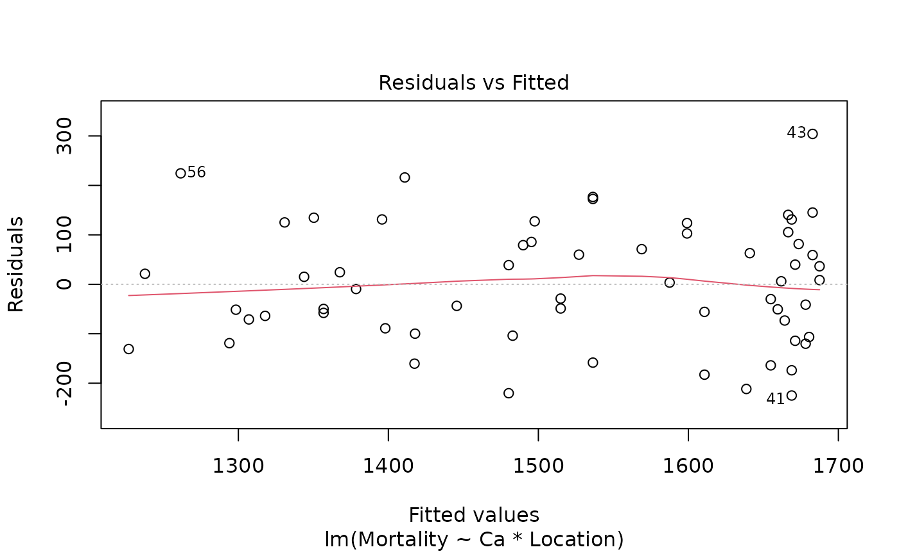
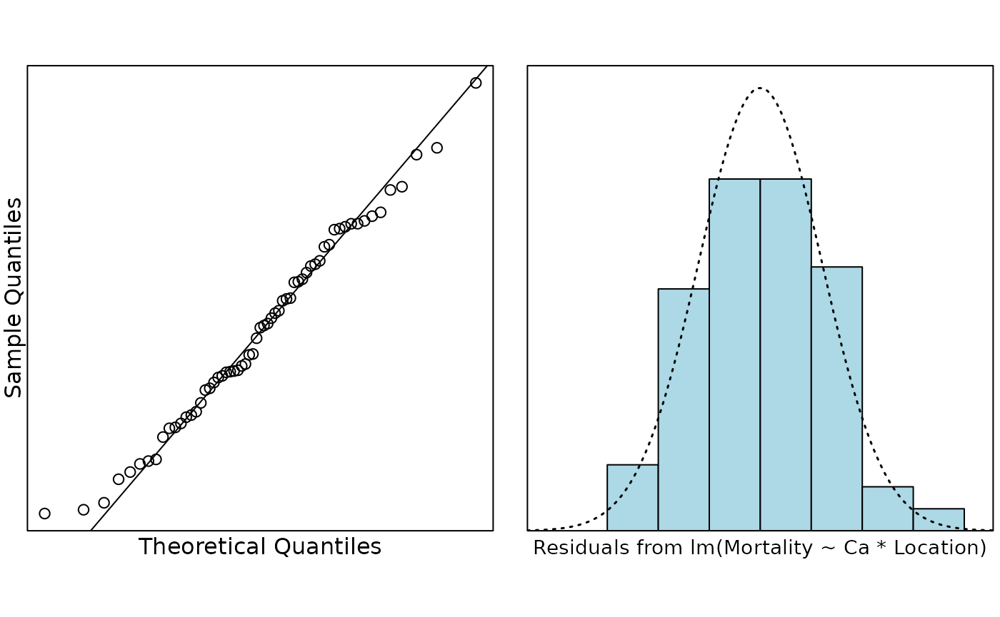
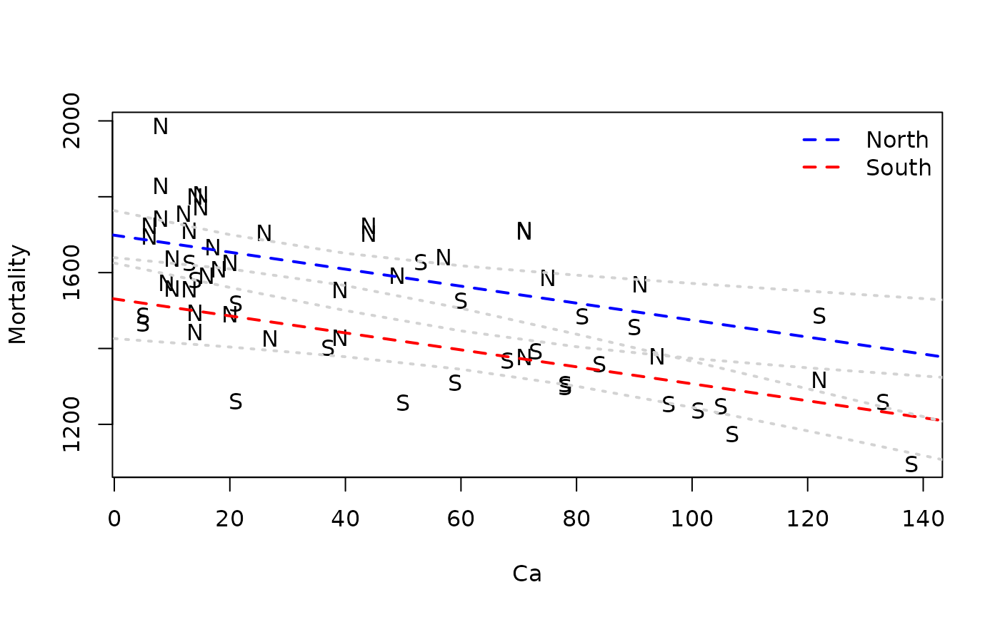

# Case Study 9.3: Water Hardness and Mortality

The data in this case study were collected in an investigation of
environmental causes of disease. They show the annual mortality rate per
100,000 for males, averaged over the years 1958–1964, and the calcium
concentration (in parts per million) in the drinking water supply for 61
large towns in England and Wales. (The higher the calcium concentration,
the harder the water.) Towns at least as far north as Derby are
identified in the data set with the code `N`. In this study we will use
R to investigate how are mortality and water hardness related, and if
there a geographical factor in the relationship. The data is in the file
`water.csv` on Canvas

``` r

water.df = read.csv("WATER.csv")
head(water.df)
```

    ##   Mortality  Ca Location
    ## 1      1247 105         
    ## 2      1668  17        N
    ## 3      1466   5         
    ## 4      1800  14        N
    ## 5      1609  18        N
    ## 6      1558  10        N

It’s always useful to check for missing values.

``` r

sum(is.na(water.df))
```

    ## [1] 0

No missing values. All good. How about a plot? The ideal plot would use
`Location` as a plotting symbol, however we can see that the towns to
the South are coded as blanks. We should change that. How? How about
making all the values that are not `N` be `S`?

``` r

water.df$Location[water.df$Location != 'N'] = 'S'
```

Hmm. That did not work, as planned. That is because `Location` is a
factor. We have a number of choices. One is to make a new variable. The
other is to make `Location` a character vector, make the change and,
then make it a factor again. Although this second option sounds like a
lot of work it is really only one line of code. It is preferable because
we will not clutter our workspace with redundant information.

``` r

water.df$Location = with(water.df, {
  Location = as.character(Location);
  Location[is.na(Location)] = 'S';
  Location = factor(Location)
})
water.df$Location
```

    ##  [1] S N S N N N N S N S S S N S S N N N N S N N N N N S N S N S S S N N S S S N
    ## [39] S N N N N N S S N N N N N S N S S S N N N S N
    ## Levels: N S

Much better. Now how about that plot?

``` r

plot(Mortality ~ Ca, pch = as.character(water.df$Location), data = water.df)
```


``` r

water.fit = lm(Mortality ~ Ca * Location, data = water.df)
plot(water.fit, which = 1)
```



``` r

normcheck(water.fit)
```



``` r

cooks20x(water.fit)
```


All looks pretty good.

``` r

summary(water.fit)
```

    ## 
    ## Call:
    ## lm(formula = Mortality ~ Ca * Location, data = water.df)
    ## 
    ## Residuals:
    ##      Min       1Q   Median       3Q      Max 
    ## -224.878  -88.953    3.495   85.617  304.172 
    ## 
    ## Coefficients:
    ##               Estimate Std. Error t value Pr(>|t|)    
    ## (Intercept)  1701.4272    30.9493  54.975  < 2e-16 ***
    ## Ca             -2.3249     0.6996  -3.323  0.00156 ** 
    ## LocationS    -175.7321    58.5586  -3.001  0.00399 ** 
    ## Ca:LocationS    0.1598     0.9460   0.169  0.86643    
    ## ---
    ## Signif. codes:  0 '***' 0.001 '**' 0.01 '*' 0.05 '.' 0.1 ' ' 1
    ## 
    ## Residual standard error: 123.9 on 57 degrees of freedom
    ## Multiple R-squared:  0.5857, Adjusted R-squared:  0.5639 
    ## F-statistic: 26.86 on 3 and 57 DF,  p-value: 5.855e-11

It does not look like there is any evidence of different slopes. Do we
get any additional info from the ANOVA table?

``` r

anova(water.fit)
```

    ## Analysis of Variance Table
    ## 
    ## Response: Mortality
    ##             Df Sum Sq Mean Sq F value    Pr(>F)    
    ## Ca           1 906185  906185 59.0005 2.330e-10 ***
    ## Location     1 331091  331091 21.5569 2.065e-05 ***
    ## Ca:Location  1    438     438  0.0285    0.8664    
    ## Residuals   57 875459   15359                      
    ## ---
    ## Signif. codes:  0 '***' 0.001 '**' 0.01 '*' 0.05 '.' 0.1 ' ' 1

Nope. We only have two levels so we do not need the ANOVA table for this
analysis.

So we do not have interaction, but it looks like there is a relationship
with hardness and it looks like there is a North/South effect
(`Location`). We should refit the model.

``` r

water.fit2 = lm(Mortality ~ Ca + Location, data = water.df)
summary(water.fit2)
```

    ## 
    ## Call:
    ## lm(formula = Mortality ~ Ca + Location, data = water.df)
    ## 
    ## Residuals:
    ##      Min       1Q   Median       3Q      Max 
    ## -223.607  -89.582    2.091   83.303  306.353 
    ## 
    ## Coefficients:
    ##              Estimate Std. Error t value Pr(>|t|)    
    ## (Intercept) 1698.5472    25.6148  66.311  < 2e-16 ***
    ## Ca            -2.2375     0.4669  -4.792 1.19e-05 ***
    ## LocationS   -167.9518    35.8694  -4.682 1.75e-05 ***
    ## ---
    ## Signif. codes:  0 '***' 0.001 '**' 0.01 '*' 0.05 '.' 0.1 ' ' 1
    ## 
    ## Residual standard error: 122.9 on 58 degrees of freedom
    ## Multiple R-squared:  0.5855, Adjusted R-squared:  0.5712 
    ## F-statistic: 40.96 on 2 and 58 DF,  p-value: 8.091e-12

Minimal change in $`R^2`$. How do the fitted lines look on the plot?

``` r

b = coef(water.fit2)
plot(Mortality ~ Ca, pch = as.character(water.df$Location), data = water.df)
abline(b[1:2], col = "blue", lty = 2, lwd = 2)
abline(b[1] + b[3], b[2], col = "red", lty = 2, lwd = 2)
legend("topright",
  lty = 2, lwd = 2, col = c("blue", "red"),
  legend = c("North", "South"), bty = "n"
)
# This code puts some confidence bounds around the lines.
# It's pretty complicated if you don't know R and it isn't examinable
pred.df = data.frame(
  Ca = rep(seq(0, 160, by = 20), 2),
  Location = rep(c('N', 'S'), c(9, 9))
)
water.pred = predict(water.fit, newdata = pred.df, interval = "confidence")
for (i in 1:2) {
  idx = 1:9 + (i - 1) * 9
  for (j in c("lwr", "upr")) {
    lines(pred.df$Ca[idx], water.pred[idx, j], lty = 3, lwd = 2, col = "lightgrey");
  }
}
```



So it looks like mortality decreases as the calcium concentration in the
water increases, and that mortality is lower in the South than the
North.
