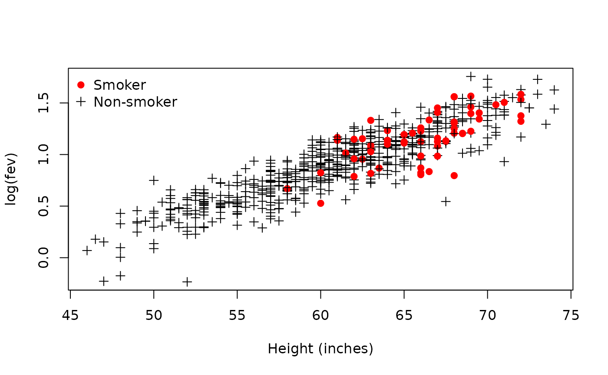
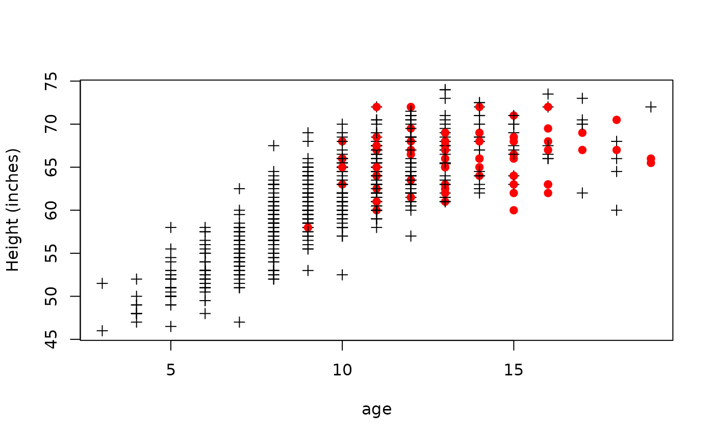
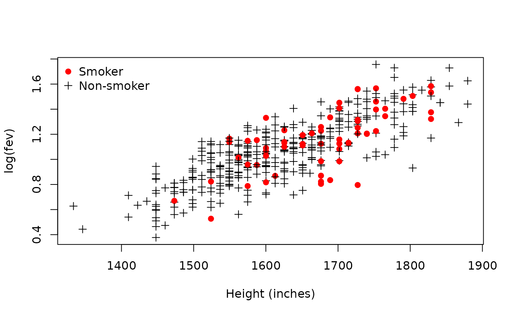
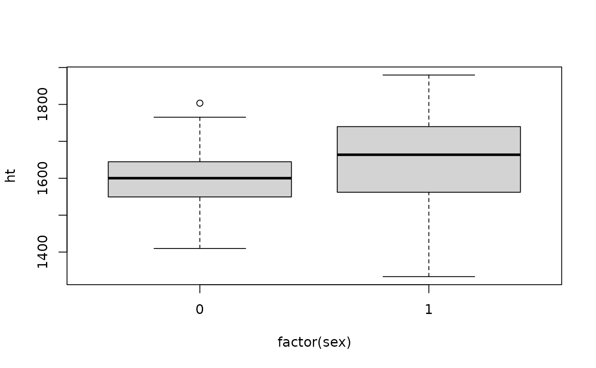
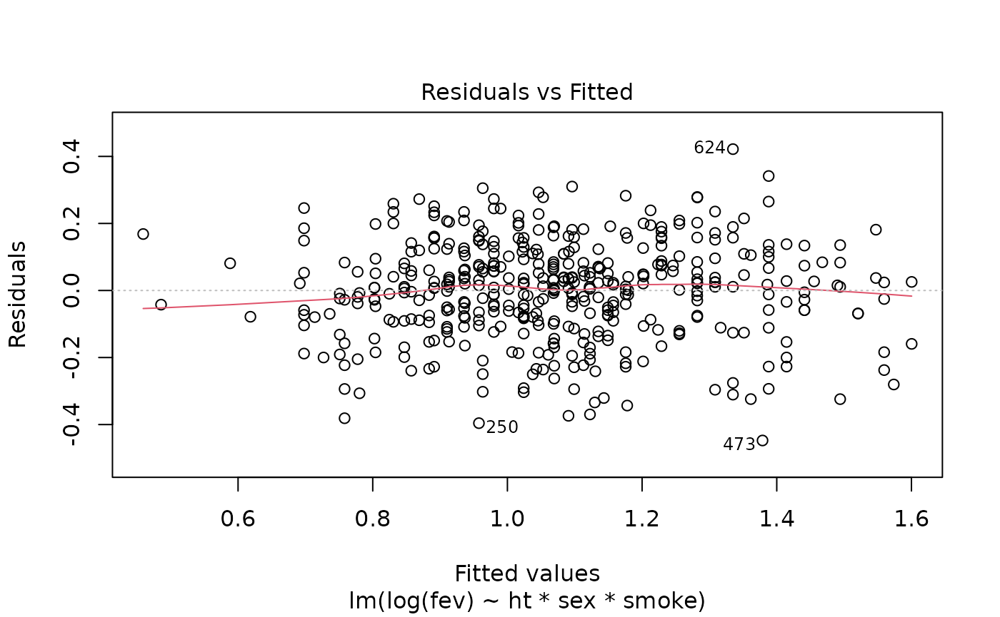
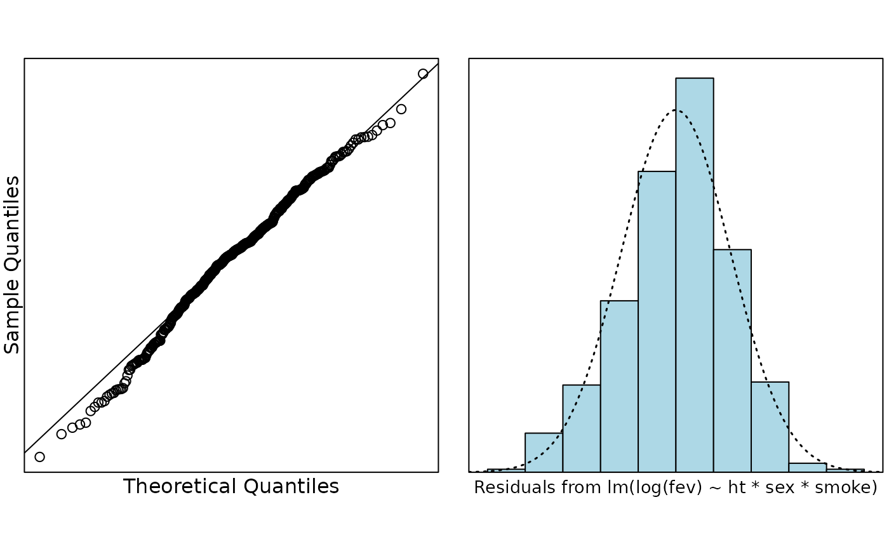
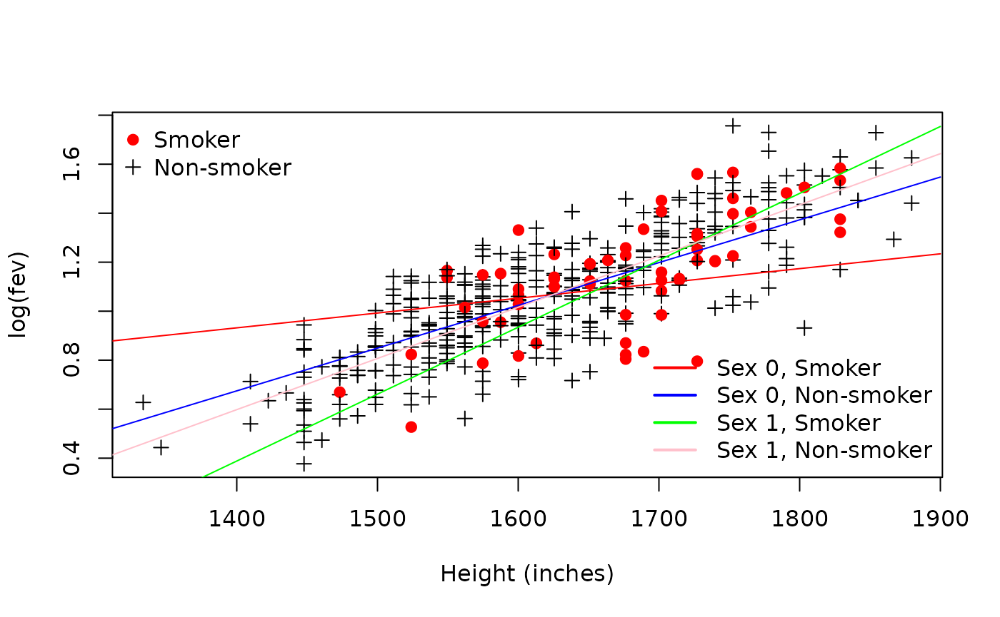
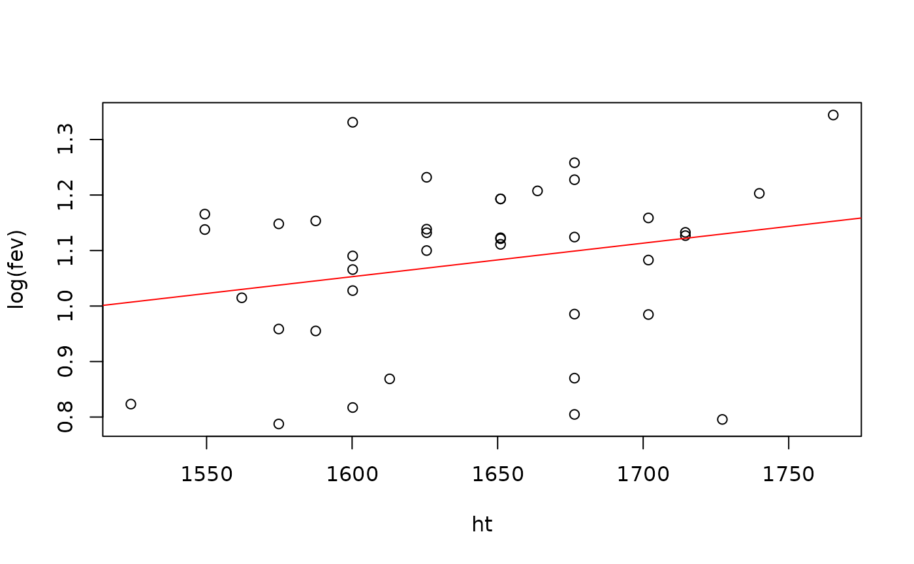
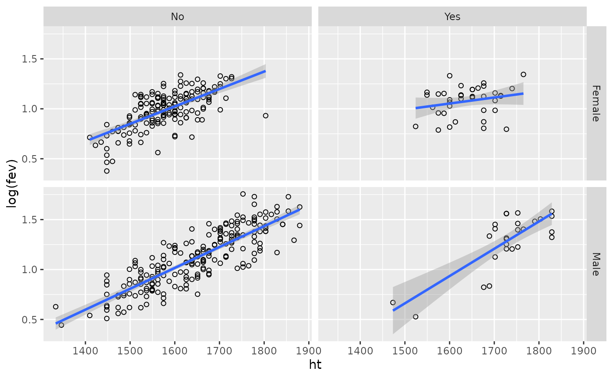
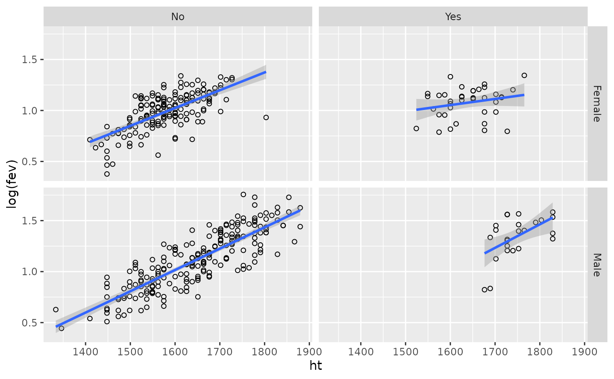

# Case Study 9.4: Forced Expiratory Volume

## Problem

The data in this case study comes from a study which was interested in
the relationship between smoking and Forced Expiratory Volume (FEV). FEV
measures how much air a person can exhale during a forced breath. You
can think of it as a measure of lung function—the higher the FEV value,
the better your lungs work. The data in this study is a random sample of
654 youths, aged 3 to 19, in the area of East Boston during middle to
late 1970’s. The question of interest concerns the relationship between
smoking and FEV.

The variables of interest are:

- `age`: age in years
- `fev`: FEV measurement
- `ht`: height in inches
- `sex`: 0 or 1 (we don’t know which is male or female but we might be
  able to guess)
- `smoke`: 1 for smoker and 0 for non-smoker

### Question of Interest

To quantify the relationship between smoking and FEV.

### Read in and Inspect the Data

``` r

fev.df = read.csv("fev.csv")
head(fev.df)
```

    ##   age   fev   ht sex smoke
    ## 1   9 1.708 57.0   0     0
    ## 2   8 1.724 67.5   0     0
    ## 3   7 1.720 54.5   0     0
    ## 4   9 1.558 53.0   1     0
    ## 5   9 1.895 57.0   1     0
    ## 6   8 2.336 61.0   0     0

``` r

# Any missing values?
sum(is.na(fev.df))
```

    ## [1] 0

``` r

plot(fev ~ ht, pch = as.character(smoke), data = fev.df)
```


It’s a little hard to see what is happening here. We can see that FEV
gets more variable as the height increases. We should probably take
logs. How about if we change visualising smokers from text to colours?

``` r

plot(log(fev) ~ ht, col = ifelse(smoke == 1, "red", "black"), pch = ifelse(smoke ==
    1, 19, 3), data = fev.df, xlab = "Height (inches)")
legend("topleft", col = c("red", "black"), pch = c(19, 3), legend = c("Smoker", "Non-smoker"),
    bty = "n")
```



Taking logs has definitely helped, and it looks like there is a positive
relationship between FEV and height. However, what also looks a little
odd is that most of the smokers seem to be taller. What is going on?

``` r

plot(ht ~ age, col = ifelse(smoke == 1, "red", "black"), pch = ifelse(smoke == 1,
    19, 3), data = fev.df, ylab = "Height (inches)")
```



Hmmm–sneaky sneaky. Looks like we’ve got quite a few very young people
in this study. Let’s remove everyone below 9 years old (under the
youngest smoking case) and take another look at the data.

``` r

teens.df = subset(fev.df, age >= 9)
teens.df$ht = 25.4 * teens.df$ht  # Who wants height in inches. We want millimetres (mm)
plot(log(fev) ~ ht, col = ifelse(smoke == 1, "red", "black"), pch = ifelse(smoke ==
    1, 19, 3), data = teens.df, xlab = "Height (inches)")
legend("topleft", col = c("red", "black"), pch = c(19, 3), legend = c("Smoker", "Non-smoker"),
    bty = "n")
```



So is there any difference between the smokers and the non-smokers? It’s
a little hard to tell, but we should fit an interaction model to find
out. We’re also going to include the effect of sex, so there is an extra
intraction to be included. We said we might be able to guess which are
the males and which are the females. How? Possibly shorter?

``` r

plot(ht ~ factor(sex), data = teens.df)
```



Well it is marginal. We could assume that the females are smaller than
the males, but remember girls often grow faster at this age than boys,
so that might be a silly assumption. Does it matter? Not really at this
point. Let’s just leave it undetermined at this point in time. Because
each of our factors only has two levels, we don’t need to really worry
about coding them as factors, however we will do it anyway.

``` r

teens.df$sex = factor(teens.df$sex)
teens.df$smoke = factor(ifelse(as.numeric(teens.df$smoke) == 1, "Yes", "No"), levels = c("Yes",
    "No"))
```

Let’s have a quick look at the gender balance of smokers and
non-smokers. `table` gives us a table of counts, `prop.table` turns it
into row proportions (if we set `margin` to `1`).

``` r

prop.table(table(teens.df$sex, teens.df$smoke), margin = 1)
```

    ##    
    ##           Yes        No
    ##   0 0.1884058 0.8115942
    ##   1 0.1120690 0.8879310

Looks okay.

### Model Building and Check Assumptions

``` r

teens.fit = lm(log(fev) ~ ht * sex * smoke, data = teens.df)
plot(teens.fit, which = 1)
```



``` r

normcheck(teens.fit)
```



``` r

cooks20x(teens.fit)
```


``` r

anova(teens.fit)
```

    ## Analysis of Variance Table
    ## 
    ## Response: log(fev)
    ##               Df  Sum Sq Mean Sq  F value    Pr(>F)    
    ## ht             1 17.6734 17.6734 822.6036 < 2.2e-16 ***
    ## sex            1  0.0000  0.0000   0.0014  0.969741    
    ## smoke          1  0.0103  0.0103   0.4776  0.489878    
    ## ht:sex         1  0.2269  0.2269  10.5597  0.001246 ** 
    ## ht:smoke       1  0.0011  0.0011   0.0498  0.823463    
    ## sex:smoke      1  0.0017  0.0017   0.0806  0.776635    
    ## ht:sex:smoke   1  0.2082  0.2082   9.6893  0.001977 ** 
    ## Residuals    431  9.2599  0.0215                       
    ## ---
    ## Signif. codes:  0 '***' 0.001 '**' 0.01 '*' 0.05 '.' 0.1 ' ' 1

``` r

summary(teens.fit)
```

    ## 
    ## Call:
    ## lm(formula = log(fev) ~ ht * sex * smoke, data = teens.df)
    ## 
    ## Residuals:
    ##      Min       1Q   Median       3Q      Max 
    ## -0.44749 -0.08704  0.01096  0.09385  0.42172 
    ## 
    ## Coefficients:
    ##                   Estimate Std. Error t value Pr(>|t|)    
    ## (Intercept)      0.0862107  0.6704649   0.129 0.897747    
    ## ht               0.0006042  0.0004087   1.478 0.140035    
    ## sex1            -3.5217144  0.9118061  -3.862 0.000130 ***
    ## smokeNo         -1.8549551  0.7161829  -2.590 0.009921 ** 
    ## ht:sex1          0.0021271  0.0005427   3.920 0.000103 ***
    ## ht:smokeNo       0.0011412  0.0004386   2.602 0.009586 ** 
    ## sex1:smokeNo     2.9629222  0.9576028   3.094 0.002103 ** 
    ## ht:sex1:smokeNo -0.0017828  0.0005727  -3.113 0.001977 ** 
    ## ---
    ## Signif. codes:  0 '***' 0.001 '**' 0.01 '*' 0.05 '.' 0.1 ' ' 1
    ## 
    ## Residual standard error: 0.1466 on 431 degrees of freedom
    ## Multiple R-squared:  0.6618, Adjusted R-squared:  0.6563 
    ## F-statistic: 120.5 on 7 and 431 DF,  p-value: < 2.2e-16

``` r

confint(teens.fit)
```

    ##                         2.5 %        97.5 %
    ## (Intercept)     -1.2315769198  1.4039983827
    ## ht              -0.0001990619  0.0014074005
    ## sex1            -5.3138540484 -1.7295747656
    ## smokeNo         -3.2626005864 -0.4473095401
    ## ht:sex1          0.0010604532  0.0031937824
    ## ht:smokeNo       0.0002791809  0.0020032276
    ## sex1:smokeNo     1.0807699274  4.8450744468
    ## ht:sex1:smokeNo -0.0029084423 -0.0006570752

``` r

100 * (exp(confint(teens.fit)) - 1)
```

    ##                        2.5 %        97.5 %
    ## (Intercept)     -70.81679810  3.071447e+02
    ## ht               -0.01990421  1.408391e-01
    ## sex1            -99.50770831 -8.226402e+01
    ## smokeNo         -96.17113046 -3.606540e+01
    ## ht:sex1           0.10610157  3.198888e-01
    ## ht:smokeNo        0.02792198  2.005235e-01
    ## sex1:smokeNo    194.69476136  1.261127e+04
    ## ht:sex1:smokeNo  -0.29042169 -6.568594e-02

### Visualising the Final Model

Looking at the ANOVA table we can see that there is evidence of an
interaction between height, sex, and smoking. Let’s proceed with this
model first (we might simplify it later). You might think this is really
complicated, but it isn’t. Each factor in our model has two levels,
therefore there are four ($`2 \times 2`$) combinations of the levels.
These are:

1.  sex = 0, smoke = “Yes”
2.  sex = 0, smoke = “No”
3.  sex = 1, smoke = “Yes”
4.  sex = 1, smoke = “No”

So we can think of this as a model with four lines, each with different
intercepts and slopes. To draw straight lines we only need two
points—the start and the finish. The range of the heights is

``` r

range(teens.df$ht)
```

    ## [1] 1333.5 1879.6

so let’s build a data.frame that predicts at 1300 mm and 1900 mm, for
each combination of the factors

``` r

pred.df = data.frame(ht = rep(c(1300, 1900), 4), sex = factor(rep(c(0, 1), c(4, 4))),
    smoke = rep(c("Yes", "No"), c(2, 2)))
pred.df
```

    ##     ht sex smoke
    ## 1 1300   0   Yes
    ## 2 1900   0   Yes
    ## 3 1300   0    No
    ## 4 1900   0    No
    ## 5 1300   1   Yes
    ## 6 1900   1   Yes
    ## 7 1300   1    No
    ## 8 1900   1    No

``` r

teens.pred = predict(teens.fit, newdata = pred.df)
pred.df = cbind(pred.df, teens.pred)
plot(log(fev) ~ ht, col = ifelse(smoke == "Yes", "red", "black"), pch = ifelse(smoke ==
    "Yes", 19, 3), data = teens.df, xlab = "Height (inches)")
legend("topleft", col = c("red", "black"), pch = c(19, 3), legend = c("Smoker", "Non-smoker"),
    bty = "n")
lines(teens.pred ~ ht, data = pred.df[1:2, ], col = "red")
lines(teens.pred ~ ht, data = pred.df[3:4, ], col = "blue")
lines(teens.pred ~ ht, data = pred.df[5:6, ], col = "green")
lines(teens.pred ~ ht, data = pred.df[7:8, ], col = "pink")
legend("bottomright", col = c("red", "blue", "green", "pink"), lty = 1, lwd = 2,
    legend = c("Sex 0, Smoker", "Sex 0, Non-smoker", "Sex 1, Smoker", "Sex 1, Non-smoker"),
    bty = "n")
```



Looking at this plot, do we think we could get away with different
lines? Probably not. To interpret this model we need to back-transform.
However, this case study is probably complicated enough already :) What
we can see is that the most striking difference is between the two
genders in the smoking group. For simplicity, let’s assume that `Sex 0`
is female, and `Sex 1` is male. If we have this coding, then we can see
that the rate of increase in FEV (with height) is much more severely
affected for female smokers, in that tall female smokers seem to have a
lower rate of increase in FEV than the other groups. Let’s just take a
quick look at the group `Sex 0, Smoker`.

``` r

femaleSmokers.df = subset(teens.df, sex == 0 & smoke == "Yes")
nrow(femaleSmokers.df)
```

    ## [1] 39

``` r

plot(log(fev) ~ ht, data = femaleSmokers.df)
lines(teens.pred ~ ht, data = pred.df[1:2, ], col = "red")
```



What we’re seeing here is that the smoking is making this line close to
flat, regardless of height. It is probably this group alone that is
driving the interaction between smoking, gender and height. We might
also ask whether we really think males who smoke have a higher rate of
increase in FEV?

``` r

teens.df$smoke = relevel(teens.df$smoke, ref = "No")
teens.df$sex = factor(ifelse(teens.df$sex == 0, "Female", "Male"))
library(ggplot2)
ggplot(data = teens.df, aes(x = ht, y = log(fev))) + geom_point(shape = 1) + facet_grid(sex ~
    smoke) + stat_smooth(method = "lm")
```

    ## `geom_smooth()` using formula = 'y ~ x'



I’m guessing probably not, and if you wanted to spend the time, you
might find that the slope is the same as the other groups. It looks like
there are two males who might be influencing our view of things.

## “The Hanging Chads”

Who are these guys? Well they’re shorter than the rest, they’re male and
they smoke. Let’s remove them and see what happens to the plot

``` r

outM = with(teens.df, which(sex == "Male" & smoke == "Yes" & log(fev) < 0.75))
outM
```

    ## [1]  60 154

``` r

ggplot(data = teens.df[-outM, ], aes(x = ht, y = log(fev))) + geom_point(shape = 1) +
    facet_grid(sex ~ smoke) + stat_smooth(method = "lm")
```

    ## `geom_smooth()` using formula = 'y ~ x'


