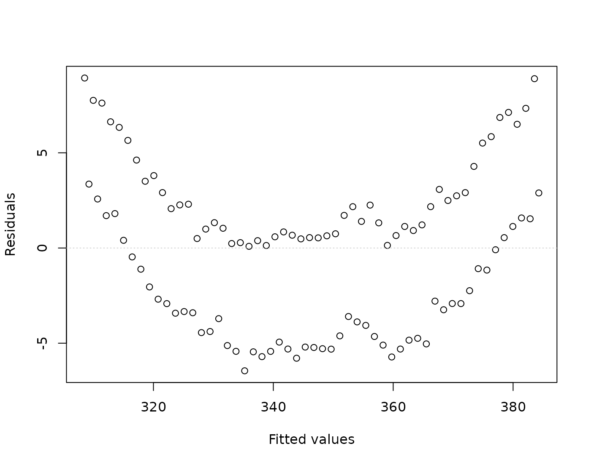
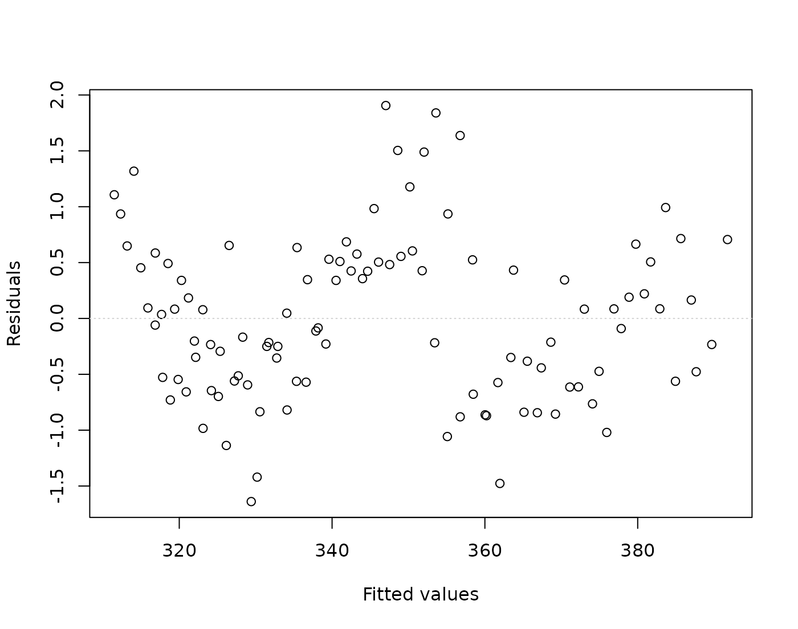
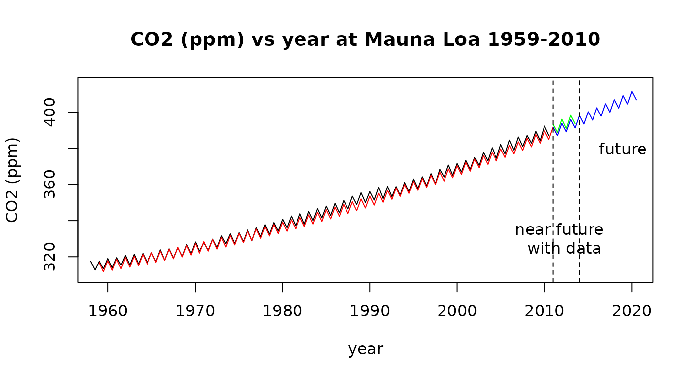

# Case Study 9.5: Case study: CO2 Emissions Data from Mauna Loa

## Background

The carbon dioxide (CO2) content of the atmosphere at the Mauna Loa
Observatory on the Big Island of Hawai’i has been measured continuously
since 1959 until 2010. Mauna Loa is an excellent site for determining
atmospheric CO2 content because of the geographic isolation of the
Hawai’ian Islands and because of the high elevation (3400 meters or
11,000 feet above sea level) of the sampling equipment. The site yields
high quality, monthly data for the CO2 concentration in the atmosphere
of the Northern Hemisphere (see reference below).

We have extracted the values for April and October for each year,
corresponding (approximately) to the maximum and minimum concentrations
of CO2 in a calendar year. The data show both a cyclic behaviour and an
exponential trend. The oscillatory behaviour corresponds to a yearly
cycle of increasing atmospheric CO2 from late fall to spring, with a
maximum in April, and then decreasing atmospheric CO2 from spring to
late fall, with a minimum in October. The simple interpretation is that
carbon dioxide is “scrubbed” or removed from the atmosphere of the
northern hemisphere during the spring-summer growing cycle, when green
plants suck up CO2 during photosynthesis. Carbon dioxide is then
released during fall and winter, when plants die and rot.

Data source: C.D. Keeling and T.P. Carbon Dioxide Research Group,
Scripps Institution of Oceanography, University of California, La Jolla,
California.

## Working hypothesis:

We believe CO2 emission are rising and there maybe differences in
winter/summer half years.

### Rcode

    ## Loading required package: s20x

``` r

ML.df = read.table("ML.txt", header = TRUE)
```

``` r

## some weid stuff happening here
dimnames(ML.df)[[2]][1]
```

    ## [1] "Year"

``` r

# somehow a weird character is being generated for my variable names
# in my importation of these data

dimnames(ML.df)[[2]][1] = "Year"

dimnames(ML.df)[[2]]
```

    ## [1] "Year" "CO2"

``` r

# checks out

## plot this data as a time series
plot(CO2 ~ Year,
  data = ML.df, type = "l", main = "CO2 (ppm) vs year at Mauna Loa 1959-2010",
  xlab = "year", ylab = "CO2 (ppm)"
)
```


``` r

## Create a factor variable for winter/summer;
WS = rep(c("Winter", "Summer"), rep(nrow(ML.df) / 2))

# get rid of 1958 as this is a large number

ML.df = within(ML.df, {
  Yearnew = Year - 1958
  Season = WS
})

ML.df[1:5, ]
```

    ##     Year    CO2 Season Yearnew
    ## 1 1958.0 317.45 Winter     0.0
    ## 2 1958.5 312.60 Summer     0.5
    ## 3 1959.0 317.72 Winter     1.0
    ## 4 1959.5 313.26 Summer     1.5
    ## 5 1960.0 319.02 Winter     2.0

``` r

## library(s20x)
## note subtract 1959 from year

ML.fit = lm(CO2 ~ Yearnew, data = ML.df)
eovcheck(ML.fit)
```



``` r

## add seaonality:
ML.fit2 = lm(CO2 ~ Yearnew + Season, data = ML.df)
eovcheck(ML.fit2)
```


``` r

# still got curvature
ML.fit3 = lm(CO2 ~ Yearnew + I(Yearnew^2) + Season, data = ML.df)

eovcheck(ML.fit3)
```



``` r

## Hmm still some signal but this is due to history AKA autocorrelation

## here this check that ther is no interaction between year/season

anova(lm(CO2 ~ (Yearnew + I(Yearnew^2)) * Season, data = ML.df))
```

    ## Analysis of Variance Table
    ## 
    ## Response: CO2
    ##                      Df Sum Sq Mean Sq    F value  Pr(>F)    
    ## Yearnew               1  51675   51675 96060.8054 < 2e-16 ***
    ## I(Yearnew^2)          1    687     687  1277.7406 < 2e-16 ***
    ## Season                1    885     885  1644.3258 < 2e-16 ***
    ## Yearnew:Season        1      2       2     3.1480 0.07906 .  
    ## I(Yearnew^2):Season   1      0       0     0.2137 0.64486    
    ## Residuals           100     54       1                       
    ## ---
    ## Signif. codes:  0 '***' 0.001 '**' 0.01 '*' 0.05 '.' 0.1 ' ' 1

``` r

# there seems little point in making this more complicated - so go for parallel lines model!

## let's see what it tells us

summary(ML.fit3)
```

    ## 
    ## Call:
    ## lm(formula = CO2 ~ Yearnew + I(Yearnew^2) + Season, data = ML.df)
    ## 
    ## Residuals:
    ##      Min       1Q   Median       3Q      Max 
    ## -1.63918 -0.56266 -0.07208  0.50541  1.90543 
    ## 
    ## Coefficients:
    ##               Estimate Std. Error t value Pr(>|t|)    
    ## (Intercept)  3.111e+02  2.236e-01 1390.99   <2e-16 ***
    ## Yearnew      8.076e-01  1.859e-02   43.45   <2e-16 ***
    ## I(Yearnew^2) 1.217e-02  3.426e-04   35.51   <2e-16 ***
    ## SeasonWinter 5.778e+00  1.434e-01   40.28   <2e-16 ***
    ## ---
    ## Signif. codes:  0 '***' 0.001 '**' 0.01 '*' 0.05 '.' 0.1 ' ' 1
    ## 
    ## Residual standard error: 0.7383 on 102 degrees of freedom
    ## Multiple R-squared:  0.999,  Adjusted R-squared:  0.9989 
    ## F-statistic: 3.256e+04 on 3 and 102 DF,  p-value: < 2.2e-16

\#Dealing with auto-correlation -discussed later in the course.

### Rcode

``` r

## This is outside the context of the course.
## A more appropriate way to model this is to model the AR(1) correlation structure.
## You will need to download this libaray from CRAN first: install.packages("nlme")
library(nlme)

ML.fit4 = gls(CO2 ~ Yearnew + I(Yearnew^2) + Season, correlation = corAR1(), data = ML.df)

## compare these
summary(ML.fit4)
```

    ## Generalized least squares fit by REML
    ##   Model: CO2 ~ Yearnew + I(Yearnew^2) + Season 
    ##   Data: ML.df 
    ##        AIC      BIC    logLik
    ##   197.0076 212.7574 -92.50378
    ## 
    ## Correlation Structure: AR(1)
    ##  Formula: ~1 
    ##  Parameter estimate(s):
    ##      Phi 
    ## 0.750789 
    ## 
    ## Coefficients:
    ##                  Value Std.Error  t-value p-value
    ## (Intercept)  311.22608 0.5275547 589.9408       0
    ## Yearnew        0.79595 0.0462667  17.2034       0
    ## I(Yearnew^2)   0.01236 0.0008497  14.5512       0
    ## SeasonWinter   5.77470 0.0583470  98.9718       0
    ## 
    ##  Correlation: 
    ##              (Intr) Yearnw I(Y^2)
    ## Yearnew      -0.831              
    ## I(Yearnew^2)  0.693 -0.964       
    ## SeasonWinter -0.065  0.004  0.000
    ## 
    ## Standardized residuals:
    ##        Min         Q1        Med         Q3        Max 
    ## -2.0907254 -0.7459209 -0.1161501  0.6388810  2.4425997 
    ## 
    ## Residual standard error: 0.7927843 
    ## Degrees of freedom: 106 total; 102 residual

``` r

# litte changes except the standard errors and therefore -t-stats/p-values
## but conclusions remain the same

## predict the future

plot(CO2 ~ Year,
  type = "l", data = ML.df, xlim = c(1959, 2020), ylim = c(310, 415),
  main = "CO2 (ppm) vs year at Mauna Loa 1959-2010",
  xlab = "year", ylab = "CO2 (ppm)"
)
lines(ML.df$Yearnew + 1959, predict(ML.fit4), col = "red")
pred.df = data.frame(
  Yearnew = seq(52, by = .5, length = 20),
  Season = factor(rep(c("Winter", "Summer"), 10))
)

predictCO2.df = data.frame(
  year = seq(2011, 2013.5, by = .5),
  CO2 = c(393.34, 388.96, 396.18, 391.01, 398.35, 393.66),
  season = rep(c("Winter", "Summer"), 3)
)
lines(predictCO2.df$year, predictCO2.df$CO2, col = "green")
lines(pred.df$Year + 1959, predict(ML.fit4, pred.df), col = "blue")
abline(v = c(2011, 2014), lty = 2)

# observed data & predicted for 2011-2013
predictCO2.df$CO2
```

    ## [1] 393.34 388.96 396.18 391.01 398.35 393.66

``` r

predict(ML.fit4, pred.df)[1:6]
```

    ## [1] 391.8208 387.0901 393.9149 389.1966 396.0338 391.3278

``` r

text(2012, 330, "near future \n with data")
text(2019, 380, "future")
```



``` r

# scarily close
```

## Formal model

$`CO2=\beta_0 +\beta_1\times year+ \beta_2\times year^2 + \beta_3 Winter+ \epsilon`$

where Winter =1 if it’s winter in the northern hemisphere, otherwise 0
and $`\epsilon \sim iid ~ N(0,\sigma^2)`$

Formal Working Hypothesis: $`\beta_1>0`$ and $`\beta_2> 0`$ and
$`\beta_3 > 0`$

Null Hypothesis: $`\beta_1=0, \beta_2=0`$, and $`\beta_3=0`$.

## Assumption Checks

We do no have independent observations as this is historical data and
the past influences the future. Essentially this means we have less data
than we thought as these observations are positively correlated.

EOV seems fin and residuals look looks approximately Normal. There do
not now appear to be any unduly influential data points. We can mostly
rely on the results from fitting this linear model - although caution is
advised.

## Executive Summary

There is a clear increasing (quadratic) relationship between the year
and CO2 emissions. There is a clear summer versus winter effect but this
is slight compared to the quadratic increase.

It seem that it’s not even close to slowing down!!
