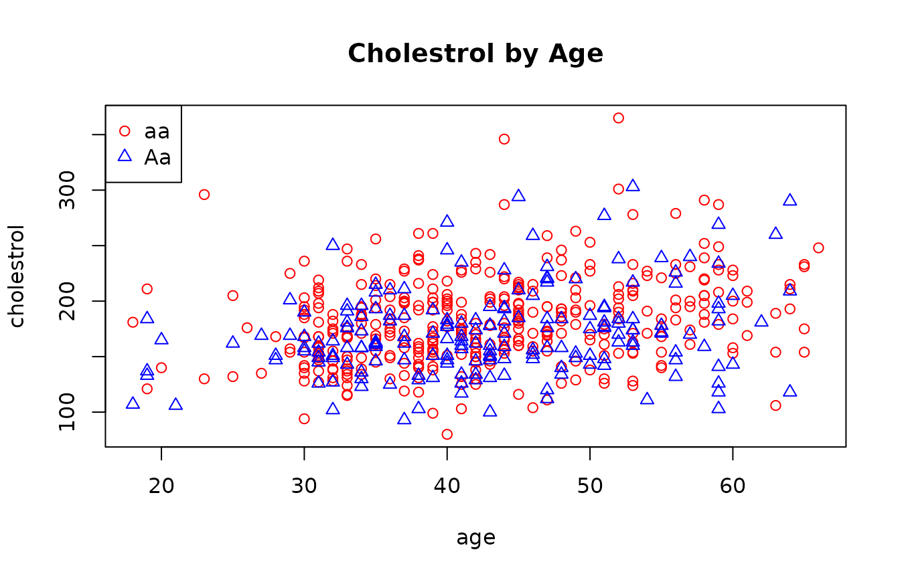
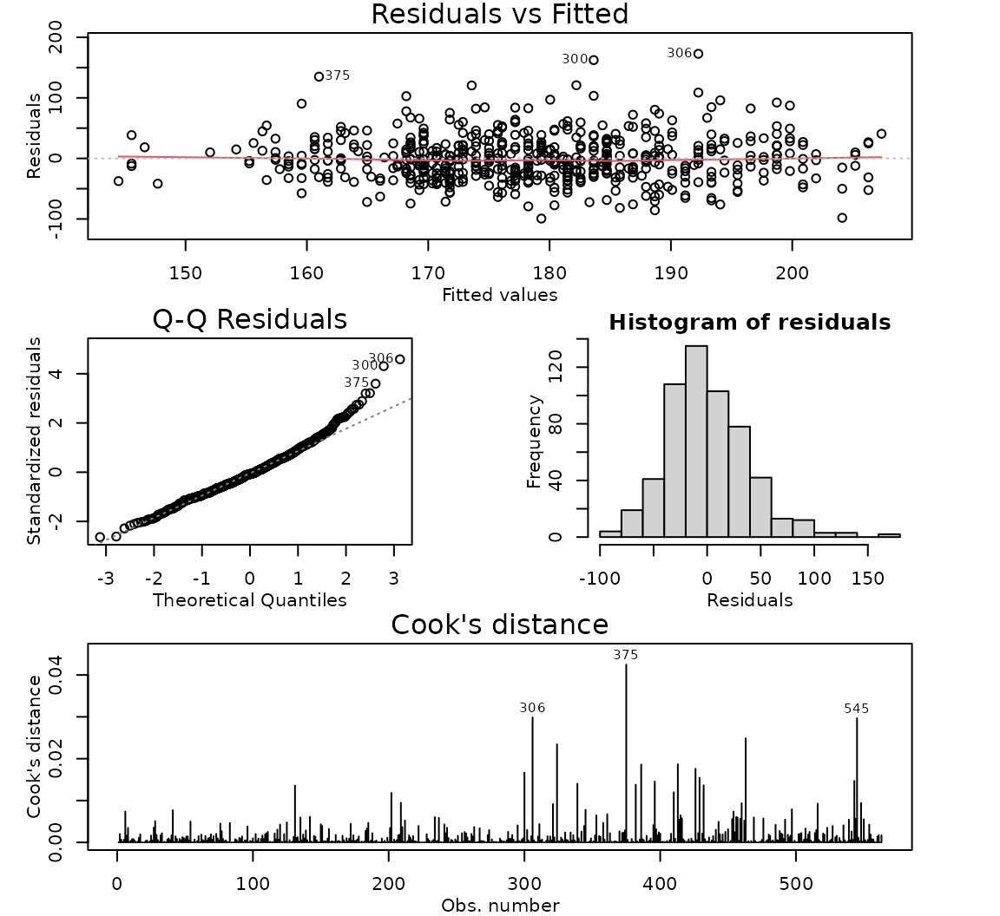
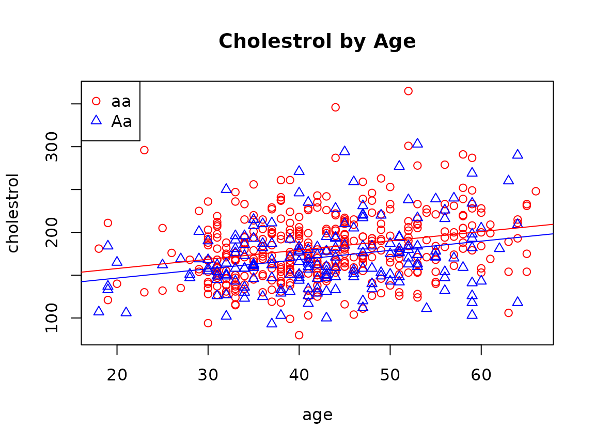

# Case Study 9.6: STATS 201/8 Extra Case Study - Parallel Lines Model

## Question 1

Researchers were interested in trying to find factors linked to
cholesterol level in people. They were studying a genotype at a marker
that was believed to be associated with cholesterol level. Data was
collected on the genotype for a random sample of people recruited from
the Dallas region. Their cholesterol level, age and their genotype at
the marker (identified from a blood sample) were recorded. It was known
that cholesterol levels generally increased with age. What was of
interest was:

- Did any age effect differ between the genotypes? If so, how?
- If not, were there differences in average cholesterol levels between
  the different genotypes? If so, quantify this. Also quantify any age
  effect.

The resulting data are in the file *Dallas.csv*, which contains the
variables:

| Variable    | Description                                              |
|-------------|----------------------------------------------------------|
| cholesterol | The cholesterol level (mg/dL) of the study subject.      |
| age         | The age (years) of the study subject.                    |
| genotype    | The genotype at the marker (classed as either aa or Aa). |

Note: a third genotype was identified, but in very small numbers. For
the purposes of this question, the data was simplified to two levels of
genotype.

**Instructions:**

- Comment on plot of the data.
- Fit an appropriate model to the data. Check the model assumptions.
- Write appropriate Methods and Assumption Checks.
- Plot the data with your appropriate model superimposed over it.
- Write an appropriate *Executive Summary*. Ensure that you have
  answered all the questions of interest.

### Question of interest/goal of the study

We are interested in how the age and genotype at a locus are related to
the cholesterol level and we are also interested in whether the effects
of age are the same at different genotype.

### inspect the data:

``` r

dallas.df = read.csv("Dallas.csv", header = TRUE, stringsAsFactors = TRUE)

plot(cholestrol ~ age,
  data = dallas.df, main = "Cholestrol by Age",
  col = ifelse(genotype == "aa", "red", "blue"),
  pch = ifelse(genotype == "aa", 1, 2)
)
legend('topleft', c("aa", "Aa"), col = c("red", "blue"), pch = c(1, 2))
```



### Comment on plot

It seems there is a slightly increasing linear relationship between age
and cholesterol level, and the trend for genotype “aa” and “Aa” looks
similar. It is difficult to see a difference between the two genotypes,
but there are fewer high values for Aa and fewer low values for aa, so
maybe aa tends to higher values.

### Fit an appropriate linear model and Check Assumptions

``` r

dallas.lm1 = lm(cholestrol ~ age * genotype, data = dallas.df)
summary(dallas.lm1)
```

    ## 
    ## Call:
    ## lm(formula = cholestrol ~ age * genotype, data = dallas.df)
    ## 
    ## Residuals:
    ##     Min      1Q  Median      3Q     Max 
    ## -99.230 -24.442  -3.142  21.158 172.420 
    ## 
    ## Coefficients:
    ##                 Estimate Std. Error t value Pr(>|t|)    
    ## (Intercept)    134.73029    8.74294  15.410  < 2e-16 ***
    ## age              1.11249    0.19957   5.574 3.87e-08 ***
    ## genotypeAa      -6.85095   14.96410  -0.458    0.647    
    ## age:genotypeAa  -0.09974    0.33978  -0.294    0.769    
    ## ---
    ## Signif. codes:  0 '***' 0.001 '**' 0.01 '*' 0.05 '.' 0.1 ' ' 1
    ## 
    ## Residual standard error: 37.77 on 559 degrees of freedom
    ## Multiple R-squared:  0.08938,    Adjusted R-squared:  0.08449 
    ## F-statistic: 18.29 on 3 and 559 DF,  p-value: 2.481e-11

``` r

# Drop interaction
dallas.lm2 = lm(cholestrol ~ age + genotype, data = dallas.df)
modelcheck(dallas.lm2)
```



``` r

summary(dallas.lm2)
```

    ## 
    ## Call:
    ## lm(formula = cholestrol ~ age + genotype, data = dallas.df)
    ## 
    ## Residuals:
    ##     Min      1Q  Median      3Q     Max 
    ## -99.323 -24.667  -2.959  21.271 172.740 
    ## 
    ## Coefficients:
    ##             Estimate Std. Error t value Pr(>|t|)    
    ## (Intercept) 136.1998     7.1619  19.017  < 2e-16 ***
    ## age           1.0781     0.1614   6.680 5.77e-11 ***
    ## genotypeAa  -11.1300     3.3772  -3.296  0.00104 ** 
    ## ---
    ## Signif. codes:  0 '***' 0.001 '**' 0.01 '*' 0.05 '.' 0.1 ' ' 1
    ## 
    ## Residual standard error: 37.74 on 560 degrees of freedom
    ## Multiple R-squared:  0.08924,    Adjusted R-squared:  0.08598 
    ## F-statistic: 27.43 on 2 and 560 DF,  p-value: 4.3e-12

``` r

confint(dallas.lm2)
```

    ##                   2.5 %     97.5 %
    ## (Intercept) 122.1322911 150.267335
    ## age           0.7610855   1.395082
    ## genotypeAa  -17.7635170  -4.496539

### Plot the data with your appropriate model superimposed over it

``` r

plot(cholestrol ~ age,
  data = dallas.df, main = "Cholestrol by Age",
  col = ifelse(genotype == "aa", "red", "blue"),
  pch = ifelse(genotype == "aa", 1, 2)
)
legend('topleft', c("aa", "Aa"), col = c("red", "blue"), pch = c(1, 2))

ests <- coef(dallas.lm2)
abline(ests[1], ests[2], col = "red")
abline(ests[1] + ests[3], ests[2], col = "blue")
```



### Method and Assumption Checks

We have two explanatory variables, one factor and one numeric, so have
fitted a linear model to the data and checked for evidence of
interaction between age and genotype. As there was no evidence of
interaction (P-value = 0.769), we dropped the interaction term and
fitted the next model. We have not been able to further simplify the
model.

The assumptions were satisfied for this model. (There was a little bit
of right skewness in the residuals, but nothing of major concern.)

Our model is:
$`cholestrol_i = \beta_0 + \beta_1 \times Age_i  + \beta_2 \times genotypeAa_i + \epsilon_{i}`$
where $`genotypeAa_i = 1`$ if the $`i`$th subject has genotype Aa at the
marker and 0 otherwise. $`\epsilon_i \sim iid ~N(0,\sigma^2)`$

Our model explained 8.9% of the variability in the data.

### Executive Summary

We are interested in how the age and genotype at a locus are related to
the cholesterol level and whether the effects of age are the same given
different genotypes.

We have evidence that both age and genotype affects cholesterol levels,
but no evidence that the effects of age on cholesterol levels differ
across different genotype groups.

Cholesterol levels tended to increase with age. For individuals with the
same genotype, we estimate that the average cholesterol level increases
by between 8 and 14 mg/dL for each additional 10 years of age.

On average, people with genotype “aa” have the higher cholesterol levels
than people with the Aa genotype, regardless of their age. For
individuals with the same age, we estimate that the mean cholesterol
level for people with genotype “aa” is between 4.5 and 17.8 mg/dL higher
than those with genotype “Aa”.
